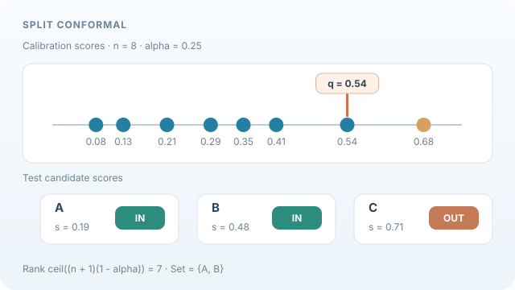
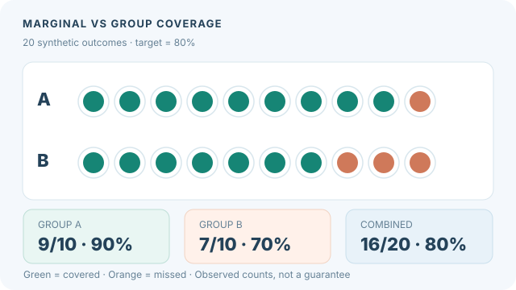
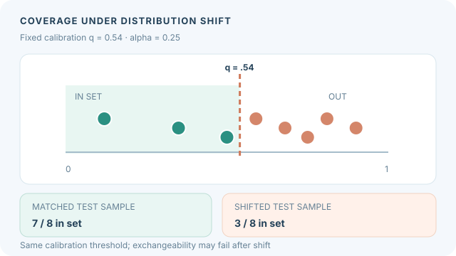
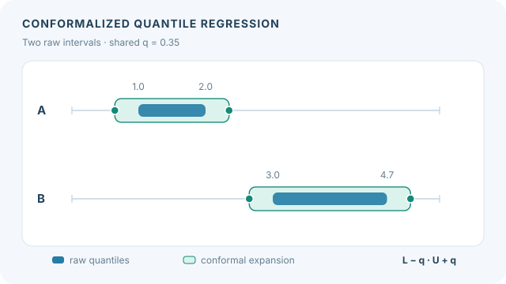
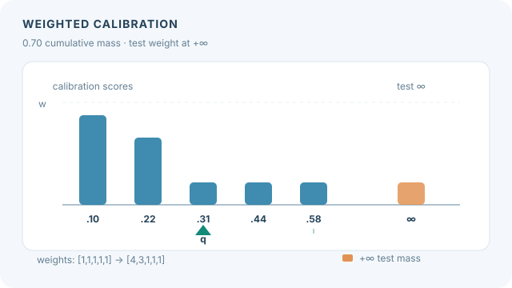

# 共形預測

共形預測可把任何預測器轉換為輸出預測集合或區間的方法，並保證這些集合以指定機率包含真實結果。此保證適用於任何模型，前提是資料具可交換性。本頁是[不確定性量化與校準](index.md)的一部分。

## 概述

只輸出單一標籤的分類器無法說明其不確定性，而機率分數也可能校準得很差。共形預測走另一條路：它要求一組合理的標籤，使其以至少 \(1-\alpha\) 的機率包含真實標籤，其中 \(\alpha\) 由使用者選定。此方法利用保留的校準集來決定預測集合應有多大。

## 關鍵概念

- **不一致分數**：衡量標籤 \(y\) 對輸入 \(x\) 有多不尋常的量 \(s(x,y)\)。常見的選擇是一減去模型對 \(y\) 的預測機率。
- **可交換性**：校準資料與測試資料可以任意置換而不改變其聯合分布。它比獨立性弱，是保證成立的假設。
- **覆蓋率**：真實標籤落在預測集合中的機率。保證的是覆蓋率，而非點預測的準確率。

## 運作方式

在分割式共形預測中，資料分為訓練集與校準集。模型在前半部訓練。在校準集上計算分數 \(s_i=s(x_i,y_i)\)，並令 \(\hat q\) 為這些分數的 \((1-\alpha)(1+1/n)\) 分位數。新輸入的預測集合為

\[
C(x)=\{\,y : s(x,y)\le \hat q\,\},
\]

在可交換性下，\(P(Y\in C(X))\ge 1-\alpha\)（Angelopoulos 與 Bates，2023）。對迴歸而言，同樣的想法產生預測區間，分數可以是絕對殘差，或來自分位數模型的量。Lei 等人（2018）在此框架下發展了迴歸的無分布假設預測推論。

*原創教學動畫（CC BY-SA 4.0）。* 假設有八筆示意校準分數，α=0.25，有限樣本的排序位置為 ceil((8+1)(1−0.25))=7，因此第七小的分數為門檻 q=0.54。另一筆示意測試輸入的候選標籤分數分別為 A: 0.19、B: 0.48、C: 0.71，得到預測集合 **{A, B}**。動畫依序呈現校準分數、門檻與集合成員。**數值是教學假設，不是實測模型結果或經驗覆蓋率。** 邊際覆蓋保證須有可交換性，並非逐筆輸入保證。MkDocs 網站可播放／暫停；[GitHub 靜態預覽](../../../../assets/concept-animations/conformal-quantile-still.svg) 顯示最終集合。手機可水平捲動。來源見 Shafer 與 Vovk（2008）、Angelopoulos 與 Bates（2023）。

### 為什麼邊際覆蓋率不代表各子群都達標

*原創教學動畫（CC BY-SA 4.0）。* 假設 **20 筆人工設計的結果**：A 群有 9/10 被預測集合涵蓋，B 群只有 7/10，合併的**樣本內涵蓋比例**卻恰好是 16/20 = 80%。這些刻意安排的結果**不是模型實測，也不是任何母體覆蓋機率的估計**。它們用來區分分割式共形預測的**邊際**覆蓋保證與不保證的條件式／子群覆蓋率（Angelopoulos 與 Bates，2023）。綠點代表涵蓋、橘點代表未涵蓋；動畫依序顯示兩群。GitHub 顯示[靜態預覽](../../../../assets/concept-animations/conformal-subgroup-coverage-still.svg)；MkDocs 可播放／暫停，手機可水平捲動或使用鍵盤操作。

### 測試分數分布改變時會發生什麼事

*原創教學動畫（CC BY-SA 4.0）。* 沿用前面八筆校準示例的**人工門檻** \(\hat q=0.54\)，一組假設的同分布測試資料中有 7/8 個分數不大於門檻，另一組假設的偏移測試資料則只有 3/8。移動的點是在**兩組人工分數清單間視覺插值**，不代表實際追蹤相同樣本，也不是部署資料或實測覆蓋率。這些計數**不能估計真正覆蓋機率**；它們示意測試分數的分布改變後，固定門檻下的涵蓋比例可能下降。更一般地，校準與測試資料不具可交換性時，原本的有限樣本保證未必成立（Barber 等人，2023）。[GitHub 靜態預覽](../../../../assets/concept-animations/conformal-shift-coverage-still.svg)；MkDocs 可播放／暫停，窄螢幕支援水平捲動。

### 共形化分位數迴歸：保留自適應寬度的校準區間

*原創教學動畫（CC BY-SA 4.0）。* 共形化分位數迴歸（CQR）使用獨立校準資料計算 $s_i=\max\{\hat q_L(x_i)-y_i,\ y_i-\hat q_U(x_i)\}$。假設五筆**人工**排序分數為 $[0.04,0.12,0.18,0.26,0.35]$，取 $\alpha=0.30$，有限樣本排序位置是 $\lceil(5+1)(1-0.30)\rceil=5$，示意修正量為 **$\hat q=0.35$**。原始區間 **A = [1.0, 2.0]**、**B = [3.0, 4.7]**，套用 $[\hat q_L(x)-\hat q,\hat q_U(x)+\hat q]$ 後，分別為 **[0.65, 2.35]** 與 **[2.65, 5.05]**。原始寬度不同，校準量卻相同；動畫僅示範區間擴張，**不是模型訓練或實測覆蓋率**。這些數值全部是人工解析示例，並非擬合模型輸出。CQR 的邊際覆蓋保證須有適當的訓練／校準切分與可交換性（Romano 等人，2019）。[GitHub 靜態預覽](../../../../assets/concept-animations/conformal-cqr-expansion-still.svg)；MkDocs 支援播放／暫停，窄螢幕支援觸控或鍵盤水平捲動。

### 加權共形校準：測試點在正無窮大的權重

*原創教學動畫（CC BY-SA 4.0）。* 對人工排序分數 **[0.10, 0.22, 0.31, 0.44, 0.58]**，另外加入位於 **$+\infty$** 的**測試點權重**，取目標累積正規化權重 $1-\alpha=0.70$。校準權重 **[1,1,1,1,1]** 搭配測試點權重 **1** 時，門檻是 **0.58**；校準權重變為 **[2.5,2,1,1,1]** 時是 **0.44**；變成 **[4,3,1,1,1]** 時則是 **0.31**，測試點權重都維持 **1**。標記在分位數跨越門檻時**離散跳動**，長條只是在替代性權重設定間插值，**不是實際模型推論歷程**。正無窮大測試點權重對這項有限樣本加權分位數構造相當重要；但理論有效性仍須共變量偏移假設與正確的密度比權重，**不能保證任意分布偏移都獲得修正**（Tibshirani 等人，2019）。上述權重是人工示例，**不是實測密度比**。[GitHub 靜態預覽](../../../../assets/concept-animations/conformal-weighted-quantile-still.svg)；MkDocs 支援播放／暫停與鍵盤水平捲動。

## 變體

- **分割式共形預測**使用單一校準集，是最簡單也最常見的形式。
- **完整共形預測**對每個候選標籤重新擬合模型，成本較高，但能更有效率地使用資料。
- **自適應分數**改變不一致度量，使模型有信心的地方預測集合較小。
- **加權校準**在已知的共變量偏移下，對校準資料重新加權（Tibshirani 等人，2019）。
- 共形化分位數迴歸（Romano 等人，2019）是區間預測中廣泛使用的自適應範例。

## 結果與限制

- 覆蓋保證在有限樣本下成立，只需可交換性，對模型沒有假設。這是此方法最主要的吸引力。
- 保證是邊際的。某些輸入（包括子群）的覆蓋率可能偏高，另一些則偏低，這對公平性與醫療應用很重要。
- 預測集合的大小取決於底層模型的品質。模型不佳時，會得到很大而沒有資訊量的集合，但它們仍然滿足保證。
- 在分布偏移下，可交換性不再成立，若不加調整，保證也就不再成立。Barber 等人（2023）給出可交換性放寬時覆蓋率損失的界。

## 應用

- **附帶棄權的分類**：回傳一組標籤，並把過大的集合標記給人工檢視（Angelopoulos 與 Bates，2023）。
- **迴歸區間**：為預測與測量提供有保證覆蓋率的預測區間（Lei 等人，2018）。
- **醫療預測**：以與模型無關的方式量化診斷模型的不確定性。

## 開放問題

- 對每個輸入或子群都成立的條件覆蓋率，在一般情況下需要很強的假設才可能達成。
- 在分布偏移下仍保有有效覆蓋，例如以加權校準資料的方式，是活躍的研究方向。
- 在高維輸出（例如結構化預測）中平衡集合大小與覆蓋率，仍然困難。

## 參考文獻

### 奠基性論文

- Vovk, V., Gammerman, A. & Shafer, G. (2005). *Algorithmic Learning in a Random World*. Springer. https://doi.org/10.1007/b106715 — 共形預測及其有效性理論的基礎專書。
- Romano, Y., Patterson, E. & Candès, E. J. (2019). Conformalized quantile regression. In *Advances in Neural Information Processing Systems* 32. arXiv:1905.03222. https://arxiv.org/abs/1905.03222 — 將分位數迴歸與分割式共形校準結合，得到自適應區間。
- Tibshirani, R. J., Foygel Barber, R., Candès, E. J. & Ramdas, A. (2019). Conformal prediction under covariate shift. In *Advances in Neural Information Processing Systems* 32. arXiv:1904.06019. https://arxiv.org/abs/1904.06019 — 以加權方式把共形覆蓋推廣到已知的共變量偏移。
- Bates, S., Angelopoulos, A., Lei, L., Malik, J. & Jordan, M. (2021). Distribution-free, risk-controlling prediction sets. *Journal of the ACM* 68(6). https://doi.org/10.1145/3478535 — 把無分布假設的集合保證推廣到一般的風險控制。
- Barber, R. F., Candès, E. J., Ramdas, A. & Tibshirani, R. J. (2023). Conformal prediction beyond exchangeability. *The Annals of Statistics* 51(2), 816–845. https://doi.org/10.1214/23-aos2276 — 在放寬可交換性時給出覆蓋率的界。
- Lei, J., G'Sell, M., Rinaldo, A., Tibshirani, R. J. & Wasserman, L. (2018). Distribution-free predictive inference for regression. *Journal of the American Statistical Association* 113(523), 1094–1111. https://doi.org/10.1080/01621459.2017.1307116 — 以分割式共形方法為迴歸提供無分布假設的預測區間。
- Shafer, G. & Vovk, V. (2008). A tutorial on conformal prediction. *Journal of Machine Learning Research* 9. https://www.jmlr.org/papers/v9/shafer08a.html — 介紹此框架與其有效性保證的教學文章。

### 綜述與教科書

- Angelopoulos, A. N. & Bates, S. (2023). Conformal prediction: a gentle introduction. *Foundations and Trends in Machine Learning* 16(4), 494–591. https://doi.org/10.1561/2200000101 — 共形方法的入門介紹，包含分割式與自適應變體。
- Guo, C., Pleiss, G., Sun, Y. & Weinberger, K. Q. (2017). On calibration of modern neural networks. In *Proceedings of the 34th International Conference on Machine Learning*, PMLR 70. https://proceedings.mlr.press/v70/guo17a.html — 記錄神經分類器的校準偏差，是與覆蓋保證並列的不確定性動機。
- Murphy, K. P. (2022). *Probabilistic Machine Learning: An Introduction*. MIT Press. https://github.com/probml/pml-book — Murphy 教科書系列的儲存庫；提供預測不確定性與區間的背景。
