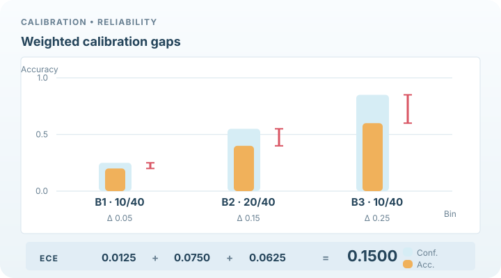

# 期望校準誤差

期望校準誤差（ECE）是校準偏差的摘要指標。它依信心把預測分入各個箱中，並以每箱預測數為權重，平均每箱信心與準確率之間的差距。本頁是[不確定性量化與校準](index.md)的一部分。

## 概述

要檢驗校準，需要一個數字。可靠度圖（reliability diagram）會顯示每箱的信心與準確率，而 ECE 把這張圖濃縮為單一數值。它廣泛用於分類器的校準研究，Guo 等人（2017）即以它比較校準方法。這個指標簡單，但其數值取決於分箱的方式。

## 關鍵概念

- **信心**：某預測的最高預測機率，即模型對其所預測標籤的聲明信心。
- **準確率**：某箱中預測標籤正確的比例。
- **箱**：一段信心值範圍，通常寬度相等，預測依此分組。
- **可靠度圖**：每箱準確率對信心的圖。校準良好的模型會落在對角線上。

## 運作方式

設共有 \(n\) 個預測，分為 \(B\) 個箱 \(B_b\)，每箱有 \(n_b\) 個預測。則

\[
\mathrm{ECE}=\sum_{b=1}^{B}\frac{n_b}{n}\,\big|\mathrm{acc}(B_b)-\mathrm{conf}(B_b)\big|,
\]

其中 \(\mathrm{acc}(B_b)\) 為該箱的準確率，\(\mathrm{conf}(B_b)\) 為平均信心。數值為零表示每箱的準確率都等於其平均信心。Guo 等人（2017）在實驗中使用 15 個等寬的箱。

*原創教學動畫（CC BY-SA 4.0）。* 本圖為**人工示意資料，並非模型實測**。40 筆預測分為 10、20、10 筆三箱，各有 2、8、6 筆正確；平均信心為 0.25、0.55、0.85，實際準確率為 0.20、0.40、0.60。紅色括號依序指出各箱的絕對校準差距（0.05、0.15、0.25），再按照樣本數佔比得到 0.0125 + 0.0750 + 0.0625 = **ECE 0.1500**。動畫演示的是分箱摘要的加權計算，而非個別樣本的時間軌跡。MkDocs 網站可使用 Play／Pause；[GitHub 靜態預覽](../../../../assets/concept-animations/ece-binned-calibration-still.svg)呈現完整計算，窄螢幕可水平捲動。依據 References 中的 Guo 等人（2017）。

## 變體

- **最大校準誤差**取最大的箱差距，而非加權平均，因此強調最差的箱。
- **自適應分箱**選擇每箱預測數相等的分箱，減少稀疏箱中的變異（Nixon 等人，2019）。
- **類別別 ECE**分別計算每個類別的差距，可以發現稀有類別上的校準偏差（Nixon 等人，2019）。

## 結果與限制

- ECE 容易計算也容易解釋，而且直接量化校準所要消除的差距。
- 其數值取決於箱的數量與位置，因此跨論文比較時需要相同的分箱方式。Naeini 等人（2015）以貝氏方式處理同樣的分箱問題。
- 在小樣本中有偏差，預測很少的箱也很嘈雜。
- 它不衡量銳利度與區分能力。一個永遠預測基礎比率的模型，ECE 可能很低，但毫無用處。結合校準與精細度的 Brier 分數可避免這個問題（Brier，1950；DeGroot 與 Fienberg，1983）。

## 應用

- **比較校準方法**：在影像分類器上，比較[溫度縮放](temperature-scaling.md)前後的 ECE（Guo 等人，2017）。
- **監控已部署的模型**：隨輸入分布改變，追蹤校準隨時間的變化。
- **報告**：以單一數字放在模型卡或論文中，並搭配可靠度圖一起解讀。

## 開放問題

- 一種不依賴分箱、在小樣本中穩定且無偏的校準衡量方式，仍是研究問題。
- ECE 是為分類定義的。把可比較的度量延伸到結構化預測與生成模型，仍無定論。

## 參考文獻

### 奠基性論文

- Guo, C., Pleiss, G., Sun, Y. & Weinberger, K. Q. (2017). On calibration of modern neural networks. In *Proceedings of the 34th International Conference on Machine Learning*, PMLR 70. https://proceedings.mlr.press/v70/guo17a.html — 以 ECE 與可靠度圖顯示現代網路的校準偏差。
- DeGroot, M. H. & Fienberg, S. E. (1983). The comparison and evaluation of forecasters. *The Statistician* 32(1/2), 12–22. https://doi.org/10.2307/2987588 — 定義校準，並把預測分數分解為校準與精細度。
- Naeini, M. P., Cooper, G. F. & Hauskrecht, M. (2015). Obtaining well calibrated probabilities using Bayesian binning. In *Proceedings of the 29th AAAI Conference on Artificial Intelligence*. https://doi.org/10.1609/aaai.v29i1.9602 — 介紹貝氏分箱以取得校準後的機率，並討論分箱誤差。
- Brier, G. W. (1950). Verification of forecasts expressed in terms of probability. *Monthly Weather Review* 78(1), 1–3. https://doi.org/10.1175/1520-0493(1950)078<0001:VOFEIT>2.0.CO;2 — 提出 Brier 分數，是不依賴分箱的替代度量。
- Niculescu-Mizil, A. & Caruana, R. (2005). Predicting good probabilities with supervised learning. In *Proceedings of the 22nd International Conference on Machine Learning*, 625–632. https://doi.org/10.1145/1102351.1102430 — 以校準度量評估分類器的機率。

### 綜述與教科書
- Nixon, J., Dusenberry, M. W., Jerfel, G. & Nguyen, T. (2019). Measuring calibration in deep learning. arXiv:1904.01685. https://arxiv.org/abs/1904.01685 — 為 ECE 提出自適應分箱與類別別校準誤差的變體。

- Murphy, K. P. (2022). *Probabilistic Machine Learning: An Introduction*. MIT Press. https://github.com/probml/pml-book — Murphy 教科書系列的儲存庫；涵蓋校準與適當評分規則。
- Angelopoulos, A. N. & Bates, S. (2023). Conformal prediction: a gentle introduction. *Foundations and Trends in Machine Learning* 16(4), 494–591. https://doi.org/10.1561/2200000101 — 把校準度量與以覆蓋率為基礎的不確定性方法並列說明。
