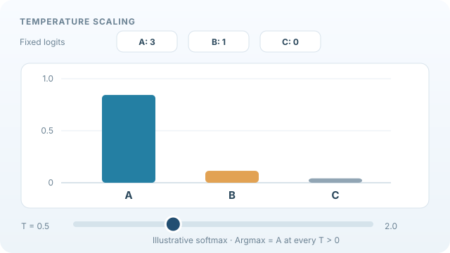

# Temperature Scaling

Temperature scaling is a post-hoc calibration method that divides a neural network's logits by one learned scalar, the temperature, before the softmax. It leaves the predicted label unchanged and adjusts only how confident the probabilities are. Part of [Uncertainty quantification and calibration](index.md).

## Overview

Modern neural networks trained with cross-entropy loss are often overconfident on test data, even when they are accurate. Guo et al. (2017) found that the miscalibration grew with model size and depth, and that a single scalar fitted on held-out data corrected much of it. Temperature scaling is the simplest such fix, and it is hard to beat for its cost.

## Key concepts

- **Logits**: the unnormalised scores \(z\) that a network produces before the softmax.
- **Temperature**: a positive scalar \(T\). Values above one soften the distribution, and values below one sharpen it.
- **Negative log-likelihood (NLL)**: the loss minimised on the held-out set to fit \(T\).
- **Post-hoc**: applied after training, so the network's weights are not changed.

## How it works

The calibrated probabilities are

\[
\hat p_k = \frac{\exp(z_k/T)}{\sum_j \exp(z_j/T)}.
\]

The parameter \(T\) is chosen to minimise the NLL of the labels on a held-out validation set. Because dividing all logits by the same positive number leaves their order unchanged, the predicted class, and hence accuracy, does not change. Only the confidence changes. Guo et al. (2017) fit \(T\) by a simple one-dimensional optimisation and report that it reduces the expected calibration error of deep networks substantially on image benchmarks.

*Original animated teaching visual (CC BY-SA 4.0).* Fixed schematic logits (3, 1, 0) are converted to softmax probabilities as the temperature varies from 0.5 to 2 and back. The animation computes 41 exact softmax samples and interpolates between them for visual continuity; intermediate interpolated frames are not independent model calculations. The argmax remains A for all positive temperatures. **These are illustrative logits, not fitted calibration parameters or measured model outputs.** On the MkDocs site use Play/Pause; the [static GitHub preview](../../../../assets/concept-animations/temperature-softmax-still.svg) shows T=1. On narrow screens, scroll the figure horizontally. See Guo et al. (2017) in References.

## Variants

- **Vector scaling** uses a separate scale and bias for each class, which is more flexible but needs more data.
- **Matrix scaling** uses a full linear map on the logits, which is the most expressive of the family and the most prone to overfitting.
- **Histogram binning** fits a piecewise-constant map from confidence to accuracy, a non-parametric alternative.

## Results and limits

- It is cheap, has one parameter, and does not change the classifier's predictions, which makes it easy to deploy.
- It is a global fix. It cannot correct miscalibration that varies across classes or inputs.
- It needs a held-out set that resembles the test distribution, and it is less effective under distribution shift.
- Its benefit can be weaker when the test data differ from the calibration data, because the fitted temperature assumes the two look alike.

## Applications

- **Deploying classifiers**: correcting the confidence of an already trained network without retraining.
- **Benchmark comparisons**: a standard baseline in calibration studies of image classifiers.
- **Decision thresholds**: making thresholds on predicted probabilities meaningful after calibration.

## Open questions

- Calibration under distribution shift is only partly solved, and a single temperature fitted on one distribution may not transfer.
- Whether calibration methods help language models and other large generative models in the same way is an open empirical question.

## References

### Seminal papers

- Guo, C., Pleiss, G., Sun, Y. & Weinberger, K. Q. (2017). On calibration of modern neural networks. In *Proceedings of the 34th International Conference on Machine Learning*, PMLR 70. https://proceedings.mlr.press/v70/guo17a.html — Introduces temperature scaling for neural networks and compares it with other calibration methods.
- Brier, G. W. (1950). Verification of forecasts expressed in terms of probability. *Monthly Weather Review* 78(1), 1–3. https://doi.org/10.1175/1520-0493(1950)078<0001:VOFEIT>2.0.CO;2 — Introduces a proper scoring rule for probability forecasts, a companion measure to calibration.
- Niculescu-Mizil, A. & Caruana, R. (2005). Predicting good probabilities with supervised learning. In *Proceedings of the 22nd International Conference on Machine Learning*, 625–632. https://doi.org/10.1145/1102351.1102430 — Compares calibration methods, including Platt scaling and isotonic regression, for classifiers.

### Surveys and textbooks

- DeGroot, M. H. & Fienberg, S. E. (1983). The comparison and evaluation of forecasters. *The Statistician* 32(1/2), 12–22. https://doi.org/10.2307/2987588 — Defines calibration for probability forecasts and compares forecasters on it.
- Murphy, K. P. (2022). *Probabilistic Machine Learning: An Introduction*. MIT Press. https://github.com/probml/pml-book — Free textbook; covers calibration and post-hoc methods.
- Gal, Y. & Ghahramani, Z. (2016). Dropout as a Bayesian approximation: representing model uncertainty in deep learning. In *Proceedings of the 33rd International Conference on Machine Learning*, PMLR 48. https://proceedings.mlr.press/v48/gal16.html — Gives an alternative route to uncertainty for the same networks.
