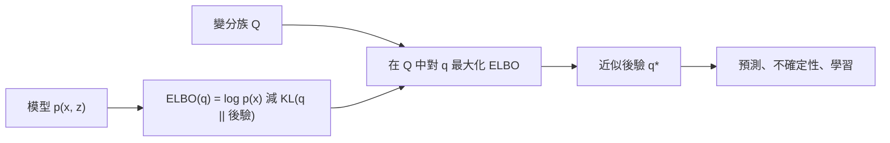

# 變分推論

變分推論（Variational inference, VI）用來近似一個難以精確計算的機率分布。它先選定一個較簡單的分布族，再以最佳化找出該族中最接近目標的成員。如此一來，推論問題就變成最大化一個下界，也就是證據下界（evidence lower bound, ELBO）。變分自編碼器背後的近似推論方法就是它，現代機率機器學習也大量使用它。

## 概述

在貝氏建模中，核心對象是後驗 \(p(z\mid x)\)，即在觀測資料 \(x\) 之下，隱藏量 \(z\)（例如參數或成因）的分布。貝氏定理用先驗與概似來表示後驗，但正規化常數 \(p(x) = \int p(x,z)\,dz\) 要對所有隱藏配置積分。對於夠有用的模型，這個積分沒有閉式解，因此後驗無法直接寫出，也無法直接抽樣。

近似的方法大致有兩類。抽樣方法，例如馬可夫鏈蒙地卡羅（MCMC），抽出的樣本分布會收斂到後驗；它們在理論上是精確的，但可能很慢。變分方法則先固定一個容易處理的分布族 \(\mathcal{Q}\)，再從中找出最接近後驗的成員 \(q\)。這個搜尋是最佳化問題，因此可以使用訓練神經網路的梯度方法。Blei 等人（2016）指出，VI 往往比 MCMC 等經典方法快，但兩者的相對精確度至今仍不清楚。[^1]

這個方法在圖模型中已有很長的歷史，當時用來為精確方法無法處理的模型界定似然的下界（Jordan 等人，1999）。它之所以能用於大規模資料，靠的是三項發展：小批次上的隨機最佳化（Hoffman 等人，2012）、不需針對模型推導的黑箱梯度估計器（Ranganath 等人，2013），以及讓變分自編碼器成為可能的攤銷推論（Kingma & Welling，2013）。

[^1]: Blei 等人（2016）也指出，VI 通常會低估後驗的變異數，這是其目標函數的結果。他們的速度比較針對的是所討論的經典方法，而不是所有抽樣方法。

## 核心概念

- **潛變數**：一個未被觀測到、用來解釋觀測資料 \(x\) 的量 \(z\)。
- **證據下界（ELBO）**：對任意分布 \(q(z)\)，都不會超過對數證據 \(\log p(x)\) 的量 \(\mathcal{L}(q)\)。當 \(q\) 等於後驗時，此下界最緊。
- **KL 散度**：\(\mathrm{KL}(q\|p)\) 衡量 \(q\) 與 \(p\) 的差距，只有當兩者相等時才為零。見[資訊理論](../../../information-theory/index.md)。
- **變分族**：候選分布的集合。它的選擇會限制近似能有多好，因此是一項建模決策。
- **平均場近似**：假設潛變數彼此獨立，即 \(q(z) = \prod_j q_j(z_j)\)。座標上升法一次更新一個因子，會收斂到 ELBO 的局部最佳解（Blei 等人，2016）。
- **攤銷推論**：不為每個資料點各自擬合參數，而是由一個共享的網路把每個 \(x\) 映射到其近似的參數。如此，對新資料點做推論的成本很低。
- **重參數化**：把一個樣本寫成參數與不依賴參數之雜訊的可微函數，使梯度可以穿過抽樣步驟。
- **分數函數梯度**：只需要 \(\nabla \log q\) 的估計器。它適用於任何可抽樣的分布族，代價是變異數較高。

## 運作方式

出發點是一個對任意分布 \(q(z)\) 都成立的恆等式：

\[
\log p(x) = \underbrace{\mathbb{E}_{q(z)}\big[\log p(x,z) - \log q(z)\big]}_{\mathcal{L}(q),\ \text{即 ELBO}} + \mathrm{KL}\big(q(z)\,\|\,p(z\mid x)\big).
\]

KL 項非負，所以 \(\mathcal{L}(q)\) 是對數證據的下界。左側不依賴 \(q\)，因此對 \(q\) 最大化 ELBO 等同於最小化 \(\mathrm{KL}(q\|p(z\mid x))\)。ELBO 可由模型直接給出的聯合密度 \(p(x,z)\) 計算，因此不必計算難以處理的正規化常數。

對平均場族而言，每個因子的最佳更新有簡單的形式：\(\log q_j^*(z_j) = \mathbb{E}_{-j}[\log p(x,z)] + \text{常數}\)，其中期望是對其他所有因子取的。當所需的期望有閉式解時，這些座標更新就是經典演算法；否則可以用蒙地卡羅估計 ELBO 的梯度。常見的三條路線如下：

- **重參數化梯度**讓梯度穿過可微的樣本。它的變異數低，也是 VAE 所用的方法。
- **分數函數梯度**使用 \(\nabla\log q\)，適用於任何分布族，但需要控制變量等變異數縮減技術。
- **自然梯度**依分布族的資訊幾何調整步長。搭配小批次就得到隨機 VI，其更新為 \(\lambda^{(t)} = (1-\rho_t)\lambda^{(t-1)} + \rho_t\hat\lambda_t\)，步長 \(\rho_t = (t+\tau)^{-\kappa}\)，其中 \(\kappa \in (0.5, 1]\)（Hoffman 等人，2012）。

這類基於梯度的訓練和深度學習使用相同的工具，包括[隨機梯度下降](../../../optimization/sgd-and-momentum/index.md)。重參數化梯度則依賴穿過抽樣步驟的[自動微分](../../../math/automatic-differentiation/index.md)。

## 關鍵方法

下表比較三個代表性方法。每個方法都有自己的頁面。

| 方法 | 年份 | 改變了什麼 | 主要想法 |
|---|---|---|---|
| [變分自編碼器](variational-autoencoder/index.md) | 2013 | 攤銷推論 | 一個編碼器網路為每個資料點給出近似後驗，重參數化技巧提供低變異數的梯度 |
| [黑箱變分推論](black-box-variational-inference/index.md) | 2013 | 梯度估計 | 分數函數梯度搭配拉奧–布萊克威爾化與控制變量，使同一演算法適用於許多模型 |
| [正規化流後驗](normalising-flow-posteriors/index.md) | 2015 | 變分族 | 把簡單密度推過一連串可逆映射，使後驗不必是高斯分布 |

隨機 VI（Hoffman 等人，2012）沒有獨立頁面。它是同一目標的小批次自然梯度形式，黑箱頁面在概述中已說明。

## 與其他主題的關聯

- **生成模型**。VAE 是帶有神經解碼器的攤銷 VI，也是更廣泛的[生成模型](../../unsupervised/density-and-generative-models/generative-models/index.md)中的一個家族。去噪擴散模型的訓練目標同樣是一個加權的變分界（Ho 等人，2020；見 [DDPM](../../unsupervised/density-and-generative-models/diffusion/ddpm.md)）。
- **資訊理論**。ELBO 中的 KL 散度是[資訊理論](../../../information-theory/index.md)的核心量。VAE 的損失包含重建項與 KL 項，後者懲罰與先驗的偏離。
- **強化學習**。分數函數估計器就是 REINFORCE 所依據的恆等式，而 REINFORCE 也用於訓練策略。見[策略梯度與 Actor-Critic](../../reinforcement-learning/policy-gradient-and-actor-critic/index.md)。
- **大腦與心智**。在自由能原理中，Friston（2010）提出大腦會最小化一個變分自由能，它是驚訝度的上界。這個量就是負的 ELBO，只是用了不同的語彙，因此知覺可以被理解為近似的貝氏推論。兩個早期受大腦啟發的系統，其結構與攤銷 VI 相同：Helmholtz 機器（Dayan 等人，1995）與清醒－睡眠演算法（Hinton 等人，1995），兩者都與生成模型一起訓練一個辨識模型。皮質是否實作這類運算仍是開放問題：這種對應是數學上的，也是一個假說，並非已確立的機制。見[預測編碼與自由能原理](../../../../brain-mind/predictive-coding/index.md)與[認知科學](../../../../brain-mind/cognitive-science/index.md)。

## 應用

- **大規模主題模型**。Hoffman 等人（2012）把潛在狄利克雷分配與階層狄利克雷過程主題模型用於 30 萬篇 Nature 文章、180 萬篇《紐約時報》文章與 380 萬篇維基百科文章的集合。他們的隨機方法可以處理整個集合，而批次 VI 只能處理其中一部分。[^2]
- **自動推論**。Kucukelbir 等人（2016）只需機率模型本身，就能推導出變分演算法，建模者不必手動推導。此方法可在 Stan 機率程式設計系統中使用。
- **臨床資料**。Ranganath 等人（2013）用 BBVI 對 976 名慢性腎臟病患者的紀錄擬合四個非共軛模型。其他臨床應用見[醫療](../../../../applications/healthcare/index.md)。

[^2]: 集合規模取自 Hoffman 等人（2012）的摘要。論文中的比較是在同一模型上比較隨機 VI 與批次 VI，而不是比較 VI 與抽樣方法。

## 開放問題

- **與抽樣方法的精確度比較**。VI 與 MCMC 的相對精確度至今不清楚（Blei 等人，2016）。
- **不確定性被低估**。VI 通常會低估後驗變異數，這是反向 KL 目標的結果。這對[貝氏深度學習](../index.md)以及依賴校準不確定性的決策都很重要。
- **局部最佳解**。ELBO 一般是非凸的，因此結果取決於初始化（Blei 等人，2016）。
- **攤銷差距**。Cremer 等人（2018）發現，訓練後 VAE 的誤差很大一部分來自不夠好的辨識網路，而非近似族的複雜度不足。因此，更好的編碼器與更豐富的分布族處理的是誤差的不同部分。

## 參考文獻

### 開創性論文

- Jordan, M. I., Ghahramani, Z., Jaakkola, T. S. & Saul, L. K. (1999). An Introduction to Variational Methods for Graphical Models. *Machine Learning*. https://doi.org/10.1023/A:1007665907178 — 早期的入門文章，把圖模型中的近似推論視為最佳化一個界。
- Hoffman, M. D., Blei, D. M., Wang, C. & Paisley, J. (2012). *Stochastic Variational Inference*. arXiv. https://arxiv.org/abs/1206.7051 — 在小批次上使用帶雜訊的自然梯度，讓變分推論能擴展到大型資料集。
- Kingma, D. P. & Welling, M. (2013). *Auto-Encoding Variational Bayes*. arXiv. https://arxiv.org/abs/1312.6114 — 提出變分自編碼器，包含變分界的重參數化估計器與共享的辨識模型。
- Ranganath, R., Gerrish, S. & Blei, D. M. (2013). *Black Box Variational Inference*. arXiv. https://arxiv.org/abs/1401.0118 — 提出附帶變異數縮減的分數函數梯度估計器，使 ELBO 能為許多模型最佳化。
- Rezende, D. J. & Mohamed, S. (2015). *Variational Inference with Normalizing Flows*. arXiv. https://arxiv.org/abs/1505.05770 — 藉由組合可逆映射建立彈性後驗，並在深度潛變數模型中訓練。
- Friston, K. (2010). The free-energy principle: a unified brain theory? *Nature Reviews Neuroscience*. https://doi.org/10.1038/nrn2787 — 提出大腦會最小化自由能，作為大腦功能的統一解釋。
- Dayan, P., Hinton, G. E., Neal, R. M. & Zemel, R. S. (1995). The Helmholtz Machine. *Neural Computation*. https://doi.org/10.1162/neco.1995.7.5.889 — 提出具有獨立辨識權重的階層式生成模型，以似然的下界訓練。
- Hinton, G. E., Dayan, P., Frey, B. J. & Neal, R. M. (1995). The "Wake-Sleep" Algorithm for Unsupervised Neural Networks. *Science*. https://doi.org/10.1126/science.7761831 — 以交替的清醒與睡眠階段，訓練含有獨立辨識網路的多層生成網路。

### 綜述與教科書

- Blei, D. M., Kucukelbir, A. & McAuliffe, J. D. (2016). *Variational Inference: A Review for Statisticians*. arXiv. https://arxiv.org/abs/1601.00670 — 清楚的 VI 綜述，涵蓋其目標、平均場更新，以及與 MCMC 的取捨。
- Zhang, C., Butepage, J., Kjellstrom, H. & Mandt, S. (2017). *Advances in Variational Inference*. arXiv. https://arxiv.org/abs/1711.05597 — 綜述可擴展的 VI、隨機與黑箱方法，以及彈性的近似分布族。
- Kingma, D. P. & Welling, M. (2019). *An Introduction to Variational Autoencoders*. arXiv. https://arxiv.org/abs/1906.02691 — 作者撰寫的入門教材，介紹以深度潛變數模型進行的攤銷 VI。

### 文章與文件

- Kucukelbir, A., Tran, D., Ranganath, R., Gelman, A. & Blei, D. M. (2016). *Automatic Differentiation Variational Inference*. arXiv. https://arxiv.org/abs/1603.00788 — 只由模型自動推導變分演算法，用於機率程式設計。
- Cremer, C., Li, X. & Duvenaud, D. (2018). *Inference Suboptimality in Variational Autoencoders*. arXiv. https://arxiv.org/abs/1801.03558 — 顯示訓練後 VAE 的近似誤差，很大一部分來自不夠好的辨識網路。
- Ho, J., Jain, A. & Abbeel, P. (2020). *Denoising Diffusion Probabilistic Models*. arXiv. https://arxiv.org/abs/2006.11239 — 以加權變分界訓練擴散模型，該界會化為預測雜訊的目標。
