# Mean-Field Variational Inference

Mean-field variational inference approximates the posterior by a product of independent factors, one per latent variable. Each factor is updated in turn by a closed-form rule, which gives coordinate ascent on the ELBO. Part of [Variational inference](index.md).

## Overview

The mean-field family assumes the latent variables are independent under \(q\): \(q(z)=\prod_j q_j(z_j)\). This is a strong assumption, since the true posterior often has correlations between variables. In exchange, the ELBO becomes simple enough that each factor has an update that can be computed in closed form for many models with conjugate priors.

## Key concepts

- **Factorised family**: \(q(z)=\prod_j q_j(z_j)\), with one factor per latent variable or block.
- **Coordinate ascent**: update one factor at a time with the others held fixed. Each step cannot decrease the ELBO.
- **Conjugacy**: when a prior and likelihood are conjugate, the updates stay in known distribution families.
- **Underestimated variance**: the factorised family usually makes the approximate posterior narrower than the true one.

## How it works

The optimal update for factor \(j\), holding the others fixed, is

\[
\log q_j^{*}(z_j) = \mathbb{E}_{\prod_{k\ne j} q_k}\big[\log p(x, z)\big] + \text{const}.
\]

The algorithm cycles through the factors, recomputing each from the current values of the others, until the ELBO stops increasing. Jordan et al. (1999) develop these updates for graphical models, where the expectation only needs local terms.

## Animated walkthrough

[Static final-update preview for GitHub and reduced-motion readers](../../../../assets/concept-animations/mean-field-coordinate-ascent-still.svg). On the MkDocs site, use **Play animation / Pause animation** (keyboard: Tab then Enter). The grey tilted contours represent a correlated target posterior; the teal axis-aligned ellipse is the independent-factor approximation $q_1(z_1)q_2(z_2)$. Each stage replaces **one factor distribution**, not one sampled point, while holding the other factor fixed. The orange dashed ellipse is the preceding approximation.

For a reproducible illustrative Gaussian target with precision matrix $\Lambda=\begin{pmatrix}2&-1.2\\-1.2&1\end{pmatrix}$, the exact mean-field Gaussian updates keep variances $(0.5,1)$ and set $\mu_1\leftarrow0.6\mu_2$, then $\mu_2\leftarrow1.2\mu_1$. Starting at $(\mu_1,\mu_2)=(-1.2,1.4)$, four updates yield $(0.84,1.4)$, $(0.84,1.008)$, $(0.6048,1.008)$, and $(0.6048,0.72576)$. These are **analytical teaching calculations, not measured optimisation traces**. The contours are stylised rather than drawn at a calibrated density level. Exact coordinate maximisation cannot decrease the ELBO, but factorisation cannot reproduce the target correlation.

*Original instructional animation and GitHub fallback: CC BY-SA 4.0.*

## Key methods

- [Stochastic variational inference](stochastic-variational-inference.md): keeps the factorised structure of conjugate models but replaces the full coordinate updates by noisy natural-gradient steps on minibatches.
- The variational-autoencoder approach ([VAE](../../unsupervised/density-and-generative-models/vae/index.md)) replaces per-variable updates with a network that outputs the factors, which is amortised inference.

## Connections

- [Variational inference](index.md) describes the ELBO and the other families of approximating distributions.
- [Probability and statistics](../../../math/probability-statistics/index.md) gives the conjugate-prior and exponential-family background needed for the updates.
- For the brain, the mean-field idea is one way to describe how a population of neurons could approximate a joint posterior with local computations. This is a modelling hypothesis, not a settled result.

## Applications

- **Topic models**: mean-field updates for latent Dirichlet allocation and related conjugate models (Blei et al., 2017).
- **Graphical models**: approximate inference on Bayesian networks with local message passing (Jordan et al., 1999).

## Open questions

- The factorisation can badly underestimate posterior correlations. Structured mean-field and richer families are the usual remedies.
- The update order and local optima affect the result, and convergence can be slow for large models.

## References

### Seminal papers

- Jordan, M. I., Ghahramani, Z., Jaakkola, T. S. & Saul, L. K. (1999). An introduction to variational methods for graphical models. *Machine Learning* 37(2), 183–233. https://doi.org/10.1023/A:1007665907178 — Derives the mean-field coordinate updates for graphical models.
- Blei, D. M., Kucukelbir, A. & McAuliffe, J. D. (2017). Variational inference: a review for statisticians. *Journal of the American Statistical Association* 112(518), 859–877. https://doi.org/10.1080/01621459.2017.1285773 — Explains the mean-field family and its coordinate-ascent algorithm with worked examples.

### Surveys and textbooks

- Wainwright, M. J. & Jordan, M. I. (2008). Graphical models, exponential families, and variational inference. *Foundations and Trends in Machine Learning*. https://nowpublishers.com/article/Details/MAL-001 — Relates mean-field approximations to exponential families.
- Bishop, C. M. (2006). *Pattern Recognition and Machine Learning*. Springer. https://www.microsoft.com/en-us/research/wp-content/uploads/2006/01/Bishop-Pattern-Recognition-and-Machine-Learning-2006.pdf — Chapter on approximate inference covers variational Bayes with factorised posteriors.
- Murphy, K. P. (2022). *Probabilistic Machine Learning: An Introduction*. MIT Press. https://github.com/probml/pml-book — Free textbook; presents mean-field VI as a standard approximate-inference method.
