# Mean-Field Variational Inference

Mean-field variational inference approximates a joint posterior with a product of distributions over latent variables or blocks. When each factor can be optimised exactly, updating one factor at a time gives coordinate ascent on the evidence lower bound (ELBO).[^blei]

## Overview

For observations $x$ and latent variables $z$, a mean-field approximation has the form $q(z)=\prod_j q_j(z_j)$. Variables in different factors are independent under $q$. Variables within the same block can still be dependent. This simplifies expectations in the ELBO and restricts the kinds of posterior dependence that the approximation can represent. [Variational inference](index.md).[^blei][^jordan]

## Key concepts

- **Variational factor** is a normalised distribution over one variable or block. Its parameters can depend on the current values of other factors' parameters.
- **Coordinate ascent variational inference (CAVI)** optimises a factor while holding the other factors fixed.
- **Conditional conjugacy** can give updates in a known distribution family. Other models may require numerical or stochastic optimisation.[^blei]

## How it works

Hold the other factors $q_{-j}$ fixed and average the log joint density over their variables. Exponentiating that function of $z_j$ and dividing by its normalising constant $Z_j$ gives the optimal factor, when the expectations exist and $Z_j$ is finite and positive.[^blei]

$$
q_j^\star(z_j)=\frac{\exp\!\left(\mathbb{E}_{q_{-j}}[\log p(x,z)]\right)}{Z_j},
\qquad
q_{-j}(z_{-j})=\prod_{k\ne j}q_k(z_k).
$$

To see why the update improves the objective, write the ELBO as $\mathcal{L}(q)=\mathbb{E}_q[\log p(x,z)-\log q(z)]$. For fixed $q_{-j}$, its dependence on $q_j$ is an expected log joint term plus the entropy of $q_j$. Substituting the normalised factor above gives the following identity, where $C$ is constant with respect to $q_j$.[^blei]

$$
\mathcal{L}(q_jq_{-j})=C-\mathrm{KL}(q_j\|q_j^\star).
$$

Thus the ELBO increases by $\mathrm{KL}(q_j^{\mathrm{old}}\|q_j^\star)$ after an exact replacement. Each update uses the latest values of the other factors. A sweep updates every factor once. In a graphical model, terms of the log joint that do not contain $z_j$ contribute only to the normaliser. The objective can have multiple local optima, so the final approximation can depend on initialisation.[^blei][^jordan]

## Animated walkthrough

The tilted contours represent the target posterior. The axis-aligned ellipse represents the product of independent factors. Each step replaces an entire factor distribution. The dashed ellipse marks the preceding approximation. Use Tab and Enter to operate the MkDocs play/pause control. [Static final-update preview](../../../../assets/concept-animations/mean-field-coordinate-ascent-still.svg).

The animation uses a zero-mean two-dimensional Gaussian with precision $\Lambda$ and covariance $\Lambda^{-1}$.

$$
\Lambda=\begin{pmatrix}2&-1.2\\-1.2&1\end{pmatrix},
\qquad
\Lambda^{-1}=\frac{1}{0.56}\begin{pmatrix}1&1.2\\1.2&2\end{pmatrix}.
$$

With factor means $\mu_1,\mu_2$, the expected log joint for the first coordinate has terms $-z_1^2+1.2\mu_2z_1$. Completing the square gives $q_1^\star=\mathcal{N}(0.6\mu_2,0.5)$, with the second argument denoting variance. The second update gives $q_2^\star=\mathcal{N}(1.2\mu_1,1)$. Starting at $(-1.2,1.4)$, the first four updates give $(0.84,1.4)$, $(0.84,1.008)$, $(0.6048,1.008)$ and $(0.6048,0.72576)$, as shown in the animation.[^blei]

Each full sweep multiplies $\mu_2$ by $0.72$, so both means converge to zero. The limiting variances $0.5$ and $1$ equal the target's conditional variances. The target marginal variances are about $1.786$ and $3.571$, and its off-diagonal covariance is about $2.143$. The factorised approximation has zero off-diagonal covariance. These numbers describe the constructed example. The animation contours are schematic.

*Original instructional animation and GitHub fallback, CC BY-SA 4.0.*

## Key methods

- [Stochastic variational inference](stochastic-variational-inference.md) estimates natural-gradient updates for global factors using subsets of observations and local factors fitted to those observations.[^svi]
- [Variational autoencoders](../../unsupervised/density-and-generative-models/vae/index.md) use an encoder to produce variational parameters for each observation. This shares inference parameters across observations and is called amortised inference.[^vae]

## Connections

Conditional conjugacy and exponential families explain why some coordinate updates stay within familiar distribution families. [Probability and statistics](../../../math/probability-statistics/index.md).[^blei]

## Applications

Mean-field updates appear in variational inference for latent Dirichlet allocation and in approximations to inference in graphical models. [Original LDA paper](https://jmlr.org/papers/v3/blei03a.html).[^lda][^jordan]

## Limitations

- Independence across factors removes posterior dependence between blocks. In the Gaussian example this also reduces the marginal variances. The size and direction of errors in posterior summaries depend on the target and approximation family.[^blei]
- An ELBO plateau indicates little further gain from the current updates. It can occur even when the approximation family leaves a substantial gap to the exact posterior.[^blei]

[^blei]: Blei, Kucukelbir and McAuliffe, [*Variational Inference: A Review for Statisticians*](https://arxiv.org/html/1601.00670), §§2.2–2.5 and 4.
[^jordan]: Jordan et al., [*An Introduction to Variational Methods for Graphical Models*](https://people.eecs.berkeley.edu/~jordan/papers/variational-intro.pdf), the mean-field example for the Boltzmann machine.
[^svi]: Hoffman et al., [*Stochastic Variational Inference*](https://jmlr.org/papers/v14/hoffman13a.html).
[^vae]: Kingma and Welling, [*Auto-Encoding Variational Bayes*](https://arxiv.org/abs/1312.6114).
[^lda]: Blei, Ng and Jordan, [*Latent Dirichlet Allocation*](https://jmlr.org/papers/v3/blei03a.html).

## References

### Seminal papers

- Jordan, M. I., Ghahramani, Z., Jaakkola, T. S. & Saul, L. K. (1999). *An Introduction to Variational Methods for Graphical Models*. Machine Learning 37, 183–233. https://people.eecs.berkeley.edu/~jordan/papers/variational-intro.pdf — Derives mean-field equations using local terms in graphical models.
- Blei, D. M., Ng, A. Y. & Jordan, M. I. (2003). *Latent Dirichlet Allocation*. JMLR 3, 993–1022. https://jmlr.org/papers/v3/blei03a.html — Derives a factorised variational approximation for the topic model.
- Hoffman, M. D., Blei, D. M., Wang, C. & Paisley, J. (2013). *Stochastic Variational Inference*. JMLR 14, 1303–1347. https://jmlr.org/papers/v14/hoffman13a.html — Develops stochastic updates for global variables in conditionally conjugate models.
- Kingma, D. P. & Welling, M. (2014). *Auto-Encoding Variational Bayes*. ICLR. https://arxiv.org/abs/1312.6114 — Trains a recognition model to produce observation-specific variational distributions.

### Surveys and textbooks

- Blei, D. M., Kucukelbir, A. & McAuliffe, J. D. (2017). *Variational Inference: A Review for Statisticians*. JASA 112, 859–877. https://arxiv.org/abs/1601.00670 — Derives coordinate ascent and illustrates mean-field variance errors with a correlated Gaussian.
