# 平均場變分推論

平均場變分推論用各潛在變數或變數區塊的分布乘積近似聯合後驗。若每個因子都能精確最佳化，逐一更新因子就形成對證據下界（ELBO）的座標上升。[^blei]

## 概述

對觀測值 $x$ 與潛在變數 $z$，平均場近似的形式為 $q(z)=\prod_j q_j(z_j)$。不同因子中的變數在 $q$ 下彼此獨立，同一區塊內的變數則可相依。這簡化了 ELBO 中的期望值計算，也限制了近似分布能表達的後驗相依性。[變分推論](index.zh-TW.md)。[^blei][^jordan]

## 關鍵概念

- **變分因子**是單一變數或區塊上的正規化分布，其參數可取決於其他因子參數的當前值。
- **座標上升變分推論（CAVI）**固定其他因子，每次最佳化一個因子。
- **條件共軛性**可讓更新後的因子維持在已知分布族內。其他模型可能需要數值或隨機最佳化。[^blei]

## 運作方式

固定其他因子 $q_{-j}$，對其變數取對數聯合密度的期望值。若期望值存在，且正規化常數 $Z_j$ 為有限正數，將所得的 $z_j$ 函數取指數後除以 $Z_j$，便得到最佳因子。[^blei]

$$
q_j^\star(z_j)=\frac{\exp\!\left(\mathbb{E}_{q_{-j}}[\log p(x,z)]\right)}{Z_j},
\qquad
q_{-j}(z_{-j})=\prod_{k\ne j}q_k(z_k).
$$

將 ELBO 寫成 $\mathcal{L}(q)=\mathbb{E}_q[\log p(x,z)-\log q(z)]$。固定 $q_{-j}$ 後，與 $q_j$ 有關的部分是對數聯合密度的期望項與 $q_j$ 的熵。代入前述正規化因子可得到下式，其中 $C$ 不隨 $q_j$ 改變。[^blei]

$$
\mathcal{L}(q_jq_{-j})=C-\mathrm{KL}(q_j\|q_j^\star).
$$

因此，精確更新後，ELBO 的增量為 $\mathrm{KL}(q_j^{\mathrm{old}}\|q_j^\star)$。每次更新都使用其他因子的最新值，一輪會更新所有因子各一次。在圖模型中，對數聯合密度中不含 $z_j$ 的項只會影響正規化常數。目標函數可能有多個局部最優解，因此最後的近似可能取決於初始值。[^blei][^jordan]

## 動畫示範

傾斜的等高線代表目標後驗，與座標軸對齊的橢圓代表獨立因子的乘積。每一步都更新整個因子分布，虛線橢圓標示更新前的近似。可用 Tab 和 Enter 操作 MkDocs 的播放／暫停按鈕。[最終更新的靜態預覽](../../../../assets/concept-animations/mean-field-coordinate-ascent-still.svg)。

動畫採用零均值的二維高斯分布，精確矩陣為 $\Lambda$，共變異數矩陣為 $\Lambda^{-1}$。

$$
\Lambda=\begin{pmatrix}2&-1.2\\-1.2&1\end{pmatrix},
\qquad
\Lambda^{-1}=\frac{1}{0.56}\begin{pmatrix}1&1.2\\1.2&2\end{pmatrix}.
$$

設兩個因子的均值為 $\mu_1,\mu_2$。取期望後，對數聯合密度中與第一個座標有關的項為 $-z_1^2+1.2\mu_2z_1$。配方後得到 $q_1^\star=\mathcal{N}(0.6\mu_2,0.5)$，其中第二個引數代表變異數。第二個因子的更新則得到 $q_2^\star=\mathcal{N}(1.2\mu_1,1)$。以 $(-1.2,1.4)$ 為初始均值，前四次更新依序得到 $(0.84,1.4)$、$(0.84,1.008)$、$(0.6048,1.008)$ 與 $(0.6048,0.72576)$，如動畫所示。[^blei]

每一輪更新都將 $\mu_2$ 乘以 $0.72$，因此兩個均值都收斂至零。近似分布的變異數 $0.5$ 與 $1$ 等於目標分布的條件變異數。目標分布的邊際變異數約為 $1.786$ 與 $3.571$，非對角共變異數約為 $2.143$。因式分解後，近似分布的非對角共變異數為零。這些數值來自教學算例，動畫中的等高線為示意。

*原創教學動畫及 GitHub 靜態預覽，CC BY-SA 4.0。*

## 主要方法

- [隨機變分推論](stochastic-variational-inference.zh-TW.md)使用部分觀測值及其擬合的區域因子，估計全域因子的自然梯度更新。[^svi]
- [變分自編碼器](../../unsupervised/density-and-generative-models/vae/index.zh-TW.md)透過編碼器產生每筆觀測值的變分參數。這種在觀測值之間共用推論模型參數的做法稱為攤銷推論。[^vae]

## 與其他頁面的連結

條件共軛性與指數族說明為何部分座標更新能維持在熟悉的分布族內。[機率與統計](../../../math/probability-statistics/index.zh-TW.md)。[^blei]

## 應用

潛在狄利克雷分配的變分推論與圖模型的近似推論都會使用平均場更新。[LDA 原論文](https://jmlr.org/papers/v3/blei03a.html)。[^lda][^jordan]

## 限制

- 因子之間的獨立性會消除區塊之間的後驗相依。在高斯算例中，邊際變異數也隨之下降。後驗摘要誤差的大小與方向取決於目標分布及近似分布族。[^blei]
- ELBO 趨於平坦表示目前的更新帶來的增益很小。即使近似分布族與精確後驗之間仍有明顯差距，也可能出現這種情況。[^blei]

[^blei]: Blei、Kucukelbir 與 McAuliffe，[*Variational Inference: A Review for Statisticians*](https://arxiv.org/html/1601.00670)，第 2.2 至 2.5 節與第 4 節。
[^jordan]: Jordan 等人，[*An Introduction to Variational Methods for Graphical Models*](https://people.eecs.berkeley.edu/~jordan/papers/variational-intro.pdf)，波茲曼機的平均場算例。
[^svi]: Hoffman 等人，[*Stochastic Variational Inference*](https://jmlr.org/papers/v14/hoffman13a.html)。
[^vae]: Kingma 與 Welling，[*Auto-Encoding Variational Bayes*](https://arxiv.org/abs/1312.6114)。
[^lda]: Blei、Ng 與 Jordan，[*Latent Dirichlet Allocation*](https://jmlr.org/papers/v3/blei03a.html)。

## 參考文獻

### 奠基性論文

- Jordan、Ghahramani、Jaakkola 與 Saul（1999）。*An Introduction to Variational Methods for Graphical Models*。Machine Learning 37，183–233。https://people.eecs.berkeley.edu/~jordan/papers/variational-intro.pdf — 使用圖模型的局部項推導平均場方程式。
- Blei、Ng 與 Jordan（2003）。*Latent Dirichlet Allocation*。JMLR 3，993–1022。https://jmlr.org/papers/v3/blei03a.html — 為主題模型推導因式分解的變分近似。
- Hoffman、Blei、Wang 與 Paisley（2013）。*Stochastic Variational Inference*。JMLR 14，1303–1347。https://jmlr.org/papers/v14/hoffman13a.html — 為條件共軛模型的全域變數發展隨機更新方法。
- Kingma 與 Welling（2014）。*Auto-Encoding Variational Bayes*。ICLR。https://arxiv.org/abs/1312.6114 — 訓練辨識模型以產生各筆觀測值的變分分布。

### 綜述與教科書

- Blei、Kucukelbir 與 McAuliffe（2017）。*Variational Inference: A Review for Statisticians*。JASA 112，859–877。https://arxiv.org/abs/1601.00670 — 推導座標上升，並用相關高斯分布說明平均場近似的變異數誤差。
