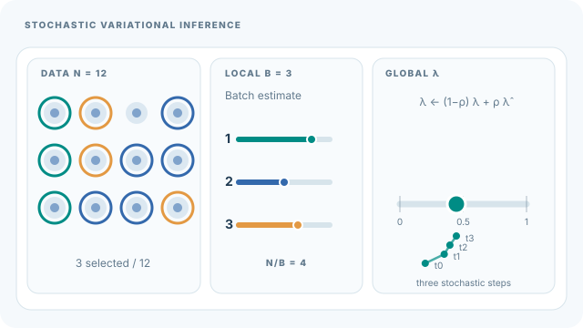

# 隨機變分推論

隨機變分推論（SVI）以小批次資料計算的雜訊梯度，把變分近似套用到非常大的資料集。它對全域潛在變數使用自然梯度更新，並以 Robbins–Monro 步長條件保證收斂。本頁是[變分推論](index.md)的一部分。

## 概述

平均場更新每一步都需要完整掃描資料，對數百萬份文件來說不切實際。SVI 以隨機抽出的小批次取代完整掃描。每一步使用由小批次計算、經過縮放的更新估計，因此平均而言與精確更新方向相同，只是多了雜訊。Hoffman 等人（2013）針對具有局部與全域潛在變數的共軛模型發展了此方法。

## 關鍵概念

- **全域與局部變數**：全域變數由整個資料集共享，局部變數則只屬於個別資料點。
- **自然梯度**：依變分分布族幾何結構縮放後的梯度。對指數族而言，其形式簡單，且與共軛更新一致。
- **Robbins–Monro 條件**：步長 \(\rho_t\) 滿足 \(\sum_t \rho_t = \infty\) 與 \(\sum_t \rho_t^2 < \infty\)，可保證雜訊更新收斂（Robbins & Monro, 1951）。
- **小批次縮放**：小批次估計乘上資料集大小與批次大小之比，使其期望值等於完整更新。

## 運作方式

每一步取出一個資料小批次，對這些資料點最佳化局部變數，由小批次計算全域變數的自然梯度估計，再以步長 \(\rho_t\) 移動全域變數：

\[
\lambda_{t+1} = (1-\rho_t)\,\lambda_t + \rho_t\,\hat\lambda_t,
\]

其中 \(\lambda\) 為全域變分參數，\(\hat\lambda_t\) 為由小批次得到的最佳值估計。更新是當前值與小批次估計之間的加權平均。

對於非共軛模型，SVI 可以改用黑箱梯度估計量，以精確性換取一般性（Ranganath et al., 2014）。

### 教學動畫：小批次如何更新全域參數

*原創連續教學動畫（CC BY-SA 4.0）。* 十二筆資料僅用於說明抽樣：每批 $B=3$，對全資料充分統計量的估計須依 $N/B=4$ 縮放。三個**人工設定**的提議值 $\hat\lambda_t=(0.8,0.5,0.65)$，搭配步長 $\rho_t=(0.25,0.30,0.20)$，使單一參數座標依 $\lambda_{t+1}=(1-\rho_t)\lambda_t+\rho_t\hat\lambda_t$，由 $0.20$ 依序更新為 $0.35$、$0.395$、$0.446$。此圖僅呈現局部最佳化之後，**全域參數其中一個座標**的共軛自然梯度示意更新，不是實測訓練軌跡，也不代表任何模型均保證 ELBO 收斂。畫面三個小批次是示意的獨立抽樣，並非必須不重複取樣。MkDocs 可播放／暫停；[GitHub 靜態回退圖](../../../../assets/concept-animations/svi-minibatch-global-still.svg)保留各次更新結果。偏好減少動態效果時預設暫停；手機可水平捲動。理論依據見 Hoffman 等人（2013）。

## 主要方法

- [平均場變分推論](mean-field.md)：全批次方法，SVI 以小批次近似其更新。
- [變分自編碼器](../../unsupervised/density-and-generative-models/vae/index.md)：另一種可擴展的方法，以編碼器網路配合隨機梯度，是 VI 的攤銷形式。

## 與其他頁面的連結

- [變分推論](index.md)說明 SVI 所最大化的 ELBO。
- [機率與統計](../../../math/probability-statistics/index.md)提供自然梯度所用的指數族背景。
- Robbins–Monro 的想法與訓練神經網路時的[隨機梯度下降](../../../math/calculus/index.md)共通。

## 應用

- **大型語料的主題模型**：SVI 把潛在狄利克雷分配擬合到非常大的文件集合，這是該論文的主要目標（Hoffman et al., 2013）。
- **大規模貝氏模型**：當完整掃描資料的成本太高時，用於可擴展的後驗近似。

## 開放問題

- 小批次雜訊與步長的選擇強烈影響收斂速度，而針對新模型調整它們大多仍依經驗。
- 此方法最適用於共軛的指數族模型。把它擴展到深層、非共軛模型，是目前研究的主要方向。

## 參考文獻

### 奠基性論文

- Hoffman, M. D., Blei, D. M., Wang, C. & Paisley, J. (2013). Stochastic variational inference. *Journal of Machine Learning Research* 14. https://www.jmlr.org/papers/v14/hoffman13a.html — 以自然梯度小批次更新，為大型共軛模型提出 SVI。
- Robbins, H. & Monro, S. (1951). A stochastic approximation method. *Annals of Mathematical Statistics* 22(3), 400–407. https://doi.org/10.1214/aoms/1177729586 — 給出步長條件，保證雜訊更新收斂。
- Ranganath, R., Gerrish, S. & Blei, D. M. (2014). Black box variational inference. *AISTATS*. https://proceedings.mlr.press/v33/ranganath14.html — 為 VI 提出適用於非共軛模型的隨機梯度估計量。

### 綜述與教科書

- Blei, D. M., Kucukelbir, A. & McAuliffe, J. D. (2017). Variational inference: a review for statisticians. *Journal of the American Statistical Association* 112(518), 859–877. https://doi.org/10.1080/01621459.2017.1285773 — 綜述隨機與黑箱 VI，並說明二者的取捨。
- Murphy, K. P. (2022). *Probabilistic Machine Learning: An Introduction*. MIT Press. https://github.com/probml/pml-book — 免費教科書；涵蓋大型資料集的可擴展變分方法。
- Kingma, D. P. & Welling, M. (2014). Auto-encoding variational Bayes. *ICLR*. arXiv:1312.6114. https://arxiv.org/abs/1312.6114 — 以小批次隨機梯度實現攤銷形式的 VI。
