# AlphaZero (Silver et al., 2018)

AlphaZero is one algorithm that learns to play chess, shogi and Go from self-play, starting from random play and given only the rules of each game. It reached superhuman strength in each game and defeated state-of-the-art programs specialised for them. It simplified the [AlphaGo](../alphago/index.md) approach by removing human game data and game-specific knowledge.

## Problem

Strong game programs before AlphaZero were built for one game each. They used opening libraries, handcrafted evaluation functions and game-specific search tricks. The paper asks whether a single learning algorithm can reach top strength in several games with no such knowledge.

## Key concepts

- **Single network**: one network takes a position and outputs both a move distribution (policy) and a value.
- **Self-play with search**: the moves are chosen by MCTS guided by the network, and the search results become the training targets.
- **Tabula rasa**: training starts from random play and uses only the rules, with no human data.

## Core idea

The network proposes moves and judges positions. Monte Carlo tree search, guided by those outputs, produces a stronger move choice than the raw network. The network is then trained to predict the search's choices and the eventual game outcome. Repeating this loop improves both the network and the search together.

## Algorithm

1. Initialise a network with random weights.
2. **Self-play.** For each move, run MCTS guided by the network. Record the visit-count distribution \(\pi\) over moves and, at the end of the game, the outcome \(z\).
3. **Training.** Sample positions from recent self-play games and update the network to reduce the combined loss below.
4. Repeat steps 2 and 3, always playing with the latest network.

```latex
\mathcal{L} = (z - v)^2 - \pi^\top \log p + c\,\lVert \theta \rVert^2
```

Here \(p\) and \(v\) are the network's move probabilities and value for a position, and \(c\) controls weight regularisation.

### PUCT: choosing the next edge to explore

At a search node, AlphaZero balances an action's estimated value \(Q\) and its prior-weighted exploration bonus \(U\). A common PUCT-style form is

\[
a^*=\arg\max_a\{Q(s,a)+U(s,a)\},\qquad
U(s,a)=cP(s,a)\frac{\sqrt{\sum_b N(s,b)}}{1+N(s,a)}.
\]

The **constructed snapshot** uses \(Q=(0.60,0.48,0.30)\), \(P=(0.20,0.65,0.15)\), \(N=(9,4,3)\), and illustrative \(c=1.5\). With 16 total visits, \(U=(0.12,0.78,0.225)\); the totals \((0.72,1.26,0.525)\) select **B**, although Q alone favors **A**. The animation adds U to Q before highlighting the selected action.



*Original teaching animation (CC BY-SA 4.0).* Arithmetic is exact for the chosen synthetic parameters, but the figure rounds U and total scores to two decimal places. **These are not measured AlphaZero search statistics**; the fixed \(c\) is a pedagogical simplification, not a claim about the full published exploration schedule. Use Play/Pause on MkDocs or the [GitHub PUCT static fallback](../../../../assets/concept-animations/alphazero-puct-select-still.svg). See the search mechanism in [Silver et al. (2018)](https://doi.org/10.1126/science.aar6404).

### Search visits as a policy-improvement target

The network prior \(p=(0.60,0.30,0.10)\) initially guides tree search. In the hypothetical 100-visit example below, the search instead allocates \(N=(12,54,34)\) visits to moves A, B, and C. AlphaZero converts these search counts into a policy target; for temperature \(\tau=1\), it is simply \(\pi=(0.12,0.54,0.34)\):

\[
\pi(a\mid s)=\frac{N(s,a)^{1/\tau}}{\sum_b N(s,b)^{1/\tau}}.
\]



*Original teaching animation (CC BY-SA 4.0).* The changing bars trace how a search may reallocate simulations away from the network prior. The prior, counts, intermediate bar heights, and target are **constructed examples, not AlphaZero measurements**; intermediate animated bars are schematic, while the printed final counts and target are exactly normalised at \(\tau=1\). On MkDocs use Play/Pause; on GitHub consult the [static policy-target overview](../../../../assets/concept-animations/alphazero-policy-target-still.svg). This illustrates the search-to-policy step in [Silver et al. (2018)](https://doi.org/10.1126/science.aar6404), not a guarantee that each search improves a move distribution.

### Self-play policy targets and terminal value labels

During a game, every searched position provides an MCTS visit-distribution target \(\pi_t\). The value label \(z_t\), by contrast, is only available **after the game terminates** and is interpreted from the player-to-move perspective. In the three-position hypothetical sequence below, White eventually wins; the value targets for White, Black and White to move are \(+1,-1,+1\), respectively. A draw would correspond to \(0\) in chess or shogi.



*Original teaching animation (CC BY-SA 4.0).* The mini-bars are illustrative policy distributions, and the terminal result propagates to historical positions only once the game ends; this is **not a recorded match, measured network prediction, or gradient propagation across moves**. Use Play/Pause on MkDocs or the [GitHub-readable terminal-target overview](../../../../assets/concept-animations/alphazero-selfplay-labels-still.svg). The tuples \((s_t,\pi_t,z_t)\) provide the policy and value targets used in the combined training objective described above.

### Backing up values across alternating players

The two-player zero-sum value is interpreted from the perspective of the **player to move**. In a search tree, that perspective changes after each ply; when values are stored for each parent state's actor, a returned leaf evaluation changes sign with each step toward the root. This is **not** backpropagation of neural-network gradients through played moves.



*Original teaching animation (CC BY-SA 4.0).* In a **hypothetical** White–Black–White–Black path, the Black-to-move leaf has \(v=+0.60\); from the parent toward the root, the White, Black and White actor viewpoints receive \(-0.60,+0.60,-0.60\). If the chosen root edge previously had \(N=4\), \(Q=0.20\), its updated mean is \(N=5\), \(Q=(4\cdot0.20-0.60)/5=0.04\). These exact synthetic values are **not model measurements**. MkDocs provides Play/Pause; GitHub uses the [static value-backup fallback](../../../../assets/concept-animations/alphazero-value-backup-still.svg). Implementations may differ in how values are stored; here each action value uses its parent player's perspective.

## Results

- **Chess**: against Stockfish, the 2016 TCEC champion, the paper's text reports no losses for AlphaZero across its matches.
- **Shogi**: against Elmo, the 2017 CSA champion, the paper's text reports eight losses for AlphaZero across its matches.
- **Go**: the paper reports matches against AlphaGo Zero (3-day version) and AlphaGo Lee. The counts are in its table.
- **Training time**: the abstract says AlphaZero reached a superhuman level "within 24 hours". The paper's supplementary table lists about 9 hours for chess, 12 for shogi and 34 for Go, so the 24-hour figure does not hold for Go.

## Limitations

- The method needs an exact simulator of the game, so it applies to games with known rules and no hidden information.
- Training consumed a large amount of computation, and the timing claim refers to the paper's hardware.
- The paper evaluates only three board games. Results on other games are not shown in it.

## Connections

- [AlphaGo](../alphago/index.md): the earlier, Go-specific system with human game data.
- [MuZero](../model-based-rl/muzero/index.md): extends the same search-and-network design to games whose rules are not given to the planner.
- [Reinforcement learning](../index.md): the wider family of methods for learning from reward.
- Brain and mind: the paper does not model neural activity. Its self-play loop is a computational example of learning from experience without human teachers.

## Applications

- Game research: a general template for self-play with search in perfect-information games.

## Open questions

- How far the approach extends to games with imperfect information, or to problems with no simulator.
- How much the learned strategies depend on the amount of compute spent on self-play.

## References

### Seminal papers

- Silver, D. et al. (2018). A general reinforcement learning algorithm that masters chess, shogi, and Go through self-play. *Science*. https://doi.org/10.1126/science.aar6404 — AlphaZero, the paper that introduces the single-algorithm approach.
- Silver, D. et al. (2017). Mastering the game of Go without human knowledge. *Nature* 550, 354–359. https://doi.org/10.1038/nature24270 — AlphaGo Zero, the Go-only predecessor that learns from random play.
- Silver, D. et al. (2016). Mastering the game of Go with deep neural networks and tree search. *Nature* 529. https://doi.org/10.1038/nature16961 — AlphaGo, which uses human game data.
- Silver, D. et al. (2017). Mastering Chess and Shogi by Self-Play with a General Reinforcement Learning Algorithm. arXiv. https://arxiv.org/abs/1712.01815 — The preprint of the AlphaZero work, with the 24-hour training result and the comparison with world-champion programs.

### Surveys and textbooks

- Browne, C. et al. (2012). A Survey of Monte Carlo Tree Search Methods. *IEEE Transactions on Computational Intelligence and AI in Games*. https://doi.org/10.1109/TCIAIG.2012.2186810 — Survey of the tree-search method AlphaZero uses for planning.
- Sutton, R. S. & Barto, A. G. *Reinforcement Learning: An Introduction*, 2nd ed. MIT Press, 2018. http://incompleteideas.net/book/the-book-2nd.html — Textbook covering the value and policy methods behind self-play learning.
