# AlphaZero（Silver 等人，2018）

AlphaZero 是同一套演算法，它只靠自我對弈，從隨機對弈開始、僅依各遊戲的規則，學會西洋棋、將棋與圍棋。它在每種遊戲中都達到超人水準，並擊敗了專為各遊戲設計的最先進程式。它移除了 [AlphaGo](../alphago/index.md) 方法中的人類棋譜與遊戲專用知識，使方法得以簡化。

## 問題

AlphaZero 之前，強大的棋類程式各自針對一種遊戲設計，使用開局庫、手工評估函數與遊戲專用的搜尋技巧。這篇論文探討的問題是：單一學習演算法，在沒有這些知識的情況下，能否在多種遊戲中達到頂尖水準。

## 關鍵概念

- **單一網路**：一個網路接收局面，同時輸出走法分布（策略）與價值。
- **搭配搜尋的自我對弈**：落點由網路引導的 MCTS 選出，搜尋結果成為訓練目標。
- **白板學習（tabula rasa）**：從隨機對弈開始，只使用規則，不用人類資料。

## 核心想法

網路提出走法並評估局面。由這些輸出引導的蒙地卡羅樹搜尋，所選的走法比網路直接輸出的更強。接著訓練網路去預測搜尋的選擇與最終的對局結果。反覆進行這個迴圈，網路與搜尋會一起進步。

## 演算法

1. 以隨機權重初始化網路。
2. **自我對弈。** 每一手都執行由網路引導的 MCTS，記錄各走法的造訪次數分布 \(\pi\)；對局結束時記錄結果 \(z\)。
3. **訓練。** 從最近的自我對弈棋局取樣局面，更新網路以降低下方的綜合損失。
4. 重複步驟 2 與 3，對弈時一律使用最新的網路。

```latex
\mathcal{L} = (z - v)^2 - \pi^\top \log p + c\,\lVert \theta \rVert^2
```

其中 \(p\) 與 \(v\) 分別是網路對某局面輸出的走法機率與價值，\(c\) 控制權重正則化的強度。

### PUCT：搜尋優先探索哪一條邊？

AlphaZero 在搜尋節點上結合動作的價值估計 \(Q\) 與策略先驗加權的探索獎勵 \(U\)。常見 PUCT 形式為

\[
a^*=\arg\max_a\{Q(s,a)+U(s,a)\},\qquad
U(s,a)=cP(s,a)\frac{\sqrt{\sum_b N(s,b)}}{1+N(s,a)}.
\]

以下**人工示例**設定 \(Q=(0.60,0.48,0.30)\)、\(P=(0.20,0.65,0.15)\)、分支造訪次數 \(N=(9,4,3)\)、示意係數 \(c=1.5\)。總造訪次數為 16，因此 \(U=(0.12,0.78,0.225)\)；加總分數為 \((0.72,1.26,0.525)\)，最終選擇 **B**，而只看 Q 會選 **A**。動畫逐步加上探索項，再標示被選分支。



*原創教學動畫（CC BY-SA 4.0）。* 計算對示例參數精確成立，但圖中 U 與總分四捨五入至小數點後兩位。**這些不是 AlphaZero 搜尋的實測資料**；固定係數 \(c\) 是教學簡化，不代表論文所有設定都如此使用。MkDocs 提供播放／暫停；GitHub 可查看[PUCT 靜態回退總覽](../../../../assets/concept-animations/alphazero-puct-select-still.svg)。參見 [Silver 等人（2018）](https://doi.org/10.1126/science.aar6404)的搜尋機制。

### 搜尋造訪次數如何形成策略改進目標

網路原始策略先驗 \(p=(0.60,0.30,0.10)\) 會引導樹搜尋，但不等於搜尋後的著手分布。下方使用人工設定的 100 次造訪，假設 A、B、C 的造訪次數為 \(N=(12,54,34)\)。當溫度參數 \(\tau=1\) 時，搜尋策略目標就是正規化後的 \(\pi=(0.12,0.54,0.34)\)：

\[
\pi(a\mid s)=\frac{N(s,a)^{1/\tau}}{\sum_b N(s,b)^{1/\tau}}.
\]



*原創教學動畫（CC BY-SA 4.0）。* 長條隨時間改變，呈現搜尋資源可能如何重新分配。先驗、造訪次數、過程中的長條高度與策略目標都是**人工示意，並非 AlphaZero 實測資料**；動畫中間影格為流程示意，最後顯示的造訪次數與 \(\tau=1\) 的正規化結果則精確對應。MkDocs 網站可使用播放／暫停；GitHub 可查看[靜態策略目標總覽](../../../../assets/concept-animations/alphazero-policy-target-still.svg)。此圖對應 [Silver 等人（2018）](https://doi.org/10.1126/science.aar6404)的搜尋轉策略目標機制，不代表每次搜尋都必然改善策略。

### 自我對弈的搜尋策略標籤與終局價值標籤

每個對弈局面都可以在搜尋完成後取得造訪分布 \(\pi_t\)，但價值標籤 \(z_t\) 必須等**整場對局結束後**才能確定，並以當前輪到的玩家為觀點。下方假設三個局面依序由白方、黑方、白方行動，而最終由白方獲勝；因此三個價值目標分別為 \(+1,-1,+1\)。西洋棋與將棋的和局目標可為 \(0\)。



*原創教學動畫（CC BY-SA 4.0）。* 小型長條代表假設的策略分布，終局後才將勝負結果對應至歷史局面；這**不是實際棋譜、模型輸出或跨回合的梯度反向傳播**。MkDocs 可使用播放／暫停；GitHub 可查看[終局價值標籤靜態總覽](../../../../assets/concept-animations/alphazero-selfplay-labels-still.svg)。\((s_t,\pi_t,z_t)\) 分別提供上方綜合損失函數所需要的策略與價值訓練目標。

### 交替玩家視角的價值回傳

雙人零和遊戲的價值應以**當前輪到行動的玩家**視角解讀。搜尋沿樹路徑回溯時，每走回一手就改變一次玩家視角；若各分支價值都以父節點行動者的視角儲存，則葉節點估值必須逐層變號。這與神經網路對歷史動作執行梯度反向傳播**不同**。



*原創教學動畫（CC BY-SA 4.0）。* 在**人工構造**的白－黑－白－黑四局面路徑中，輪到黑方的葉節點有 \(v=+0.60\)；從父節點至根節點，白、黑、白的視角依序接收 \(-0.60,+0.60,-0.60\)。若根節點選中分支原有 \(N=4\)、\(Q=0.20\)，加入這次模擬後變為 \(N=5\)、\(Q=(4\cdot0.20-0.60)/5=0.04\)。這些精確示意數值**不是模型實測**。MkDocs 提供播放／暫停；GitHub 可查看[價值回傳靜態總覽](../../../../assets/concept-animations/alphazero-value-backup-still.svg)。不同實作的價值儲存慣例可能不同，本圖一律以父節點行動者的視角表示。

## 結果

- **西洋棋**：對戰二〇一六年 TCEC 冠軍 Stockfish 時，論文文字記載 AlphaZero 在其比賽中沒有輸掉任何一局。
- **將棋**：對戰二〇一七年 CSA 冠軍 Elmo 時，論文文字記載 AlphaZero 在其比賽中輸了八局。
- **圍棋**：論文報告了與 AlphaGo Zero（三天版本）及 AlphaGo Lee 的比賽，勝負數字見其表格。
- **訓練時間**：摘要指出 AlphaZero 在「24 小時內」達到超人水準。論文的補充表格列出西洋棋約 9 小時、將棋約 12 小時、圍棋約 34 小時，因此 24 小時的說法不適用於圍棋。

## 限制

- 此方法需要遊戲的精確模擬器，因此只適用於規則已知、沒有隱藏資訊的遊戲。
- 訓練耗用大量運算，而 24 小時的時間說明對應的是論文所用的硬體。
- 論文只評估三種棋類遊戲，其他遊戲的結果並未在論文中呈現。

## 相關連結

- [AlphaGo](../alphago/index.md)：較早、專為圍棋設計、使用人類棋譜的系統。
- [MuZero](../model-based-rl/muzero/index.md)：把同一套搜尋加網路的設計，延伸到規則不交給規劃器的遊戲。
- [強化學習](../index.md)：從獎勵中學習的更廣泛方法家族。
- 腦與心智：論文未模擬神經活動。它的自我對弈迴圈是無人類教師、從經驗中學習的計算範例。

## 應用

- 遊戲研究：在完全資訊棋類遊戲中，搭配搜尋的自我對弈的通用範本。

## 開放問題

- 此方法能延伸到什麼程度，例如不完全資訊遊戲，或沒有模擬器的問題。
- 學到的策略在多大程度上取決於自我對弈所投入的運算量。

## 參考文獻

### 開創性論文

- Silver, D. et al. (2018). A general reinforcement learning algorithm that masters chess, shogi, and Go through self-play. *Science*. https://doi.org/10.1126/science.aar6404 — AlphaZero，介紹單一演算法的方法。
- Silver, D. et al. (2017). Mastering the game of Go without human knowledge. *Nature* 550, 354–359. https://doi.org/10.1038/nature24270 — AlphaGo Zero，只針對圍棋、從隨機對弈學習的前身。
- Silver, D. et al. (2016). Mastering the game of Go with deep neural networks and tree search. *Nature* 529. https://doi.org/10.1038/nature16961 — AlphaGo，使用人類棋譜。
- Silver, D. et al. (2017). Mastering Chess and Shogi by Self-Play with a General Reinforcement Learning Algorithm. arXiv. https://arxiv.org/abs/1712.01815 — AlphaZero 工作的預印本，含 24 小時訓練結果與與世界冠軍程式的比較。

### 綜述與教科書

- Browne, C. et al. (2012). A Survey of Monte Carlo Tree Search Methods. *IEEE Transactions on Computational Intelligence and AI in Games*. https://doi.org/10.1109/TCIAIG.2012.2186810 — AlphaZero 用於規劃的樹搜尋方法綜述。
- Sutton, R. S. & Barto, A. G. *Reinforcement Learning: An Introduction*, 2nd ed. MIT Press, 2018. http://incompleteideas.net/book/the-book-2nd.html — 涵蓋自我對弈學習背後之價值與策略方法的教科書。
