# Deep Q-networks (Mnih et al., 2015)

A convolutional network approximates the action-value function from raw frames, stabilised by experience replay and a target network.

## Problem

Value-based reinforcement learning was hard to apply to raw sensory input. Q-learning with a neural network was unstable: consecutive observations are strongly correlated, and the target value moves with every update. The question was whether one architecture and one training procedure could learn control policies for many Atari 2600 games directly from the screen.

## Core idea

A convolutional network takes the last four preprocessed frames and outputs one Q-value per action. Training uses two stabilisers. Experience replay stores transitions from the most recent one million frames and trains on uniformly sampled minibatches of 32. A target network has parameters θ⁻ that are copied from the online network only every C steps. Rewards are clipped to +1 and −1, and the agent acts ε-greedily. The paper uses the same architecture, learning algorithm and hyperparameters for every game, but trains a separate network for each game.

## Equation or algorithm

The network is trained to reduce the squared temporal-difference error against the target network:

\[
L(\theta) = \mathbb{E}\left[\left(r + \gamma \max_{a'} Q(s', a'; \theta^-) - Q(s, a; \theta)\right)^2\right]
\]

The procedure, following the paper's Methods section:

1. Initialise the replay memory \(D\) and the online network with weights \(\theta\), then set \(\theta^- = \theta\).
2. At each step, choose a random action with probability \(\varepsilon\), otherwise the greedy action \(\arg\max_a Q(s_t, a; \theta)\). The paper anneals \(\varepsilon\) linearly from 1.0 to 0.1 over the first million frames, then keeps it at 0.1.
3. Execute the action and repeat it for \(k = 4\) frames. Clip the reward and store the transition in \(D\).
4. Sample a minibatch of 32 transitions from \(D\).
5. Set the target to \(y = r\) for terminal transitions and \(y = r + \gamma \max_{a'} Q(s', a'; \theta^-)\) otherwise. Take one RMSProp step to reduce \((y - Q(s, a; \theta))^2\).
6. Every \(C\) steps, set \(\theta^- \leftarrow \theta\).

*Original teaching schematic (CC BY-SA 4.0).* Two replay transitions are sampled; the online Q-network updates while the target Q-network remains fixed, then a periodic hard copy synchronises their parameters. The colored bars symbolise parameters rather than actual learned weights, timings or empirical performance. On MkDocs, use Play/Pause; the [static GitHub overview](../../../../assets/concept-animations/dqn-target-sync-still.svg) shows the copy step.

## Results

Across 49 Atari 2600 games, with the same settings for all of them, DQN reached more than 75% of the human score on 29 games. It outperformed the best existing reinforcement learning methods on 43 games. Each game was trained for 50 million frames and evaluated with \(\varepsilon = 0.05\).

## Limitations

- **Discrete actions only.** The maximum over actions must be computed exactly, which is impractical for large or continuous action spaces.
- **Overestimation.** The maximum in the target biases value estimates upward. van Hasselt et al. (2016) showed substantial overestimation in some Atari games and reduced it with Double DQN.
- **Uniform replay.** Every stored transition is sampled with equal weight. Schaul et al. (2016) showed that prioritised replay beats uniform replay on 41 of 49 games.
- **Long-horizon planning.** The paper says that games needing more temporally extended planning, such as Montezuma's Revenge, remained a major challenge for DQN.
- **Reward clipping.** Clipping cannot tell rewards of different magnitudes apart, which the authors note may affect performance.
- **Sample cost.** Each game needs tens of millions of frames of experience.

Later work combined several fixes. Rainbow merges six DQN extensions, including double Q-learning and prioritised replay, and reports state-of-the-art Atari performance (Hessel et al., 2018).

## Connections

- Parent topic: [Reinforcement Learning](../index.md)
- The replay and target-network ideas are discussed in [Experience replay](../experience-replay/index.md), and the method family is compared in [Value-based methods](../value-based-methods/index.md).
- ε-greedy exploration is covered in [Exploration](../exploration/index.md).
- Other method on this topic: [Proximal Policy Optimisation](../proximal-policy-optimisation/index.md), which takes the policy-based route.
- The parent page discusses the analogy between experience replay and hippocampal replay.

## Applications

- **Benchmarks.** After DQN, the Atari 2600 games became a standard test bed for value-based agents. Rainbow still reports its results on this suite (Hessel et al., 2018).

## Open questions

- Sample efficiency: learning from fewer frames without losing stability.
- Exploration in sparse-reward games such as Montezuma's Revenge.
- Why replay and target networks stabilise training is only partly explained by theory.

## References

### Seminal papers

- Mnih et al. (2015), "Human-level control through deep reinforcement learning", *Nature* 518, 529–533. https://doi.org/10.1038/nature14236 — The DQN paper: a convolutional Q-network with replay and a target network, trained on 49 Atari games.
- Mnih et al. (2013), "Playing Atari with deep reinforcement learning", [arXiv:1312.5602](https://arxiv.org/abs/1312.5602) — The earlier preprint, which learned seven Atari games from raw pixels.
- van Hasselt, Guez & Silver (2016), "Deep reinforcement learning with double Q-learning", [arXiv:1509.06461](https://arxiv.org/abs/1509.06461) — Shows that DQN overestimates action values and reduces the bias with double Q-learning.
- Schaul, Quan, Antonoglou & Silver (2016), "Prioritized experience replay", [arXiv:1511.05952](https://arxiv.org/abs/1511.05952) — Replays important transitions more often, beating uniform replay on 41 of 49 games.
- Hessel et al. (2018), "Rainbow: Combining improvements in deep reinforcement learning", [arXiv:1710.02298](https://arxiv.org/abs/1710.02298) — Combines six DQN extensions and reports state-of-the-art Atari performance.

### Surveys and textbooks

- Sutton, R. S. & Barto, A. G. *Reinforcement Learning: An Introduction*, 2nd ed. MIT Press, 2018. http://incompleteideas.net/book/the-book-2nd.html — The standard RL textbook, with a free online draft that covers value-based methods.
