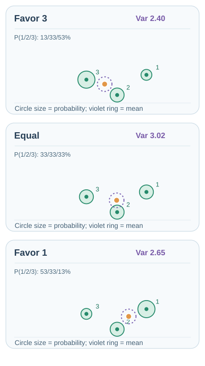

# Intrinsic curiosity module (Pathak et al., 2017)

An exploration method that gives the agent a curiosity reward equal to the error of its own forward model, measured in a learned feature space. The features are trained with a self-supervised inverse dynamics model, encouraging the bonus to focus on action-relevant changes, though this filtering is not guaranteed.

## Problem

Extrinsic rewards are often extremely sparse or absent, so the agent needs an intrinsic reward to explore and to learn skills that may be useful later. Predicting raw pixels as a curiosity signal is a poor choice, since visual detail that the agent cannot control, such as moving leaves, produces large errors that carry no useful information. Pathak et al. ask how to define curiosity so that it responds to the consequences of the agent's own actions.

## Core idea

ICM has three networks:

- An **encoder** maps the observation \(s_t\) to a feature vector \(\phi(s_t)\).
- An **inverse dynamics model** predicts the action \(a_t\) from \(\phi(s_t)\) and \(\phi(s_{t+1})\). Training this model encourages features to retain information useful for identifying the agent's action, while reducing sensitivity to irrelevant changes; it does not guarantee complete disentanglement of controllable and uncontrollable factors.
- A **forward model** predicts \(\phi(s_{t+1})\) from \(\phi(s_t)\) and \(a_t\).

The intrinsic reward is the squared error of the forward model in the feature space. Ideally, the learned representation deemphasises uncontrollable visual changes, but unpredictable factors may remain and can still contribute to the bonus. The agent is rewarded for visiting states where its own actions have consequences it cannot yet predict.

## Equation or algorithm

With the forward model \(\hat\phi\), the intrinsic reward is

\[
r^{\text{int}}_t = \tfrac{\eta}{2}\,\lVert \hat\phi(\phi(s_t), a_t) - \phi(s_{t+1}) \rVert_2^2 ,
\]

where \(\eta\) is a scaling factor. The encoder, forward model and inverse model are trained jointly, and the policy maximises the sum of the intrinsic and extrinsic rewards.

## Instructional animation

*Original instructional animation (CC BY-SA 4.0).* The two **Encoder** boxes represent the **same learned feature mapping** applied to consecutive observations. The **Forward** model combines the current feature and action to predict the next feature; the orange point moves toward the green encoded next feature, reducing the squared feature-space error that supplies intrinsic reward. The **Inverse** branch uses both encoded features to learn which action produced the transition, encouraging action-relevant representations. The arrow to the comparison pane comes from the **actual next-state feature, not the inverse-model output**. The **Error → reward** bar follows the **squared distance** between the plotted green target and orange prediction throughout the learning phase, under a fixed illustrative scale. At loop restart it snaps to the initial state without depicting reverse learning. This is a **schematic example**, not measured performance or a promise that training error decreases monotonically. MkDocs offers Play/Pause; [static GitHub-friendly preview](../../../../../assets/concept-animations/icm-forward-inverse-still.svg). Source: [Pathak et al. (2017)](https://arxiv.org/abs/1705.05363).

**Reading the signal traces.** The short blue and amber pulses enter the **forward** model from the current feature and action, respectively. A subsequent **orange pulse** traces the forward prediction into the comparison pane, while a **green pulse** traces the independently encoded actual next feature there. A dashed amber **update** cue then returns from the error comparison to the **Forward** model. It represents a schematic loss-driven parameter update **across training iterations**, rather than a prediction correcting itself during a single inference. **Only after this cue** does the orange prediction approach the encoded target and the bonus shrink. The two purple input pulses enter the **inverse** model from the two encoded observations. A final short purple pulse exits as the estimated action (\(\hat a_t\)): this is an **inverse-dynamics training output**, not the next-feature target and not a curiosity reward. The input and comparison pulses show computational dependencies; only the amber return cue represents a training update. This short path is not a complete gradient graph (the encoder can also receive gradients), and the inverse output does not supply the forward target. Only the forward prediction error determines the illustrated intrinsic bonus.

### Predictable versus stochastic transitions

*Original instructional animation (CC BY-SA 4.0).* Both panels repeat the **same encoded current feature and action**. On the **Predictable** side, the observed next feature remains the same, so learning can move the orange forward prediction toward that green target and reduce its error. On the **Stochastic** side, several possible encoded next features arise from the **same input**; one deterministic forward prediction cannot match all outcomes simultaneously. Thus a prediction-error bonus can remain positive even after the model has learned the conditional distribution's central tendency. This is an **illustration of residual unpredictability, not a claim that ICM must reward every random observation**: the inverse-dynamics representation may suppress some uncontrollable factors, but cannot be assumed to remove all of them. In this **three-outcome schematic**, the three possible green targets are assigned equal illustrative weight, and their arithmetic mean equals the fixed orange forward prediction. The faint teal triangle outlines the three possible next-feature outcomes, while the orange point marked **mean** is their equal-weight centroid. The **violet tick** on the right-hand error bar stays fixed at the *expected* squared error over those outcomes, even as the orange bar switches between individual sampled squared errors; a sample can lie below that expectation. This conditional-variance floor assumes the encoder is fixed and the deterministic predictor outputs the conditional mean, rather than measuring ICM training. In **both** panels, the orange error bars scale with the **squared feature-space distance** between the predicted and actual feature: it decreases continuously during the illustrated training on the left, and changes discretely with sampled outcomes on the right. The blue input pulse repeats the unchanged feature–action pair immediately before each discrete outcome switch; the plotted green marker jumps between sampled outcomes instead of interpolating unobserved states. Coordinates and weights are not estimated probabilities, measured bonuses, or actual training trajectories. The animation loop replays the comparison, not a reset of learned weights. On MkDocs use Play/Pause. On narrow screens, the same comparison automatically uses a larger-label, vertically stacked animation instead of shrinking two panels side by side; pausing or enabling reduced motion shows its matching static frame. Both layouts are independent **schematic coordinate examples**, not measurements. [Static GitHub-friendly desktop preview](../../../../../assets/concept-animations/icm-predictable-stochastic-still.svg). Source: [Pathak et al. (2017)](https://arxiv.org/abs/1705.05363).

For a fixed encoder and a deterministic forward-model prediction, write \(z=(\phi(s_t),a_t)\) and \(Y=\phi(s_{t+1})\). The squared-error decomposition is

\[
\mathbb E[\|Y-\hat\phi(z)\|_2^2\mid z]
=\|\mathbb E[Y\mid z]-\hat\phi(z)\|_2^2
+\operatorname{tr}\!\big(\operatorname{Cov}[Y\mid z]\big).
\]

Even a predictor matching the conditional mean leaves the conditional-variance term. Joint feature learning can change that variance; the right-hand panel illustrates a **possible limitation**, not a universal failure of ICM.

## Interactive feature-error probe

Use **Previous/Next**, the timeline slider, or Play/Pause with 0.5×–2× speed to inspect each illustrative transition. The diagram is recomputed per step: **distinct stochastic outcomes switch discretely**, without depicting unobserved intermediate next states. The first three steps demonstrate repeated training on a **fixed, repeatable next-state feature**: the orange forward prediction approaches the unchanged green feature, so the squared gap decreases from **3.73 → 0.67 → 0.00** in arbitrary display units. The later three steps compare a **different stochastic conditional transition** whose fixed forecast equals its conditional mean; they are not additional training updates to the preceding deterministic case. The three equally likely stochastic outcomes have their mean at the fixed predictor. The orange bar is the **sample squared error**; the violet tick denotes the **expected squared error**, not any single observed reward. The coordinate scale and displayed squared gaps are **arbitrary teaching units, never trained-model measurements**.

**Deterministic expectation versus sample error.** During the three repeatable-outcome updates, the conditional next-feature distribution is a point mass: its variance is zero, but the predictor's error is not zero before fitting. Therefore, the violet **Expected** tick must coincide with the orange sampled squared-error bar at **3.73 → 0.67 → 0.00** (illustrative units). This is distinct from the stochastic case below, where the expected tick averages over three possible results and need not coincide with any single sample.

**Conditional-mean experiment (MkDocs).** Select stochastic step 4–6 and move **Prediction shift** between −40 and +40 schematic feature-coordinate units. The orange forecast moves horizontally, while the three possible green outcome locations remain fixed; their weights are equal in the default configuration. A dashed violet circle marks their **conditional mean**. The orange bar shows the current **sample** squared gap; the violet tick shows **expected** squared error over all three outcomes. The live readout computes **expected MSE = squared bias + conditional variance** using the same coordinates, with displayed values divided by 1,000. At the conditional mean (shift 0), the illustrative expected error is **3.02**; a 40-unit shift raises it to **4.62** (= 1.60 squared bias + 3.02 variance), even if the error for one particular sample becomes smaller. Use **Reset to mean** to compare. This slider **manually changes a hypothetical deterministic forecast**; it is not a learning update, an empirical reward trace, or a claim about ICM's trained features. Keyboard arrow keys operate the slider and manual controls remain available with reduced motion.

**Outcome-probability experiment (MkDocs).** In stochastic steps 4–6, the new **Outcome balance** slider changes a *hypothetical conditional distribution*, not the encoder, forward-model weights, or the three possible feature locations. With slider value \(k\) from −60 to +60, the probabilities of samples labelled 1/2/3 are \(p_1=(100+k)/300\), \(p_2=1/3\), and \(p_3=(100-k)/300\). All stay positive. The dotted green rings change weight, while the violet conditional-mean marker and the orange prediction move to the **probability-weighted** mean; a nonzero Prediction shift remains a horizontal offset from that new mean. The orange bar is still the *selected sample's* squared error, and the violet tick and readout recompute the **weighted expected error = conditional variance + squared prediction bias**. The animated **Weighted p × gap²** strip beneath the feature-space plot breaks this expectation into three colour-coded terms, one for each possible next feature: each segment's length is proportional to \(p_i\lVert Y_i-\hat\phi(z)\rVert^2\), and the three segments add to the violet expected error. Moving either slider recomputes all three segments, so a selected sample with a small error does not have to be the largest contributor. Unlike the individual sample-error bar above, this strip includes the hypothetical probabilities. At equal weights (33.3% each), variance is **3.02** schematic units; at k = −60 (13.3% / 33.3% / 53.3%), it is **2.40**; at k = +60 (53.3% / 33.3% / 13.3%), it is **2.65**. These different expected errors describe different assumed transition distributions, **not a training improvement**. Use **Equal weights** to restore the baseline, then **Reset to mean** to set prediction bias to zero. The GitHub static previews retain the equal-weight baseline; probability controls require the MkDocs site. All probabilities, coordinates and errors are constructed teaching examples, **not observed model or environment statistics**.

### Animated distribution reweighting

*Original ten-second continuous instructional animation (CC BY-SA 4.0).* The three coloured widths represent the hypothetical conditional probabilities (p_1,p_2,p_3), while the **three encoded next-state outcomes remain in fixed positions**. Their coloured outer rings change with probability weight. Three outcome-coloured dashed links connect each fixed feature outcome to the **violet weighted mean**; their changing lengths trace the geometric distance entering each identically coloured lower contribution bar. Ring thickness, by contrast, reflects probability. The inner amber point is the **optimal deterministic prediction** under squared-error loss. The violet **Variance floor** bar responds to the same changing weights, using the exact conditional variance of those three outcomes (sampled densely for smooth rendering). Its **three coloured segments** now resolve that floor into the terms $p_i\lVert Y_i-\mu\rVert_2^2$, with $\mu=\sum_i p_iY_i$. The segment colours match outcome markers 1, 2 and 3; their lengths sum to the total floor at every instant. Because the distances to the *moving* conditional mean change along with the probabilities, an outcome's contribution need not change in direct proportion to its probability. The sweep goes from (k=-60) to (0) to (+60) and back: **it changes an assumed distribution, not learned weights, and is not a training trajectory**. Its expected gap need not move monotonically when probability is transferred between possible outcomes. On MkDocs use Play/Pause; pausing, reduced motion, and GitHub Markdown use the [matching static three-case preview](../../../../../assets/concept-animations/icm-weighted-outcomes-still.svg) below. The 400-pixel-wide portrait composition preserves readable symbols on phones. All positions, probabilities and error bars are constructed teaching examples, **not empirical ICM measurements**. Source: [Pathak et al. (2017)](https://arxiv.org/abs/1705.05363).

*Original three-case GitHub-safe fallback (CC BY-SA 4.0).* All three panels share the same three possible next-feature locations; circle size encodes their **hypothetical probability**, the violet ring marks the resulting weighted conditional mean, and the orange point is a forecast at that mean. The values 2.40, 3.02 and 2.65 are **illustrative conditional variances** in arbitrary display units, not observed rewards. This summary is static only to support GitHub/no-script readers; the **Outcome balance** and **Prediction shift** sliders on MkDocs provide continuous, keyboard-operable counterfactual experiments.

This interactive step-through is available on the MkDocs site; the SVG animations and GitHub-safe static previews above remain available without scripts.

## Results

The paper evaluates ICM on the visual games VizDoom and Super Mario Bros, where the extrinsic reward is sparse or absent. The abstract reports that curiosity alone lets the agent learn to explore. The paper reports that a Mario agent trained without any extrinsic reward can learn to cross over 30% of Level 1 of Super Mario Bros, and that in VizDoom the agent learns to walk along corridors instead of bumping into walls or getting stuck in corners.

## Limitations

- **Stochastic dynamics.** The forward model can still be unpredictable in states that the agent cannot control, if they are relevant to the transition.
- **Novelty.** Like other curiosity bonuses, the reward favours states the agent finds hard to predict, which may not be the states that matter for the task.
- **Feature learning.** The inverse-model features depend on the agent's actions, so exploration can be weak in environments where the agent has little control.

## Connections

- Parent topic: [Exploration](../index.md).
- It is a prediction-error bonus, like [random network distillation](../rnd/index.md), but it predicts in a learned feature space rather than comparing against a random target.
- The paper's main agent, ICM with A3C, combines the curiosity reward with the asynchronous actor-critic method of [A3C](../../policy-gradient-and-actor-critic/a3c/index.md).

## Applications

- **Games with sparse rewards**, such as the platform and first-person games used in the paper.
- **Robotics** where the agent must learn which of its actions change the scene.

## Open questions

- How to make the feature space capture the agent's control without losing task-relevant detail.
- How to combine curiosity with goal-directed exploration.

## References

### Seminal papers

- Pathak, Agrawal, Efros & Darrell (2017), "Curiosity-driven exploration by self-supervised prediction", [arXiv:1705.05363](https://arxiv.org/abs/1705.05363) — The ICM paper, with the inverse-dynamics feature space, the forward-model bonus and the VizDoom and Super Mario Bros experiments.
- Burda, Edwards, Storkey & Klimov (2018), "Exploration by random network distillation", [arXiv:1810.12894](https://arxiv.org/abs/1810.12894) — RND, a prediction-error bonus that does not need a feature space.
- Bellemare et al. (2016), "Unifying count-based exploration and intrinsic motivation", [arXiv:1606.01868](https://arxiv.org/abs/1606.01868) — Pseudo-count bonuses, the count-based approach that curiosity methods are compared with.
- Stadie, Levine & Abbeel (2015), "Incentivizing exploration in reinforcement learning with deep predictive models", [arXiv:1507.00814](https://arxiv.org/abs/1507.00814) — An earlier prediction-based exploration bonus that uses a learned predictive model.
- Houthooft et al. (2016), "VIME: Variational information maximizing exploration", [arXiv:1605.09674](https://arxiv.org/abs/1605.09674) — Information-gain exploration, an alternative curiosity signal.
