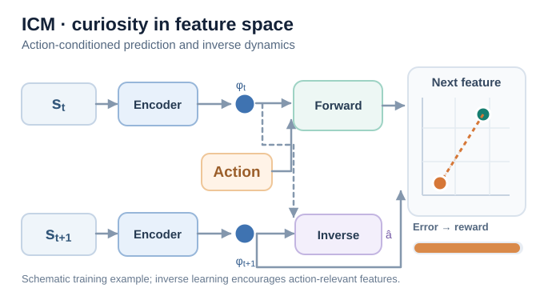
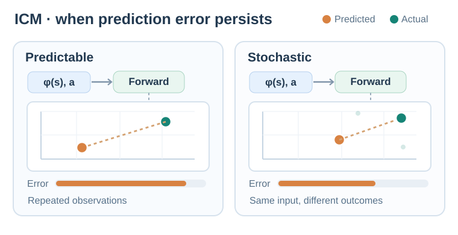

# Intrinsic curiosity module (Pathak et al., 2017)

An exploration method that gives the agent a curiosity reward equal to the error of its own forward model, measured in a learned feature space. The features are trained with a self-supervised inverse dynamics model, encouraging the bonus to focus on action-relevant changes, though this filtering is not guaranteed.

## Problem

Extrinsic rewards are often extremely sparse or absent, so the agent needs an intrinsic reward to explore and to learn skills that may be useful later. Predicting raw pixels as a curiosity signal is a poor choice, since visual detail that the agent cannot control, such as moving leaves, produces large errors that carry no useful information. Pathak et al. ask how to define curiosity so that it responds to the consequences of the agent's own actions.

## Core idea

ICM has three networks:

- An **encoder** maps the observation \(s_t\) to a feature vector \(\phi(s_t)\).
- An **inverse dynamics model** predicts the action \(a_t\) from \(\phi(s_t)\) and \(\phi(s_{t+1})\). Training this model encourages features to retain information useful for identifying the agent's action, while reducing sensitivity to irrelevant changes; it does not guarantee complete disentanglement of controllable and uncontrollable factors.
- A **forward model** predicts \(\phi(s_{t+1})\) from \(\phi(s_t)\) and \(a_t\).

The intrinsic reward is the squared error of the forward model in the feature space. Ideally, the learned representation deemphasises uncontrollable visual changes, but unpredictable factors may remain and can still contribute to the bonus. The agent is rewarded for visiting states where its own actions have consequences it cannot yet predict.

## Equation or algorithm

With the forward model \(\hat\phi\), the intrinsic reward is

\[
r^{\text{int}}_t = \tfrac{\eta}{2}\,\lVert \hat\phi(\phi(s_t), a_t) - \phi(s_{t+1}) \rVert_2^2 ,
\]

where \(\eta\) is a scaling factor. The encoder, forward model and inverse model are trained jointly, and the policy maximises the sum of the intrinsic and extrinsic rewards.

## Instructional animation

*Original instructional animation (CC BY-SA 4.0).* The two **Encoder** boxes represent the **same learned feature mapping** applied to consecutive observations. The **Forward** model combines the current feature and action to predict the next feature; the orange point moves toward the green encoded next feature, reducing the squared feature-space error that supplies intrinsic reward. The **Inverse** branch uses both encoded features to learn which action produced the transition, encouraging action-relevant representations. The arrow to the comparison pane comes from the **actual next-state feature, not the inverse-model output**. This is a **schematic example**, not measured performance or a promise that training error decreases monotonically. MkDocs offers Play/Pause; [static GitHub-friendly preview](../../../../../assets/concept-animations/icm-forward-inverse-still.svg). Source: [Pathak et al. (2017)](https://arxiv.org/abs/1705.05363).

**Reading the signal traces.** The short blue and amber pulses enter the **forward** model from the current feature and action, respectively. A subsequent **orange pulse** traces the forward prediction into the comparison pane, while a **green pulse** traces the independently encoded actual next feature there. A dashed amber **update** cue then returns from the error comparison to the **Forward** model. It represents a schematic loss-driven parameter update **across training iterations**, rather than a prediction correcting itself during a single inference. **Only after this cue** does the orange prediction approach the encoded target and the bonus shrink. The two purple input pulses enter the **inverse** model from the two encoded observations. A final short purple pulse exits as the estimated action (\(\hat a_t\)): this is an **inverse-dynamics training output**, not the next-feature target and not a curiosity reward. The input and comparison pulses show computational dependencies; only the amber return cue represents a training update. This short path is not a complete gradient graph (the encoder can also receive gradients), and the inverse output does not supply the forward target. Only the forward prediction error determines the illustrated intrinsic bonus.

### Predictable versus stochastic transitions

*Original instructional animation (CC BY-SA 4.0).* Both panels repeat the **same encoded current feature and action**. On the **Predictable** side, the observed next feature remains the same, so learning can move the orange forward prediction toward that green target and reduce its error. On the **Stochastic** side, several possible encoded next features arise from the **same input**; one deterministic forward prediction cannot match all outcomes simultaneously. Thus a prediction-error bonus can remain positive even after the model has learned the conditional distribution's central tendency. This is an **illustration of residual unpredictability, not a claim that ICM must reward every random observation**: the inverse-dynamics representation may suppress some uncontrollable factors, but cannot be assumed to remove all of them. In this **three-outcome schematic**, the three possible green targets are assigned equal illustrative weight, and their arithmetic mean equals the fixed orange forward prediction. The faint teal triangle outlines the three possible next-feature outcomes, while the orange point marked **mean** is their equal-weight centroid. The **violet tick** on the right-hand error bar stays fixed at the *expected* squared error over those outcomes, even as the orange bar switches between individual sampled squared errors; a sample can lie below that expectation. This conditional-variance floor assumes the encoder is fixed and the deterministic predictor outputs the conditional mean, rather than measuring ICM training. In **both** panels, the orange error bars scale with the **squared feature-space distance** between the predicted and actual feature: it decreases continuously during the illustrated training on the left, and changes discretely with sampled outcomes on the right. The blue input pulse repeats the unchanged feature–action pair immediately before each discrete outcome switch; the plotted green marker jumps between sampled outcomes instead of interpolating unobserved states. Coordinates and weights are not estimated probabilities, measured bonuses, or actual training trajectories. The animation loop replays the comparison, not a reset of learned weights. On MkDocs use Play/Pause. On narrow screens, the same comparison automatically uses a larger-label, vertically stacked animation instead of shrinking two panels side by side; pausing or enabling reduced motion shows its matching static frame. Both layouts are independent **schematic coordinate examples**, not measurements. [Static GitHub-friendly desktop preview](../../../../../assets/concept-animations/icm-predictable-stochastic-still.svg). Source: [Pathak et al. (2017)](https://arxiv.org/abs/1705.05363).

For a fixed encoder and a deterministic forward-model prediction, write \(z=(\phi(s_t),a_t)\) and \(Y=\phi(s_{t+1})\). The squared-error decomposition is

\[
\mathbb E[\|Y-\hat\phi(z)\|_2^2\mid z]
=\|\mathbb E[Y\mid z]-\hat\phi(z)\|_2^2
+\operatorname{tr}\!\big(\operatorname{Cov}[Y\mid z]\big).
\]

Even a predictor matching the conditional mean leaves the conditional-variance term. Joint feature learning can change that variance; the right-hand panel illustrates a **possible limitation**, not a universal failure of ICM.

## Results

The paper evaluates ICM on the visual games VizDoom and Super Mario Bros, where the extrinsic reward is sparse or absent. The abstract reports that curiosity alone lets the agent learn to explore. The paper reports that a Mario agent trained without any extrinsic reward can learn to cross over 30% of Level 1 of Super Mario Bros, and that in VizDoom the agent learns to walk along corridors instead of bumping into walls or getting stuck in corners.

## Limitations

- **Stochastic dynamics.** The forward model can still be unpredictable in states that the agent cannot control, if they are relevant to the transition.
- **Novelty.** Like other curiosity bonuses, the reward favours states the agent finds hard to predict, which may not be the states that matter for the task.
- **Feature learning.** The inverse-model features depend on the agent's actions, so exploration can be weak in environments where the agent has little control.

## Connections

- Parent topic: [Exploration](../index.md).
- It is a prediction-error bonus, like [random network distillation](../rnd/index.md), but it predicts in a learned feature space rather than comparing against a random target.
- The paper's main agent, ICM with A3C, combines the curiosity reward with the asynchronous actor-critic method of [A3C](../../policy-gradient-and-actor-critic/a3c/index.md).

## Applications

- **Games with sparse rewards**, such as the platform and first-person games used in the paper.
- **Robotics** where the agent must learn which of its actions change the scene.

## Open questions

- How to make the feature space capture the agent's control without losing task-relevant detail.
- How to combine curiosity with goal-directed exploration.

## References

### Seminal papers

- Pathak, Agrawal, Efros & Darrell (2017), "Curiosity-driven exploration by self-supervised prediction", [arXiv:1705.05363](https://arxiv.org/abs/1705.05363) — The ICM paper, with the inverse-dynamics feature space, the forward-model bonus and the VizDoom and Super Mario Bros experiments.
- Burda, Edwards, Storkey & Klimov (2018), "Exploration by random network distillation", [arXiv:1810.12894](https://arxiv.org/abs/1810.12894) — RND, a prediction-error bonus that does not need a feature space.
- Bellemare et al. (2016), "Unifying count-based exploration and intrinsic motivation", [arXiv:1606.01868](https://arxiv.org/abs/1606.01868) — Pseudo-count bonuses, the count-based approach that curiosity methods are compared with.
- Stadie, Levine & Abbeel (2015), "Incentivizing exploration in reinforcement learning with deep predictive models", [arXiv:1507.00814](https://arxiv.org/abs/1507.00814) — An earlier prediction-based exploration bonus that uses a learned predictive model.
- Houthooft et al. (2016), "VIME: Variational information maximizing exploration", [arXiv:1605.09674](https://arxiv.org/abs/1605.09674) — Information-gain exploration, an alternative curiosity signal.
