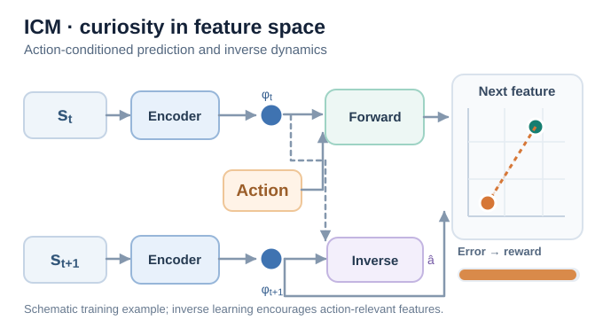
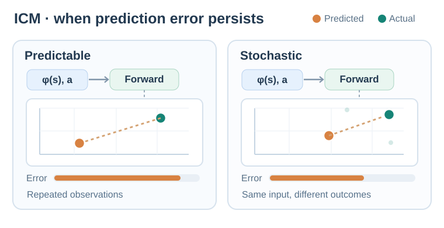
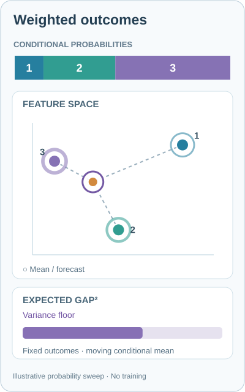
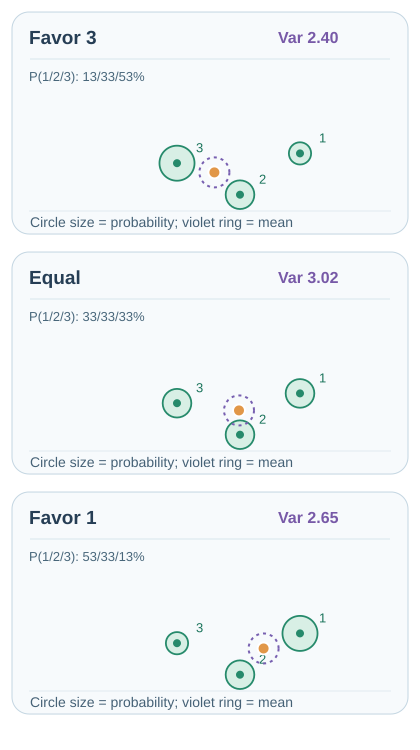
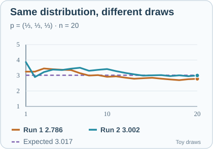
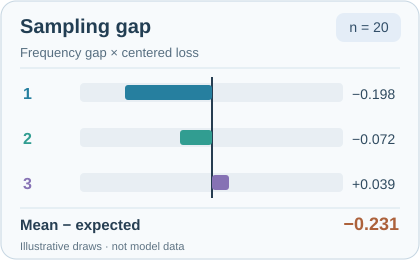
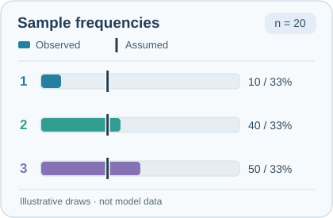
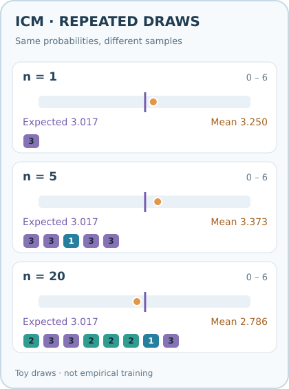

# 內在好奇心模組（Pathak 等人，2017）

一種探索方法，給智能體的好奇心獎勵等於其自身前向模型在學到的特徵空間中的誤差。特徵以自監督的逆動態模型訓練，藉此鼓勵獎勵聚焦在與動作有關的變化，但無法保證完全排除不可控因素。

## 問題

外在獎勵常常極為稀疏，甚至完全沒有，因此智能體需要內在獎勵來探索，並學習日後可能有用的技能。把原始像素當作好奇心訊號的預測效果很差，因為智能體無法控制的視覺細節（例如擺動的樹葉）會產生很大的誤差，卻沒有有用的資訊。Pathak 等人探討如何定義好奇心，使它對智能體自身動作的後果有所反應。

## 核心想法

ICM 包含三個網路：

- **編碼器**將觀測 \(s_t\) 映射為特徵向量 \(\phi(s_t)\)。
- **逆動態模型**從 \(\phi(s_t)\) 與 \(\phi(s_{t+1})\) 預測動作 \(a_t\)。訓練這個模型會鼓勵特徵保留有助於辨識智能體動作的資訊，並降低對無關變化的敏感度，但無法保證完全分離可控與不可控因素。
- **前向模型**從 \(\phi(s_t)\) 與 \(a_t\) 預測 \(\phi(s_{t+1})\)。

內在獎勵是前向模型在特徵空間中的平方誤差。理想情況下，學到的表示會淡化智能體無法控制的視覺變化；但仍可能保留難以預測的因素，使其對好奇心獎勵有所貢獻。智能體會因造訪那些「自身動作的後果尚無法預測」的狀態而獲得獎勵。

## 方程式與演算法

設前向模型為 \(\hat\phi\)，內在獎勵為

\[
r^{\text{int}}_t = \tfrac{\eta}{2}\,\lVert \hat\phi(\phi(s_t), a_t) - \phi(s_{t+1}) \rVert_2^2 ,
\]

其中 \(\eta\) 是縮放係數。編碼器、前向模型與逆模型聯合訓練，策略則最大化內在獎勵與外在獎勵的總和。

## 教學動畫

*原創教學動畫（CC BY-SA 4.0）。* 畫面上兩個 **Encoder** 方塊代表作用於連續兩個觀測的**同一組編碼器**。**Forward** 模型以當前特徵及動作預測下一個特徵；橘色預測點朝綠色實際編碼特徵靠近，兩者的平方誤差提供內在獎勵。**Inverse** 分支則以轉移前後的特徵預測動作，促使特徵表示保留與動作相關的資訊。比較區域的實際特徵來自**下一個觀測的編碼結果，而不是逆動態模型的輸出**。**Error → reward** 長條依固定示意比例，呈現綠色目標與橘色預測點之間的**特徵平方距離**；循環重播直接回到起始狀態，不呈現預測器倒退學習的假象。座標與學習變化**皆為教學示意，非模型實測，也不保證誤差單調下降**。MkDocs 網站提供播放／暫停控制；GitHub 可查看[靜態回退預覽](../../../../../assets/concept-animations/icm-forward-inverse-still.svg)。原始研究：[Pathak 等人（2017）](https://arxiv.org/abs/1705.05363)。

**訊號流向解讀。** 短暫出現的藍色與琥珀色光點，分別代表當前特徵與動作輸入 **Forward** 模型；後續的**橘色光點**將前向預測傳至比較區，**綠色光點**則沿另一條路徑傳遞實際下一狀態的編碼特徵。**兩項前向輸入與比較訊號抵達後**，琥珀色虛線上的 **update** 光點才會由誤差比較區返回 **Forward** 模型，示意**跨訓練迭代**、由預測損失驅動的參數更新；並不是單次推論時預測自動修正。**更新訊號完成後**，橘色預測點才逐漸接近目標，示意的內在獎勵隨之下降。兩個紫色輸入光點則代表前後觀測的編碼特徵輸入 **Inverse** 模型；最後一個短暫的紫色輸出光點代表預測動作（\(\hat a_t\)），它用於**逆動態模型的訓練**，並非下一狀態特徵的預測目標，也不是內在獎勵。輸入與比較光點呈現**計算依賴關係**，只有琥珀色回傳光點示意訓練更新。該路徑**並非完整反向傳播圖**（共享編碼器也可能接收梯度）；圖中的內在獎勵只由前向預測誤差決定。

### 可預測與隨機轉移的差異

*原創教學動畫（CC BY-SA 4.0）。* 兩個面板都重複給予**相同的當前編碼特徵與動作**。左側 **Predictable** 的下一狀態特徵固定，前向模型可藉訓練讓橘色預測靠近綠色目標，降低誤差；右側 **Stochastic** 的相同輸入可能導致不同的下一狀態編碼特徵，單一確定性預測無法同時符合所有結果。因此，即使模型已學到條件分布的中央趨勢，預測誤差獎勵仍可能持續出現。這是**殘餘不可預測性的示意，不代表 ICM 必然獎勵所有隨機觀測**：逆動態表示學習可能過濾部分不可控因素，但不能假定完全消除。在這個**三種結果的示意**中，三個綠色候選目標採相同的示意權重，算術平均恰好落在固定的橘色前向預測點上。 淺綠色三角形圈出三個可能的下一狀態特徵，標示 **mean** 的橘色點則是等權重的形心。右側誤差長條上的**紫色刻度**固定代表這三種結果的*期望平方誤差*；橘色長條則隨個別取樣結果切換，單次樣本誤差可能低於期望值。此條件變異數下界以編碼器固定且確定性預測器輸出條件平均值為前提，並非 ICM 的實測訓練結果。**兩側**橘色誤差長條都依預測與實際特徵間的**平方距離**等比例縮放：左側隨示意訓練過程連續縮小，右側則隨離散取樣結果同步切換；藍色輸入光點在每次切換之前重送相同的特徵與動作；綠色結果點會直接跳至下一個離散樣本，不在中間插值生成未觀測的狀態。這些座標及權重並非估計機率、模型實測獎勵或真實訓練軌跡。循環播放是重新演示，不代表已學參數重設。MkDocs 網站可播放／暫停；窄螢幕自動改用上下排列、字體較大的動畫，不會把左右雙欄直接縮小。暫停或啟用減少動態效果時會顯示對應的手機版靜態畫面；桌面與手機的特徵座標皆為**獨立的示意數值**，並非模型實測。GitHub 可查看[桌面版靜態回退預覽](../../../../../assets/concept-animations/icm-predictable-stochastic-still.svg)。原始研究：[Pathak 等人（2017）](https://arxiv.org/abs/1705.05363)。

更精確地說，若先固定編碼器，且前向模型輸出為確定性預測，令 \(z=(\phi(s_t),a_t)\)、\(Y=\phi(s_{t+1})\)，則平方誤差可分解為

\[
\mathbb E[\|Y-\hat\phi(z)\|_2^2\mid z]
=\|\mathbb E[Y\mid z]-\hat\phi(z)\|_2^2
+\operatorname{tr}\!\big(\operatorname{Cov}[Y\mid z]\big).
\]

即使預測器已學到條件平均值，只要給定相同 \(z\) 時下一狀態特徵仍有變異，條件變異數項便不會消失；聯合學習的特徵表示可能改變這項變異，因此右側面板呈現的是 **ICM 可能遇到的限制**，並非必然失效。

## 互動式特徵誤差示範

使用**上一步／下一步**、進度滑桿或播放／暫停（0.5×–2×）檢查不同狀態。每個步驟都重新計算圖形；不同隨機取樣結果以離散方式切換，不會生成未觀測的中間下一狀態。前三步重複使用**固定且可預測的下一狀態特徵**，讓橘色前向預測逐漸接近未改變的綠色實際特徵，示意平方誤差依序由 **3.73 → 0.67 → 0.00**（任意顯示單位）下降。後三步改為比較**另一個隨機條件轉移**，預測點固定於其條件平均值；這不是延續前面同一個模型的訓練迭代。三個等機率隨機結果的平均值恰好位於固定預測點。橘色長條是**單次樣本平方誤差**，紫色刻度則是**期望平方誤差**，並非單筆觀測獎勵。所用座標、誤差比例與訓練軌跡都是**人工示意，絕非模型實測**。

**確定性轉移的期望誤差與單次誤差。** 在前三個可重複的轉移步驟中，給定相同輸入的下一狀態特徵為退化分布，條件變異數是零；但預測器尚未擬合前，**期望平方誤差不會因此是零**。紫色 **Expected** 刻度應與橘色單次平方誤差長條重合，依序為 **3.73 → 0.67 → 0.00**（示意單位）。這與後面隨機轉移的期望刻度不同：後者對三種可能結果取平均，不必與任何單筆取樣誤差相等。

**條件平均值實驗（MkDocs）。** 將步驟切換至第 4–6 步的隨機轉移，再拖曳**預測位置偏移**滑桿（−40 至 +40，人工設定的特徵座標單位）。橘色預測點沿水平方向移動，三個綠色候選結果的位置不變；預設情況下才是等權重；紫色虛線圓圈標示**條件平均值**。橘色長條是目前這次取樣的**平方誤差**，紫色刻度是對全部三個結果取期望的**平方誤差**。下方即時計算**期望均方誤差＝偏差平方＋條件變異數**，顯示數值均將座標平方距離除以 1,000。預測位於條件平均值時（偏移 0），示意期望誤差為 **3.02**；向任一側偏移 40 單位，期望誤差上升至 **4.62**（偏差平方 1.60＋變異數 3.02），即使某一次樣本的誤差可能反而縮小。可按**回到條件平均值**恢復對照。滑桿只會**手動改變假想的確定性預測**，不是訓練更新、實測獎勵變化或對 ICM 已學特徵的實驗結論。滑桿支援方向鍵；啟用減少動態效果後仍能逐步操作。

**結果機率加權實驗（MkDocs）。** 在隨機轉移的第 4–6 步，調整**結果機率偏重**滑桿，可比較不同的**假設性條件機率分布**，而非修改編碼器、前向模型權重或三個候選特徵座標。令滑桿值 \(k\) 介於 −60 至 +60，畫面標示的結果 1／2／3 分別具有機率 \(p_1=(100+k)/300\)、\(p_2=1/3\)、\(p_3=(100-k)/300\)，三者在允許範圍內皆大於零。綠色虛線圓圈的線寬反映相對權重；紫色圈隨**機率加權條件平均值**移動，橘色預測點則位於新平均值再加上水平偏移。橘色長條仍是**目前選取樣本的平方誤差**；紫色刻度及即時數值改為依新權重計算**期望平方誤差＝條件變異數＋預測偏差平方**。 特徵空間下方新增會隨滑桿更新的 **Weighted p × gap²** 分項長條，三種顏色分別代表每個可能結果的 \(p_i\lVert Y_i-\hat\phi(z)\rVert^2\) 貢獻；三段相加等於紫色期望誤差。即使目前取樣的誤差很小，也不代表該結果對期望值的加權貢獻最大。上方橘色長條只顯示單次取樣；下方長條則納入假設性機率。等機率（各 33.3%）下的示意變異數為 **3.02**；\(k=-60\)（13.3%／33.3%／53.3%）時為 **2.40**，\(k=+60\)（53.3%／33.3%／13.3%）時為 **2.65**。這代表比較不同的假想轉移分布，**不是模型訓練後誤差改善**。可先按**恢復等機率**，再按**回到條件平均值**恢復起始對照。GitHub 靜態預覽保留等機率版本；操作機率滑桿需使用 MkDocs 網站。所有數值都是人工示意，**不是環境統計或模型實測**。

**偏差–變異數幾何分解（MkDocs）。** 在隨機轉移步驟中，從**紫色條件平均值到橘色預測點的紫色線段**表示預測偏差。除了按結果分色的加權樣本誤差長條，下方新增 **Variance + Bias²** 分解長條：紫色區段是條件變異數，橘色區段是**預測點相對條件平均值的距離平方**；兩者相加等於相同的條件期望平方誤差。調整**結果機率偏重**會改變紫色變異數；移動**預測位置偏移**後，橘色偏差平方依二次關係增加。兩個分解長條使用相同的固定比例（每 6,000 個原始特徵座標平方單位對應 344 像素），總長度在 SVG 四捨五入誤差內一致。上方 **Squared gap** 單次樣本長條另採 16,000 單位的固定範圍，避免最高 **14,700.24** 的示意取樣誤差被截斷；**不同刻度的長條不可直接比較寬度，應比較數值**。這是可操作的數學反事實示範，不是訓練更新或實測 ICM 獎勵。

### 機率重新加權的連續動畫

*原創 10 秒連續教學動畫（CC BY-SA 4.0）。* 上方三段彩色長條分別代表假設性的條件機率 (p_1,p_2,p_3)，三個**可能的下一狀態編碼特徵位置始終固定**；外圈粗細則隨機率權重變化。三條虛線各以所屬結果的顏色連至**紫色加權條件平均值**，對應下方同色的變異數貢獻長條；線段長度呈現到平均值的距離，外圈粗細才代表機率。中心琥珀色圓點為平方誤差損失下的**最佳確定性預測**。下方紫色 **Variance floor** 長條以相同的三個結果與機率計算條件變異數，並以較密集的時間取樣呈現連續變化。現在將長條拆成三種與候選結果 1、2、3 對應的色塊，分別代表 $p_i\lVert Y_i-\mu\rVert_2^2$，其中 $\mu=\sum_i p_iY_i$；三段長度在每個時間點都加總為條件變異數。由於**到加權平均值的距離也在改變**，單一結果的變異數貢獻不會只隨機率線性變化。動畫將假設性 (k) 從 −60 調整到 0、+60，再反向返回；**改變的是假設性條件分布，不是模型權重或訓練軌跡**。機率質量轉移後，期望誤差下界也不一定單調改變。MkDocs 網站可播放／暫停；暫停、偏好減少動態效果或 GitHub Markdown 可閱讀下方的[三情境靜態回退圖](../../../../../assets/concept-animations/icm-weighted-outcomes-still.svg)。直式 400 像素版面兼顧手機文字辨識。所有位置、機率與誤差都是**教學示意，不是實際 ICM 訓練測量**。原始研究：[Pathak 等人（2017）](https://arxiv.org/abs/1705.05363)。

*原創三情境 GitHub 靜態回退圖（CC BY-SA 4.0）。* 三個面板使用相同的候選下一狀態特徵座標；綠色圓圈大小代表**假設性發生機率**，紫色環標示加權條件平均值，橘色點表示位於該平均值的預測。2.40、3.02、2.65 是任意單位的**示意條件變異數**，不是實測獎勵。此圖僅作為 GitHub／停用指令碼時的回退預覽；MkDocs 網站的**結果機率偏重**與**預測位置偏移**滑桿可連續操作，並支援鍵盤。

### 樣本平均與條件期望值

MkDocs 在隨機轉移的第 4–6 步提供**重複抽樣**操作。按**抽取 1 次**或**抽取 20 次**，會根據當前假想機率，從**三個固定的可能下一狀態特徵**獨立抽樣；橘色標記顯示累積樣本平方誤差平均，紫色標記是相同條件下不變的**解析期望誤差**。下方的小色塊標示最近抽到的結果。新增的**累積樣本平均軌跡**會將**每一次抽樣之後的前綴平均值**畫成折線，並以水平紫色虛線顯示不變的解析期望；第 \(n\) 個折線點是**前 \(n\) 次的平均**，不是第 \(n\) 次的個別誤差，因此能觀察樣本平均如何暫時遠離或跨越期望值。折線圖的縱軸以目前條件下**所有可能的單次誤差**設定，新增樣本時不會重新縮放；最多顯示最近 120 個前綴平均點以控制渲染成本，但計數與平均仍使用**全部抽樣**。上方另一個橫向標記帶固定使用 0–16 量尺。顯示值均為特徵座標平方距離除以 1,000。

若每次結果 \(I_j\sim\mathrm{Categorical}(p_1,p_2,p_3)\)，在分布與預測點不變時，樣本平均為 \(\bar L_n=n^{-1}\sum_{j=1}^n\|Y_{I_j}-\hat\phi(z)\|^2/1000\)，解析期望則是 \(L=\sum_i p_i\|Y_i-\hat\phi(z)\|^2/1000\)。**有限樣本的平均誤差不保證單調接近期望值**；樣本數增加時也可能暫時偏離得更遠。調整**結果機率偏重**或**預測位置偏移**後，抽樣紀錄會清除，避免把不同條件下的樣本混在一起。此處使用**可重現的偽隨機示意抽樣**，不是實際環境轉移，也不是 ICM 模型實測獎勵。

### 二十次抽樣：結果頻率與累積樣本平均的同步動畫

*原創 13.2 秒循環動畫（CC BY-SA 4.0）；[GitHub 可顯示的靜態回退預覽](../../../../../assets/concept-animations/icm-sampling-frequency-still.svg)。* 每一次離散跳動代表**一次人工獨立抽樣**，不是梯度更新或模型策略的學習步驟。在固定且等機率的假設分布下，深色標記固定在三分之一；三條彩色長條則表示累積樣本比例 (N_i/n)。橘色折線是**累積樣本平均** (ar L_n=sum_i(N_i/n)ell_i)，並非每次抽出的個別損失；紫色虛線是固定的解析期望 (L=sum_i p_iell_i=3.017)（示意損失單位）。固定種子的二十次抽樣最後得到 **2、8、10** 次、樣本平均 **2.786**。折線不單調接近期望值，說明增加樣本數不保證每一步都縮小差距。動畫循環時是**重播同一組人工抽樣序列**，並非每輪重新抽樣；如需產生新的抽樣路徑或調整假設機率，應操作下方 MkDocs 互動實驗。網站提供播放／暫停，減少動態效果偏好或 GitHub Markdown 可閱讀靜態回退圖。所有數值都是教學示意，**不是 ICM 模型實測結果**。

**獨立抽樣重複實驗（MkDocs）。** 按**新的 20 次抽樣**會在**相同的三種假設機率、預測點及解析期望值**下，換一組獨立起始種子的可重現偽隨機序列，重新抽取 20 個示意結果。面板顯示新的輪次，以及**上一輪的樣本平均與當時樣本數**；對照橘色軌跡與樣本頻率，可以直接觀察相同條件分布下，有限樣本估計值如何因抽樣路徑而不同。**重設樣本**只清空目前這輪，保留該輪種子，再按**抽取 20 次**可精確重播；改變任一機率／預測滑桿則回到第 1 輪、清除跨輪比較，避免混用不同條件。不同抽樣路徑只代表**抽樣變異**，並非 ICM 模型訓練、參數更新或實驗數據。

*原創 GitHub／停用 JavaScript 靜態回退預覽（CC BY-SA 4.0）。* 兩條軌跡採用**相同的三結果等機率示意損失分布**，中途沒有模型更新；第 20 次抽樣後的樣本平均分別為 **2.786**、**3.002**，固定解析期望為 **3.017**。MkDocs 互動版可持續產生不同軌跡並重播同一輪；靜態圖僅比較兩組可重現的人工偽隨機結果，**並非模型實測**。

**解析抽樣不確定性（MkDocs）。** 淡紫色 **±1 SE** 參考帶以精確期望損失 \(L\) 為中心，隨抽樣次數 \(n\) 增加而收窄。定義各可能結果的損失 \(\ell_i=\lVert Y_i-\hat\phi(z)\rVert^2/1000\)，及其變異數 \(\sigma_\ell^2=\sum_i p_i(\ell_i-L)^2\)；在固定分布下獨立抽樣時，樣本平均的理論標準誤為 \(\operatorname{SE}(\bar L_n)=\sigma_\ell/\sqrt n\)。這是**樣本損失平均值的抽樣變異程度**，並非下一狀態特徵向量的條件變異數、從樣本估出的誤差、信賴區間，或橘色軌跡必然落入的範圍。圖表縱軸在第 1 次抽樣時已涵蓋參考帶，後續不會自動縮放；更改滑桿會重設抽樣並重新計算。所有數值均為示意。

**結果頻率實驗（MkDocs）。** 新增的三條動態長條顯示各結果的**樣本相對頻率** `N_i/n`，深色垂直標記則代表目前**假設的條件機率** `p_i`。每列依序標示「樣本比例／假設機率」，並沿用特徵空間及加權平方誤差圖的結果配色。比例由**所有抽樣**計算，不只採用最近 12 個結果色塊或折線圖最近 120 個樣本平均值。因此，在預測點與損失固定時，樣本平均也能由各結果的樣本比例精確重建：

$
\\bar L_n=\\sum_{i=1}^3\\frac{N_i}{n}\\ell_i,\\qquad
L=\\sum_{i=1}^3 p_i\\ell_i.
$

兩個平均值的差異來自**樣本頻率與假設機率不一致**，而非 ICM 模型發生了參數更新。在等機率的可重現**20 次示意抽樣**中，各結果分別出現 **2、8、10 次**（10%、40%、50%），但假設機率仍各為 **1/3**；樣本平均為 **2.786**，解析期望為 **3.017**。抽樣更多次不保證每個頻率長條都會單調接近深色標記。調整兩個滑桿或重設樣本時，次數也會清除。上述全屬人工示意，非環境實測或模型訓練結果。

**樣本平均為何偏離期望值？以期望損失為基準的頻率貢獻（MkDocs）。** 各結果的樣本頻率與假設機率之差滿足 $\sum_i(N_i/n-p_i)=0$，因此從每個結果損失扣除同一個基準值，不會改變總抽樣落差。選擇**解析期望損失** $L$ 作為基準，可得到以零為中心、依結果配色的分解：

\[
\bar L_n-L=\sum_{i=1}^{3}\left(\frac{N_i}{n}-p_i\right)(\ell_i-L).
\]

若抽到**低於平均損失**的結果比假設機率更頻繁，該結果會產生負向貢獻；若**高於平均損失**的結果被過度抽中，則產生正向貢獻。在固定種子的 20 次人工示意抽樣中，三項分別是 **−0.198、−0.072、+0.039**，合計 **−0.231**（四捨五入後可能有末位差異）。相較於直接使用未中心化的 $\ell_i$，**即使所有結果損失都加上任意相同常數，每一項中心化貢獻仍保持不變**，避免貢獻正負號受到損失零點選擇影響。這只是有限樣本的**代數帳務分解**，不是因果效果、模型參數更新、實際內在獎勵或新增訓練損失。在分布與預測點固定的抽樣過程中，長條尺度不會隨次數增加而改變；重設樣本或更動任一滑桿都會清除既有紀錄。

*原創 GitHub／停用指令碼回退預覽（CC BY-SA 4.0）。* 長條呈現**20 次假想抽樣**；中央深色線代表零，所有損失皆為示意單位，**不是模型實測**。MkDocs 互動圖會隨每次抽樣更新，並支援鍵盤按鈕、螢幕閱讀器標籤與減少動態效果。

*原創 GitHub／停用指令碼靜態回退預覽（CC BY-SA 4.0）。* 此圖呈現固定偽隨機序列抽取 20 次的單一情境；完整頻率更新、操作及中英雙語無障礙標籤僅在 MkDocs 互動版提供，靜態圖本身不會抽樣。

*原創 GitHub／停用指令碼回退預覽（CC BY-SA 4.0）。* 在等機率、預測偏移為零的情況下，解析期望是 **3.017**，固定偽隨機序列在抽取 1、5、20 次後的樣本平均分別是 **3.250、3.373、2.786**。圖內尺度為 0–6；MkDocs 標記帶固定採 0–16，新增的累積軌跡則有獨立標示的縱軸刻度。**不同圖表應比較標示數值，而非標記距離。** 橘色代表樣本平均，紫色代表解析期望，所有數字皆為人工設定，**不是模型訓練結果**。

互動逐步示範可於 MkDocs 網站使用；不執行指令碼時仍可閱讀上方 SVG 動畫與 GitHub 靜態回退預覽。

## 結果

論文在視覺遊戲 VizDoom 與《超級瑪利歐兄弟》上評估 ICM，這些遊戲的外在獎勵稀疏或不存在。摘要指出，在沒有外在獎勵的探索中，好奇心會促使智能體更有效率地探索。論文報告，沒有外在獎勵、僅以好奇心訓練的瑪利歐智能體，能通過第 1 關的 30% 以上；在 VizDoom 中，智能體學會沿著走廊有目的地前進，而不是撞牆或卡在角落。

## 限制

- **隨機動態。** 若某些狀態與轉移相關，但智能體無法控制它們，前向模型在這些狀態上仍可能無法預測。
- **新穎性偏好。** 與其他好奇心獎勵一樣，獎勵偏好那些智能體難以預測的狀態，但這些狀態未必對任務重要。
- **特徵學習。** 逆模型的特徵取決於智能體的動作，因此在智能體能控制的範圍很小的環境中，探索可能較弱。

## 關聯

- 上層主題：[探索](../index.zh-TW.md)。
- 它是一種預測誤差獎勵，與[隨機網路蒸餾](../rnd/index.zh-TW.md)相似，但它是在學到的特徵空間中預測，而非與隨機目標比較。
- 論文的主要智能體 ICM 搭配 A3C，即把好奇心獎勵與[異步優勢演員–評論家](../../policy-gradient-and-actor-critic/a3c/index.zh-TW.md)結合。

## 應用

- **稀疏獎勵的遊戲**，例如論文所用的平台遊戲與第一人稱遊戲。
- **機器人**，讓智能體學會哪些動作會改變場景。

## 未解問題

- 如何讓特徵空間捕捉智能體的控制能力，同時不丟失與任務相關的細節。
- 如何把好奇心與目標導向的探索結合。

## 參考文獻

### 開創性論文

- Pathak、Agrawal、Efros 與 Darrell（2017），"Curiosity-driven exploration by self-supervised prediction"，[arXiv:1705.05363](https://arxiv.org/abs/1705.05363) — ICM 原始論文，包含逆動態特徵空間、前向模型獎勵，以及 VizDoom 與《超級瑪利歐兄弟》實驗。
- Burda、Edwards、Storkey 與 Klimov（2018），"Exploration by random network distillation"，[arXiv:1810.12894](https://arxiv.org/abs/1810.12894) — RND，不需要特徵空間的預測誤差獎勵。
- Bellemare 等人（2016），"Unifying count-based exploration and intrinsic motivation"，[arXiv:1606.01868](https://arxiv.org/abs/1606.01868) — 偽計數獎勵，是好奇心方法所比較的計數式探索方法。
- Stadie、Levine 與 Abbeel（2015），"Incentivizing exploration in reinforcement learning with deep predictive models"，[arXiv:1507.00814](https://arxiv.org/abs/1507.00814) — 較早以學到的預測模型提供探索獎勵的方法。
- Houthooft 等人（2016），"VIME: Variational information maximizing exploration"，[arXiv:1605.09674](https://arxiv.org/abs/1605.09674) — 以資訊增益進行的探索，是另一種好奇心訊號。
