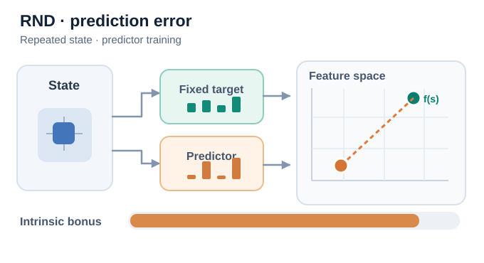

# Random network distillation (Burda et al., 2018)

An exploration method that rewards the agent for visiting states its own predictor has not learned yet. The predictor is trained to imitate a fixed, randomly initialised network, so its error is high on novel states and falls as states become familiar.

## Problem

In sparse-reward environments, the agent receives almost no learning signal until it finds a rare reward. Some games, such as Montezuma's Revenge, require a long, specific sequence of actions before any reward appears. Earlier bonuses based on counts or learned dynamics models were difficult to scale to these high-dimensional observations. Burda et al. ask whether a simple prediction error can drive exploration in such settings.

## Core idea

RND has two networks that take the same observation. A **target** network has random weights that are fixed and never trained. A **predictor** network is trained by gradient descent to match the target's output on the states the agent visits. The squared difference between the two outputs is the exploration bonus, which is added to the extrinsic reward.

Because the predictor has been trained on frequently visited states, its error is small there. A new state gives a large error, and the agent is pushed toward it. The method does not need a model of the environment's dynamics, and it avoids the difficulty of predicting raw future observations.

The paper also uses a modified version of PPO. Two value heads estimate the returns for the extrinsic and intrinsic rewards, so that different discount rates can be used for the two streams.

## Equation or algorithm

For an observation \(s\), with a fixed random target \(f\) and a trained predictor \(\hat f_\theta\), the intrinsic reward is

\[
r^{\text{int}}_t = \lVert \hat f_\theta(s_t) - f(s_t) \rVert^2 .
\]

The predictor parameters \(\theta\) are updated to minimise this error on the visited states, and the agent maximises the sum of extrinsic and intrinsic returns.

## Instructional animation

*Original instructional animation (CC BY-SA 4.0).* The **green target remains fixed** while the **orange predictor feature approaches it** for repeated training on the same visited observation. The dashed gap illustrates the squared prediction-error bonus, not an explicit state-visitation counter. A novel observation can produce a different large error. The positions, bar lengths and training trajectory are **schematic, not measured outputs or a guaranteed monotonic learning curve**. On the MkDocs site, use the Play/Pause control; [static GitHub-friendly preview](../../../../../assets/concept-animations/rnd-prediction-error-still.svg). Source: [Burda et al. (2018)](https://arxiv.org/abs/1810.12894).

**Reading the feature channels.** The green and orange input pulses show the **same observation going to both networks** before learning: only the orange predictor is updated; the random target remains frozen. During the loop, the orange predictor bars converge toward the unchanged green target bars. The bars and two-dimensional feature-space marker are complementary **schematic views**, not numerically coupled feature coordinates; bar length is not a calibrated reward measurement. Each replay restarts the illustration rather than reversing learning.

**Familiarity versus novelty.** The second animation follows the same observation A as its prediction error decreases after repeated training, then changes the input to a different observation B. **The random target's weights remain fixed, but \(f(s_A)\) and \(f(s_B)\) need not be equal.** The predictor can therefore have a larger error on B even after learning A. This does **not** imply a parameter reset, nor does every unseen observation necessarily produce a high bonus: generalisation can yield low error. The last phase also shows **further predictor training on observation B**: its orange feature approaches B's unchanged target output, so the illustrative bonus decreases again. This does not alter the target weights or imply a reset of the predictor when observations change. The two-dimensional positions and bonus bar are illustrative, not quantitatively calibrated or measured values; replaying the loop is not a model training operation.

*Second original instructional animation (CC BY-SA 4.0).* The green dot denotes the fixed-parameter target network's **output for the current input**, not a universal constant feature. Orange denotes the predictor output; the dashed segment indicates their separation. **Blue input pulses for A and amber pulses for B** travel along both observation-to-network paths before the corresponding feature response. They show that both the frozen target and trainable predictor evaluate each input; they do **not** represent changes to target weights. The MkDocs site provides Play/Pause; the [static comparison of A and B](../../../../../assets/concept-animations/rnd-state-novelty-still.svg) is readable on GitHub without animation.

## Results

The paper reports that an agent that maximises only the RND bonus, with no extrinsic reward, consistently finds more than half of the rooms in Montezuma's Revenge. The full method, combined with the two-head PPO, often finds 22 of the 24 rooms on the first level, and occasionally (though not frequently) passes the first level. The abstract reports state-of-the-art performance on Venture, Gravitar and Montezuma's Revenge. For Gravitar, the paper notes that RND does not consistently beat PPO, although it exceeds the prior state of the art.

## Limitations

- **Novelty, not progress.** The bonus rewards novelty, so the agent can be attracted to unpredictable but unimportant states.
- **Stochastic observations.** The predictor can keep producing error for states that look new but are not, which may hold exploration back.
- **Tuning.** The results depend on the choice of reward normalisation and the two discount rates.

## Connections

- Parent topic: [Exploration](../index.md).
- It is a prediction-error bonus, like the [intrinsic curiosity module](../icm/index.md), but it does not need a forward model.
- The count-based bonus of Bellemare et al. (2016) is the earlier approach it is compared with, and the modified PPO builds on [PPO](../../proximal-policy-optimisation/index.md).

## Applications

- **Hard exploration games**, where rewards are rare and long sequences of actions are needed.
- **Sparse-reward robotics**, when the reward is available only at task completion.

## Open questions

- How to separate novelty caused by the agent's own choices from novelty caused by randomness in the environment.
- How to combine novelty bonuses with the goal-directed behaviour a task requires.

## References

### Seminal papers

- Burda, Edwards, Storkey & Klimov (2018), "Exploration by random network distillation", [arXiv:1810.12894](https://arxiv.org/abs/1810.12894) — The RND paper, with the target and predictor bonus, the two-head PPO and the Montezuma's Revenge results.
- Bellemare et al. (2016), "Unifying count-based exploration and intrinsic motivation", [arXiv:1606.01868](https://arxiv.org/abs/1606.01868) — Pseudo-count bonuses, the count-based approach that RND is compared with.
- Pathak, Agrawal, Efros & Darrell (2017), "Curiosity-driven exploration by self-supervised prediction", [arXiv:1705.05363](https://arxiv.org/abs/1705.05363) — The intrinsic curiosity module, another prediction-error bonus.
- Stadie, Levine & Abbeel (2015), "Incentivizing exploration in reinforcement learning with deep predictive models", [arXiv:1507.00814](https://arxiv.org/abs/1507.00814) — An early prediction-error bonus based on a learned predictive model.
- Houthooft et al. (2016), "VIME: Variational information maximizing exploration", [arXiv:1605.09674](https://arxiv.org/abs/1605.09674) — Information-gain exploration, an alternative to prediction-error bonuses.
- Schulman et al. (2017), "Proximal policy optimization algorithms", [arXiv:1707.06347](https://arxiv.org/abs/1707.06347) — The policy-gradient method that RND modifies with two value heads.
