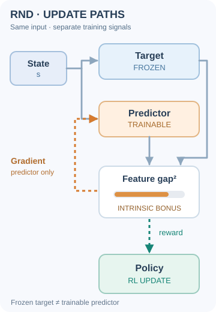
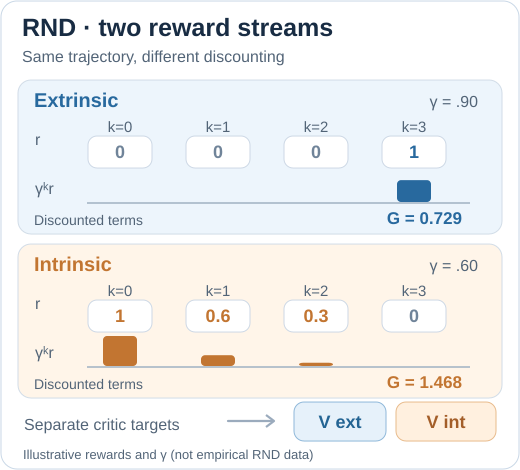
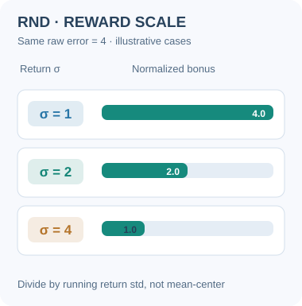
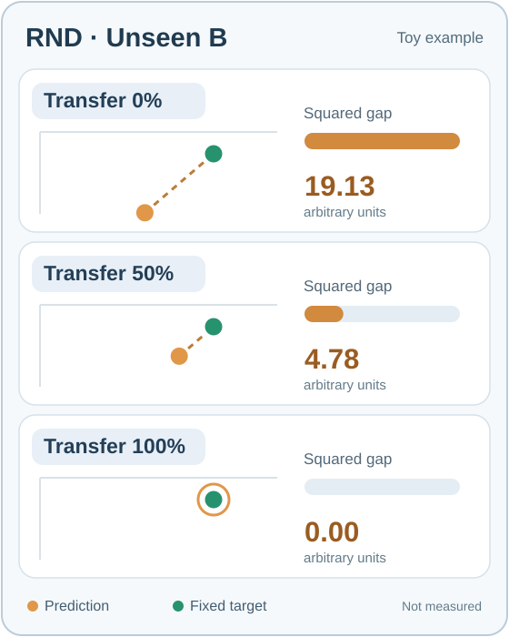
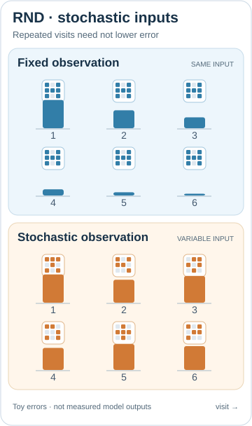

# Random network distillation (Burda et al., 2018)

An exploration method that rewards the agent for visiting states its own predictor has not learned yet. The predictor is trained to imitate a fixed, randomly initialised network, so its error may be high where prediction has not generalised, while training often reduces the error on visited states.

## Problem

In sparse-reward environments, the agent receives almost no learning signal until it finds a rare reward. Some games, such as Montezuma's Revenge, require a long, specific sequence of actions before any reward appears. Earlier bonuses based on counts or learned dynamics models were difficult to scale to these high-dimensional observations. Burda et al. ask whether a simple prediction error can drive exploration in such settings.

## Core idea

RND has two networks that take the same observation. A **target** network has random weights that are fixed and never trained. A **predictor** network is trained by gradient descent to match the target's output on the states the agent visits. The squared difference between the two outputs is the exploration bonus, which is added to the extrinsic reward.

Training on frequently visited states can reduce their prediction errors. A new state may produce a larger bonus that encourages exploration, but a predictor may also generalise to a previously unseen state and assign it a small bonus. The method does not need a model of the environment's dynamics, and it avoids the difficulty of predicting raw future observations.

The paper also uses a modified version of PPO. Two value heads estimate the returns for the extrinsic and intrinsic rewards, so that different discount rates can be used for the two streams.

## Equation or algorithm

For an observation \(s\), with a fixed random target \(f\) and a trained predictor \(\hat f_\theta\), the intrinsic reward is

\[
r^{\text{int}}_t = \lVert \hat f_\theta(s_t) - f(s_t) \rVert^2 .
\]

The predictor parameters \(\theta\) are updated to minimise this error on the visited states, and the agent maximises the sum of extrinsic and intrinsic returns.

### Predictor gradient and policy reward are different signals

The target network $f$ is **frozen**. The predictor $\hat f_\theta$ is fitted to the *current observation* by minimising a squared feature discrepancy, whereas the policy is updated using a reinforcement-learning objective with this discrepancy as an **intrinsic reward**. The policy is not directly optimised by backpropagating the predictor's squared-error gradient into policy parameters.

*Original ten-second SVG/SMIL teaching animation (CC BY-SA 4.0).* Blue pulses show the current observation and feature computations. The orange dashed return path represents **predictor-loss backpropagation**, which does not update the frozen target. The green path delivers the error-derived bonus to the **policy's RL learning objective**, not a differentiable gradient from the bonus computation to the policy. A hypothetical error bar becomes shorter after the update cue only to illustrate a possible later fit; its height and timing are schematic, **not a measured training curve or a guarantee of monotonic improvement**. Pause/resume with the keyboard-accessible control on MkDocs; [GitHub/no-script fallback](../../../../../assets/concept-animations/rnd-learning-paths-still.svg) shows all dependencies without animation. This separation follows [Burda et al. (2018)](https://arxiv.org/abs/1810.12894).

### Two discounted reward streams and value heads

In the RND implementation of PPO, extrinsic and intrinsic rewards have **separate value estimates** and may use different discount factors. For a fixed illustrative four-step sequence, the two discounted-return targets are

\[
G_t^{\mathrm{ext}}=\sum_{k=0}^{3}(\gamma_{\mathrm{ext}})^k r_{t+k}^{\mathrm{ext}},
\qquad
G_t^{\mathrm{int}}=\sum_{k=0}^{3}(\gamma_{\mathrm{int}})^k r_{t+k}^{\mathrm{int}}.
\]

*Original instructional SVG/SMIL animation (CC BY-SA 4.0).* The blue **extrinsic** and amber **intrinsic** lanes scan the **same time steps**. At each step, the corresponding discounted contribution appears and its running sum updates. The toy extrinsic rewards \((0,0,0,1)\), with \(\gamma_{\mathrm{ext}}=0.90\), yield \(G^{\mathrm{ext}}=0.90^3=0.729\). The toy intrinsic rewards \((1,0.6,0.3,0)\), with \(\gamma_{\mathrm{int}}=0.60\), yield \(G^{\mathrm{int}}=1+0.60(0.6)+0.60^2(0.3)=1.468\). These **returns are illustrative training targets**, not the predictions of either value head, and the shown rewards/discounts are **not** the paper's hyperparameters or measured RND values. This visual isolates the two critic targets; it does not depict the full advantage normalization or policy update. Use Play/Pause on MkDocs; [GitHub and no-script static preview](../../../../../assets/concept-animations/rnd-dual-value-still.svg). The distinction between value heads follows [Burda et al. (2018)](https://arxiv.org/abs/1810.12894).

### Normalizing RND intrinsic rewards by return variability

RND's feature-prediction error can have very different scales across environments and training phases. Burda et al. divide the intrinsic reward by a running estimate of the **standard deviation of intrinsic discounted returns**, without mean-centring the reward. This is **not** the variance of the target feature vector:

\[
\widetilde r_t^{\mathrm{int}} =
\frac{r_t^{\mathrm{int}}}{\widehat\sigma(R^{\mathrm{int}})}.
\]

*Original nine-second SVG/SMIL illustration (CC BY-SA 4.0).* The orange raw error remains **4** while **three hypothetical, alternative return histories** supply standard deviations **1, 2 and 4**. The green scaled bonus changes to **4, 2 and 1**. These numbers are **counterfactual inputs, not measured RND statistics or a sequence of training updates**. The graphic isolates the scaling operation, not the variance estimator. On MkDocs use the keyboard-accessible Play/Pause control; the [GitHub/no-script preview](../../../../../assets/concept-animations/rnd-return-scale-still.svg) shows all cases. See [Burda et al. (2018), Section 2.4](https://arxiv.org/abs/1810.12894).

## Instructional animation

*Original instructional animation (CC BY-SA 4.0).* The **green target remains fixed** while the **orange predictor feature approaches it** for repeated training on the same visited observation. The dashed segment shows feature separation; the orange intrinsic-bonus bar scales with the **square** of that distance, not with state-visit counts. A novel observation can produce a different large error. The positions, bar lengths and training trajectory are **schematic, not measured outputs or a guaranteed monotonic learning curve**. On the MkDocs site, use the Play/Pause control; [static GitHub-friendly preview](../../../../../assets/concept-animations/rnd-prediction-error-still.svg). Source: [Burda et al. (2018)](https://arxiv.org/abs/1810.12894).

**Reading the feature channels.** The green and orange input pulses show the **same observation going to both networks** before learning: only the orange predictor is updated; the random target remains frozen. During the loop, the orange predictor bars converge toward the unchanged green target bars. The bars and two-dimensional feature-space marker are complementary **schematic views**, not numerically coupled feature coordinates; bar length is not a calibrated reward measurement. Each replay restarts the illustration rather than reversing learning.

**Familiarity versus novelty.** The second animation follows the same observation A as its prediction error decreases after repeated training, then changes the input to a different observation B. **The random target's weights remain fixed, but \(f(s_A)\) and \(f(s_B)\) need not be equal.** The predictor can therefore have a larger error on B even after learning A. This does **not** imply a parameter reset, nor does every unseen observation necessarily produce a high bonus: generalisation can yield low error. The last phase also shows **further predictor training on observation B**: its orange feature approaches B's unchanged target output, so the illustrative bonus decreases again. This does not alter the target weights or imply a reset of the predictor when observations change. The two-dimensional positions and bonus bar are illustrative, not quantitatively calibrated or measured values; replaying the loop is not a model training operation.

*Second original instructional animation (CC BY-SA 4.0).* The green dot denotes the fixed-parameter target network's **output for the current input**, not a universal constant feature. Orange denotes the predictor output; the dashed segment indicates their separation. **Blue input pulses for A and amber pulses for B** travel along both observation-to-network paths before the corresponding feature response. They show that both the frozen target and trainable predictor evaluate each input; they do **not** represent changes to target weights. Once the B input signals reach the networks, the two output features and the illustrative bonus change together, without tracing an artificial path of intermediate observations between A and B. On phones (up to 640 px), MkDocs uses a separately composed vertical animation with legible labels rather than shrinking the desktop figure. Both A and B enter the frozen target and trainable predictor before each new feature response; the bonus bars in **both layouts** are proportional to the **illustrated squared feature-space separation** as A is learned, B is encountered, and B is learned. The mobile [stacked static comparison](../../../../../assets/concept-animations/rnd-state-novelty-mobile-still.svg) is available when animation is paused or reduced motion is preferred. The desktop diagram also keeps A visible until B reaches both networks, and resets the loop without a fictitious B-to-A feature trajectory. Its coordinates and reward lengths are **schematic, not measured data**. The MkDocs site provides Play/Pause; the [static comparison of A and B](../../../../../assets/concept-animations/rnd-state-novelty-still.svg) is readable on GitHub without animation.

## Interactive feature-error probe

Use **Previous/Next**, the timeline slider, or Play/Pause with 0.5×–2× speed to inspect each illustrative transition. The diagram is recomputed per step: there is **no interpolated state A→B**. The two target outputs differ by input even though target weights remain fixed; the orange point moves only during schematic predictor updates. The coordinate scale and displayed squared gaps are **arbitrary teaching units, never trained-model measurements**.

**RND generalisation experiment (MkDocs).** On observation B (timeline steps 5–8), change **Transfer to B** from 0% to 100%. This compares **counterfactual predictor outputs after training on A**, not visitation counts or new gradient updates. The fixed random target output for the never-seen B remains `(350, 125)`, while only the hypothetical B prediction moves. At the first B step, the illustrative squared gap falls from **19.13** at 0% transfer to **4.78** at 50% and **0.00** at 100% (display units are squared coordinate distance divided by 1,000). Here `prediction_B = target_B + (1 − transfer_fraction) × (baseline_prediction_B − target_B)`, so the gap scales as `(1 − transfer_fraction)²`. The same hypothetical transfer adjustment is applied to later B steps, not to A. A previously unseen observation **can** give little RND bonus because a predictor may generalise; 100% is an extreme mathematical illustration, not a promise of perfect real-world generalisation. Use **Reset transfer** to restore the original schematic trajectory. Keyboard arrows and reduced motion are supported. All numbers are hand-designed, **not empirical training outcomes**.

This interactive step-through is available on the MkDocs site; the SVG animations and GitHub-safe static previews above remain available without scripts.

*Original continuous instructional animation (CC BY-SA 4.0).* The green point is the **fixed target feature for unseen B**; the orange point is a **family of hypothetical predictor outputs**, not consecutive updates to the same network. The blue *Transfer* bar rises linearly from 0% to 100% and returns; the orange *Squared gap* bar follows the **square** of the remaining feature distance, using the same schematic B coordinates as the interactive slider below: $f(B)=(350,125)$ and $\hat f_0(B)=(245,215)$. Thus the displayed squared gap is $19.125(1-g)^2$ in arbitrary thousands of squared-coordinate units, where $g\in[0,1]$ is the transfer fraction. The orange ring at full transfer marks an overlapping prediction, not a missing one. The loop reverses a **counterfactual parameter sweep**, not training history. On MkDocs the animation supports Play/Pause and Reduced Motion through its [three-case static fallback](../../../../../assets/concept-animations/rnd-b-transfer-still.svg); numeric values are **illustrative, never trained-model measurements**.

*Original static fallback for the interactive transfer experiment (CC BY-SA 4.0).* This three-row summary is **specifically for GitHub and no-script readers**; use the interactive slider on MkDocs for intermediate values and keyboard control. The orange ring around the final green target means the two features coincide, not that the predictor output disappeared. The predictions are independent **counterfactual illustrations**, not simultaneous outputs of the same trained model or measured rewards.

## Results

The paper reports that an agent that maximises only the RND bonus, with no extrinsic reward, consistently finds more than half of the rooms in Montezuma's Revenge. The full method, combined with the two-head PPO, often finds 22 of the 24 rooms on the first level, and occasionally (though not frequently) passes the first level. The abstract reports state-of-the-art performance on Venture, Gravitar and Montezuma's Revenge. For Gravitar, the paper notes that RND does not consistently beat PPO, although it exceeds the prior state of the art.

### Stochastic distractors: noisy inputs versus predictor generalisation

Revisiting a **stochastic source** does not mean receiving the same pixels each time. Whether RND repeatedly rewards such visits also depends on how its predictor generalises across observations. The three-track animation separates the stochastic input from the predictor's ability to transfer what it learns.

*Original nine-second SVG/SMIL teaching animation (CC BY-SA 4.0).* Each discrete reveal adds **one visit to each of three lanes**. The upper lane repeats the identical input and illustrates falling prediction error. The lower two lanes receive **exactly the same six varying patterns** but depict **different hypothetical predictor behaviours**: weak transfer can leave errors high, whereas stronger generalisation can bring them down despite the changed pixels. Their toy relative-error profiles are (0.96, 0.61, 0.37, 0.21, 0.11, 0.06), (0.96, 0.78, 0.91, 0.75, 0.88, 0.81), and (0.96, 0.69, 0.44, 0.25, 0.14, 0.08). These are **hand-chosen illustrative bar heights**, not actual RND intrinsic rewards, predictor training measurements or guaranteed monotonic trajectories. The target network remains fixed **in weights**, while its feature output can vary with observation. RND is learning to predict features **of the current input**, not the next frame. The two noisy lanes represent separate **counterfactual predictors**, not two simultaneous outputs from one model. Thus stochasticity is a possible failure mode, **not a guarantee of permanently high curiosity**. Use Play/Pause on MkDocs; the [GitHub and no-script static fallback](../../../../../assets/concept-animations/rnd-stochastic-distractor-still.svg) displays all 18 illustrations. See [Burda et al. (2018), *Large-Scale Study of Curiosity-Driven Learning*](https://arxiv.org/abs/1808.04355) and the [RND method](https://arxiv.org/abs/1810.12894).

## Limitations

- **Error proxy, not a visit counter.** The bonus measures prediction mismatch, not whether an exact state has been visited. Generalisation can make an unseen state low-error; persistent error can also draw the agent to unimportant states.
- **Stochastic observations.** The predictor can keep producing error for states that look new but are not, which may hold exploration back.
- **Tuning.** The results depend on the choice of reward normalisation and the two discount rates.

## Connections

- Parent topic: [Exploration](../index.md).
- It is a prediction-error bonus, like the [intrinsic curiosity module](../icm/index.md), but it does not need a forward model.
- The count-based bonus of Bellemare et al. (2016) is the earlier approach it is compared with, and the modified PPO builds on [PPO](../../proximal-policy-optimisation/index.md).

## Applications

- **Hard exploration games**, where rewards are rare and long sequences of actions are needed.
- **Sparse-reward robotics**, when the reward is available only at task completion.

## Open questions

- How to separate novelty caused by the agent's own choices from novelty caused by randomness in the environment.
- How to combine novelty bonuses with the goal-directed behaviour a task requires.

## References

### Seminal papers

- Burda, Edwards, Storkey & Klimov (2018), "Exploration by random network distillation", [arXiv:1810.12894](https://arxiv.org/abs/1810.12894) — The RND paper, with the target and predictor bonus, the two-head PPO and the Montezuma's Revenge results.
- Bellemare et al. (2016), "Unifying count-based exploration and intrinsic motivation", [arXiv:1606.01868](https://arxiv.org/abs/1606.01868) — Pseudo-count bonuses, the count-based approach that RND is compared with.
- Pathak, Agrawal, Efros & Darrell (2017), "Curiosity-driven exploration by self-supervised prediction", [arXiv:1705.05363](https://arxiv.org/abs/1705.05363) — The intrinsic curiosity module, another prediction-error bonus.
- Stadie, Levine & Abbeel (2015), "Incentivizing exploration in reinforcement learning with deep predictive models", [arXiv:1507.00814](https://arxiv.org/abs/1507.00814) — An early prediction-error bonus based on a learned predictive model.
- Houthooft et al. (2016), "VIME: Variational information maximizing exploration", [arXiv:1605.09674](https://arxiv.org/abs/1605.09674) — Information-gain exploration, an alternative to prediction-error bonuses.
- Schulman et al. (2017), "Proximal policy optimization algorithms", [arXiv:1707.06347](https://arxiv.org/abs/1707.06347) — The policy-gradient method that RND modifies with two value heads.
