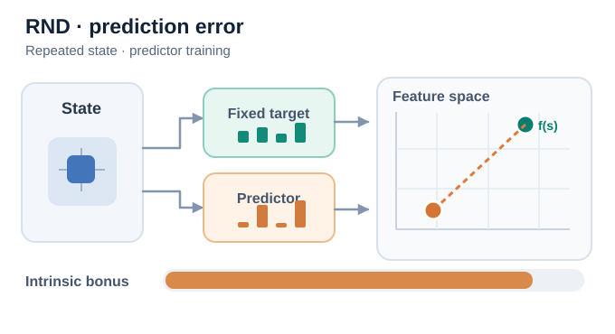
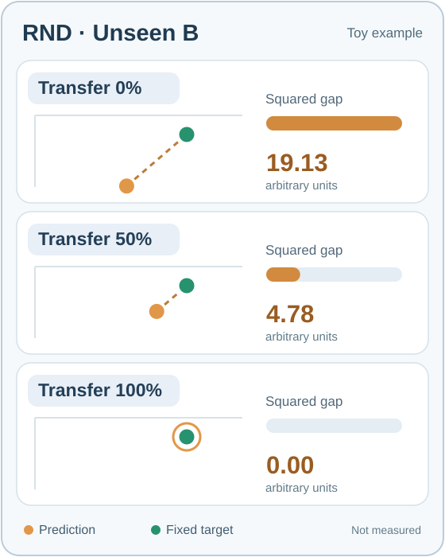

# 隨機網路蒸餾（Burda 等人，2018）

一種探索方法，獎勵智能體造訪其自身預測器尚未學會的狀態。預測器被訓練去模仿一個固定、隨機初始化的網路，因此當預測器尚未能泛化至某個觀測時，誤差可能很高；在已造訪狀態上訓練則通常能降低誤差。

## 問題

在稀疏獎勵的環境中，智能體在找到罕見獎勵之前幾乎得不到學習訊號。有些遊戲（例如《蒙特祖瑪的復仇》）需要一長串特定的動作，之後才會出現獎勵。先前以計數或學習得到的動力學模型為基礎的獎勵，難以擴展到這類高維觀測上。Burda 等人探討：在這些情境中，一個簡單的預測誤差能否驅動探索。

## 核心想法

RND 有兩個以相同觀測為輸入的網路。**目標網路**具有隨機權重，固定不訓練。**預測器網路**以梯度下降訓練，使其在智能體造訪的狀態上匹配目標網路的輸出。兩者輸出之差的平方即為探索獎勵，並加到外在獎勵上。

對常被造訪的狀態反覆訓練，通常能降低其預測誤差。新的狀態可能產生較大的獎勵並引導探索，但預測器也可能泛化至從未造訪的狀態，讓該狀態仍有很小的獎勵。此方法不需要環境動力學的模型，也避開了預測原始未來觀測的困難。

論文也使用了修改過的 PPO。兩個價值頭（value heads）分別估計外在與內在獎勵的回報，因此兩個串流可以使用不同的折扣率。

## 方程式與演算法

對觀測 \(s\)，固定的隨機目標為 \(f\)，訓練中的預測器為 \(\hat f_\theta\)，內在獎勵為

\[
r^{\text{int}}_t = \lVert \hat f_\theta(s_t) - f(s_t) \rVert^2 .
\]

預測器參數 \(\theta\) 被更新，以最小化在已造訪狀態上的誤差；智能體則最大化外在與內在回報的總和。

## 教學動畫

*原創教學動畫（CC BY-SA 4.0）。* **綠色目標特徵保持固定**，**橘色預測器特徵**則示範對同一已造訪觀測反覆訓練後，逐漸靠近目標的過程。虛線表示特徵距離，橘色內在獎勵長條依**距離平方**縮放，**不是**狀態造訪次數計數；切換至新觀測時，誤差可能再次升高。圖中的座標、獎勵長條與訓練軌跡都**僅為示意，並非模型實測，也不代表誤差必然單調下降**。MkDocs 網站提供播放／暫停控制；GitHub 可查看[靜態回退預覽](../../../../../assets/concept-animations/rnd-prediction-error-still.svg)。原始研究：[Burda 等人（2018）](https://arxiv.org/abs/1810.12894)。

**特徵通道解讀。** 綠色與橘色的輸入光點表示**同一份觀測分別進入兩個網路**，只有橘色預測器會學習，隨機目標網路保持固定。動畫中橘色預測器長條會逐漸接近固定不變的綠色目標長條。長條與右側二維特徵點是彼此互補的**示意視角**，並不是可互相換算的實際特徵座標；長條長度也不是經校準的獎勵實測值。每次循環僅重播示意流程，**不表示模型真的逆向學習**。

**熟悉狀態與新穎狀態的差別。** 第二段動畫先讓預測器在反覆造訪的狀態 A 上逐漸降低誤差，接著將輸入切換為另一個觀測 B。**目標網路的參數始終固定，但不同輸入的目標特徵 \(\,f(s_A)\,\) 與 \(\,f(s_B)\,\) 不一定相同。** 因此，即使預測器已學會狀態 A，面對 B 時仍可能出現較大的特徵誤差與內在獎勵。這不表示模型權重被重設，也**不保證**所有未見過的觀測都有高獎勵：預測器的泛化能力可能使誤差很低。動畫最後也呈現**繼續使用觀測 B 訓練預測器**：橘色預測特徵逐漸靠近 B 對應的固定目標輸出，示意內在獎勵再次降低。這不代表目標網路的權重改變，也不代表切換觀測時重設了預測器。圖中二維特徵座標、距離與獎勵長條僅為**教學示意，並非實測或經校準的數值**；動畫循環也不是實際重新訓練。

*第二段原創教學動畫（CC BY-SA 4.0）。* 綠色點是**固定權重的目標網路對目前輸入的輸出**，不是對所有狀態均相同的常數特徵；橘色點代表預測器輸出，兩點間虛線表示誤差距離。**藍色輸入光點代表 A、琥珀色輸入光點代表 B**，兩者都沿著觀測通往目標網路與預測器的路徑移動，接著才呈現對應特徵輸出的變化。這表示兩個網路都會處理不同輸入，**並非目標網路的權重改變**。當 B 的輸入訊號抵達兩個網路後，目標特徵、預測特徵與示意獎勵才同步切換，不會以連續插值誤導讀者，讓不同觀測之間出現不存在的中間特徵。手機畫面（寬度不超過 640px）會使用另外設計的上下配置動畫，保留可辨識的字體，而非直接縮小桌面圖。A／B 都先進入固定目標網路和可訓練預測器，才切換對應特徵；桌面版與手機版獎勵長條均依**示意特徵平方距離**呈現 A 逐漸熟悉、遇到 B、繼續學習 B 的變化。暫停或偏好減少動態效果時，可使用[手機版上下排列靜態預覽](../../../../../assets/concept-animations/rnd-state-novelty-mobile-still.svg)。桌面版也會等 B 的輸入訊號抵達兩個網路後才切換 A／B 標籤，且循環重播時直接重設，不會捏造 B 到 A 的中間特徵路徑。圖中的特徵座標、平方誤差比例及獎勵長度皆為示意，非模型實測。MkDocs 網站提供播放／暫停；GitHub 可直接閱讀[狀態 A／B 的靜態對照預覽](../../../../../assets/concept-animations/rnd-state-novelty-still.svg)。

## 互動式特徵誤差示範

使用**上一步／下一步**、進度滑桿或播放／暫停（0.5×–2×）檢查不同狀態。每個步驟都重新計算圖形，不會產生不存在的 A→B 中間觀測。目標網路權重始終固定，但不同輸入的目標輸出可以不同；橘色點僅在示意預測器訓練階段移動。所用座標、誤差比例與訓練軌跡都是**人工示意，絕非模型實測**。

**RND 泛化反例實驗（MkDocs）。** 在觀測 B（時間軸第 5–8 步），調整 **「對 B 的泛化程度」** 滑桿（0%–100%）。這是在比較**只訓練過 A 的不同假設性預測器對 B 的反事實輸出**，並非統計造訪次數或執行梯度更新。尚未造訪的 B，其固定隨機目標輸出維持在 `(350, 125)`，只有假設性的 B 預測逐漸接近目標。首次出現 B 時，示意平方誤差由泛化 0% 的 **19.13** 降至 50% 的 **4.78**，100% 則為 **0.00**（顯示單位為特徵座標平方距離除以 1,000）。本例滿足 `預測_B = 目標_B + (1 − 泛化比例) × (基準預測_B − 目標_B)`，因此平方誤差依 `(1 − 泛化比例)²` 縮放；同一種假設性調整也套用至後續 B 步驟，**不影響 A**。這說明**從未造訪的 B 也可能因泛化而有很低的 RND 獎勵**；100% 只是極端數學示例，並非宣稱真實模型能完美泛化。按 **「重設泛化」** 即恢復原始示意軌跡。支援鍵盤方向鍵與減少動態效果模式。數值皆為人工設計，**不是模型實測結果**。

互動逐步示範可於 MkDocs 網站使用；不執行指令碼時仍可閱讀上方 SVG 動畫與 GitHub 靜態回退預覽。

*原創連續教學動畫（CC BY-SA 4.0）。* 綠點是**未造訪觀測 B 的固定目標特徵**，橘點代表**一系列假設性的預測器輸出**，不是同一模型連續訓練更新後的結果。藍色 **Transfer** 長條從 0% 線性增加至 100% 再返回；橘色 **Squared gap** 長條則依剩餘特徵距離的**平方**縮小。本動畫與下方互動滑桿使用相同的人工 B 座標：$f(B)=(350,125)$、$\hat f_0(B)=(245,215)$，因此以千倍平方座標為顯示單位的誤差為 $19.125(1-g)^2$，其中 $g\in[0,1]$ 為假設性泛化比例。兩點重合時的橘色圓環表示預測器輸出仍存在；循環返回表示**反事實參數掃描**，**不是模型反向學習或重設權重**。MkDocs 可播放／暫停，減少動態效果時使用[三情境靜態回退圖](../../../../../assets/concept-animations/rnd-b-transfer-still.svg)。全部數值僅供教學示意，**不是實際訓練測量**。

*此互動實驗的原創靜態回退預覽（CC BY-SA 4.0）。* 三列摘要專為 **GitHub 和停用指令碼的讀者**提供；MkDocs 互動滑桿可檢視中間數值並使用鍵盤。最下一列綠色目標點外側的橘色圓環表示兩個特徵重合，**不代表預測器輸出消失**。三種預測是不同的**假設性反事實情境**，不是同一已訓練模型同時產生的輸出，也不是實測獎勵。

## 結果

論文指出，若只最大化 RND 獎勵、不使用外在獎勵，智能體能穩定地找到《蒙特祖瑪的復仇》中超過一半的房間。完整方法搭配雙頭 PPO，通常能在第一關找到 24 個房間中的 22 個，並偶爾（但不常）通過第一關。摘要報告，此方法在 Venture、Gravitar 與《蒙特祖瑪的復仇》上達到當時最先進的效能。對於 Gravitar，論文指出 RND 並非每次都勝過 PPO，但它超越了先前的最先進結果。

## 限制

- **預測誤差不等於造訪次數。** 獎勵衡量兩個網路輸出的落差，不能精確判斷是否造訪過該狀態。泛化可能讓未造訪的狀態誤差很低；持續的誤差也可能使智能體受到不重要狀態吸引。
- **隨機觀測。** 對看似新穎但其實不是的狀態，預測器可能持續產生誤差，這可能會阻礙探索。
- **調校。** 結果取決於獎勵標準化的方式與兩個折扣率的選擇。

## 關聯

- 上層主題：[探索](../index.zh-TW.md)。
- 它是一種預測誤差獎勵，與[內在好奇心模組](../icm/index.zh-TW.md)相似，但不需要前向模型。
- Bellemare 等人（2016）的計數式獎勵是 RND 所比較的較早方法；修改後的 PPO 則建立在 [PPO](../../proximal-policy-optimisation/index.zh-TW.md) 之上。

## 應用

- **困難探索遊戲**，獎勵罕見，需要很長的動作序列。
- **稀疏獎勵的機器人**，獎勵只在任務完成時才出現。

## 未解問題

- 如何區分由智能體自身選擇所造成的新穎性，與環境隨機性所造成的新穎性。
- 如何把新穎性獎勵與任務所需的目標導向行為結合。

## 參考文獻

### 開創性論文

- Burda、Edwards、Storkey 與 Klimov（2018），"Exploration by random network distillation"，[arXiv:1810.12894](https://arxiv.org/abs/1810.12894) — RND 原始論文，包含目標與預測器獎勵、雙頭 PPO，以及《蒙特祖瑪的復仇》結果。
- Bellemare 等人（2016），"Unifying count-based exploration and intrinsic motivation"，[arXiv:1606.01868](https://arxiv.org/abs/1606.01868) — 偽計數獎勵，是 RND 所比較的計數式方法。
- Pathak、Agrawal、Efros 與 Darrell（2017），"Curiosity-driven exploration by self-supervised prediction"，[arXiv:1705.05363](https://arxiv.org/abs/1705.05363) — 內在好奇心模組，另一種預測誤差獎勵。
- Stadie、Levine 與 Abbeel（2015），"Incentivizing exploration in reinforcement learning with deep predictive models"，[arXiv:1507.00814](https://arxiv.org/abs/1507.00814) — 以學到的預測模型為基礎的早期預測誤差獎勵。
- Houthooft 等人（2016），"VIME: Variational information maximizing exploration"，[arXiv:1605.09674](https://arxiv.org/abs/1605.09674) — 以資訊增益進行探索，是預測誤差獎勵的替代方案。
- Schulman 等人（2017），"Proximal policy optimization algorithms"，[arXiv:1707.06347](https://arxiv.org/abs/1707.06347) — RND 以兩個價值頭修改的策略梯度方法。
