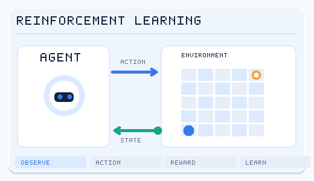

---
related:
- brain-mind/memory-learning
- brain-mind/neuroai
- applications/robotics
- applications/games
- theory/models/llm
- society/safety-alignment
- theory/paradigms/online
- theory/paradigms/imitation
aliases:
  - RL
  - 增強學習
---

# Reinforcement Learning

## Intuition

An **agent** acts in an **environment**, receives **rewards**, and tries to learn a policy that maximises **long-term cumulative reward**. Nobody tells it the right answer; it learns by trial and error. This maps deeply onto animal learning (operant conditioning) and the brain's dopamine system.

*Agent–environment interaction (original schematic, CC BY-SA 4.0).* The agent receives an observation, selects an action, and gets a subsequent observation and reward. The grid shows one illustrative trajectory toward a goal. **Reward is feedback, not a label identifying the correct action.** The actual policy update depends on the learning algorithm.

## Formalism: Markov decision processes

An MDP is \((S, A, P, R, \gamma)\): states, actions, transition probabilities, reward function, discount factor.

- **Policy** \(\pi(a\mid s)\)
- **Return** \(G_t = \sum_{k=0}^\infty \gamma^k r_{t+k+1}\)
- **State value** \(V^\pi(s) = \mathbb{E}_\pi[G_t\mid s_t=s]\)
- **Action value** \(Q^\pi(s,a) = \mathbb{E}_\pi[G_t\mid s_t=s, a_t=a]\)

**Bellman optimality equation:**

\[
Q^*(s,a) = \mathbb{E}\big[r + \gamma \max_{a'} Q^*(s',a')\big]
\]

## Algorithm families

| Family | Examples | Idea |
|---|---|---|
| Dynamic programming | Value iteration, policy iteration | Solve Bellman equations with a known model |
| Monte Carlo | MC control | Update from complete-episode returns |
| Temporal difference (TD) | TD(0), SARSA, Q-learning | Bootstrap from the next estimate |
| Deep value-based | DQN, Double DQN, Rainbow | Neural network approximates Q |
| Policy gradient | REINFORCE | Gradient ascent on policy parameters |
| Actor–critic | A2C/A3C, PPO, SAC, TD3 | Policy (actor) + value estimate (critic) |
| Model-based | Dyna, MuZero, Dreamer | Learn a model; plan or "imagine" with it |
| Offline RL | CQL, IQL, Decision Transformer | Learn from logged data only |
| Multi-agent RL | MADDPG, QMIX, self-play | Several interacting agents |

The **TD error** is the key quantity:

\[
\delta_t = r_{t+1} + \gamma V(s_{t+1}) - V(s_t)
\]

## Reinforcement learning and the brain

### Dopamine as reward-prediction error

Schultz, Dayan & Montague (1997) showed that midbrain dopamine neurons fire in a way that closely matches the TD error δ:

- Unexpected reward → dopamine burst (δ > 0)
- Once the reward is predicted, the response moves to the **predictive cue**; the reward itself no longer excites
- Predicted reward omitted → dip below baseline (δ < 0)

This is one of the most successful meetings of computational theory and neuroscience. Later, **distributional RL** found a counterpart too: different dopamine neurons appear to encode predictions with different degrees of optimism (Dabney et al., 2020, *Nature*).

### Other correspondences

| RL concept | Brain / psychology counterpart |
|---|---|
| Model-free control | Habits; dorsolateral striatum |
| Model-based control | Goal-directed behaviour; prefrontal cortex and dorsomedial striatum |
| Actor–critic | Dorsal striatum (actor) and ventral striatum (critic) hypothesis |
| Experience replay | Hippocampal sequence replay during sleep and rest |
| Exploration vs exploitation | Norepinephrine system, frontopolar cortex; human decision research |
| Curiosity / intrinsic motivation | Novelty-driven exploration, information seeking |
| Discount factor | Delay discounting, impulsivity |
| Successor representation | Predictive maps in hippocampal place cells (Stachenfeld et al., 2017) |

Psychological roots: Thorndike's law of effect, Skinner's operant conditioning, the Rescorla–Wagner model (1972) — itself a prediction-error learning rule.

## Key methods

Each method has its own page. The overview and comparison here are brief.

### Deep Q-networks (Mnih et al., 2015)

- **Overview:** A convolutional network approximates the action-value function from raw frames, stabilised by experience replay and a target network.
- **Comparison:** The value-based route. The value-based methods page covers the family, and PPO below takes the policy-based route.
- **Full write-up:** [Deep Q-Networks](deep-q-networks/index.md)

### Proximal policy optimisation (Schulman et al., 2017)

- **Overview:** A policy-gradient method that clips the probability ratio between the new and old policies, so each update stays near the old policy.
- **Comparison:** The policy-based route, simpler than trust-region methods. It is on-policy, which the offline RL page contrasts with.
- **Full write-up:** [Proximal Policy Optimisation](proximal-policy-optimisation/index.md)

### AlphaGo and AlphaZero (Silver et al., 2016, 2018)

- **Overview:** Search with learned networks. AlphaGo combines a policy network and a value network with Monte Carlo tree search and uses human games to start. AlphaZero learns from self-play alone, with only the rules of each game.
- **Comparison:** The search-based route to game play. Both sit in the Go and board-game milestones, and [MuZero](model-based-rl/muzero/index.md) extends the same search to games whose rules are not given to the planner.
- **Full write-up:** [AlphaGo](alphago/index.md), [AlphaZero](alphazero/index.md)

## Milestones

- **TD-Gammon** (1992)
- **DQN** (2013/2015): Atari from pixels
- **[AlphaGo](alphago/index.md) / [AlphaZero](alphazero/index.md) / [MuZero](model-based-rl/muzero/index.md)** (2016–2019): self-play + Monte Carlo tree search
- **OpenAI Five, AlphaStar** (2019): Dota 2, StarCraft II
- **RLHF** (2017 onward, mainstream with ChatGPT in 2022): train a reward model on human preferences, then optimise the LLM with PPO
- **RL for reasoning** (2024–2025): training long chains of thought with verifiable rewards (math answers, unit tests), e.g. GRPO as used for DeepSeek-R1
- **Robotics**: sim-to-real transfer for legged and humanoid locomotion

## Practical challenges

- Poor sample efficiency
- Reward design is hard; agents exploit loopholes (**reward hacking**) — see [Safety & Alignment](../../../society/safety-alignment/index.md)
- Exploration under sparse rewards
- Unstable training, hyperparameter sensitivity
- The sim-to-real gap

## Subtopics

- [Value-based methods](value-based-methods/index.md): Q-learning, SARSA, DQN, Double DQN and Rainbow.
- [Policy gradient and actor-critic](policy-gradient-and-actor-critic/index.md): REINFORCE, A3C, TRPO, DDPG, TD3, SAC and GRPO, with PPO as its own page.
- [Model-based RL](model-based-rl/index.md): world models, MuZero and Dreamer.
- [Offline RL](offline-rl/index.md): learning from fixed datasets with conservative value estimates.
- [Multi-agent RL](multi-agent-rl/index.md): several learning agents, with MADDPG, QMIX and MAPPO as examples of centralised training.
- [Learning from human feedback](learning-from-human-feedback/index.md): reward models and RLHF.
- [Experience replay](experience-replay/index.md): reusing past transitions to learn more from each one.
- [Exploration](exploration/index.md): how agents try new actions when rewards are sparse.

## Resources

- Sutton & Barto, *Reinforcement Learning: An Introduction*, 2nd ed. (free PDF)
- David Silver's UCL RL course
- OpenAI [Spinning Up](https://spinningup.openai.com/) (MIT)
- Hugging Face Deep RL Course
- [Gymnasium](https://gymnasium.farama.org/), [Stable-Baselines3](https://stable-baselines3.readthedocs.io/)
- Niv (2009), "Reinforcement learning in the brain" (neuroscience review)

## References

### Seminal papers

- Mnih et al. (2015), "Human-level control through deep reinforcement learning", *Nature* 518. https://doi.org/10.1038/nature14236 — The DQN paper, the start of deep reinforcement learning at scale.
- Silver et al. (2016), "Mastering the game of Go with deep neural networks and tree search", *Nature* 529. https://research.google/pubs/mastering-the-game-of-go-with-deep-neural-networks-and-tree-search/ — AlphaGo, combining learned networks with search.
- Christiano et al. (2017), "Deep reinforcement learning from human preferences", NeurIPS, arXiv:1706.03741 — Learns reward functions from human comparisons, the basis of RLHF.
- Schulman et al. (2017), "Proximal policy optimization algorithms", arXiv:1707.06347 — PPO, the policy-gradient method most used in practice.

### Surveys and textbooks

- Sutton, R. S. & Barto, A. G. *Reinforcement Learning: An Introduction*, 2nd ed. MIT Press, 2018. http://incompleteideas.net/book/the-book-2nd.html — The standard RL textbook, with a free online draft covering the algorithm families above.
- Levine, S., Kumar, A., Tucker, G. & Fu, J. (2020), "Offline reinforcement learning: tutorial, review, and perspectives on open problems", arXiv:2005.01643 — Tutorial and review on learning from fixed datasets.
