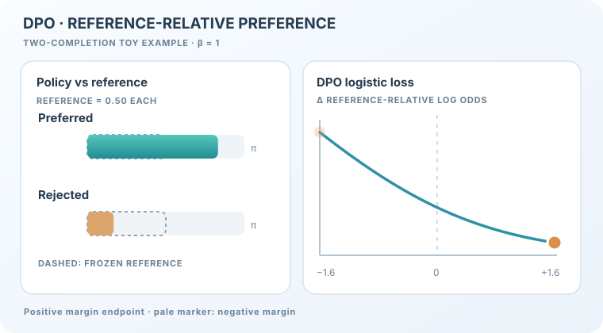

# 直接偏好最佳化（Rafailov 等人，2023）

以分類損失把語言模型擬合到偏好對上，因此不需要獨立的獎勵模型，也不需要強化學習迴圈。

## 問題

從人類回饋學習的強化學習，先以比較資料訓練獎勵模型，再對它執行策略梯度方法。相較於直接把模型擬合到比較資料上，這種做法實作與調校都更複雜。Rafailov 等人探討：帶 KL 約束的獎勵最大化目標，能否直接以偏好資料求解。

## 核心想法

帶 KL 約束的目標有已知的最佳策略。對參考策略 \(\pi_{\text{ref}}\)、係數 \(\beta\) 與獎勵 \(r\)，其最佳解為 \(\pi_r(y \mid x) \propto \pi_{\text{ref}}(y \mid x)\exp(r(x, y)/\beta)\)。整理後可以用策略表示獎勵：\(r(x, y) = \beta \log(\pi_r(y \mid x)/\pi_{\text{ref}}(y \mid x)) + \beta \log Z(x)\)。把它代入 Bradley–Terry 偏好模型後，配分項會消去，獎勵模型也隨之消失。剩下的只是一個只涉及策略與參考模型的損失。

## 方程式與演算法

在偏好三元組 \((x, y_w, y_l)\) 上，DPO 損失為

\[
\mathcal{L}_{\text{DPO}}(\pi_\theta; \pi_{\text{ref}}) = -\mathbb{E}_{(x, y_w, y_l)} \left[\log \sigma\left(\beta \log \frac{\pi_\theta(y_w \mid x)}{\pi_{\text{ref}}(y_w \mid x)} - \beta \log \frac{\pi_\theta(y_l \mid x)}{\pi_{\text{ref}}(y_l \mid x)}\right)\right]
\]

其中 \(y_w\) 是被偏好的回應，\(y_l\) 是不被偏好的回應，\(\beta\) 控制 KL 約束的強度。流程如下：

1. 取一批提示，每個提示配有被偏好與不被偏好的回應。
2. 分別在策略與凍結的參考模型下，計算每個回應的對數機率。
3. 對上式損失做一次梯度更新。
4. 重複直到策略收斂。訓練時不需要從策略取樣。

### 教學動畫：相對參考模型的偏好差距

*原創向量教學動畫（CC BY-SA 4.0）。* 考慮只有兩個回應的**人工示例**，令 \(\pi_{\mathrm{ref}}(y_w\mid x)=\pi_{\mathrm{ref}}(y_l\mid x)=0.5\)，相對參考模型的偏好差距與 DPO 損失為：

\[
\Delta=\log\frac{\pi_\theta(y_w\mid x)}{\pi_{\mathrm{ref}}(y_w\mid x)}-\log\frac{\pi_\theta(y_l\mid x)}{\pi_{\mathrm{ref}}(y_l\mid x)},\qquad
\ell_{\mathrm{DPO}}=-\log\sigma(\beta\Delta).
\]

取 \(\beta=1\)，將**構造的**差距從 \(-1.6\) 掃描到 \(+1.6\) 時，偏好回應的策略機率從 \(0.168\) 增至 \(0.832\)，損失由 \(1.784\) 降至 \(0.184\)。虛線長條是固定參考機率；橘色游標沿解析式損失曲線移動。**這是跨假設策略的連續視覺插值，不是梯度下降歷程、獎勵模型輸出或訓練實測資料。** MkDocs 網站支援播放／暫停及 Enter／Space，靜態與減少動態效果版本保留正差距端點。詳見 [Rafailov 等人（2023）](https://arxiv.org/abs/2305.18290)。

### 互動計算實驗：相對參考策略的勝算

  
無 JavaScript 時仍能直接閱讀上方的靜態 SVG。

這是**人工構造的雙回應模型**。可調整偏好回應的策略機率 \(p\)、凍結參考策略的偏好機率 \(r\) 與 \(\beta\)；拒絕回應的機率分別為 \(1-p\)、\(1-r\)。實驗會計算相對參考策略差距與配對邏輯損失：

\[
\Delta=\operatorname{logit}(p)-\operatorname{logit}(r),\qquad
\ell=\log(1+\exp(-\beta\Delta)).
\]

當 \(p=r\) 時，差距為零、損失為 \(\ln 2\approx0.693\)，不必要求機率為 0.5。若 \(p<r\)，即使 \(p>0.5\)，相對差距**仍為負值**。長條比較策略與參考分布，調整 \(r\) 或 \(\beta\) 時曲線會重新計算。支援上一步／下一步、播放／暫停、進度滑桿、0.5×／1×／2× 速度、重設、鍵盤操作與手機水平捲動；減少動態效果模式可手動逐步檢視。原有靜態 SVG 是 GitHub／無 JavaScript 的回退預覽。

數值皆為**人工設計並解析計算**，不是實測 LLM 機率、DPO 最佳化軌跡或訓練結果。

## 結果

論文將 DPO 與基於 PPO 的 RLHF 在多項任務上比較：

- **情感控制。** DPO「產生的是遠比其他方法有效率的前緣」，在達到最高獎勵的同時維持低 KL；在控制生成文本情感上，超越基於 PPO 的 RLHF。
- **摘要。** 在溫度 0.0 下，DPO 對參考答案的勝率約為 61%；PPO 在其最佳取樣溫度（同樣為 0.0）下為 57%。作者指出，他們並未對 \(\beta\) 做實質調整，因此這些結果可能低估了 DPO。
- **人類研究。** 溫度 0.25 的 DPO 樣本，在 58% 的判斷中被偏好於溫度 0 的 PPO 樣本。
- **對話。** 論文報告，在 Anthropic HH 資料集上，DPO 是唯一在計算上有效率、且能超越被偏好回應的方法。

## 限制

- **規模。** 模型評估最大為 60 億參數；論文將把 DPO 擴展到更大模型列為未來工作。
- **泛化。** 論文提出 DPO 策略在分布外的泛化，相較於從明確獎勵函數學習的情況如何，但未作解答。
- **過度最佳化。** 論文提出獎勵過度最佳化在直接設定中如何出現的問題，尚未解決。
- **自動判斷。** GPT-4 計算的勝率取決於提示，因此評估本身也受到質疑。

## 關聯

- 上層主題：[從人類回饋學習](../index.md)，以及更廣的[強化學習](../../index.zh-TW.md)概觀。
- DPO 去除了[獎勵建模](../reward-modelling/index.zh-TW.md)中明確的獎勵模型，並使用相同的 Bradley–Terry 比較模型。
- 它取代了 [InstructGPT](../../../../models/llm/instructgpt-rlhf/index.zh-TW.md) 中的策略最佳化步驟，後者使用[近端策略最佳化](../../proximal-policy-optimisation/index.zh-TW.md)。

## 應用

- **語言模型的偏好微調。** 論文在偏好資料上微調摘要與對話模型。
- **可控生成。** 把生成文本的情感導向偏好的輸出。

## 未解問題

- 不使用明確獎勵模型訓練出的策略，其泛化能力是否與使用獎勵模型者相當。
- 在更大規模下，如何調整 \(\beta\) 與參考模型以獲得最佳結果。

## 參考文獻

### 開創性論文

- Rafailov 等人（2023），"Direct preference optimization: your language model is secretly a reward model"，NeurIPS 2023，[arXiv:2305.18290](https://arxiv.org/abs/2305.18290) — DPO 原始論文，包含損失函數、封閉形式推導與上述結果。
- Ouyang 等人（2022），"Training language models to follow instructions with human feedback"，[arXiv:2203.02155](https://arxiv.org/abs/2203.02155) — InstructGPT，DPO 所簡化的 RLHF 流程。
- Christiano 等人（2017），"Deep reinforcement learning from human preferences"，[arXiv:1706.03741](https://arxiv.org/abs/1706.03741) — 從人類比較中學習獎勵函數，是 DPO 所避開的獎勵模型之基礎。
- Stiennon 等人（2020），"Learning to summarize from human feedback"，NeurIPS 2020，[arXiv:2009.01325](https://arxiv.org/abs/2009.01325) — 以獎勵模型與 PPO 進行摘要，是 DPO 比較的基準之一。
- Bradley 與 Terry（1952），"Rank analysis of incomplete block designs: I. The method of paired comparisons"，*Biometrika* 39(3/4)，自第 324 頁起。https://doi.org/10.2307/2334029 — 推導 DPO 損失所用的成對比較模型。
