# Monte Carlo tree search and self-play

Monte Carlo tree search (MCTS) is a planning method that builds a search tree by repeatedly simulating possible futures and learning from their results. Combined with self-play, in which a program trains by playing against copies of itself, it became the search engine behind the strongest game programs of the late 2010s.

## Overview

Choosing a move means judging what follows from it. In games such as Go, the number of possible positions is far too large for exhaustive search. MCTS focuses effort on the most promising lines and estimates how good a line is from simulated games, rather than analysing every branch. Self-play then produces training data that improves the evaluator used inside the search.

## Key concepts

- **Tree policy**: the rule that chooses which child to follow from a node already in the tree.
- **Expansion**: adding a new position to the tree when the search reaches one it has not stored yet.
- **Evaluation**: estimating the value of a new position, either by a random playout to the end of the game or by a learned value function.
- **Backup**: passing the result back up the path so that each node on it updates its average value and visit count.
- **Self-play**: generating training games by letting a program play against itself, usually against a recent copy of itself.

## How it works

Each iteration of the search runs four steps: select a path from the root with the tree policy, expand one new node, evaluate it, and back up the result. After many iterations the move with the most visits is played. A common tree policy is UCT, which applies the UCB1 bandit rule at every node. UCB1 adds to a child's sample mean a confidence term that shrinks as the child is visited more often:

\[
a_t = \arg\max_a \left( \bar{X}_a + \sqrt{\frac{2 \ln N}{n_a}} \right)
\]

Here \(\bar{X}_a\) is the mean result of simulations through child \(a\), \(n_a\) is the number of times it has been visited, and \(N\) is the number of visits to the parent. Auer, Cesa-Bianchi & Fischer (2002) show that UCB1's regret grows only logarithmically with the number of plays. Kocsis & Szepesvári (2006) applied the same rule to Monte Carlo planning, which gave the UCT algorithm.

*Original teaching schematic (CC BY-SA 4.0).* The four states trace a single search iteration: select branch A, expand a new child, evaluate it and back up the result along the visited path. The `+1` value and `N + 1` visit-count marker are illustrative, not measured outcomes or computed UCT scores. Use the MkDocs Play/Pause control, or view the [GitHub-readable static overview](../../../../assets/concept-animations/mcts-search-cycle-still.svg).

## Key methods

The landmark systems below differ in where their evaluations come from and what the search learns from. Each system's detail is on its own page, except the two classical methods, which are described here.

- **Plain MCTS with random playouts (Coulom, 2006)**: the search evaluates new positions with random playouts, and its quality depends on the selection and backup operators. The paper analyses those operators for Go-playing programs.
- **UCT (Kocsis & Szepesvári, 2006)**: applies UCB1 at every node, so the search keeps exploring promising lines while still trying alternatives.
- [AlphaGo](../alphago/index.md) (Silver et al., 2016): guides the tree with a policy network and judges positions with a value network. Both start from human games.
- [AlphaZero](../alphazero/index.md) (Silver et al., 2018): uses one network, trained on self-play alone, to guide the same search.
- [MuZero](../model-based-rl/muzero/index.md) (Schrittwieser et al., 2020): runs the search over a learned model of the game rather than the real rules.

## Self-play

In self-play, the search produces its own training targets. The visit counts from each search become the target for the move policy, and the final game outcome becomes the target for the value. Because the opponent is the learner's own recent version, the difficulty of the games rises as the learner improves. Evaluating each new version against earlier ones tracks progress, and the same loop works without any human games.

## Connections

- [Reinforcement learning](../index.md): the wider family of methods for learning from reward. Tree search is one way to use a learned value or policy at decision time.
- [Model-based reinforcement learning](../model-based-rl/index.md): planning with a learned model, which MuZero extends to games whose rules are not given.
- [Games](../../../../applications/games/index.md): the history of game-playing systems, of which these methods are the core.

## Applications

- **Board games**: Go, chess and shogi programs, from AlphaGo to AlphaZero.
- **Planning with learned models**: MuZero uses the same search over a learned model, including in Atari games.
- **Reasoning in language models**: Tree of Thoughts (Yao et al., 2023) treats intermediate reasoning steps as a tree and searches over it. In the paper's Game of 24 task, its abstract reports a 74% success rate, against 4% for GPT-4 with chain-of-thought prompting.

## Limitations

- Search costs many simulations for every move, so strength is tied to the time and compute available at play time.
- The search is only as good as its evaluator. A poor value estimate misleads the search, and self-play then trains on the mistake.
- Self-play can settle into a narrow style if the learner keeps facing similar opponents.
- In language-model reasoning, the thoughts are judged by a model, so the evaluation can be wrong in ways the search cannot see.

## Open questions

- How much search is worth at play time when the policy and value are already strong, and where the balance lies between searching and learning.
- Whether tree search over reasoning steps gives reliable gains for language models outside tasks with a clear checker, such as puzzles.
- How self-play can be extended to games with hidden information, where the simulator cannot be copied and searched directly.

## References

### Seminal papers

- Coulom, R. (2006). Efficient selectivity and backup operators in Monte-Carlo tree search. *Computers and Games (CG 2006)*, LNCS 4630, Springer. https://link.springer.com/doi/10.1007/978-3-540-75538-8_7 — Analyses the selection and backup operators of Monte-Carlo tree search for Go-playing programs.
- Kocsis, L. & Szepesvári, C. (2006). Bandit based Monte-Carlo planning. *Machine Learning: ECML 2006*, LNCS 4212, Springer. https://link.springer.com/chapter/10.1007/11871842_29 — Introduces UCT, which applies the UCB1 bandit rule at each node of the search tree.
- Auer, P., Cesa-Bianchi, N. & Fischer, P. (2002). Finite-time analysis of the multiarmed bandit problem. *Machine Learning* 47(2–3), 235–256. https://homes.di.unimi.it/~cesabian/Pubblicazioni/ml-02.pdf — The UCB1 rule and its logarithmic regret bound, from the authors' own copy.
- Silver, D. et al. (2016). Mastering the game of Go with deep neural networks and tree search. *Nature* 529, 484–503. https://doi.org/10.1038/nature16961 — AlphaGo, which combines a policy network, a value network and tree search.
- Schrittwieser, J. et al. (2020). Mastering Atari, Go, chess and shogi by planning with a learned model. *Nature*. https://doi.org/10.1038/s41586-020-03051-4 — MuZero, which runs the search over a learned model.
- Yao, S. et al. (2023). Tree of Thoughts: Deliberate problem solving with large language models. arXiv. https://arxiv.org/abs/2305.10601 — Applies tree search over intermediate reasoning steps in language models.

### Surveys and textbooks

- Browne, C. et al. (2012). A Survey of Monte Carlo Tree Search Methods. *IEEE Transactions on Computational Intelligence and AI in Games*. https://doi.org/10.1109/TCIAIG.2012.2186810 — Survey of MCTS variants and their applications across games and planning.
