# Model-based policy optimisation (Janner et al., 2019)

A model-based method that trains a policy with a learned model, but only uses short model rollouts that start from real data. The authors argue that this keeps the bias of the model small while retaining much of the sample efficiency of model-based learning.

## Problem

Model-based reinforcement learning can use data far more efficiently than model-free learning, but its asymptotic performance often lags behind. A policy trained only on model-generated data inherits the model's errors, and those errors compound over long rollouts. Janner et al. ask how much a policy should rely on model-generated experience, and how to use the model without the usual pitfalls.

## Core idea

The method combines three parts:

- A **real environment buffer** that holds data collected by the current policy.
- An **ensemble of dynamics models**, trained on the real buffer, that predicts the next state and reward.
- A **model buffer** that holds short rollouts generated by the model. Each rollout starts from a state sampled from the real buffer, and it runs for a short horizon \(k\).

The policy is trained with a model-free algorithm, here soft actor-critic, on a mix of real and model-generated transitions. The model is used only for short rollouts, so model error has little time to compound.

### Visualising short branched rollouts

*Original animated teaching schematic (CC BY-SA 4.0).* Highlighted **real replay states** seed multiple model-generated branches. Each illustrated branch contains only **two imagined transitions** (an example $k=2$); the synthetic transitions feed **model replay** and then off-policy **policy updates**, together with real data. The faint continuation beyond the cutoff is intentionally *not used*. Coordinates, branch geometry and sample counts are schematic rather than measured model errors or training observations. The method does **not** run long model rollouts from scratch. Use **Play/Pause** on MkDocs; GitHub readers can open the [static two-step branch overview](../../../../../assets/concept-animations/mbpo-short-branches-still.svg). See [Janner et al. (2019)](https://arxiv.org/abs/1906.08253).

### Visualising model-error accumulation and the rollout cutoff

*Original animated teaching schematic (CC BY-SA 4.0).* To isolate why a shorter imagined horizon may be useful, consider a **constructed scalar system** with $s_{t+1}=s_t+1$, while an imperfect learned model predicts $\hat s_{t+1}=\hat s_t+1.2$ from the same real seed $s_0=\hat s_0=0$. With no corrective real observations, absolute state error becomes $0,0.2,0.4,0.6,0.8$ across steps $0$–$4$. The teal prefix ends at illustrative rollout length $k=2$, while the orange continuation is **counterfactual and excluded** from model replay. This is not an empirical MBPO error curve or a guarantee that model error grows monotonically: stochastic and state-dependent errors can compound, cancel or vary. MBPO draws fresh seeds from real replay and uses short synthetic transitions for off-policy training. Use **Play/Pause** on MkDocs; [GitHub static overview](../../../../../assets/concept-animations/mbpo-horizon-error-still.svg). Source: [Janner et al. (2019)](https://arxiv.org/abs/1906.08253).

## Equation or algorithm

The procedure repeats the following steps:

1. Collect real transitions with the current policy and add them to the environment buffer.
2. Train the dynamics ensemble on the environment buffer.
3. Sample a batch of states from the environment buffer, and roll each out for \(k\) steps with the model and the current policy. Add the generated transitions to the model buffer. (The paper uses \(B\) for the size of the model ensemble.)
4. Take several gradient steps of the model-free update on minibatches drawn from both buffers.

The analysis in the paper gives a monotonic-improvement guarantee for model-based policy optimisation. The bound depends on the model's error and on how far the policy moves from the data. Taken literally, it suggests that real off-policy data is always preferable to model-generated on-policy data, and the bound is maximised when the rollout length \(k = 0\). The paper calls the analysis overly pessimistic, and argues that an empirical estimate of model generalisation can justify short model usage in practice.

## Results

The paper reports that the method "surpasses the sample efficiency of prior model-based methods, matches the asymptotic performance of the best model-free algorithms, and scales to horizons that cause other model-based methods to fail entirely". The experiments are on continuous-control benchmarks, where model-based methods are compared with model-free ones.

## Limitations

- **Model dependence.** The benefit depends on how well the model generalises to the states the policy visits.
- **Rollout length.** Short rollouts keep error small, but the best length is task-dependent and needs tuning.
- **Continuous control.** The reported experiments are on continuous-control tasks, so transfer to discrete or high-dimensional observation settings is not shown.

## Connections

- Parent topic: [Model-based RL](../index.md).
- It uses [Soft actor-critic](../../policy-gradient-and-actor-critic/sac/index.md) as its model-free learner, so its policy updates are off-policy.
- It is an alternative to [PETS](../pets/index.md), which plans with an ensemble of models rather than training a policy on imagined rollouts.
- The trust-region analysis of model use is related to [TRPO](../../policy-gradient-and-actor-critic/trpo/index.md).

## Applications

- **Robot control** with few real trials, where the model is trained on the data collected so far.
- **Continuous-control benchmarks**, where sample efficiency matters.

## Open questions

- How to choose the rollout length automatically, from a measure of model error.
- How to keep the model accurate in states the policy visits later in training.

## References

### Seminal papers

- Janner, Fu, Zhang & Levine (2019), "When to trust your model: Model-based policy optimization", [arXiv:1906.08253](https://arxiv.org/abs/1906.08253) — The MBPO paper, with the short-rollout method, the monotonic-improvement analysis and the continuous-control results.
- Chua et al. (2018), "Deep reinforcement learning in a handful of trials using probabilistic dynamics models", [arXiv:1805.12114](https://arxiv.org/abs/1805.12114) — PETS, an ensemble model-based method that MBPO is compared with.
- Kurutach et al. (2018), "Model-ensemble trust-region policy optimization", [arXiv:1802.10592](https://arxiv.org/abs/1802.10592) — Uses an ensemble of learned models to train a trust-region policy, an early model-ensemble method.
- Haarnoja et al. (2018), "Soft actor-critic: Off-policy maximum entropy deep reinforcement learning with a stochastic actor", [arXiv:1801.01290](https://arxiv.org/abs/1801.01290) — The model-free learner that MBPO uses for its policy updates.
- Schulman et al. (2017), "Proximal policy optimization algorithms", [arXiv:1707.06347](https://arxiv.org/abs/1707.06347) — The on-policy model-free baseline against which model-based methods are commonly compared.
