# MuZero (Schrittwieser et al., 2020)

MuZero plans with a learned model instead of the rules of the game. It learns a model that predicts only the quantities planning needs: reward, the policy and the value. It matched the superhuman performance of [AlphaZero](../../alphazero/index.md), which was given the rules, in Go, chess and shogi, and it set a new state of the art across 57 Atari games.

## Problem

Planning with a model needs one that is accurate where it matters. Learning to predict every future observation, such as every pixel of a game screen, spends capacity on details that do not affect decisions. The paper asks whether a model can be learned that predicts only the quantities needed for planning, and still plan well when the game's rules are unknown to it.

## Key concepts

- **Latent state**: an internal representation of the game that the model maintains, not an observation the model must reproduce.
- **Prediction targets**: at each step the model predicts reward, the move policy and the value. Nothing else is predicted.
- **Planning**: Monte Carlo tree search runs inside the learned model, over imagined latent states.

## Core idea

Three learned functions cooperate. A representation function turns the observations into a starting latent state. A dynamics function takes a latent state and an action and returns the next latent state and reward. A prediction function returns the policy and value of a latent state. Search runs over latent states using these functions, and the networks are trained so that their predicted rewards, policies and values match what the search and the real game produce.

## Algorithm

1. **Represent.** Encode the recent observations into a latent state \(s^0\).
2. **Unroll.** For each planned action \(a^k\), compute \(s^k, r^k\) with the dynamics function and \(p^k, v^k\) with the prediction function.
3. **Search.** Run MCTS over these latent states to choose an action. Store the visit-count policy and the value found by search.
4. **Train.** Update all three functions, end to end, so that the predicted rewards, policies and values match the real rewards, the search policies and the game outcomes over the unrolled steps.

*Original teaching schematic (CC BY-SA 4.0).* The four stages separate observation encoding \(h\), recurrent dynamics \(g\) that predicts latent transitions and rewards, prediction \(f\) of policies and values, and MCTS choosing an actual action using search visit counts. The diagram shows **one illustrative unroll**, not an observed game trajectory or measured model output; the model need not reconstruct future images. On MkDocs, use Play/Pause; the [GitHub-readable static overview](../../../../../assets/concept-animations/muzero-latent-planning-still.svg) shows the planning decision.

## Results

The paper compares MuZero with model-free and model-based baselines on Atari, and with AlphaZero on board games. The figures below are the paper's reported numbers.

- **Board games**: MuZero matched the superhuman performance of AlphaZero, which was given the game rules. In Go it slightly exceeded AlphaZero while using less computation per search-tree node.
- **Atari, large-data setting**: MuZero reached a median normalised score of 2041.1% and a mean of 4999.2%, above R2D2 with a median of 1920.6% and a mean of 4024.9%.
- **Atari, 200 million frames per game**: the Reanalyze variant reached a median of 731.1%. In the same setting the paper compares it with IMPALA (191.8% median), Rainbow (231.1%) and LASER (431%).

The full tables are in the paper.

## Limitations

- The learned model is not checked against the real game. Errors in it can mislead the search, which is why the training targets are the real rewards and outcomes.
- Planning with search is expensive at play time, and training used a large amount of computation.
- The latent states are not interpretable as game states, so the model's plans are hard to inspect.

## Connections

- [AlphaZero](../../alphazero/index.md): the search-and-network design that MuZero extends to games without given rules.
- [Model-based RL](../index.md): the family MuZero belongs to, which also includes Dyna and world models.
- Brain and mind: planning by simulating futures inside a learned model is a computational account of goal-directed behaviour. See [computational neuroscience](../../../../../brain-mind/computational-neuroscience/index.md) for the neuroscience side.

## Applications

- Game playing without rules: the method plays Atari and board games from experience alone.
- Model-based research: the paper is a reference point for planning with a model learned only for decision-relevant quantities.

## Open questions

- How to plan well when the learned model is wrong about rarely visited states.
- How to reduce the computation needed for search at play time.

## References

### Seminal papers

- Schrittwieser, J. et al. (2020). Mastering Atari, Go, chess and shogi by planning with a learned model. *Nature* 588, 604–609. https://doi.org/10.1038/s41586-020-03051-4 — MuZero, planning with a learned model that predicts reward, policy and value.
- Silver, D. et al. (2018). A general reinforcement learning algorithm that masters chess, shogi, and Go through self-play. *Science*. https://doi.org/10.1126/science.aar6404 — AlphaZero, the baseline MuZero matches in board games.
- Silver, D. et al. (2016). Mastering the game of Go with deep neural networks and tree search. *Nature* 529. https://doi.org/10.1038/nature16961 — AlphaGo, the Go-specific system that started this line of work.
- Ha, D. & Schmidhuber, J. (2018). World Models. arXiv. https://arxiv.org/abs/1803.10122 — Learns a latent world model and trains a controller inside it.

### Surveys and textbooks

- Sutton, R. S. & Barto, A. G. *Reinforcement Learning: An Introduction*, 2nd ed. MIT Press, 2018. http://incompleteideas.net/book/the-book-2nd.html — Textbook covering the model-based planning methods that MuZero builds on.
