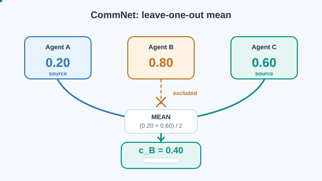

# CommNet（Sukhbaatar 等人，2016）

一種完全合作的模型：智能體透過共享的廣播通道傳送連續向量進行通訊，通道與策略以反向傳播共同學習。

## 問題

許多合作任務中，智能體只能看到環境的一部分。在多數早期研究中，通訊協定是由設計者決定的。Sukhbaatar 等人探討：智能體能否學會該傳送什麼，而學到的通訊是否能讓它們表現得比不通訊的智能體更好。

## 核心想法

許多合作任務中的智能體只能看到環境的一部分。早期研究大多由設計者預先固定通訊協定。Sukhbaatar 等人把所有智能體視為一個大型前饋控制器的組成部分。每個智能體佔用其中一部分單元，各層之間的連接即是廣播通道。在每一步，智能體 \(j\) 由其輸入產生隱藏狀態 \(h_j\)。接著，每個智能體接收其他智能體傳送內容的平均，並由自身狀態與該平均產生下一個隱藏狀態。由於通道是連續的，整個系統可以用一般的反向傳播訓練，也能與標準的單智能體強化學習或監督式學習結合。

模型很簡單，因此可以套用到許多只有部分觀測的任務上。它也允許智能體數量在執行時改變，作者指出這對移動車輛之間的通訊等應用很重要。

## 方程式或演算法

智能體 \(j\) 在第 \(i+1\) 層的廣播輸入，是其他智能體隱藏狀態的平均：

\[
c_j^{i+1} = \frac{1}{J-1}\sum_{j' \neq j} h_{j'}^{i+1}
\]

接著，每個智能體由自身狀態與此輸入更新隱藏狀態：\(h_j^{i+1} = f^i(h_j^i, c_j^i)\)。線性情形為 \(h_j^{i+1} = \sigma(H^i h_j^i + C^i c_j^i)\)。局部連接的變體只對範圍內的智能體取平均。所有智能體共享同一獎勵。

### 排除自身訊息的平均通訊（動畫）

[GitHub 靜態回退預覽：CommNet 排除自身的平均通訊](../../../../../../assets/concept-animations/commnet-leave-one-out-still.svg)

**智能體 B** 接收的通訊向量是**其他**智能體的平均值，不包含自己的隱藏狀態。以人工設定的一維座標為例，令 \(h_A=0.20\)、\(h_B=0.80\)、\(h_C=0.60\)，因此 \(c_B=(0.20+0.60)/2=0.40\)。橘色叉號表示 \(h_B\) 不參與此次通訊平均；但 **B 在更新下一層時仍會另外使用自己的隱藏狀態**。實際 CommNet 傳送的是向量，平均運算逐座標進行。光點移動與數值皆為教學示意，**不是模型實測結果**。[^comm-mean]

MkDocs 播放器支援**播放／暫停**及鍵盤 **Enter／Space**；減少動態效果模式預設顯示靜態回退。原創圖由 AI Wiki 貢獻者製作，採 **CC BY-SA 4.0** 授權。

[^comm-mean]: Sukhbaatar、Szlam 與 Fergus（2016），[*Learning Multiagent Communication with Backpropagation*](https://arxiv.org/abs/1605.07736)，詳見參考文獻。

### 跨智能體多層通訊與狀態更新（動畫）

[GitHub 靜態回退預覽：CommNet 的連續兩層更新](../../../../../../assets/concept-animations/commnet-layer-iterations-still.svg)

CommNet 並非只計算一次廣播平均值：後續層可用**更新後的隱藏狀態重新通訊**。本圖使用**人工構造的一維教學範例**，初始 \((h_A^0,h_B^0,h_C^0)=(0.20,0.80,0.60)\)，刻意以簡單的 \(h_j^{\ell+1}=0.5h_j^\ell+0.5c_j^\ell\) 取代實際學得的非線性更新，其中 \(c_j^\ell\) 是在第 \(\ell\) 層對其他智能體的平均。第一層 \(c_B^0=(0.20+0.60)/2=0.40\)，因此 \(h_B^1=0.60\)，同時 \(h_A^1=0.45\)、\(h_C^1=0.55\)。下一層 \(c_B^1=(0.45+0.55)/2=0.50\)，使 \(h_B^2=0.55\)；其餘 \(h_A^2\approx0.51\)、\(h_C^2\approx0.54\) 亦由相同的示意規則算得。**這些數值不是原始 CommNet 的學習權重或模型實測結果**。[^comm-mean]

藍色與青綠色路徑代表其他智能體資訊，橘色代表接收者自身狀態參與混合。MkDocs 播放器支援**播放／暫停**、鍵盤 **Enter／Space** 及減少動態效果的靜態回退。AI Wiki 貢獻者原創圖，採 **CC BY-SA 4.0** 授權。

## 結果

論文在數個合作任務上評估 CommNet，包括拉桿任務、車輛必須不相撞地通過的交通路口任務，以及戰鬥任務。摘要報告，智能體「學會彼此通訊，表現優於不通訊的智能體與基準」。在某些情況下，學到的語言可以被解讀，揭示解決任務的簡單策略。

## 限制

- **假設完全合作。** 每個智能體都接收相同的獎勵，因此模型不處理競爭情境。
- **以平均通訊。** 對傳送內容取平均，等於把所有其他智能體一視同仁，因此模型難以專注於特定的智能體。
- **可解釋性。** 部分學到的訊息可以被解讀，但這取決於任務。

## 關聯

- DIAL（見 [RIAL 與 DIAL](../rial-dial/index.md)）同樣端到端地學習通訊，但在執行時使用離散訊息。
- [MADDPG](../../maddpg/index.md) 不使用學到的通道來協調智能體。它的集中式評論家在訓練時看到其他智能體的動作，而不是訊息。
- CommNet 是[總覽](../index.md)所涵蓋的湧現式通訊方法之一。

## 應用

- **交通控制。** 車輛就路口狀況互相通訊，如交通路口任務所示。
- **多機器人協調**，每個機器人只有局部視野，必須分享資訊。

## 未解問題

- 如何處理大量或數量變動的智能體之間的通訊。
- 如何讓學到的訊息更容易解讀。

## 參考文獻

### 奠基性論文

- Sukhbaatar, Szlam & Fergus (2016), "Learning multiagent communication with backpropagation", [arXiv:1605.07736](https://arxiv.org/abs/1605.07736) — CommNet 論文，包含廣播通道、反向傳播訓練，以及交通路口與戰鬥任務。
- Foerster et al. (2016), "Learning to communicate with deep multi-agent reinforcement learning", [arXiv:1605.06676](https://arxiv.org/abs/1605.06676) — RIAL 與 DIAL，分別學習離散與可微分的訊息，用於比較。
- Lazaridou, Peysakhovich & Baroni (2017), "Multi-agent cooperation and the emergence of (natural) language", [arXiv:1612.07182](https://arxiv.org/abs/1612.07182) — 研究指涉遊戲中湧現的符號，以及如何把它們與人類語言建立連結。
- Lowe et al. (2017), "Multi-agent actor-critic for mixed cooperative-competitive environments", [arXiv:1706.02275](https://arxiv.org/abs/1706.02275) — 集中式評論家，用於與以通訊為基礎的協調方式比較。

### 綜述與教科書

- Busoniu, Babuska & De Schutter (2008), "A comprehensive survey of multiagent reinforcement learning", *IEEE Transactions on Systems, Man, and Cybernetics, Part C* 38(2), 156–172. https://doi.org/10.1109/TSMCC.2007.913919 — 多智能體學習情境的綜述，包含把通訊作為協調工具。
