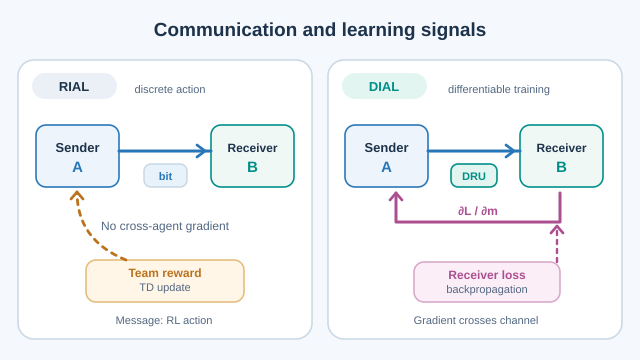
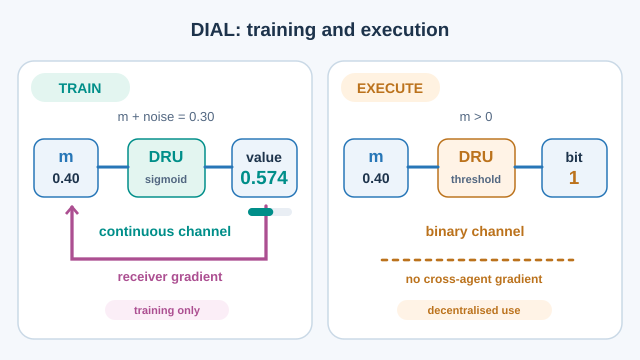

# RIAL and DIAL (Foerster et al., 2016)

Two ways for a team of agents to learn a communication protocol end to end. RIAL trains the message with deep Q-learning, while DIAL lets error gradients flow through the channel itself during training.

## Problem

Agents see only part of the state, and must share information to solve a joint task. The paper studies tasks inspired by communication riddles and by multi-agent vision, where each agent sees only part of the input. The protocol is not given. Agents must learn what to send and how to read what they receive, and the only feedback is the team's shared reward.

## Core idea

Each agent has a network that outputs two things: an environment action and a message for the other agents. Messages are passed to the other agents at the next time step. The two methods differ in how they handle the message channel.

- **RIAL** (reinforced inter-agent learning) treats each message symbol as an action. Each agent learns separate environment-action and message Q-value outputs, and it uses a recurrent network to handle partial observability. The messages are learned by the same reinforcement signal as the actions.
- **DIAL** (differentiable inter-agent learning) makes the channel differentiable. During centralised learning, the receiver's loss is back-propagated through the message to the sender. A discretise/regularise unit regularises the message with noise during training and discretises it during decentralised execution. Because the gradient passes between agents, the message gets a much more direct learning signal than in RIAL.

The paper uses centralised learning with decentralised execution. Parameters can be shared across agents, which the authors find helpful for learning in these tasks.

## Equation or algorithm

RIAL uses separate \(Q_u\) and \(Q_m\) outputs, not a Cartesian-product action head. For either head \(k\), a schematic DQN target is

\[
y_t^{(k)}=r_t+\gamma(1-d_t)\max_{a'}Q_k^-(h_{t+1},a').
\]

Here \(a'\) ranges over environment actions or message symbols, respectively; \(h\) abbreviates recurrent inputs, \(Q^-\) is the target network, and \(d_t\) marks termination. The chosen output is trained toward this target. For DIAL, training sends \(\operatorname{Logistic}(m+\varepsilon)\), with \(\varepsilon\sim\mathcal N(0,\sigma^2)\). Execution sends \(\mathbf1\{m>0\}\); cross-agent backpropagation is training-only.

### Communication credit paths (animated)

[Static GitHub fallback: RIAL and DIAL credit paths](../../../../../../assets/concept-animations/rial-dial-credit-path-still.svg)

The blue pulses represent messages from a sender to a receiver. **RIAL** treats a discrete message as an action, so its message choice is trained through a reward-based temporal-difference update, not by differentiating through the receiver. **DIAL**, during *centralised training*, uses the noisy differentiable discretise/regularise unit (DRU), allowing the receiver's loss gradient (pink) to reach the sender through the message channel. During decentralised execution, the DRU discretises the message; the pink path is **not** an execution-time feedback channel. The moving markers represent dependencies, not measured gradients or an observed training trajectory. [^comm-credit]

The MkDocs player supports **Play/Pause** and keyboard **Enter/Space**; readers who prefer reduced motion initially see the static fallback. Original diagram by AI Wiki contributors, **CC BY-SA 4.0**.

[^comm-credit]: Foerster et al. (2016), [*Learning to Communicate with Deep Multi-Agent Reinforcement Learning*](https://arxiv.org/abs/1605.06676), as listed in References.

### DIAL's DRU: differentiable during training, binary at execution (animated)

[Static GitHub fallback: DIAL's two channel modes](../../../../../../assets/concept-animations/dial-dru-train-execute-still.svg)

The **discretise/regularise unit (DRU)** has two different roles. During centralised training, it applies noise and a smooth logistic transformation, so the receiver's loss is differentiable with respect to the sender's message. During decentralised execution it emits a discrete bit, without a cross-agent gradient path. In this **constructed scalar example**, a sender activation \(m=0.40\) and one hypothetical noise sample \(\varepsilon=-0.10\) give \(\sigma(0.30)\approx0.574\) in training; the corresponding positive activation yields bit \(1\) under a zero threshold at execution. The drawn path is schematic, **not a sampled training trace or a measured model activation**. It also must not be interpreted as claiming an execution-time gradient. [^comm-credit]

The MkDocs player offers **Play/Pause** via mouse or **Enter/Space**. Reduced-motion preference and GitHub Markdown use the linked static overview. Original figure by AI Wiki contributors, **CC BY-SA 4.0**.

Printed values are available for checking; moving packets indicate dependencies, not measurements. Messages arrive before subsequent computation or training gradients begin; the static figure is an overview of the complete process. The 640-pixel figure can be focused and scrolled horizontally with arrow keys.

## Results

In the switch riddle with three agents, all four variants (RIAL and DIAL, each with and without parameter sharing) learn an optimal policy within about 5,000 episodes, as the paper's text states. DIAL with parameter sharing reaches it faster than RIAL. With four agents, RIAL without parameter sharing does not beat the no-communication baseline. In the multi-step and colour-digit MNIST tasks, DIAL substantially outperforms the other methods on both games, and RIAL fails to learn the multi-step task. The results are shown as curves normalised to an oracle baseline, so the exact values are in the figures.

## Limitations

- **Centralised learning.** DIAL needs gradients to flow between agents during training, which requires a shared training process.
- **Independent learning is fragile.** Without parameter sharing, RIAL did not beat the no-communication baseline in the four-agent switch riddle.
- **Interpretability.** The learned symbols are not guaranteed to carry any human-readable meaning.

## Connections

- RIAL uses the deep Q-learning approach of [Deep Q-networks](../../../deep-q-networks/index.md) for each agent.
- DIAL's relaxed message channel is a differentiable communication channel, which is an alternative to CommNet's averaged hidden states, described in [CommNet](../commnet/index.md).
- Communication is studied in the [overview](../index.md) of emergent communication.

## Applications

- **Coordination with limited observations**, where each agent knows only part of the state.
- **Multi-agent vision**, where each agent sees a different view of a scene.

## Open questions

- How to learn communication that transfers to new partners.
- How to ground learned messages in shared meaning without human supervision.

## References

### Seminal papers

- Foerster et al. (2016), "Learning to communicate with deep multi-agent reinforcement learning", [arXiv:1605.06676](https://arxiv.org/abs/1605.06676) — The RIAL and DIAL paper, with the switch riddle and the discretise/regularise unit described above.
- Mnih et al. (2015), "Human-level control through deep reinforcement learning", *Nature* 518, 529–533. https://doi.org/10.1038/nature14236 — The deep Q-learning method that RIAL uses for each agent.
- Sukhbaatar, Szlam & Fergus (2016), "Learning multiagent communication with backpropagation", [arXiv:1605.07736](https://arxiv.org/abs/1605.07736) — CommNet, a continuous alternative to DIAL's discrete channel.
- Lazaridou, Peysakhovich & Baroni (2017), "Multi-agent cooperation and the emergence of (natural) language", [arXiv:1612.07182](https://arxiv.org/abs/1612.07182) — Studies emergent symbols in referential games and how they can be grounded in human language.

### Surveys and textbooks

- Busoniu, Babuska & De Schutter (2008), "A comprehensive survey of multiagent reinforcement learning", *IEEE Transactions on Systems, Man, and Cybernetics, Part C* 38(2), 156–172. https://doi.org/10.1109/TSMCC.2007.913919 — Survey of multi-agent learning settings and of the coordination problems that communication addresses.
