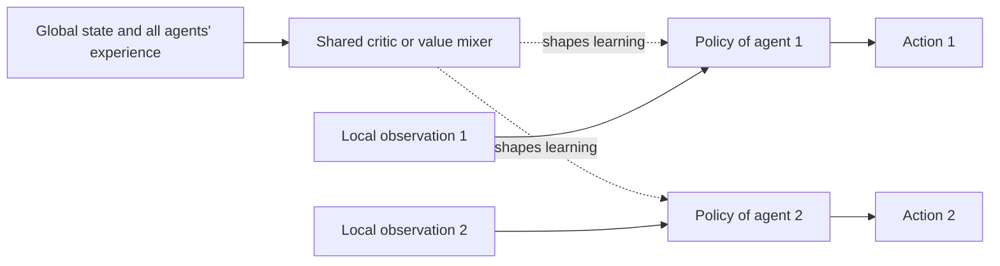

# Multi-Agent Reinforcement Learning

Multi-agent reinforcement learning (MARL) studies several learning agents that act in the same environment, where each agent's experience depends on what the others do. It extends single-agent [reinforcement learning](../index.md) to teams that must cooperate, rivals that must compete, and mixtures of both. Its central difficulty is that, as partners and opponents learn, the world seems to change from each agent's point of view.

## Overview

A single-agent learner faces a fixed Markov decision process. With other learners present, the outcome of an action depends on their choices, which keep changing. Littman (1994) proposed the *Markov game* as the framework for this case, a generalisation of the Markov decision process in which several agents choose actions at once. Game theory supplies the solution concepts, most importantly the Nash equilibrium (Nash, 1950), in which no agent can gain by changing its strategy alone.

MARL draws on reinforcement learning and on older work in multi-agent systems and game theory, which asked how agents should coordinate or compete long before deep learning. Busoniu et al. (2008) and Hernandez-Leal et al. (2018) survey both traditions.

## Key concepts

- **Markov game**: agents, states, joint actions, transitions, one reward function per agent, and a discount factor.
- **Joint action**: the vector of every agent's action at one time step. The next state depends on the joint action, not just on the learner's own action.
- **Partial observability**: each agent often sees only its own local observation, not the full state.
- **Non-stationarity**: from agent $i$'s view, the transition probability depends on the other agents' policies, which change during training.
- **Cooperative, competitive and mixed settings**: a team shares one reward, a zero-sum game pits one agent's gain against another's loss, and most real settings lie between.
- **Credit assignment**: when a team earns a shared reward, the learner must decide which agent's actions deserve credit.
- **Social dilemma**: individually rational choices that leave the group worse off, as in the prisoner's dilemma.

## How it works

### Markov games

A Markov game is written as $\langle N, S, \{A_i\}_{i \in N}, P, \{R_i\}_{i \in N}, \gamma \rangle$. Each agent $i$ picks an action $a_i$, the joint action $\mathbf{a}$ moves the system to a new state with probability $P(s' \mid s, \mathbf{a})$, and each agent receives its own reward $r_i$. A joint policy $\boldsymbol{\pi}^\ast$ is a Nash equilibrium when no agent can do better by changing only its own policy:

$$
J_i(\pi_i^\ast, \boldsymbol{\pi}^\ast_{-i}) \ge J_i(\pi_i, \boldsymbol{\pi}^\ast_{-i}) \quad \text{for every agent } i \text{ and every policy } \pi_i.
$$

Learning rules that converge in a single-agent problem may cycle when several agents adjust at once.

### Independent and centralised learning

The simplest approach is **independent learning**: each agent runs an ordinary single-agent algorithm on its own observations and treats the others as part of the environment. Independent learning is easy to scale, but non-stationarity makes it unreliable. Independent Q-learning also sits badly with experience replay, because old transitions were generated under other agents' former policies.

Most recent work uses **centralised training with decentralised execution** (CTDE): training may use information unavailable at run time, such as the global state, but each agent acts from its own observation afterwards.

The methods differ in what the central part learns. A centralised critic can take every agent's action as input, as in [MADDPG](maddpg/index.md) and the counterfactual baseline of COMA (Foerster et al., 2017). Value-decomposition methods build a joint value from per-agent values, as [QMIX](qmix/index.md) and the earlier VDN do (Sunehag et al., 2017). Papoudakis et al. (2020) compare these families on a common set of cooperative tasks.

### Emergent communication and cooperation

When agents can send messages, the protocol itself can be learned. Foerster et al. (2016) introduced RIAL, which learns discrete messages with deep Q-learning, and DIAL, which passes gradients back through the message channel during training. Lazaridou et al. (2016) used a referential game, in which a sender must describe a target image so that a receiver can pick it out, and found that simple symbol systems arise from the need to coordinate. Mordatch and Abbeel (2017) reported a basic compositional vocabulary and non-verbal signals such as pointing.

Cooperation can also emerge without explicit messages. Leibo et al. (2017) studied sequential social dilemmas, in which cooperation is a property of a policy rather than of one action, and found that learned behaviour depended on environmental factors such as resource abundance. Baker et al. (2019) reported that hide-and-seek agents went through several strategy phases, including shelter building and ramp use, because each side's new strategy pressed the other to adapt. Emergent signals help coordination but need not resemble human language, so claims about meaning need testing.

### Populations and self-play

Training against one fixed opponent can produce strategies that fail elsewhere. [Self-play](../mcts-and-self-play/index.md) removes the fixed opponent, but a pair of learners can still cycle. Population methods keep many agents at once, so that each learner faces a range of rivals, as in the league used for AlphaStar. See [population-based training](population-based-training/index.md).

## Key methods

Three landmark approaches have their own pages.

| Method | Year | Learning setup | Idea |
|---|---|---|---|
| [QMIX](qmix/index.md) | 2018 | Cooperative, CTDE | Joint action value as a monotonic mix of per-agent values |
| [MADDPG](maddpg/index.md) | 2017 | Cooperative or competitive, CTDE | Each agent has a critic that sees all agents' actions |
| [Population-based training](population-based-training/index.md) | 2017–2019 | Competitive or mixed | Train a population and let weaker members copy stronger ones |

## Connections

MARL builds on the single-agent methods in this section: the value functions of [value-based methods](../value-based-methods/index.md), the actors and critics of [policy gradient and actor-critic](../policy-gradient-and-actor-critic/index.md), and the replay problems of [experience replay](../experience-replay/index.md). Population methods also link to [evolutionary and swarm intelligence](../../../evolutionary/index.md), and most public successes have come in [games](../../../../applications/games/index.md).

The brain and mind connection is at the level of questions rather than established mechanisms. What an agent must model about its partners is the question that [theory of mind](../../../../brain-mind/psychology/index.md) research asks about people. Social learning in animals, discussed in [animal cognition](../../../../brain-mind/animal-cognition/index.md), is a natural comparison for emergent communication. No MARL system has been shown to share the brain's mechanisms, so these comparisons remain hypotheses.

Language-model systems use "multi-agent" for something different. [Multi-agent orchestration](../../../../engineering/agents/multi-agent-orchestration/index.md) coordinates prompted models at inference time, whereas MARL trains the policies themselves.

## Applications

- **Games.** OpenAI Five, a team of five neural networks, defeated the Dota 2 world champions in 2019 after large-scale self-play (Berner et al., 2019). AlphaStar reached grandmaster level in StarCraft II with a league of agents (Vinyals et al., 2019), and population-based training produced teams that competed with humans in Quake III Capture the Flag (Jaderberg et al., 2019). See [Games](../../../../applications/games/index.md).
- **Networks and traffic.** Packet routing and autonomous vehicle coordination are natural multi-agent problems (Foerster et al., 2017).
- **Benchmarks.** Multi-agent particle worlds and the StarCraft Multi-Agent Challenge are common test beds. Papoudakis et al. (2020) argue that comparisons need shared, well-documented tasks.
- **Mixed-motive tasks.** Social dilemmas test whether policies balance self-interest against group welfare, a concern also raised by [AI safety and alignment](../../../../society/safety-alignment/index.md).

## Open questions

- **Convergence.** Many MARL algorithms have no guarantee of reaching an equilibrium, and the theory lags far behind practice (Zhang et al., 2019).
- **Scaling to many agents.** Joint action spaces grow exponentially with the number of agents, and it is unclear how much is lost by approximations.
- **Ad hoc teamwork.** Agents trained together often fail with unfamiliar partners, since independent learners overfit to each other (Lanctot et al., 2017).
- **Meaningful communication.** Learned protocols solve their tasks, but whether they generalise or keep stable meaning across populations is still under study.
- **Evaluation.** Results depend on the benchmark and the opponent pool, and it is hard to tell robust play from exploitation of one opponent type.

## References

### Seminal papers

- Littman, M. L. (1994). *Markov games as a framework for multi-agent reinforcement learning*. Machine Learning Proceedings 1994. https://doi.org/10.1016/B978-1-55860-335-6.50027-1 — Introduces the Markov game, the framework for most MARL work.
- Nash, J. F. (1950). *Equilibrium points in n-person games*. Proceedings of the National Academy of Sciences. https://doi.org/10.1073/pnas.36.1.48 — Defines the Nash equilibrium used throughout multi-agent learning.
- Foerster, J. et al. (2016). *Learning to Communicate with Deep Multi-Agent Reinforcement Learning*. arXiv:1605.06676. https://arxiv.org/abs/1605.06676 — Introduces RIAL and DIAL, which learn communication protocols end to end.
- Lowe, R. et al. (2017). *Multi-Agent Actor-Critic for Mixed Cooperative-Competitive Environments*. arXiv:1706.02275. https://arxiv.org/abs/1706.02275 — MADDPG, with a critic that sees all agents' actions during training.
- Rashid, T. et al. (2018). *QMIX: Monotonic Value Function Factorisation for Deep Multi-Agent Reinforcement Learning*. arXiv:1803.11485. https://arxiv.org/abs/1803.11485 — Mixes per-agent values monotonically into a team value.
- Sunehag, P. et al. (2017). *Value-Decomposition Networks For Cooperative Multi-Agent Learning*. arXiv:1706.05296. https://arxiv.org/abs/1706.05296 — VDN, which decomposes the team value into a sum of agent-wise values.
- Vinyals, O. et al. (2019). *Grandmaster level in StarCraft II using multi-agent reinforcement learning*. Nature. https://doi.org/10.1038/s41586-019-1724-z — AlphaStar, trained with a league of agents playing one another.
- Jaderberg, M. et al. (2019). *Human-level performance in 3D multiplayer games with population-based reinforcement learning*. Science. https://doi.org/10.1126/science.aau6249 — Trains teams in Quake III Capture the Flag through a population of learners.

### Surveys and textbooks

- Busoniu, L., Babuska, R. & De Schutter, B. (2008). *A Comprehensive Survey of Multiagent Reinforcement Learning*. IEEE Transactions on Systems, Man, and Cybernetics, Part C. https://doi.org/10.1109/TSMCC.2007.913919 — Early survey of learning among several agents and its difficulties.
- Hernandez-Leal, P., Kartal, B. & Taylor, M. E. (2018). *A Survey and Critique of Multiagent Deep Reinforcement Learning*. arXiv:1810.05587. https://arxiv.org/abs/1810.05587 — Reviews deep MARL and which earlier assumptions still hold.
- Zhang, K., Yang, Z. & Başar, T. (2019). *Multi-Agent Reinforcement Learning: A Selective Overview of Theories and Algorithms*. arXiv:1911.10635. https://arxiv.org/abs/1911.10635 — Overview of MARL theory, which the abstract describes as relatively lacking.

### Articles and documentation

- Foerster, J. et al. (2017). *Counterfactual Multi-Agent Policy Gradients*. arXiv:1705.08926. https://arxiv.org/abs/1705.08926 — COMA, a centralised critic with a counterfactual baseline for decentralised actors.
- Lazaridou, A., Peysakhovich, A. & Baroni, M. (2016). *Multi-Agent Cooperation and the Emergence of (Natural) Language*. arXiv:1612.07182. https://arxiv.org/abs/1612.07182 — Referential games in which agents invent a language to coordinate.
- Mordatch, I. & Abbeel, P. (2017). *Emergence of Grounded Compositional Language in Multi-Agent Populations*. arXiv:1703.04908. https://arxiv.org/abs/1703.04908 — Compositional vocabulary and pointing emerge in a grounded multi-agent environment.
- Leibo, J. Z. et al. (2017). *Multi-agent Reinforcement Learning in Sequential Social Dilemmas*. arXiv:1702.03037. https://arxiv.org/abs/1702.03037 — Shows how learned cooperation depends on resource abundance in social dilemmas.
- Baker, B. et al. (2019). *Emergent Tool Use From Multi-Agent Autocurricula*. arXiv:1909.07528. https://arxiv.org/abs/1909.07528 — Hide-and-seek agents produce successive strategy phases, including tool use.
- Berner, C. et al. (2019). *Dota 2 with Large Scale Deep Reinforcement Learning*. arXiv:1912.06680. https://arxiv.org/abs/1912.06680 — The OpenAI Five system, trained by large-scale self-play.
- Lanctot, M. et al. (2017). *A Unified Game-Theoretic Approach to Multiagent Reinforcement Learning*. arXiv:1711.00832. https://arxiv.org/abs/1711.00832 — Shows that independent learners overfit to each other's policies.
- Papoudakis, G. et al. (2020). *Benchmarking Multi-Agent Deep Reinforcement Learning Algorithms in Cooperative Tasks*. arXiv:2006.07869. https://arxiv.org/abs/2006.07869 — Compares independent learning, centralised policy gradients and value decomposition on common tasks.
