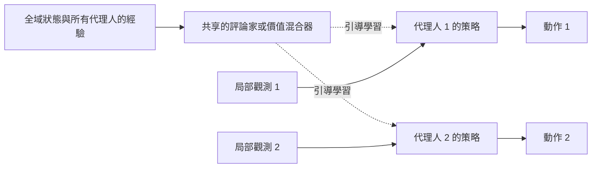

# 多代理人強化學習

多代理人強化學習（multi-agent reinforcement learning，MARL）研究多個學習代理人在同一環境中行動的情況，每個代理人的經驗都取決於其他代理人的作為。它把單一代理人的[強化學習](../index.md)延伸到必須合作的團隊、必須對抗的競爭者，以及兩者兼有的混合情境。它的核心難題在於：隨著隊友與對手一起學習，從每個代理人的角度看，世界本身也在變動。

## 概述

單一代理人的學習者面對的是固定的馬可夫決策過程。當其他學習者也存在時，一個動作的結果取決於他們的選擇，而這些選擇會不斷改變。Littman（1994）提出以**馬可夫博弈**（Markov game）作為這種情境的框架，它是馬可夫決策過程的推廣，讓多個代理人同時選擇動作。博弈論提供了解概念，其中最重要的是納許均衡（Nash, 1950），也就是沒有任何代理人能只靠改變自己的策略而獲益的狀態。

多代理人強化學習同時承接強化學習，以及多代理人系統與博弈論的舊有研究；後者早在深度學習出現之前，就已探討代理人應如何協調或競爭。Busoniu 等人（2008）與 Hernandez-Leal 等人（2018）對這兩個傳統都有綜述。

## 關鍵概念

- **馬可夫博弈**：由代理人、狀態、聯合動作、轉移、每個代理人各自的獎勵函數與折扣因子組成。
- **聯合動作**：所有代理人在某一時間步的動作向量。下一個狀態取決於聯合動作，而不只是學習者自己的動作。
- **部分可觀測性**：每個代理人往往只看得見自己的局部觀測，看不到完整狀態。
- **非平穩性**：從代理人 $i$ 的角度來看，轉移機率取決於其他代理人的策略，而這些策略在訓練中會改變。
- **合作、競爭與混合情境**：團隊共享同一份獎勵；零和博弈中，一方的得益即另一方的損失；多數實際情境介於兩者之間。
- **信用分配**：當團隊共享獎勵時，學習者必須判斷哪個代理人的動作應獲得功勞。
- **社會困境**：個體理性的選擇卻使群體變差，如囚徒困境。

## 運作方式

### 馬可夫博弈

馬可夫博弈寫作 $\langle N, S, \{A_i\}_{i \in N}, P, \{R_i\}_{i \in N}, \gamma \rangle$。每個代理人 $i$ 選擇動作 $a_i$，聯合動作 $\mathbf{a}$ 以機率 $P(s' \mid s, \mathbf{a})$ 把系統推進到新狀態，且每個代理人各自得到獎勵 $r_i$。若某個聯合策略 $\boldsymbol{\pi}^\ast$ 滿足沒有任何代理人能只改變自己的策略而獲益，則它是一個納許均衡：

$$
J_i(\pi_i^\ast, \boldsymbol{\pi}^\ast_{-i}) \ge J_i(\pi_i, \boldsymbol{\pi}^\ast_{-i}) \quad \text{對每個代理人 } i \text{ 與每個策略 } \pi_i \text{ 皆成立。}
$$

在單一代理人問題中可以收斂的學習規則，當多個代理人同時調整時，可能會陷入循環。

### 獨立學習與中心化學習

最簡單的做法是**獨立學習**（independent learning）：每個代理人只用自己的觀測執行單一代理人的演算法，並把其他代理人視為環境的一部分。獨立學習容易擴展，但非平穩性使它不夠可靠。獨立的 Q 學習也難以與經驗回放結合，因為舊的轉移是在其他代理人以前的策略下產生的。

近期大多數研究採用**中心化訓練、去中心化執行**（centralised training with decentralised execution，CTDE）：訓練時可以使用執行時無法取得的資訊，例如全域狀態，但之後每個代理人只根據自己的觀測行動。

各種方法的差別在於中心部分學習什麼。中心化評論家可以把所有代理人的動作當作輸入，如 [MADDPG](maddpg/index.md) 以及 COMA 的反事實基線（Foerster 等人，2017）。價值分解方法則由每個代理人的價值組合出聯合價值，如 [QMIX](qmix/index.md) 與較早的 VDN（Sunehag 等人，2017）。Papoudakis 等人（2020）在共同的合作式任務上比較了這些方法。

### 湧現的溝通與合作

當代理人能夠傳送訊息時，溝通協定本身也可以被學習。Foerster 等人（2016）提出 RIAL，以深度 Q 學習學習離散訊息；以及 DIAL，在訓練時把梯度穿過訊息通道傳回。Lazaridou 等人（2016）設計指涉遊戲：發送者必須描述一張目標圖片，讓接收者能把它挑出來，並發現簡單的符號系統會因協調的需要而出現。Mordatch 與 Abbeel（2017）則報告了基本的組合式詞彙，以及如指向之類的非語言訊號。

不需要明確的訊息，合作也可能出現。Leibo 等人（2017）研究序列社會困境，其中合作是策略的性質，而不是單一動作；他們發現學到的行為取決於資源豐裕等環境因素。Baker 等人（2019）報告，玩捉迷藏的代理人經歷了幾個策略階段，包括建造掩體與使用斜坡，因為每一方的新策略都迫使另一方調整。湧現的訊號有助於協調，但不一定與人類語言相似，因此關於意義的主張需要檢驗。

### 族群與自我對弈

只對抗單一固定對手，可能會得到在其他情況下失效的策略。[自我對弈](../mcts-and-self-play/index.md)移除了固定對手，但一對學習者仍可能陷入循環。族群方法同時維持許多代理人，使每個學習者面對一系列對手，例如 AlphaStar 所用的聯盟；詳見[基於族群的訓練](population-based-training/index.md)。

## 關鍵方法

三個里程碑式的方法各有專頁。

| 方法 | 年份 | 學習設定 | 核心想法 |
|---|---|---|---|
| [QMIX](qmix/index.md) | 2018 | 合作式，CTDE | 聯合動作價值是每個代理人價值的單調混合 |
| [MADDPG](maddpg/index.md) | 2017 | 合作或競爭，CTDE | 每個代理人都有一個能看到所有代理人動作的評論家 |
| [基於族群的訓練](population-based-training/index.md) | 2017–2019 | 競爭或混合 | 訓練一個族群，讓較弱的成員複製較強的成員 |

## 關聯

多代理人強化學習直接建立在本節的單一代理人方法之上：[價值基礎方法](../value-based-methods/index.md)的價值函數、[策略梯度與 Actor-Critic](../policy-gradient-and-actor-critic/index.md)的演員與評論家，以及[經驗回放](../experience-replay/index.md)所面對的重播問題。族群方法也與[演化計算與群體智慧](../../evolutionary/index.md)相關，且公開最成功的案例大多出現在[遊戲](../../../../applications/games/index.md)領域。

腦科學與心智的連結停留在問題層次，而非已確立的機制。一個代理人必須對其夥伴建立怎樣的模型，正是[心智理論](../../../../brain-mind/psychology/index.md)研究對人類提出的問題；而[動物認知](../../../../brain-mind/animal-cognition/index.md)中討論的動物社會學習，則是湧現溝通的自然對照。目前還沒有任何多代理人強化學習系統被證明與大腦共享機制，因此這些比較仍只是假說。

語言模型系統也使用「多代理人」一詞，但指的是另一回事。[多代理人編排](../../../../engineering/agents/multi-agent-orchestration/index.md)是在推論時協調經過提示的模型，而多代理人強化學習訓練的是策略本身。

## 應用

- **遊戲。** OpenAI Five 是由五個神經網路組成的團隊，在 2019 年經大規模自我對弈後擊敗了 Dota 2 的世界冠軍（Berner 等人，2019）。AlphaStar 以代理人聯盟達到星海爭霸 II 的大師級水準（Vinyals 等人，2019），而基於族群的訓練讓雷神之鎚 III 的奪旗團隊能與人類競爭（Jaderberg 等人，2019）。見[遊戲](../../../../applications/games/index.md)。
- **網路與交通。** 封包路由與自動駕駛車輛的協調，是天然的多代理人問題（Foerster 等人，2017）。
- **基準測試。** 多代理人粒子環境與星海爭霸多代理人挑戰是常見的測試平台。Papoudakis 等人（2020）主張比較應使用共同且記錄完整的任務。
- **混合動機任務。** 社會困境用來測試策略能否在自身利益與群體福祉之間取得平衡，這個問題也是 [AI 安全與對齊](../../../../society/safety-alignment/index.md)所關心的。

## 開放問題

- **收斂性。** 許多多代理人強化學習演算法無法保證達到均衡，而理論遠遠落後於實務（Zhang 等人，2019）。
- **擴展到大量代理人。** 聯合動作空間隨代理人數量呈指數成長，而近似方法會損失多少仍不清楚。
- **臨時團隊合作。** 一起訓練的代理人，遇到不熟悉的夥伴時常常表現不佳，因為獨立學習者會對彼此過度擬合（Lanctot 等人，2017）。
- **有意義的溝通。** 學到的協定能解決任務，但它們能否泛化，或能否在族群之間保持穩定的意義，仍在研究中。
- **評估。** 結果取決於基準與對手群，很難分辨穩健的表現與只針對某一類對手的利用。

## 參考文獻

### 開創性論文

- Littman, M. L. (1994). *Markov games as a framework for multi-agent reinforcement learning*. Machine Learning Proceedings 1994. https://doi.org/10.1016/B978-1-55860-335-6.50027-1 — 提出馬可夫博弈，是多數多代理人強化學習工作所用的框架。
- Nash, J. F. (1950). *Equilibrium points in n-person games*. Proceedings of the National Academy of Sciences. https://doi.org/10.1073/pnas.36.1.48 — 定義納許均衡，整個多代理人學習都以此為解概念。
- Foerster, J. 等人 (2016). *Learning to Communicate with Deep Multi-Agent Reinforcement Learning*. arXiv:1605.06676. https://arxiv.org/abs/1605.06676 — 提出 RIAL 與 DIAL，以端到端方式學習溝通協定。
- Lowe, R. 等人 (2017). *Multi-Agent Actor-Critic for Mixed Cooperative-Competitive Environments*. arXiv:1706.02275. https://arxiv.org/abs/1706.02275 — MADDPG，訓練時評論家能看到所有代理人的動作。
- Rashid, T. 等人 (2018). *QMIX: Monotonic Value Function Factorisation for Deep Multi-Agent Reinforcement Learning*. arXiv:1803.11485. https://arxiv.org/abs/1803.11485 — 以單調方式把各代理人的價值混合為團隊價值。
- Sunehag, P. 等人 (2017). *Value-Decomposition Networks For Cooperative Multi-Agent Learning*. arXiv:1706.05296. https://arxiv.org/abs/1706.05296 — VDN，把團隊價值分解為各代理人價值的總和。
- Vinyals, O. 等人 (2019). *Grandmaster level in StarCraft II using multi-agent reinforcement learning*. Nature. https://doi.org/10.1038/s41586-019-1724-z — AlphaStar，以彼此對弈的代理人聯盟訓練而成。
- Jaderberg, M. 等人 (2019). *Human-level performance in 3D multiplayer games with population-based reinforcement learning*. Science. https://doi.org/10.1126/science.aau6249 — 透過一個族群訓練雷神之鎚 III 奪旗的團隊代理人。

### 綜述與教科書

- Busoniu, L., Babuska, R. & De Schutter, B. (2008). *A Comprehensive Survey of Multiagent Reinforcement Learning*. IEEE Transactions on Systems, Man, and Cybernetics, Part C. https://doi.org/10.1109/TSMCC.2007.913919 — 早期綜述，討論多個代理人之間的學習及其困難。
- Hernandez-Leal, P., Kartal, B. & Taylor, M. E. (2018). *A Survey and Critique of Multiagent Deep Reinforcement Learning*. arXiv:1810.05587. https://arxiv.org/abs/1810.05587 — 回顧深度多代理人強化學習，並檢視哪些早期假設仍然成立。
- Zhang, K., Yang, Z. & Başar, T. (2019). *Multi-Agent Reinforcement Learning: A Selective Overview of Theories and Algorithms*. arXiv:1911.10635. https://arxiv.org/abs/1911.10635 — 多代理人強化學習理論的概覽；摘要指出這方面的理論相對薄弱。

### 文章與文件

- Foerster, J. 等人 (2017). *Counterfactual Multi-Agent Policy Gradients*. arXiv:1705.08926. https://arxiv.org/abs/1705.08926 — COMA，以中心化評論家與反事實基線訓練去中心化的演員。
- Lazaridou, A., Peysakhovich, A. & Baroni, M. (2016). *Multi-Agent Cooperation and the Emergence of (Natural) Language*. arXiv:1612.07182. https://arxiv.org/abs/1612.07182 — 指涉遊戲中，代理人為了協調而發明語言。
- Mordatch, I. & Abbeel, P. (2017). *Emergence of Grounded Compositional Language in Multi-Agent Populations*. arXiv:1703.04908. https://arxiv.org/abs/1703.04908 — 在有基礎的多代理人環境中，出現組合式詞彙與指向行為。
- Leibo, J. Z. 等人 (2017). *Multi-agent Reinforcement Learning in Sequential Social Dilemmas*. arXiv:1702.03037. https://arxiv.org/abs/1702.03037 — 顯示在社會困境中，學到的合作取決於資源是否豐裕。
- Baker, B. 等人 (2019). *Emergent Tool Use From Multi-Agent Autocurricula*. arXiv:1909.07528. https://arxiv.org/abs/1909.07528 — 捉迷藏代理人產生連續的策略階段，包括使用工具。
- Berner, C. 等人 (2019). *Dota 2 with Large Scale Deep Reinforcement Learning*. arXiv:1912.06680. https://arxiv.org/abs/1912.06680 — OpenAI Five 系統，以大規模自我對弈訓練而成。
- Lanctot, M. 等人 (2017). *A Unified Game-Theoretic Approach to Multiagent Reinforcement Learning*. arXiv:1711.00832. https://arxiv.org/abs/1711.00832 — 顯示獨立學習者會對彼此的策略過度擬合。
- Papoudakis, G. 等人 (2020). *Benchmarking Multi-Agent Deep Reinforcement Learning Algorithms in Cooperative Tasks*. arXiv:2006.07869. https://arxiv.org/abs/2006.07869 — 在共同任務上比較獨立學習、中心化策略梯度與價值分解。
