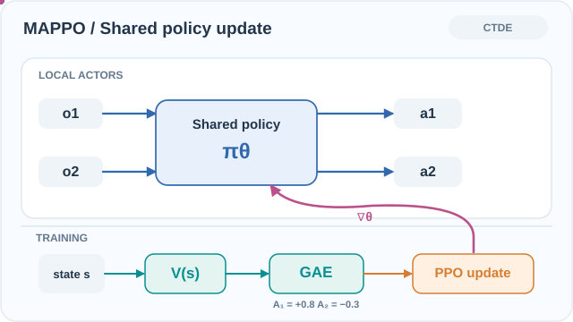

# 多智能體 PPO（Yu 等人，2022）

顯示以共享策略與集中式價值函數的 PPO，是合作式多智能體遊戲中很強的基線，在數個基準上與 QMIX 和 MADDPG 相當。

## 問題

QMIX 與 MADDPG 等離策略及價值分解方法，主導了合作式多智能體基準。PPO 簡單且廣泛使用，但一般認為它在多智能體設定中較弱。Yu 等人探討：PPO 經過幾項有依據的調整後，能否在這些任務上表現良好。

## 核心想法

論文比較兩種做法：獨立 PPO（IPPO），每個智能體在局部觀測上有自己的評論家；以及 MAPPO，智能體共享一個策略網路，並由集中式價值函數以全域狀態為輸入。在智能體同質的設定中使用參數共享，論文附錄指出，有參數共享的 MAPPO「以明顯差距勝過沒有參數共享的 MAPPO」。價值函數可以同時接受智能體專屬特徵與全域特徵作為輸入。

## 方程式或演算法

MAPPO 即[近端策略最佳化](../../proximal-policy-optimisation/index.md)的 PPO 演算法，但有三項改變：智能體共享的演員、以全域狀態為輸入的集中式價值函數 \(V(s)\)，以及由該價值計算的優勢估計。論文建議以下做法：

- **價值正規化**，以穩定價值學習。
- **價值輸入**同時包含局部的智能體專屬特徵與全域特徵（若可取得）。
- **有限的迭代次數。**困難環境最多 10 次訓練迭代，簡單環境最多 15 次。
- **裁剪**，比率保持在 0.2 以下，並在此範圍內調整。
- **大批次**，依樣本效率調整，論文未給出固定數值。

論文也發現，在多智能體領域中，若樣本重複使用過於頻繁，表現會下降。

*原創教學動畫（CC BY-SA 4.0）。* **藍色光點**展示兩個同質智能體如何使用**相同策略參數**，分別根據自身的局部觀測產生動作。訓練期間，**青綠色路徑**簡化呈現集中式 \(V(s)\) 如何支援廣義優勢估計（GAE），**橘色及洋紅色路徑**則表示 PPO 的裁剪目標更新共享策略。GAE 還需要獎勵與軌跡資料（圖中省略）；集中式評論家**不是執行階段演員的輸入**。圖中的 \(A_1=+0.8\)、\(A_2=-0.3\) 是**人工設定的教學數值**，並非實測優勢或精確的最佳化過程。MkDocs 可使用播放／暫停；[GitHub 可閱讀的靜態回退圖](../../../../../assets/concept-animations/mappo-shared-advantage-still.svg)保留全部路徑。研究依據為參考文獻中的 Yu 等人（2022）及 Schulman 等人（2017）。

### 集中式價值函數如何向後計算 GAE

以一個智能體的軌跡為例，僅訓練階段使用的集中式評論家提供 \(V(s_t)\)。標準 PPO 型的 GAE 遞迴為：
\[
\delta_t=r_t+\gamma(1-d_t)V(s_{t+1})-V(s_t),\qquad
\hat A_t=\delta_t+\gamma\lambda(1-d_t)\hat A_{t+1}.
\]
圖中設定 \(\gamma=0.9\)、\(\lambda=0.8\)、獎勵 \((0.2,0.4,0.6)\)、評論家估計值 \((1.0,0.8,0.5,0)\)，最後一步為終止狀態。先得到 \(\delta=(-0.08,0.05,0.10)\)，再**由後往前**得到 \(\hat A_2=0.10\)、\(\hat A_1=0.122\)、\(\hat A_0=0.00784\)。這是 MAPPO 集中式價值條件與一般 GAE 的組合示範；**不是訓練所得數據，也不代表所有智能體共享相同獎勵**。

*原創教學動畫（CC BY-SA 4.0）。* 先觀察每個時間欄位的獎勵與價值，再沿著琥珀色光點，從最後一個時間步向前追蹤優勢估計的依賴關係。逐步高亮的是遞迴計算，而非固定四張投影片。所有數值為**人工教學示例，並非學得的模型估計**。MkDocs 提供播放／暫停；[GitHub 可閱讀的靜態回退圖](../../../../../assets/concept-animations/mappo-backward-gae-still.svg)保留所有結果。研究依據為 Yu 等人（2022）與 Schulman 等人（2017），見參考文獻。

## 結果

- **SMAC。** 在 6h_vs_8z 地圖上，搭配特徵修剪的 MAPPO 中位勝率為 88.3%，QMIX 為 9.4%（表 1）。
- **參數共享。** 附錄 C.2 報告，有參數共享的 MAPPO 以明顯差距優於沒有參數共享者，例如在 6h_vs_8z 上為 88.3 對 11.4。
- **MPE。** MAPPO 與離策略基線表現相當或更好，在所有任務上與 QMIX 非常接近。
- **Google Research Football。** 在 3v1 情境中，MAPPO 六個種子的平均成功率為 88.03，QMIX 為 8.12（表 2）。
- **Hanabi。** 論文指出，在幾乎所有設定中，MAPPO 與 SAD 和 VDN 的最佳與平均回報相當或更好。例外是四人時的最佳分數，MAPPO 略低。

## 限制

- **樣本重用。**訓練資料重複使用過多時表現會下降，這限制了同策略方法的樣本效率。
- **同質智能體。**參數共享最適合同質智能體，論文最強的主張也多針對這類設定。
- **超參數敏感。**多項建議的因素彼此相互影響，結果需要仔細調整。

## 連結

- 母頁：[多智能體強化學習](../index.md)，以及更大範圍的[強化學習](../../index.md)總覽。
- 它所調整的單智能體演算法是[近端策略最佳化](../../proximal-policy-optimisation/index.md)。
- 主要替代方案是 [QMIX](../qmix/index.md)（價值分解）與 [MADDPG](../maddpg/index.md)（集中式評論家的演員–評論家方法）。

## 應用

- **合作基準。**論文使用的星際爭霸多智能體挑戰（StarCraft Multi-Agent Challenge）、Google Research Football 與 Hanabi。
- **模擬中的團隊協調。**具有共享獎勵的多智能體導航與通訊任務。

## 未解問題

- 這些建議做法如何推廣到異質團隊與更多智能體。
- 如何結合同策略方法的穩定性與回放方法的樣本效率。

## 參考文獻

### 開創性論文

- Yu et al. (2022), "The surprising effectiveness of PPO in cooperative multi-agent games", [arXiv:2103.01955](https://arxiv.org/abs/2103.01955) — MAPPO 論文，包含基準結果與上述建議做法。
- Schulman et al. (2017), "Proximal policy optimization algorithms", [arXiv:1707.06347](https://arxiv.org/abs/1707.06347) — MAPPO 所改編的單智能體 PPO 演算法。
- Rashid et al. (2018), "QMIX: Monotonic value function factorisation for deep multi-agent reinforcement learning", *Proceedings of ICML 2018*, PMLR 80, [arXiv:1803.11485](https://arxiv.org/abs/1803.11485) — MAPPO 所比較的價值分解基線。
- Lowe et al. (2017), "Multi-agent actor-critic for mixed cooperative-competitive environments", [arXiv:1706.02275](https://arxiv.org/abs/1706.02275) — MADDPG，論文比較中的集中式評論家基線。
- Engstrom et al. (2020), "Implementation matters in deep policy gradients: a case study on PPO and TRPO", [arXiv:2005.12729](https://arxiv.org/abs/2005.12729) — 顯示實作細節（MAPPO 的建議也依賴這些細節）可能改變 PPO 的結果。
