# QMIX：單調值函數分解（Rashid 等人，2018）

為每個智能體學習一個價值，並以混合網路把它們組合成團隊價值。混合網路受到一項限制，使每個智能體的貪婪選擇與團隊的最佳聯合動作一致。

## 問題

獨立學習者會受非平穩性所苦。涵蓋所有智能體的完整聯合動作價值函數，其規模隨智能體數量呈指數成長，因此不切實際。問題在於：如何訓練一個團隊價值函數，使它能搭配執行時每個智能體各自的動作選擇。

## 核心想法

每個智能體有自己的動作價值函數 \(Q_a\)，以其觀測為輸入。混合網路把這些值組合為團隊價值 \(Q_{tot}\)，並以對 \(Q_{tot}\) 的時序差分損失端到端訓練。限制是 \(Q_{tot}\) 對每個智能體的價值都是單調的：

\[
\frac{\partial Q_{tot}}{\partial Q_a} \ge 0 \quad \text{對所有智能體 } a.
\]

Rashid 等人透過讓混合網路的權重非負來強制此限制。這些權重由以狀態為條件的超網路產生，並以絕對值激活函數確保非負。由於單調性，對 \(Q_{tot}\) 取全域 argmax 的結果，與每個智能體各自取 argmax 相同。因此執行時只需要每個智能體的價值。

## 方程式或演算法

團隊價值為 \(Q_{tot}(\tau, \mathbf{u}) = f_{\text{mix}}(Q_1(\tau_1, u_1), \ldots, Q_N(\tau_N, u_N); s)\)，其中 \(\tau_a\) 是智能體 \(a\) 的觀測歷史，\(u_a\) 是其動作，\(s\) 是全域狀態。流程如下：

1. 每個智能體由自身的觀測歷史計算 \(Q_a\)。
2. 混合網路以由全域狀態產生的權重組合這些值，得到 \(Q_{tot}\)。
3. 以對 \(Q_{tot}\) 的時序差分損失（並使用目標網路）一起訓練各部分。
4. 執行時，每個智能體選擇使其 \(Q_a\) 最大的動作，不需要中央協調者。

*原創教學示意圖（CC BY-SA 4.0）。* 四個階段依序突顯各智能體的動作價值、由全域狀態決定且非負的混合權重、單調的團隊價值，以及分散式動作選擇。長條長度與雙智能體動作標籤**僅為示意，並非學習結果或實測數據**。單調性保證固定狀態下的貪婪選擇一致性，不代表能表示任意非單調團隊價值。MkDocs 可使用播放／暫停控制；[GitHub 靜態預覽](../../../../../assets/concept-animations/qmix-monotonic-greedy-still.svg)展示分散式執行。

## 結果

實驗使用星海爭霸 II 的分散式單位微操，在六張地圖上進行：3m、5m、8m、2s_3z、3s_5z 與 1c_3s_5z。基線為獨立 Q 學習（IQL）與 VDN。結果為測試勝率，取 20 次執行的平均，並附 95% 信賴區間。論文指出：「QMIX 在所有地圖上都明顯最強」（第 7.1 節）。

## 限制

- **可表示的價值函數。** 單調性限制使 QMIX 無法表示每個團隊價值函數。若某個智能體的最佳動作取決於其他智能體的動作，這類函數超出混合網路能表示的範圍。
- **離散動作。** 對每個智能體的價值取 argmax，假設動作集合是有限的。
- **基準範圍。** 實驗只在同一系列的微操地圖上進行，論文未測試更廣泛的設定。

## 連結

- 母頁：[多智能體強化學習](../index.md)，以及更大範圍的[強化學習](../../index.md)總覽。
- 它所擴展的單智能體價值方法是[深度 Q 網路](../../deep-q-networks/index.md)，屬於[值函數方法](../../value-based-methods/index.md)家族。
- 連續動作的集中式評論家替代方案是 [MADDPG](../maddpg/index.md)，同策略的替代方案是 [MAPPO](../mappo/index.md)。

## 應用

- **團隊遊戲。**星海爭霸 II 的微操，團隊單位必須協調攻擊。
- **協調控制。**任何有離散動作、且能取得單一團隊獎勵的合作任務。

## 未解問題

- 如何把分解推廣到不滿足單調性限制的價值函數。
- 如何把分解與連續動作以及智能體之間的通訊結合。

## 參考文獻

### 開創性論文

- Rashid et al. (2018), "QMIX: Monotonic value function factorisation for deep multi-agent reinforcement learning", *Proceedings of ICML 2018*, PMLR 80, [arXiv:1803.11485](https://arxiv.org/abs/1803.11485) — QMIX 論文，包含單調混合網路與上述星海爭霸 II 結果。
- Mnih et al. (2015), "Human-level control through deep reinforcement learning", *Nature* 518, 529–533. https://doi.org/10.1038/nature14236 — QMIX 每個智能體價值函數所依據的深度 Q 學習智能體。
- Lowe et al. (2017), "Multi-agent actor-critic for mixed cooperative-competitive environments", [arXiv:1706.02275](https://arxiv.org/abs/1706.02275) — MADDPG，多智能體學習中的集中式評論家替代方法。
- Yu et al. (2022), "The surprising effectiveness of PPO in cooperative multi-agent games", [arXiv:2103.01955](https://arxiv.org/abs/2103.01955) — 在星海爭霸 II 地圖與其他基準上比較 PPO 基線與 QMIX。

### 綜述與教科書

- Busoniu, Babuska & De Schutter (2008), "A comprehensive survey of multiagent reinforcement learning", *IEEE Transactions on Systems, Man, and Cybernetics, Part C* 38(2), 156–172. https://doi.org/10.1109/TSMCC.2007.913919 — 多智能體學習情境與其困難的綜述。
