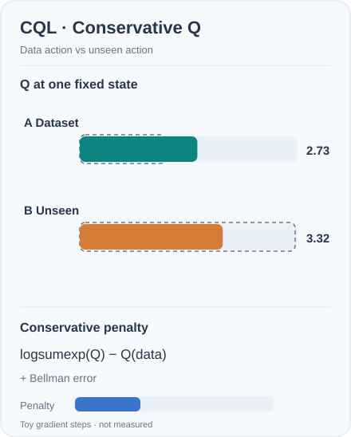

# Conservative Q-learning (Kumar et al., 2020)

An offline reinforcement learning method that learns a Q-function which is deliberately pessimistic. It adds a penalty that lowers the values of actions not supported by the dataset, so that the learned value of the policy is a lower bound on its true value.

## Problem

In offline reinforcement learning, the agent learns only from a fixed dataset collected by some other policy. Standard off-policy methods bootstrap from the value of the next action, and that action may be one the dataset never covers. The learned Q-value of such an action is not corrected by any data, so it can be over-estimated. The policy then chases these over-estimates, and performance collapses. Kumar et al. address this distributional shift directly.

## Core idea

CQL augments the standard Bellman error with a regulariser that pushes Q-values down on actions sampled from the learned policy, and pushes Q-values up on actions in the dataset. The result is a Q-function that assigns lower values to out-of-distribution actions than to in-distribution ones, so the policy stays close to the data. The authors prove that the expected value of the policy under the learned Q-function lower-bounds its true value, and that the bound can be used in a policy learning procedure with improvement guarantees.

The regulariser is simple to add to existing deep Q-learning or actor-critic implementations, which is one reason the method is widely used.

## Equation or algorithm

The Q-function update minimises the Bellman error plus a conservative penalty, of the form

\[
\min_Q \; \alpha\, \mathbb{E}_{s \sim \mathcal{D}}\left[\log \sum_a \exp Q(s,a) - \mathbb{E}_{a \sim \hat{\pi}_\beta(a\mid s)}[Q(s,a)]\right] + \tfrac{1}{2}\mathbb{E}_{(s,a,s') \sim \mathcal{D}}\left[(Q(s,a) - \hat{\mathcal{B}}^\pi Q(s,a))^2\right] ,
\]

where \(\alpha\) controls the strength of the penalty, \(\hat{\pi}_\beta\) is the behaviour policy estimated from the data, and \(\hat{\mathcal{B}}^\pi\) is the Bellman operator for the current policy. The first term lowers the values of actions the dataset does not favour, and the second term keeps the Q-function consistent with the data.

## Animated computation: conservative action values

The two bars depict a **toy discrete-action objective** at one state: A is the dataset action and B is *unseen*. Dashed outlines record their initial (Q_A=2), (Q_B=5). The moving bars illustrate the effect of the log-sum-exp conservative regulariser, which assigns an upward gradient to the unsupported action's Q-value and a downward gradient to the dataset action's Q-value in the loss. Together with a Bellman fit to observed data, gradient **descent** tends to shrink the gap.[^cql-motion]

*Original instructional animation (CC BY-SA 4.0).* Specifically, use the two-action simplification (L=log(e^{Q_A}+e^{Q_B})-Q_A+	frac12(Q_A-2)^2), with conservative weight (alpha=1), Bellman target 2, and learning rate 0.5. Four simultaneous gradient steps from ((2,5)) yield approximately ((2.73,3.32)), and the conservative term decreases from 3.05 to 1.03. The animation **interpolates between these illustrative snapshots**; intermediate screen positions are not exact optimiser iterates. This is **not** a trained critic, a guarantee that every unseen action is always lower, or CQL's full continuous-action algorithm. On MkDocs use Play/Pause (keyboard Enter/Space); GitHub shows the static before/after fallback. Reduced motion defaults to the still.

## Results

The paper evaluates CQL on offline benchmarks with both discrete and continuous actions, and compares it with off-policy methods, which can fail on offline data because of overestimation. The abstract reports that CQL often learns policies that attain two to five times higher final return than prior offline methods, especially when the data come from complex, multi-modal distributions.

## Limitations

- **Pessimism.** A conservative estimate can underestimate good actions, so performance may be below what the data would support.
- **Hyperparameter sensitivity.** The penalty weight \(\alpha\) must be tuned, and its best value depends on the dataset.
- **Coverage.** When the dataset covers few useful actions, the lower bound stays low and little improvement is possible.

## Connections

- Parent topic: [Offline RL](../index.md).
- CQL builds on the value learning of [Deep Q-networks](../../deep-q-networks/index.md), and on actor-critic methods such as [SAC](../../policy-gradient-and-actor-critic/sac/index.md).
- It addresses the same problem as batch-constrained Q-learning (BCQ, Fujimoto et al., 2019), which restricts actions to those resembling the data.
- [Implicit Q-learning](../iql/index.md) avoids querying unseen actions at all, and [Decision Transformer](../decision-transformer/index.md) avoids value learning.

## Applications

- **Offline benchmarks** such as D4RL, where the dataset is fixed and the agent cannot explore.
- **Robotics** from logged data, where new exploration is costly.

## Open questions

- How to choose the penalty weight without online evaluation.
- How to combine pessimism with the need to improve beyond the data.

[^cql-motion]: Kumar, Zhou, Tucker & Levine (2020), [*Conservative Q-Learning for Offline Reinforcement Learning*](https://arxiv.org/abs/2006.04779), develop the conservative Q regulariser and its offline-RL motivation.

## References

### Seminal papers

- Kumar, Zhou, Tucker & Levine (2020), "Conservative Q-learning for offline reinforcement learning", [arXiv:2006.04779](https://arxiv.org/abs/2006.04779) — The CQL paper, with the conservative penalty, the lower-bound result and the offline experiments.
- Fujimoto, Meger & Precup (2019), "Off-policy deep reinforcement learning without exploration", [arXiv:1812.02900](https://arxiv.org/abs/1812.02900) — Batch-constrained Q-learning, which restricts the policy to actions that resemble the data.
- Fu, Kumar, Nachum, Tucker & Levine (2020), "D4RL: Datasets for deep data-driven reinforcement learning", [arXiv:2004.07219](https://arxiv.org/abs/2004.07219) — Standard offline datasets and benchmarks, used to compare offline methods.
- Kostrikov, Nair & Levine (2021), "Offline reinforcement learning with implicit Q-learning", [arXiv:2110.06169](https://arxiv.org/abs/2110.06169) — An alternative offline method that never evaluates actions outside the dataset.
- Chen et al. (2021), "Decision Transformer: Reinforcement learning via sequence modeling", [arXiv:2106.01345](https://arxiv.org/abs/2106.01345) — An offline method that treats RL as sequence modelling, for comparison.
