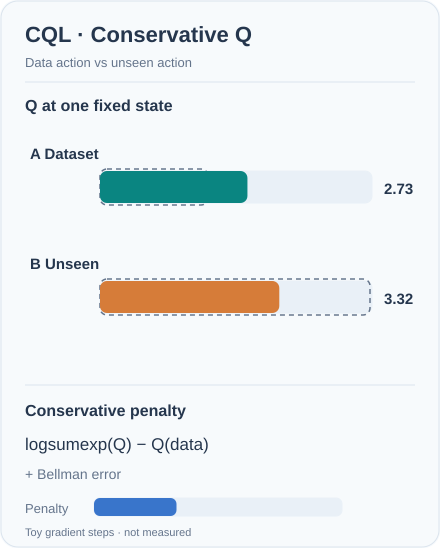

# 保守 Q 學習（Kumar 等人，2020）

一種離線強化學習方法，學習刻意保持悲觀的 Q 函數。它加入一個懲罰，降低資料集未涵蓋的動作的價值，使學到的策略價值成為其真實價值的下界。

## 問題

在離線強化學習中，智能體只能從其他策略收集的固定資料集學習。標準的離策略方法會從下一個動作的價值進行自舉（bootstrap），而該動作可能完全不在資料集中。這類動作學到的 Q 值沒有任何資料加以修正，因此可能被高估。策略會追逐這些高估的值，表現因此崩潰。Kumar 等人直接處理這種分布偏移。

## 核心想法

CQL 在標準的貝爾曼誤差之外加入一個正則項：一方面壓低比較動作分布下的 Q 值（離散 CQL(H) 使用 softmax Q），另一方面把資料集中動作的 Q 值推高。這會抑制未受資料支持的高估，但不保證每個分布外動作的 Q 都低於每個資料內動作。在論文假設及足夠正則化下，作者證明，策略在學到的 Q 函數下的期望值，是其真實價值的下界，而且這個界可用於具有改進保證的策略學習程序。

這個正則項很容易加到既有的深度 Q 學習或演員–評論家實作中，這也是此方法廣泛被使用的原因之一。

## 方程式或演算法

Q 函數的更新最小化貝爾曼誤差加上保守懲罰，形式如下：

\[
\begin{aligned}\min_Q\;&\alpha\, \mathbb{E}_{s \sim \mathcal{D}}\left[\log \sum_a \exp Q(s,a) - \mathbb{E}_{a \sim \hat{\pi}_\beta(a\mid s)}[Q(s,a)]\right]\\ &+\tfrac{1}{2}\mathbb{E}_{(s,a,s') \sim \mathcal{D}}\left[(Q(s,a) - \hat{\mathcal{B}}^\pi Q(s,a))^2\right].\end{aligned}
\]

其中 \(\alpha\) 控制懲罰的強度，\(\hat{\pi}_\beta\) 是由資料估計的行為策略，\(\hat{\mathcal{B}}^\pi\) 是目前策略的貝爾曼運算子。第一項降低資料不偏好之動作的價值，第二項使 Q 函數與資料保持一致。

## 動態計算示例：保守式動作價值更新

在同一個固定狀態下，資料集只觀測到動作 A，動作 B 則是**未見過的動作**。這個刻意簡化的雙動作示例以 $Q_A=2$、$Q_B=5$ 起始；虛線輪廓代表更新前的值。動畫展示保守式 log-sum-exp 懲罰如何抑制未受資料支持的高 $Q_B$，同時以資料內動作的貝爾曼擬合約束 $Q_A$。[^cql-motion]

*原創教學動畫（CC BY-SA 4.0）。* 示意目標為

\[
\begin{aligned}L(Q_A,Q_B)&=\log(e^{Q_A}+e^{Q_B})-Q_A\\
&+\tfrac12(Q_A-2)^2.\end{aligned}
\]

，設保守係數 $\alpha=1$、貝爾曼目標值為 $2$、學習率為 $0.5$。從 $(2,5)$ 同步執行四次梯度下降，得到約 $(2.73,3.32)$，保守懲罰由約 $3.05$ 降至 $1.03$。畫面在人工選定的狀態之間**平滑插值**，中間影格不代表精確的最佳化器迭代；也不表示已訓練模型的實測結果、所有分布外動作皆會被壓低，或完整的連續動作 CQL。MkDocs 網站支援播放／暫停，聚焦按鈕後可用 Enter／空白鍵操作；GitHub 顯示靜態對照圖，偏好減少動態效果的使用者預設顯示靜態圖。

此處是離散動作 CQL(H)：log-sum-exp 涵蓋所有列出的動作，減去的項則是資料動作分布下的平均 Q，並非只對「未見」動作求和。本例資料分布全在 A；正則項對 B 的梯度為 softmax(Q)_B，對 A 為 softmax(Q)_A−1。最終 Q_B 仍高於 Q_A，說明保守性不是逐動作排序保證。

圖框保留 640 像素，可聚焦後橫向捲動；數字標籤只在對應數值停留時顯示，重播回程不顯示終值。

## 結果

論文在離散與連續動作的離線基準上評估 CQL，並與離策略方法比較；後者在離線資料上可能因高估問題而失敗。摘要指出，CQL 常能學到最終回報為先前離線方法二到五倍的策略，尤其是在資料來自複雜的多模態分布時。

## 限制

- **悲觀。** 保守估計可能低估好的動作，因此表現可能低於資料所能支持的程度。
- **超參數敏感。** 懲罰權重 \(\alpha\) 需要調整，其最佳值取決於資料集。
- **覆蓋範圍。** 當資料涵蓋的有用動作很少時，下界也很低，改進空間有限。

## 關聯

- 上層主題：[離線強化學習](../index.md)。
- CQL 建立在[深度 Q 網路](../../deep-q-networks/index.md)的價值學習之上，並與 [SAC](../../policy-gradient-and-actor-critic/sac/index.md) 等演員–評論家方法相關。
- 它處理與批次約束方法（BCQ，Fujimoto 等人，2019）相同的問題，後者將動作限制在與資料相似的範圍內。
- [隱式 Q 學習](../iql/index.md)完全避免查詢未見過的動作，[決策 Transformer](../decision-transformer/index.md)則完全避免價值學習。

## 應用

- **離線基準**，例如 D4RL，資料集固定，智能體無法探索。
- **機器人學**，從記錄資料學習，因為新的探索成本很高。

## 未解問題

- 如何在沒有線上評估的情況下選擇懲罰權重。
- 如何在保持悲觀的同時，超越資料所能支持的表現。

[^cql-motion]: Kumar、Zhou、Tucker 與 Levine（2020），[*Conservative Q-Learning for Offline Reinforcement Learning*](https://arxiv.org/abs/2006.04779)，提出保守 Q 正則項及其離線強化學習動機。

## 參考文獻

### 奠基性論文

- Kumar, Zhou, Tucker & Levine（2020），"Conservative Q-learning for offline reinforcement learning"，[arXiv:2006.04779](https://arxiv.org/abs/2006.04779) — CQL 論文，包含保守懲罰、下界結果與離線實驗。
- Fujimoto, Meger & Precup（2019），"Off-policy deep reinforcement learning without exploration"，[arXiv:1812.02900](https://arxiv.org/abs/1812.02900) — 批次約束 Q 學習，將策略限制在與資料相似的動作上。
- Fu, Kumar, Nachum, Tucker & Levine（2020），"D4RL: Datasets for deep data-driven reinforcement learning"，[arXiv:2004.07219](https://arxiv.org/abs/2004.07219) — 標準的離線資料集與基準，用於比較離線方法。
- Kostrikov, Nair & Levine（2021），"Offline reinforcement learning with implicit Q-learning"，[arXiv:2110.06169](https://arxiv.org/abs/2110.06169) — 另一種離線方法，從不評估資料集之外的動作。
- Chen 等人（2021），"Decision Transformer: Reinforcement learning via sequence modeling"，[arXiv:2106.01345](https://arxiv.org/abs/2106.01345) — 將強化學習視為序列建模的離線方法，用於比較。
