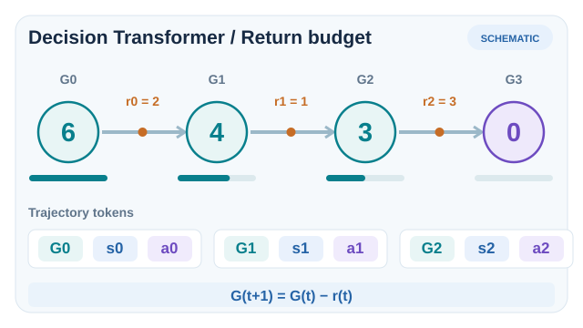
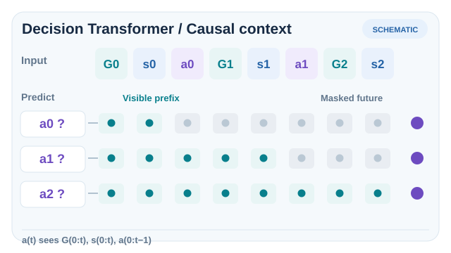

# Decision Transformer (Chen et al., 2021)

An offline reinforcement learning method that treats decision making as sequence modelling. A causally masked Transformer is trained on trajectories, and at test time it is conditioned on a desired return, so that it generates actions that aim for that return. No value function is learned.

## Problem

Value-based offline methods must estimate the value of actions the data does not cover, and policy-gradient methods need many on-policy samples. Chen et al. ask whether the sequence-modelling tools behind large language models can replace both. The idea is to abstract reinforcement learning as a sequence problem: given the past states, actions and desired return, predict the next action.

## Core idea

Each trajectory is written as a sequence of tokens, in which each step contributes three entries: the return-to-go (the sum of future rewards that the agent wants to obtain), the state, and the action. A causally masked Transformer is trained to predict each action from the preceding tokens, which is supervised learning on logged trajectories. At test time, the agent starts with a high desired return, appends each observed state, and samples the next action. The return-to-go is then decreased by the reward received, so that it always states the return still wanted.

Because the desired return acts as a prompt for generation, the same trained model can be asked for different levels of performance. The method needs no Bellman backups and no value estimates.

## Equation or algorithm

The model is trained to maximise the likelihood of the logged actions, each conditioned on the last \(K\) timesteps of return-to-go, states and actions,

\[
\mathcal{L}(\theta) = -\mathbb{E}_{\tau \sim \mathcal{D}}\left[\sum_t \log \pi_\theta\big(a_t \mid \hat{R}_{t-K+1:t},\, s_{t-K+1:t},\, a_{t-K+1:t-1}\big)\right],
\]

where \(\hat{R}_t = \sum_{t' \ge t} r_{t'}\) is the return-to-go of the logged trajectory and \(K\) is the context length. At evaluation, the first return-to-go is set to the desired return, and it is reduced by each observed reward.

### Return-to-go conditioning as an online budget

*Original 12-second SVG/SMIL teaching animation (CC BY-SA 4.0).* The model is initially conditioned on **desired** return $G_0=6$. After taking an action and observing reward $r_t$, the next **desired** return token is updated by

$
G_{t+1}=G_t-r_t.
$

For the artificial reward sequence $(r_0,r_1,r_2)=(2,1,3)$, the target evolves as $6\rightarrow4\rightarrow3\rightarrow0$. Each generated action is appended to the context, and the next observation is supplied before predicting another action. **The initial target is a conditioning request, not a guaranteed achieved return, and the rewards and actions are not trained model measurements.** This test-time recurrence differs from training, where the return-to-go tokens are computed retrospectively from recorded future rewards. The animation highlights the update order rather than showing actual policy inference latency. On MkDocs, Play/Pause (keyboard Enter or Space) and reduced-motion settings use the shared player; the [GitHub-readable static fallback](../../../../../assets/concept-animations/dt-return-budget-still.svg) shows the complete recurrence.

### Causal masking during action prediction

*Original 12-second SVG/SMIL teaching animation (CC BY-SA 4.0).* The input sequence interleaves desired returns, observed states and **previous** actions. To predict $a_0$, only $(G_0,s_0)$ is known; to predict $a_1$, the accessible prefix is $(G_0,s_0,a_0,G_1,s_1)$; to predict $a_2$, the accessible prefix extends through $(G_2,s_2)$. The moving outline marks which tokens are *eligible* as causal context. **It does not visualize learned attention coefficients, prove that every allowed token receives nonzero attention, or reveal future rewards.** In actual implementations, actions are predicted from the corresponding state-token representation under a causal attention mask. The static [GitHub fallback](../../../../../assets/concept-animations/dt-causal-prefix-still.svg) displays all three allowable prefixes simultaneously; MkDocs supplies Play/Pause and a keyboard-accessible reduced-motion fallback.

These two schematic mechanisms follow the trajectory representation and test-time generation procedure of [Chen et al. (2021)](https://arxiv.org/abs/2106.01345), already listed in References. Neither illustration represents a measured policy rollout.

## Results

The abstract reports that Decision Transformer "matches or exceeds the performance of state-of-the-art model-free offline RL baselines on Atari, OpenAI Gym, and Key-to-Door tasks". The paper evaluates on these benchmarks against conservative and value-based offline methods.

## Limitations

- **Conditioning on returns.** The desired return is an input chosen at test time, and the generated behaviour depends on that choice.
- **Context length.** The Transformer sees a fixed window of past tokens, which limits the history it can use.

## Connections

- Parent topic: [Offline RL](../index.md).
- It is a sequence-model alternative to value-based offline methods such as [CQL](../cql/index.md) and [IQL](../iql/index.md).
- The sequence-model idea links to the Transformer architecture in [the Transformer model family](../../../../models/transformer/index.md), and to [imitation learning](../../../imitation/index.md), since it is trained by supervised prediction on logged trajectories.

## Applications

- **Atari games** from logged play, as in the paper's experiments.
- **Control tasks** from logged trajectories, where the paper evaluates on OpenAI Gym.

## Open questions

- How to combine sequence modelling with value learning so that the model can stitch trajectories.
- How to choose the desired return for a new task.

## References

### Seminal papers

- Chen et al. (2021), "Decision Transformer: Reinforcement learning via sequence modeling", [arXiv:2106.01345](https://arxiv.org/abs/2106.01345) — The Decision Transformer paper, with the return-conditioned sequence model and the Atari, Gym and Key-to-Door results.
- Kumar, Zhou, Tucker & Levine (2020), "Conservative Q-learning for offline reinforcement learning", [arXiv:2006.04779](https://arxiv.org/abs/2006.04779) — A value-based offline method, for comparison with sequence modelling.
- Kostrikov, Nair & Levine (2021), "Offline reinforcement learning with implicit Q-learning", [arXiv:2110.06169](https://arxiv.org/abs/2110.06169) — A value-based offline method that avoids querying unseen actions.
- Fu, Kumar, Nachum, Tucker & Levine (2020), "D4RL: Datasets for deep data-driven reinforcement learning", [arXiv:2004.07219](https://arxiv.org/abs/2004.07219) — The offline benchmark suite used to compare offline methods.
- Fujimoto, Meger & Precup (2019), "Off-policy deep reinforcement learning without exploration", [arXiv:1812.02900](https://arxiv.org/abs/1812.02900) — Batch-constrained Q-learning, an offline baseline for comparison.
