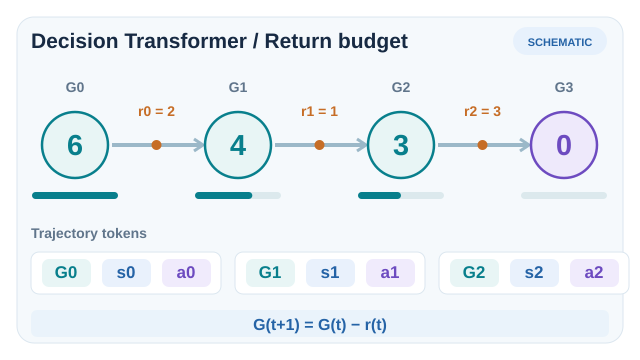
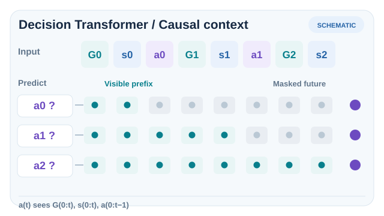

# 決策 Transformer（Chen 等人，2021）

一種離線強化學習方法，把決策視為序列建模。在軌跡上訓練一個因果遮罩的 Transformer，測試時以期望回報為條件，使它生成朝向該回報的動作。它不學習價值函數。

## 問題

以價值為基礎的離線方法必須估計資料未涵蓋的動作價值，而策略梯度方法則需要許多同策略樣本。Chen 等人探討：支撐大型語言模型的序列建模工具，能否同時取代這兩者。想法是把強化學習抽象為序列問題：給定過去的狀態、動作與期望回報，預測下一個動作。

## 核心想法

每條軌跡被寫成一串 token，每個時間步貢獻三個項目：回報至終（return-to-go，即智能體希望獲得的未來獎勵總和）、狀態與動作。一個因果遮罩的 Transformer 被訓練來從前面的 token 預測每個動作，這就是在記錄軌跡上的監督式學習。測試時，智能體從一個高的期望回報開始，附加每個觀測到的狀態，並取樣下一個動作；接著依收到的獎勵更新回報至終。

由於期望回報扮演生成提示的角色，同一個訓練好的模型可以被要求達到不同的表現水準。此方法不需要貝爾曼備份，也不需要價值估計。

## 方程式或演算法

模型被訓練以最大化記錄動作的似然，每個動作以最後 \(K\) 個時間步的回報至終、狀態與動作為條件：

\[
\mathcal{L}(\theta) = -\mathbb{E}_{\tau \sim \mathcal{D}}\left[\sum_t \log \pi_\theta\big(a_t \mid \hat{R}_{t-K+1:t},\, s_{t-K+1:t},\, a_{t-K+1:t-1}\big)\right],
\]

其中 \(\hat{R}_t = \sum_{t' \ge t} r_{t'}\) 是記錄軌跡的回報至終，\(K\) 是上下文長度。評估時，第一個回報至終設為期望回報，並隨每個觀測到的獎勵遞減。

### 回報至終條件如何隨互動更新

*原創 12 秒 SVG／SMIL 教學動畫（CC BY-SA 4.0）。* 模型在執行前使用**期望**回報 $G_0=6$ 作為條件。在執行動作並觀察到獎勵 $r_t$ 後，下一個**期望**回報 token 依下式更新：

$
G_{t+1}=G_t-r_t.
$

示意獎勵序列 $(r_0,r_1,r_2)=(2,1,3)$ 使條件目標依序從 $6\rightarrow4\rightarrow3\rightarrow0$。每次產生的動作加入上下文，收到下一個狀態觀測後再預測後續動作。**初始回報只是條件要求，不保證最終一定達成；所有獎勵與動作都是人工教學數值，並非模型實測。** 這是推論階段的目標更新；訓練資料的 return-to-go 則是依記錄軌跡的未來獎勵回溯計算。動畫強調更新順序，並不模擬真實推論耗時。MkDocs 提供可用 Enter／Space 操作的播放／暫停與減少動態效果支援；[GitHub 靜態回退圖](../../../../../assets/concept-animations/dt-return-budget-still.svg) 直接呈現完整更新過程。

### 預測動作時的因果注意力遮罩

*原創 12 秒 SVG／SMIL 教學動畫（CC BY-SA 4.0）。* 輸入序列交錯排列期望回報、已觀察的狀態與**先前**動作。預測 $a_0$ 時只能使用 $(G_0,s_0)$；預測 $a_1$ 時可使用 $(G_0,s_0,a_0,G_1,s_1)$；預測 $a_2$ 時可使用延伸至 $(G_2,s_2)$ 的完整歷史。移動光圈代表因果遮罩**允許存取**的 token，而**不是**模型學到的注意力權重，也不表示所有可見 token 的權重皆非零，更不表示模型預先知道未來獎勵。實作上通常由對應狀態 token 的表示輸出動作預測。[GitHub 靜態回退圖](../../../../../assets/concept-animations/dt-causal-prefix-still.svg) 同時展示三個允許的上下文前綴；MkDocs 提供鍵盤可操作的播放／暫停及減少動畫時的靜態顯示。

以上兩項示意依據已列於參考文獻的 [Chen 等人（2021）原始論文](https://arxiv.org/abs/2106.01345)所述軌跡表示與推論流程。兩張圖都不是模型實測的策略軌跡。

## 結果

摘要指出，Decision Transformer「在 Atari、OpenAI Gym 與 Key-to-Door 任務上，達到或超過最先進的無模型離線 RL 基準」。論文在這些基準上與保守型與以價值為基礎的離線方法比較。

## 限制

- **以回報為條件。** 測試時的期望回報是一個輸入，生成的行為取決於這個選擇。
- **上下文長度。** Transformer 只看見固定窗口的過去 token，限制了它能使用的歷史長度。

## 關聯

- 上層主題：[離線強化學習](../index.md)。
- 它是以價值為基礎的離線方法（如 [CQL](../cql/index.md) 與 [IQL](../iql/index.md)）的序列模型替代方案。
- 序列模型的想法與 Transformer 架構相關，見 [Transformer 模型家族](../../../../models/transformer/index.md)；它也與[模仿學習](../../../imitation/index.md)相關，因為它以記錄軌跡上的監督式預測來訓練。

## 應用

- **Atari 遊戲**，從記錄的遊玩中學習，如論文實驗所示。
- **控制任務**，從記錄軌跡學習，論文在 OpenAI Gym 上評估。

## 未解問題

- 如何把序列建模與價值學習結合，使模型能拼接軌跡片段。
- 如何為新任務選擇期望回報。

## 參考文獻

### 奠基性論文

- Chen 等人（2021），"Decision Transformer: Reinforcement learning via sequence modeling"，[arXiv:2106.01345](https://arxiv.org/abs/2106.01345) — Decision Transformer 論文，包含以回報為條件的序列模型，以及 Atari、Gym 與 Key-to-Door 結果。
- Kumar, Zhou, Tucker & Levine（2020），"Conservative Q-learning for offline reinforcement learning"，[arXiv:2006.04779](https://arxiv.org/abs/2006.04779) — 以價值為基礎的離線方法，與序列建模比較。
- Kostrikov, Nair & Levine（2021），"Offline reinforcement learning with implicit Q-learning"，[arXiv:2110.06169](https://arxiv.org/abs/2110.06169) — 避免查詢未見動作的以價值為基礎離線方法。
- Fu, Kumar, Nachum, Tucker & Levine（2020），"D4RL: Datasets for deep data-driven reinforcement learning"，[arXiv:2004.07219](https://arxiv.org/abs/2004.07219) — 用於比較離線方法的離線基準套件。
- Fujimoto, Meger & Precup（2019），"Off-policy deep reinforcement learning without exploration"，[arXiv:1812.02900](https://arxiv.org/abs/1812.02900) — 批次約束 Q 學習，作為離線基準。
