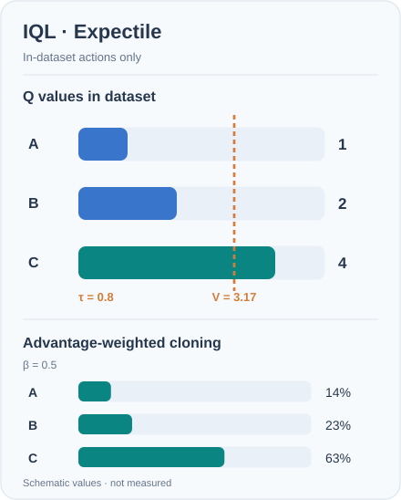

# 隱式 Q 學習（Kostrikov 等人，2021）

一種離線強化學習方法，從不評估資料集之外動作的價值。它以期望分位回歸（expectile regression）估計資料中最佳動作的價值，再以加權行為複製擷取策略。

## 問題

離線方法必須能改進產生資料的行為，但無法在環境中檢驗未見過的動作。因此，多數離線方法不是把策略限制在資料之內，就是對未見動作的價值做正則化。Kostrikov 等人探討：策略能否在從不查詢資料中沒有之動作價值的前提下，改進資料中最佳的行為。

## 核心想法

IQL 學習三個函數：Q 函數、狀態價值函數 \(V\) 與策略。關鍵步驟是價值的更新。IQL 不取所有動作的最大值（這需要查詢未見動作），而是把 \(V\) 擬合到資料中動作 Q 值的上期望分位數。期望分位數會更重視最好的資料內動作，因此 \(V\) 近似資料所能支持的最佳動作價值。接著以這個 \(V\) 訓練 Q 函數，並以優勢加權行為複製擷取策略，偏好優勢較高的資料動作。

因此，此方法是透過泛化來改進行為，而不是靠查詢分布外的動作。

## 方程式或演算法

價值函數以不對稱最小平方擬合，期望分位數 \(\tau\) 接近一：

\[
L_V(\psi) = \mathbb{E}_{(s,a) \sim \mathcal{D}}\left[ L_2^\tau\big(Q_{\hat\theta}(s,a) - V_\psi(s)\big) \right].
\]

\[
L_2^\tau(u) = |\tau - \mathbb{1}(u < 0)|\, u^2 .
\]

Q 函數以貝爾曼目標 \(r + \gamma V_\psi(s')\) 訓練，只使用資料中的動作。策略隨後以加權行為複製擬合，資料轉移的權重為 \(\exp(\beta(Q(s,a) - V(s)))\)。

## 動態計算示例：上期望分位數與策略擷取

三個長條代表**同一個狀態下資料集已觀測的動作**，以人工設定的 $Q(s,A)=1$、$Q(s,B)=2$ 和 $Q(s,C)=4$ 為例。橘色參考線從算術平均 $7/3\approx2.33$ 移至 $\tau=0.8$ 的上期望分位數。此不對稱最小平方法的示意最優值滿足 $0.8(4-V)=0.2(V-1)+0.2(V-2)$，故 $V=19/6\approx3.17$。接著下方的長條對**相同的資料內動作**重新加權，以擷取策略；整個過程不需要評估未見動作的 Q 值。[^iql-motion]

*原創教學動畫（CC BY-SA 4.0）。* 設 $\beta=0.5$，且三種資料內動作各出現一次。將 $\exp[\beta(Q(s,a)-V(s))]$ 正規化，得到約 **14%、23%、63%** 的示意權重。這些值是人工構造的分類權重，不是模型量測的策略機率或資料頻率；動畫中的連續變化也不是實際訓練歷程。MkDocs 網站可播放／暫停，聚焦控制按鈕後可使用 Enter 或空白鍵；GitHub 提供完整的靜態比較，偏好減少動態效果的讀者預設觀看靜態圖。

以殘差 u=Q−V 為準：正殘差的平方誤差乘 τ，負殘差乘 1−τ；τ=.8 因此偏向較高的資料內 Q。這不是第 80 百分位數。正規化後同一狀態的共同 V 因子會消去，但 V 仍決定價值學習。

圖框保留 640 像素，可聚焦後橫向捲動；數字標籤只在對應數值停留時顯示，重播回程不顯示終值。

## 結果

論文在 D4RL 離線基準上評估 IQL，其中包括 AntMaze 導航任務，並與其他離線方法比較。摘要指出，IQL 在 D4RL 上達到最先進的表現，並且在離線預訓練後以線上互動微調時表現強勁。

## 限制

- **期望分位數與溫度。** 結果取決於期望分位數 \(\tau\) 與優勢溫度 \(\beta\)，兩者都需要調整。
- **資料品質。** 改進的幅度受限於能從資料泛化出來的程度，因此方法無法創造資料中從未出現的好動作。
- **策略擷取。** 加權行為複製的品質，取決於它所用的優勢估計。

## 關聯

- 上層主題：[離線強化學習](../index.md)。
- 它的價值更新是 [CQL](../cql/index.md) 悲觀懲罰的替代方案。
- 策略擷取採用優勢加權的行為複製，與優勢加權回歸相近。
- [決策 Transformer](../decision-transformer/index.md) 以相關的目標學習，從資料的回報中學習，但不進行價值學習。

## 應用

- **導航**，從記錄資料學習，例如論文中的 AntMaze 任務。
- **從示範學習**，當示範中包含一些次佳行為時。

## 未解問題

- 如何在不做線上調整的情況下設定期望分位數與溫度。
- 如何把此方法延伸到資料集非常狹窄的設定。

[^iql-motion]: Kostrikov、Nair 與 Levine（2021），[*Offline Reinforcement Learning with Implicit Q-Learning*](https://arxiv.org/abs/2110.06169)，提出上期望分位數回歸與優勢加權行為複製。

## 參考文獻

### 奠基性論文

- Kostrikov, Nair & Levine（2021），"Offline reinforcement learning with implicit Q-learning"，[arXiv:2110.06169](https://arxiv.org/abs/2110.06169) — IQL 論文，包含期望價值更新、優勢加權的策略擷取與 D4RL 結果。
- Kumar, Zhou, Tucker & Levine（2020），"Conservative Q-learning for offline reinforcement learning"，[arXiv:2006.04779](https://arxiv.org/abs/2006.04779) — IQL 的主要悲觀替代方案，用於比較。
- Fujimoto, Meger & Precup（2019），"Off-policy deep reinforcement learning without exploration"，[arXiv:1812.02900](https://arxiv.org/abs/1812.02900) — 批次約束 Q 學習，將策略限制在資料上。
- Fu, Kumar, Nachum, Tucker & Levine（2020），"D4RL: Datasets for deep data-driven reinforcement learning"，[arXiv:2004.07219](https://arxiv.org/abs/2004.07219) — IQL 所評估的離線基準套件。
- Chen 等人（2021），"Decision Transformer: Reinforcement learning via sequence modeling"，[arXiv:2106.01345](https://arxiv.org/abs/2106.01345) — 以序列建模從回報學習的離線方法，用於比較。
