# Asynchronous advantage actor-critic (Mnih et al., 2016)

Several parallel actor-learners on CPU threads share one network and update it asynchronously, which decorrelates their data and removes the need for a replay buffer.

## Problem

DQN-style agents needed replay buffers and, in the reported setup, many days of GPU training. Policy-gradient methods learning from consecutive, correlated data were often unstable. Mnih et al. ask whether asynchronous parallel actors can stabilise online actor-critic learning on their own, without replay.

## Core idea

Many workers each run their own copy of the environment and act with the shared policy. Each worker collects a few steps of its own experience, computes gradients from it, and applies them to the shared parameters without waiting for the others. Since the workers are in different states at any time, their updates are less correlated than consecutive steps from one agent. The update uses an advantage, the \(n\)-step return minus the value estimate, and an entropy term that keeps the policy exploratory.

## Equation or algorithm

For a worker, with \(k\) up to \(t_{\max}\) steps since its last update, the gradient is

\[
\nabla_{\theta'} \log \pi(a_t \mid s_t; \theta')\,\big(R_t - V(s_t; \theta_v)\big) + \beta\, \nabla_{\theta'} H\big(\pi(s_t; \theta')\big)
\]

where \(R_t\) is the discounted \(n\)-step return and \(H\) is the policy entropy. The procedure for each worker:

1. Copy the shared parameters.
2. Act for up to \(t_{\max}\) steps or until the episode ends.
3. Compute \(R\) by bootstrapping from the value estimate at the last state, or from zero if the episode ended.
4. Walk backward through the steps, accumulating the gradient above.
5. Apply the accumulated gradient to the shared parameters, asynchronously, and repeat.

The Atari experiments use \(t_{\max} = 5\) and an entropy weight \(\beta = 0.01\).

## Teaching animation: asynchronous gradient arrival

*Original teaching animation (CC BY-SA 4.0).* The blue and teal workers start with **separate local parameter copies** of the same shared policy, roll out different trajectories, and send gradients to shared parameters **at different times**. The first update changes the global weights to \(\theta_1\); the second gradient was still computed from a snapshot of \(\theta_0\). Applying a stale gradient is not the same as replacing the global weights with the old snapshot. The coloured markers represent **illustrative timing, not measured training events**. The MkDocs viewer offers Play/Pause; [view the static GitHub fallback](../../../../../assets/concept-animations/a3c-async-gradient-still.svg). See [Mnih et al. (2016)](https://arxiv.org/abs/1602.01783).

## Teaching animation: backward n-step bootstrapping

*Original teaching animation (CC BY-SA 4.0).* A worker rolls its local $n$-step return **backward** from $R_3=V(s_3)=1$, with illustrative rewards $(r_0,r_1,r_2)=(1,0,2)$ and discount $\gamma=0.9$: $R_2=2.9$, $R_1=2.61$, and $R_0=3.349$. Subtracting the initial value estimate $V(s_0)=2.5$ yields the example advantage $A_0=0.849$. A terminal final state would have bootstrap value zero instead. These **invented numerical values are not measured model outputs**; the moving marker shows the direction of recursive computation, not gradient backpropagation. On MkDocs, use Play/Pause; [GitHub-readable still](../../../../../assets/concept-animations/a3c-nstep-return-still.svg). Based on [Mnih et al. (2016)](https://arxiv.org/abs/1602.01783).

## Results

The paper reports human-normalised Atari results (Table 1). Its A3C feedforward agent trained for 4 days on CPU reaches a mean of 496.8% and a median of 116.6%. The LSTM variant reaches a mean of 623.0% and a median of 112.6%. A dueling DDQN trained for 8 days on GPU reaches a mean of 343.8% and a median of 117.1%. The abstract states that A3C surpasses the state of the art on Atari while training in half the time, on a single multi-core CPU with no GPU. The advantage is clearest in the mean; the medians are close.

The paper also reports a TORCS driving result, in which A3C reaches between roughly 75% and 90% of a human tester's score in about 12 hours. On continuous MuJoCo tasks it finds good solutions in less than 24 hours, and it learns a reasonable exploration strategy in random 3D mazes from visual input.

## Limitations

- **No replay, so sample reuse is limited.** Each experience is used for one update, which trades sample efficiency for parallel throughput.
- **Stale parameters.** Asynchronous updates are computed from parameters that may have changed by the time they are applied.
- **Synchronous variants.** The later synchronous baseline A2C is used as a comparison in the PPO paper (Schulman et al., 2017), which reports that PPO has better sample complexity than A2C on Atari.

## Connections

- Parent topic: [Policy gradient and actor-critic](../index.md), and the wider [Reinforcement Learning](../../index.md) overview.
- The advantage follows [REINFORCE](../reinforce/index.md) with a learned baseline. [Proximal Policy Optimisation](../../proximal-policy-optimisation/index.md) is a later policy-gradient method that builds on the same advantage idea.
- The replay-based alternative is [Deep Q-networks](../../deep-q-networks/index.md).

## Applications

- **Atari and 3D navigation.** The paper's experiments cover Atari and random 3D mazes from visual input, the benchmarks used to test the method.
- **Robot and simulated control.** The MuJoCo results show the method on continuous control.

## Open questions

- Whether the asynchronous speed-up is worth its stale updates once synchronous hardware is used.
- How the entropy weight should be tuned across tasks.

## References

### Seminal papers

- Mnih et al. (2016), "Asynchronous methods for deep reinforcement learning", [arXiv:1602.01783](https://arxiv.org/abs/1602.01783) — The A3C paper, with the parallel actor-learner design and the Atari results reported above.
- Mnih et al. (2015), "Human-level control through deep reinforcement learning", *Nature* 518, 529–533. https://doi.org/10.1038/nature14236 — The replay-based deep value method that A3C is compared against.
- Schulman et al. (2016), "High-dimensional continuous control using generalized advantage estimation", [arXiv:1506.02438](https://arxiv.org/abs/1506.02438) — Advantage estimation used in the same family of actor-critic methods.
- Schulman et al. (2017), "Proximal policy optimization algorithms", [arXiv:1707.06347](https://arxiv.org/abs/1707.06347) — Reports the A2C comparison and the sample-complexity results against which A3C-style methods are measured.

### Surveys and textbooks

- Sutton, R. S. & Barto, A. G. *Reinforcement Learning: An Introduction*, 2nd ed. MIT Press, 2018. http://incompleteideas.net/book/the-book-2nd.html — Actor-critic methods and the role of advantages in the standard textbook.
