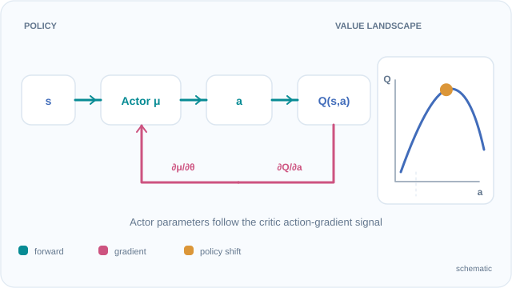
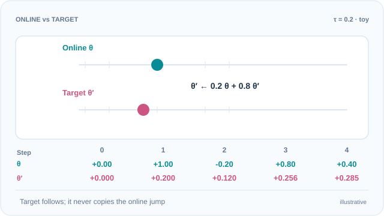
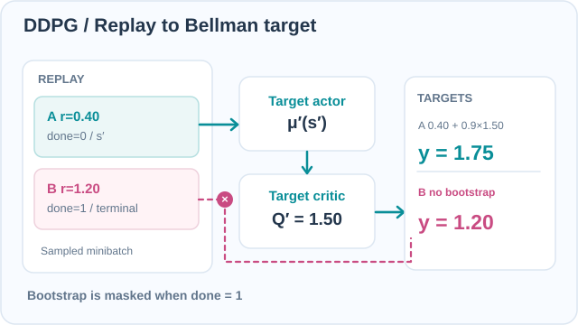
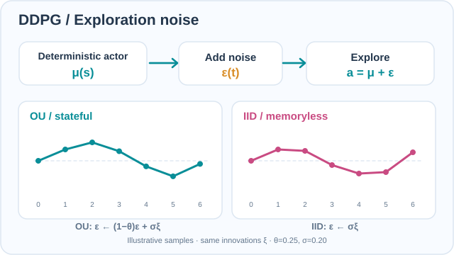

# Deep deterministic policy gradient (Lillicrap et al., 2016)

An off-policy actor-critic method for continuous actions that trains a deterministic actor with a deep Q-function critic, using DQN-style replay and slowly updated target networks.

## Problem

DQN takes a maximum over a discrete set of actions, which is not available when actions are continuous. Policy gradients handle continuous actions but need many on-policy samples. Lillicrap et al. ask whether the ideas that let DQN learn from raw pixels can be combined with a deterministic policy gradient for continuous control.

## Core idea

The actor \(\mu(s \mid \theta^\mu)\) outputs an action directly, with no sampling. The critic \(Q(s, a \mid \theta^Q)\) estimates the value of state–action pairs. The actor is trained by following the gradient of the critic with respect to the action, which is the deterministic policy gradient. The critic is trained with a temporal-difference target computed by a target actor and a target critic, and both target networks follow the learned networks with a small soft update. Transitions are stored in a replay buffer and sampled in minibatches, as in DQN.

## Equation or algorithm

The actor update, with the deterministic policy gradient, is

\[
\begin{aligned}
g_a(s)&=\nabla_a Q(s,a\mid\theta^Q)\big|_{a=\mu(s)}, \\
\nabla_{\theta^\mu}J&\approx\mathbb{E}_{s\sim\mathcal R}\!\left[g_a(s)\,\nabla_{\theta^\mu}\mu(s)\right].
\end{aligned}
\]

The critic minimises the squared loss 

\[
L = \frac{1}{N}\sum_i (y_i - Q(s_i, a_i \mid \theta^Q))^2
\]

, where

\[
\begin{aligned}
a'_i &= \mu'(s_{i+1}\mid\theta^{\mu'}), \\
q'_i &= Q'(s_{i+1},a'_i\mid\theta^{Q'}), \\
y_i &= r_i+\gamma(1-d_i)q'_i.
\end{aligned}
\]

and the target networks are updated as 

\[
\theta' \leftarrow \tau\theta + (1 - \tau)\theta'
\]

, with \(\tau = 0.001\) in the paper. The replay buffer holds \(10^6\) transitions, and the minibatch size is 64 for low-dimensional states and 16 when learning from pixels. The discount is \(\gamma = 0.99\).

Here dᵢ denotes a true MDP termination; a time-limit truncation alone normally still bootstraps. Treat targets as constants in the critic update; ascend the actor gradient with the critic fixed and states sampled from replay.

### Visual walkthrough: actor gradient through a deterministic action

Focus the figure with Tab, then scroll with Left/Right arrow keys.

*Original instructional animation (CC BY-SA 4.0).* The **teal** trace evaluates 

\[
s \rightarrow \mu_{\theta^\mu}(s) \rightarrow Q_{\theta^Q}(s,a)
\]

. The **magenta** trace represents \(\nabla_a Q\) flowing through \(\nabla_{\theta^\mu}\mu\) to update the *actor parameters*, not to train the critic from the actor loss. The **amber** point moves uphill on an **invented one-dimensional Q slice** only to illustrate the intended local policy improvement; it is not a measured learning trajectory and cannot guarantee global optimality. The critic remains fixed during this conceptual actor-gradient step. Use the site's Play/Pause button (Enter or Space when focused); [GitHub-readable static overview](../../../../../assets/concept-animations/ddpg-actor-gradient-still.svg). See [Silver et al. (2014)](https://proceedings.mlr.press/v32/silver14.html) and [Lillicrap et al. (2016)](https://arxiv.org/abs/1509.02971).

### Visual walkthrough: slow target-network tracking

Focus the figure with Tab, then scroll with Left/Right arrow keys.

*Original instructional animation (CC BY-SA 4.0).* The **teal online parameter** jumps as optimisation changes it; the **magenta target parameter** follows a weighted average rather than copying the new value. The toy scalar values are \(\theta=(0,1,-0.2,0.8,0.4)\) at steps 0–4. With \(\theta'_0=0\), an intentionally exaggerated illustrative rate **\(\tau=0.2\)** yields \(\theta'=(0,0.2,0.12,0.256,0.2848)\). In the actual DDPG paper **\(\tau=0.001\)**; the displayed speed and numbers are neither its training hyperparameters nor measured model parameters. This mechanism applies separately to actor and critic target networks, and the smooth travel between discrete updates is a visual interpolation only. The lower row reveals each completed step over time. Use Play/Pause, or see the [GitHub-readable static overview](../../../../../assets/concept-animations/ddpg-polyak-target-still.svg). See [Lillicrap et al. (2016)](https://arxiv.org/abs/1509.02971).

### Visual walkthrough: replay and terminal-masked critic bootstrap

Focus the figure with Tab, then scroll with Left/Right arrow keys.

*Original instructional animation (CC BY-SA 4.0).* A replay buffer supplies off-policy transitions `(s, a, r, s', done)`; the **target actor** proposes the next action and the **target critic** evaluates that action for **nonterminal** transitions. The terminal flag suppresses the bootstrap term: \(y=r+\gamma(1-d)Q'(s',\mu'(s'))\). With **illustrative, not measured** values \(\gamma=0.9\) and \(Q'=1.50\), sample A \((r=0.40,d=0)\) yields \(1.75\), whereas terminal sample B \((r=1.20,d=1)\) yields \(1.20\). The image focuses on target formation, not the subsequent online-critic squared-error minimisation. Use the site's Play/Pause control (Enter/Space while focused) or the [GitHub-readable static fallback](../../../../../assets/concept-animations/ddpg-replay-bootstrap-still.svg). See [Lillicrap et al. (2016)](https://arxiv.org/abs/1509.02971).

### Visual walkthrough: correlated OU exploration and independent noise

Focus the figure with Tab, then scroll with Left/Right arrow keys.

*Original instructional animation (CC BY-SA 4.0).* A deterministic actor requires an **external behaviour-policy exploration process** during data collection. Compare Ornstein–Uhlenbeck (OU) noise 

\[
\epsilon_{t+1}=(1-\theta)\epsilon_t+\sigma\xi_t
\]

 (for unit time steps and zero mean) with independently sampled \(\epsilon_{t+1}=\sigma\xi_t\). The animation draws each time step from the **same hand-picked innovation sequence**, with **illustrative** \(\theta=0.25,\sigma=0.20\); these curves are not empirical trajectories or evidence that one noise type always improves performance. DDPG's original experiments used OU-style temporally correlated exploration; independent Gaussian action noise is a common simpler alternative. The exploration term is applied to the actor's action during interaction, not to the deterministic target actor when computing this DDPG critic target. Use Play/Pause or the [GitHub-readable static fallback](../../../../../assets/concept-animations/ddpg-ou-noise-still.svg). See [Lillicrap et al. (2016)](https://arxiv.org/abs/1509.02971).

This is an Euler-discretised OU illustration, not the exact continuous-time OU transition. Start at ε₀=0 with hand-picked innovations (0.8, 0.7, −0.3, −0.9, −0.8, 0.6); both panels use 100 pixels per unit and zero at y=227. Connecting lines only identify discrete samples, not continuous observations.

## Results

The abstract reports that the algorithm "robustly solves more than 20 simulated physics tasks" with one learning algorithm, one architecture and one set of hyperparameters. The paper also reports that for many of the tasks the method can learn policies end-to-end, directly from raw pixel inputs.

## Limitations

- **Critic overestimation.** The critic uses a single Q-function, which can overestimate values in the way that DQN does. [TD3](../td3/index.md) addresses this directly.
- **Brittle training.** Learning depends on the target-network rate, the replay design and the exploration noise added to actions, and the method is sensitive to these settings.
- **Deterministic policy.** The actor outputs one action per state, so exploration must be added externally, and the policy does not represent uncertainty by itself. [SAC](../sac/index.md) uses a stochastic actor instead.

## Connections

- Parent topic: [Policy gradient and actor-critic](../index.md), and the wider [Reinforcement Learning](../../index.md) overview.
- DDPG is the continuous-action analogue of [Deep Q-networks](../../deep-q-networks/index.md), using the same replay and target-network ideas.
- Its successors are [TD3](../td3/index.md), which fixes its overestimation, and [SAC](../sac/index.md), which uses a stochastic actor with entropy regularisation.

## Applications

- **Simulated robot control.** The paper's physics tasks are simulated robot and locomotion problems, the standard setting for continuous-control methods.
- **Learning from pixels.** The reported end-to-end results from raw images show the method outside state-based control.

## Open questions

- How to make deterministic actor–critic methods stable without careful hand-tuning of noise and target rates.
- How to represent uncertainty in continuous control when the actor is deterministic.

## References

### Seminal papers

- Lillicrap et al. (2016), "Continuous control with deep reinforcement learning", ICLR, [arXiv:1509.02971](https://arxiv.org/abs/1509.02971) — The DDPG paper, with the deterministic actor, the target networks and the physics results above.
- Mnih et al. (2015), "Human-level control through deep reinforcement learning", *Nature* 518, 529–533. https://doi.org/10.1038/nature14236 — The replay and target-network design that DDPG adapts to continuous actions.
- Silver et al. (2014), "Deterministic policy gradient algorithms", *Proceedings of ICML 2014*, PMLR 32, 387–395. https://proceedings.mlr.press/v32/silver14.html — The deterministic policy gradient theorem on which DDPG's actor update rests.
- Fujimoto, van Hoof & Meger (2018), "Addressing function approximation error in actor-critic methods", [arXiv:1802.09477](https://arxiv.org/abs/1802.09477) — TD3, a later method that corrects DDPG's overestimation.
- Haarnoja et al. (2018), "Soft actor-critic: Off-policy maximum entropy deep reinforcement learning with a stochastic actor", [arXiv:1801.01290](https://arxiv.org/abs/1801.01290) — A stochastic successor to DDPG for continuous control.

### Surveys and textbooks

- Sutton, R. S. & Barto, A. G. *Reinforcement Learning: An Introduction*, 2nd ed. MIT Press, 2018. http://incompleteideas.net/book/the-book-2nd.html — Background on policy gradients and actor-critic methods.
