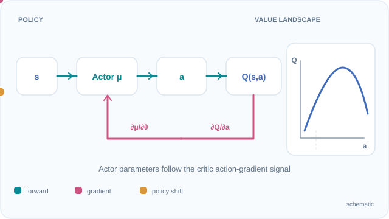

# 深度確定性策略梯度（Lillicrap 等人，2016）

一種用於連續動作的離策略演員–評論家方法：以確定性的演員搭配深度 Q 函數評論家，並採用 DQN 式的回放與緩慢更新的目標網路。

## 問題

DQN 需要對離散的動作集合取最大值，連續動作時無法這樣做。策略梯度可以處理連續動作，但需要大量同策略樣本。Lillicrap 等人探討：能讓 DQN 從原始像素學習的想法，能否與確定性策略梯度結合，用於連續控制。

## 核心想法

演員 \(\mu(s \mid \theta^\mu)\) 直接輸出動作，不做取樣。評論家 \(Q(s, a \mid \theta^Q)\) 估計狀態–動作對的價值。演員沿著評論家對動作的梯度更新，這就是確定性策略梯度。評論家則以目標演員與目標評論家計算的時序差分目標訓練，兩個目標網路以很小的軟更新跟隨學習中的網路。轉換資料存入回放緩衝區，並像 DQN 一樣以小批次抽樣。

## 方程式與演算法

以確定性策略梯度表示，演員的更新為

\[
\nabla_{\theta^\mu} J \approx \mathbb{E}_{s}\left[\nabla_a Q(s, a \mid \theta^Q)\big|_{a = \mu(s)}\, \nabla_{\theta^\mu} \mu(s \mid \theta^\mu)\right]
\]

評論家最小化平方損失 \(L = \frac{1}{N}\sum_i (y_i - Q(s_i, a_i \mid \theta^Q))^2\)，其中

\[
y_i = r_i + \gamma\, Q'\big(s_{i+1}, \mu'(s_{i+1} \mid \theta^{\mu'}) \mid \theta^{Q'}\big)
\]

目標網路以 \(\theta' \leftarrow \tau\theta + (1 - \tau)\theta'\) 更新，論文中 \(\tau = 0.001\)。回放緩衝區保存 \(10^6\) 筆轉換；低維狀態的小批次大小為 64，從像素學習時為 16。折扣因子為 \(\gamma = 0.99\)。

### 動態教學：確定性演員的梯度鏈

*原創教學動畫（CC BY-SA 4.0）。* **青綠色**路徑展示 \(s \rightarrow \mu_{\theta^\mu}(s) \rightarrow Q_{\theta^Q}(s,a)\) 的前向評估；**洋紅色**路徑表示先取得 \(\nabla_a Q\)，再透過 \(\nabla_{\theta^\mu}\mu\) 更新**演員參數**，不是用演員的損失更新評論家。**琥珀色**標記沿著人工繪製的**一維 Q 函數切片**移動，只用來說明局部策略改善方向，不是模型實測軌跡，也不代表保證達到全域最佳值。這個示意步驟將評論家視為固定。網站可使用 Play／Pause（聚焦後按 Enter 或空白鍵）；GitHub 可查看[靜態完整預覽](../../../../../assets/concept-animations/ddpg-actor-gradient-still.svg)。依據 [Silver 等人（2014）](https://proceedings.mlr.press/v32/silver14.html)與 [Lillicrap 等人（2016）](https://arxiv.org/abs/1509.02971)。

### 動態教學：目標網路的軟更新

*原創教學動畫（CC BY-SA 4.0）。* **青綠色線上參數**隨最佳化跳動；**洋紅色目標參數**按加權平均追蹤，不直接複製新參數。人工設定的純量線上參數為步驟 0–4 的 \(\theta=(0,1,-0.2,0.8,0.4)\)，令 \(\theta'_0=0\)，刻意放大的示意係數 **\(\tau=0.2\)** 產生 \(\theta'=(0,0.2,0.12,0.256,0.2848)\)。**原始 DDPG 論文使用 \(\tau=0.001\)**；圖中的追蹤速度和數值不是論文實測或實際訓練設定。這項軟更新分別應用於目標演員與目標評論家，而連續移動是兩次離散更新間的視覺插值，不代表更新期間的實際參數演變。下方的數值依步驟逐漸揭露。使用網站播放／暫停，或查看 [GitHub 靜態完整預覽](../../../../../assets/concept-animations/ddpg-polyak-target-still.svg)。依據 [Lillicrap 等人（2016）](https://arxiv.org/abs/1509.02971)。

## 結果

摘要指出，此演算法能以同一套學習演算法、同一種架構與同一組超參數，「穩健地解決超過 20 個模擬物理任務」。論文也指出，在許多任務上，此方法能直接從原始像素輸入端到端地學習策略。

## 限制

- **評論家高估。** 評論家只使用單一 Q 函數，可能像 DQN 一樣高估價值。[TD3](../td3/index.zh-TW.md)直接處理這個問題。
- **訓練脆弱。** 學習依賴目標網路的更新速率、回放設計與加在動作上的探索噪聲，對這些設定相當敏感。
- **確定性策略。** 演員對每個狀態只輸出一個動作，因此探索必須從外部加入，而策略本身無法表示不確定性。[SAC](../sac/index.zh-TW.md)改用隨機演員。

## 關聯

- 上層主題：[策略梯度與演員–評論家](../index.md)，以及更廣的[強化學習](../../index.zh-TW.md)概觀。
- DDPG 是[深度 Q 網路](../../deep-q-networks/index.zh-TW.md)在連續動作上的對應方法，使用相同的回放與目標網路概念。
- 它的後繼方法包括修正高估問題的 [TD3](../td3/index.zh-TW.md)，以及使用帶熵正則化的隨機演員的 [SAC](../sac/index.zh-TW.md)。

## 應用

- **模擬機器人控制。** 論文的物理任務是模擬的機器人與移動問題，也是連續控制方法的標準設定。
- **從像素學習。** 報告中從原始影像端到端學習的結果，顯示此方法不限於以狀態為輸入的控制。

## 未解問題

- 如何在不仔細手動調整噪聲與目標更新速率的情況下，讓確定性的演員–評論家方法保持穩定。
- 當演員是確定性的時，如何在連續控制中表示不確定性。

## 參考文獻

### 開創性論文

- Lillicrap 等人（2016），"Continuous control with deep reinforcement learning"，ICLR，[arXiv:1509.02971](https://arxiv.org/abs/1509.02971) — DDPG 論文，包含確定性演員、目標網路與上述物理任務結果。
- Mnih 等人（2015），"Human-level control through deep reinforcement learning"，*Nature* 518, 529–533。https://doi.org/10.1038/nature14236 — DDPG 所調整至連續動作的回放與目標網路設計。
- Silver 等人（2014），"Deterministic policy gradient algorithms"，*Proceedings of ICML 2014*，PMLR 32, 387–395。https://proceedings.mlr.press/v32/silver14.html — DDPG 演員更新所依據的確定性策略梯度定理。
- Fujimoto、van Hoof 與 Meger（2018），"Addressing function approximation error in actor-critic methods"，[arXiv:1802.09477](https://arxiv.org/abs/1802.09477) — TD3，修正 DDPG 高估問題的後續方法。
- Haarnoja 等人（2018），"Soft actor-critic: Off-policy maximum entropy deep reinforcement learning with a stochastic actor"，[arXiv:1801.01290](https://arxiv.org/abs/1801.01290) — DDPG 在連續控制上的隨機後繼方法。

### 綜述與教科書

- Sutton, R. S. & Barto, A. G. *Reinforcement Learning: An Introduction*，第 2 版。MIT Press, 2018。http://incompleteideas.net/book/the-book-2nd.html — 策略梯度與演員–評論家方法的背景知識。
