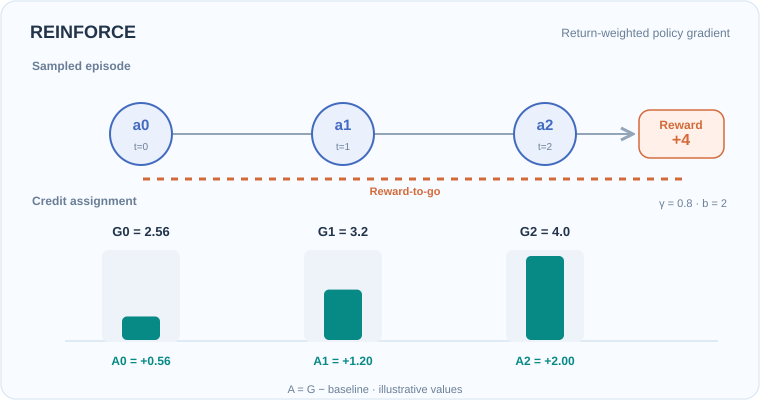
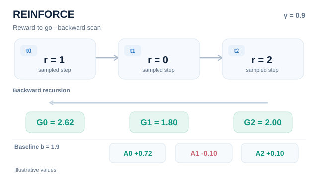

# REINFORCE (Williams, 1992)

A Monte Carlo policy-gradient method that raises the log-probability of each sampled action in proportion to the return that followed it.

## Problem

A stochastic policy should be adjusted directly to increase the expected reinforcement it receives, without a model of the environment or a value function. Williams asks which update rule gives this for networks with stochastic output units, and whether it moves the parameters in the direction of the gradient of expected reinforcement.

## Core idea

For a stochastic unit with weight \(w_{ij}\), Williams defines the update \(\Delta w_{ij} = \alpha_{ij}\,(r - b_{ij})\,e_{ij}\). Here \(r\) is the reinforcement, \(b_{ij}\) is a baseline, and \(e_{ij}\) is the eligibility term, which is the derivative of the log-probability of the sampled output with respect to that weight. The paper's Theorem 1 states that the average update vector lies in a direction in which expected reinforcement increases. The theorem requires the reinforcement baseline not to depend on the sampled output whose score is used; within that constraint, but the paper conjectures that the choice of baseline makes convergence to a local maximum more or less likely.

## Equation or algorithm

In the notation used across this wiki, REINFORCE estimates the gradient of the expected return \(J(\theta)\) from sampled episodes:

\[
\nabla_\theta J(\theta) \approx \sum_t \nabla_\theta \log \pi_\theta(a_t \mid s_t)\,\big(G_t - b\big)
\]

where \(G_t\) is the return from step \(t\) and \(b\) is a baseline. The procedure:

1. Initialise the policy parameters \(\theta\).
2. Sample a complete episode by following \(\pi_\theta\).
3. For each step \(t\), compute the return \(G_t\).
4. Update \(\theta \leftarrow \theta + \alpha \sum_t \nabla_\theta \log \pi_\theta(a_t \mid s_t)\,(G_t - b)\).
5. Repeat from step 2.

The equation above uses the undiscounted episodic convention. For the discounted start-state objective $J_\gamma=\mathbb{E}[\sum_t\gamma^t r_t]$, the full score-function contribution is $\gamma^t(G_t-b)\nabla\log\pi(a_t\mid s_t)$. The visuals below isolate the **centred-return factor** $G_t-b$, not that full coefficient or a gradient vector. A baseline must be independent of the currently sampled action conditional on its state.

This time factor follows by collecting the rewards affected by action $a_t$: $\sum_{k=t}^{T-1}\gamma^k r_k=\gamma^t G_t$. For an action-independent baseline, the conditional score expectation is zero, $\mathbb{E}_{a_t\sim\pi}[b(s_t)\nabla\log\pi(a_t\mid s_t)]=b(s_t)\nabla\sum_a\pi(a\mid s_t)=0$. The fixed baseline below is held constant in this score estimator.

### Visual walkthrough: return-weighted actions

  

*Original continuous teaching animation (CC BY-SA 4.0).* A three-action **synthetic episode** has step rewards `(0, 0, 4)`, discount `γ = 0.8`, and a fixed baseline `b = 2`. Discounted returns are `G = (2.56, 3.2, 4)`; subtracting the baseline produces centred-return factors `(0.56, 1.2, 2)` on the corresponding **log-policy gradients**. The animation moves forward while sampling actions, then backward to illustrate reward-to-go assignment. The bars are *weights*, **not** trained parameters, gradient magnitudes, or empirical learning curves; each sampled action has its own log-probability gradient direction. These are hand-chosen values, not model measurements. Use the MkDocs Play/Pause button (also operable with Enter or Space) or the [GitHub static preview](../../../../../assets/concept-animations/reinforce-return-credit-still.svg). The derivation is in [Williams (1992)](https://doi.org/10.1007/bf00992696).

### Interactive lab: delayed credit and baseline sign

  
The script-free SVG and computation explanation above remain readable on GitHub.

The lab recomputes the **actual three-step reward-to-go arithmetic** for editable synthetic rewards \(r=(r_0,r_1,r_2)\). Choose the terminal-reward preset \((0,0,4)\) or intermediate-reward preset \((1,0,2)\), then move each reward, discount \(\gamma\), and constant baseline \(b\) independently. Step from the sampled episode to the discounted returns \(G_t=r_t+\gamma G_{t+1}\), with \(G_3=0\) (the terminal-only special case is \(G_t=\gamma^{2-t}R\)), then to the centred-return factors \(G_t-b\) that multiply each action's **own** log-policy gradient. With \(R=4\), \(\gamma=0.8\), \(b=2\), these weights are \((0.56,1.20,2.00)\). Raising the baseline can make earlier weights negative **without changing the sampled rewards**. Negative coefficients reverse a local log-probability gradient's contribution, but the figure does **not** specify the gradient vector or a policy parameter update.

Use **Previous/Next, Play/Pause, seek, playback speed and Reset** to inspect discrete stages. The dark SVG plot uses a keyboard-focusable horizontal scroller on narrow screens; the controls use native keyboard events. Reduced-motion preference disables autoplay while retaining manual stepping. This is a deterministic constructed example, **not measured training**. See Williams (1992) in References.

### Intermediate rewards: general backward recurrence

*Original instructional animation (CC BY-SA 4.0).* The return is accumulated **backward**, not propagated as a neural-network gradient. For illustrative rewards $(r_0,r_1,r_2)=(1,0,2)$, discount $\gamma=0.9$, and a terminal state after $t=2$, the computed returns are $G_2=2$, $G_1=1.8$, and $G_0=2.62$. Subtracting the *action-independent* baseline $b=1.9$ produces weights $(G_t-b)=(+0.72,-0.10,+0.10)$ for the sampled log-probability gradients. The second term has a negative coefficient along its own log-policy gradient; other terms and shared parameters still determine the total update; the figure does not assert any measured learning outcome. Values and animation timing are invented for teaching, **not model measurements**.

On the MkDocs site, use the Play/Pause button (keyboard Enter or Space). Reduced-motion settings show the static view. [GitHub-readable still preview](../../../../../assets/concept-animations/reinforce-reward-to-go-still.svg). See [Williams (1992)](https://doi.org/10.1007/BF00992696).

The lab also offers the intermediate-reward preset $(1,0,2)$ with $\gamma=0.9$, $b=1.9$. All three rewards are editable; it computes the general recurrence $G_t=r_t+\gamma G_{t+1}$ with $G_3=0$. The terminal-only power formula is a special case. Each stage labels its shared display scale; bar heights are proportional without saturation.

SVG numeric labels name the final target values while bars interpolate; the interactive lab recomputes the actual numerical state.

## Results

Williams's paper gives a derivation and a theorem rather than a benchmark. Its contribution is the general class of update rules, which underlies the policy-gradient methods that followed.

## Limitations

- **High variance.** Using the full return as the weight gives an unbiased but noisy gradient. Baselines and critics, the basis of [actor-critic methods](../a3c/index.md), reduce the variance.
- **On-policy and episodic.** Each episode is used for one update, which makes the method sample-hungry.
- **Local maxima.** The paper does not prove convergence. It conjectures that the baseline affects which local maximum is reached, and its theorem guarantees only that the expected update points uphill.

## Connections

- Parent topic: [Policy gradient and actor-critic](../index.md), and the wider [Reinforcement Learning](../../index.md) overview.
- Its advantage-weighted form is the starting point for [A3C](../a3c/index.md), [TRPO](../trpo/index.md) and [Proximal Policy Optimisation](../../proximal-policy-optimisation/index.md).
- [GRPO](../grpo/index.md) keeps the REINFORCE-style update but takes its baseline from the mean reward of a group of sampled outputs.

## Applications

- **Language model fine-tuning.** Policy-gradient updates with a sampled-reward baseline underlie the reinforcement learning used to align language models (Ouyang et al., 2022; Shao et al., 2024).

## Open questions

- Which baselines give low variance without bias in long-horizon tasks.
- How to keep the simplicity of REINFORCE while reusing data, which the later methods pursue.

## References

### Seminal papers

- Williams (1992), "Simple statistical gradient-following algorithms for connectionist reinforcement learning", *Machine Learning* 8(3–4), 229–256. https://doi.org/10.1007/bf00992696 — The paper that introduces the REINFORCE update and proves the gradient-direction theorem.
- Schulman et al. (2016), "High-dimensional continuous control using generalized advantage estimation", [arXiv:1506.02438](https://arxiv.org/abs/1506.02438) — Advantage estimation for reducing the variance of policy-gradient updates.
- Mnih et al. (2016), "Asynchronous methods for deep reinforcement learning", [arXiv:1602.01783](https://arxiv.org/abs/1602.01783) — Actor-critic policy gradients with an advantage baseline.
- Schulman et al. (2017), "Proximal policy optimization algorithms", [arXiv:1707.06347](https://arxiv.org/abs/1707.06347) — A clipped policy-gradient method built on the same log-probability gradient.

### Surveys and textbooks

- Sutton, R. S. & Barto, A. G. *Reinforcement Learning: An Introduction*, 2nd ed. MIT Press, 2018. http://incompleteideas.net/book/the-book-2nd.html — Policy-gradient methods and the role of baselines in the standard textbook.

### Articles and documentation

- Ouyang et al. (2022), "Training language models to follow instructions with human feedback", [arXiv:2203.02155](https://arxiv.org/abs/2203.02155) — InstructGPT, which fine-tunes a language model with reinforcement learning from human feedback.
- Shao et al. (2024), "DeepSeekMath: Pushing the limits of mathematical reasoning in open language models", [arXiv:2402.03300](https://arxiv.org/abs/2402.03300) — Introduces GRPO, which uses a group-mean baseline in place of a learned critic.
