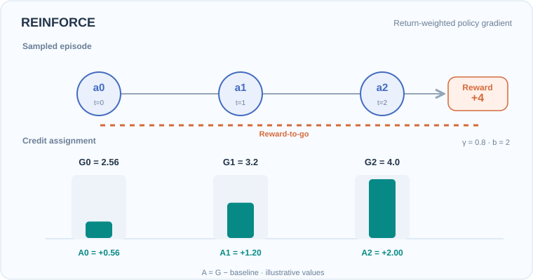
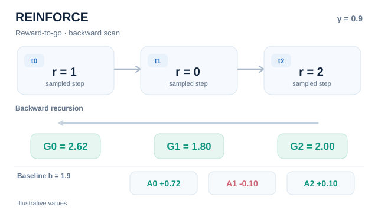

# REINFORCE（Williams，1992）

一種蒙地卡羅策略梯度方法：每個被取樣的動作，其對數機率會依其後所得的回報成比例地提高。

## 問題

隨機策略應該被直接調整，以增加它所獲得的期望強化，而不需要環境模型或價值函數。Williams 探討：對於具有隨機輸出單元的網路，哪一種更新規則能做到這點，以及它是否會使參數沿著期望強化的梯度方向移動。

## 核心想法

對於權重為 \(w_{ij}\) 的隨機單元，Williams 定義更新 \(\Delta w_{ij} = \alpha_{ij}\,(r - b_{ij})\,e_{ij}\)。其中 \(r\) 是強化訊號，\(b_{ij}\) 是基線，\(e_{ij}\) 是資格項（eligibility term），即被取樣輸出的對數機率對該權重的導數。論文的定理 1 指出，平均更新向量位於期望強化會增加的方向上。該定理要求基線不依賴資格項所對應的當次取樣輸出；在此限制下，論文推測，基線的選擇會使演算法收斂到局部最大值的可能性有所不同。

## 方程式與演算法

依本維基使用的記號，REINFORCE 以取樣的回合估計期望回報 \(J(\theta)\) 的梯度：

\[
\nabla_\theta J(\theta) \approx \sum_t \nabla_\theta \log \pi_\theta(a_t \mid s_t)\,\big(G_t - b\big)
\]

其中 \(G_t\) 是從第 \(t\) 步起的回報，\(b\) 是基線。流程如下：

1. 初始化策略參數 \(\theta\)。
2. 依 \(\pi_\theta\) 行動，取樣一個完整的回合。
3. 對每一步 \(t\)，計算回報 \(G_t\)。
4. 更新：

    \[
    \begin{aligned}
    \theta &\leftarrow \theta + \alpha\,\widehat g,\\
    \widehat g &= \sum_t \nabla_\theta \log \pi_\theta(a_t \mid s_t)\\
    &\qquad\cdot(G_t-b).
    \end{aligned}
    \]

5. 回到第 2 步重複。

上式採未折扣的回合目標慣例。若目標為 $J_\gamma=\mathbb{E}[\sum_t\gamma^t r_t]$，完整的得分函數貢獻是 $\gamma^t(G_t-b)\nabla\log\pi(a_t\mid s_t)$。以下圖表只呈現**中心化回報因子** $G_t-b$，不是完整係數或梯度向量。基線在給定狀態下不得依賴當前抽樣動作。

時間權重可由動作 $a_t$ 影響的未來獎勵直接整理得出：$\sum_{k=t}^{T-1}\gamma^k r_k=\gamma^t G_t$。若基線不依賴抽樣動作，條件得分期望為零：

\[
\begin{aligned}
&\mathbb{E}_{a_t\sim\pi}[b(s_t)\nabla\log\pi(a_t\mid s_t)]\\
&=b(s_t)\nabla\sum_a\pi(a\mid s_t)\\
&=0.
\end{aligned}
\]

以下固定基線在此得分估計式中視為常數。

### 視覺化解讀：回報加權的動作更新

  

*原創連續教學動畫（CC BY-SA 4.0）。* 在**人工設定的回合**中，三個時間步的獎勵為 `(0, 0, 4)`，折扣率 `γ = 0.8`，固定基線 `b = 2`。從每個時間步算出的折扣回報為 `G = (2.56, 3.2, 4)`，扣除基線得到優勢權重 `(0.56, 1.2, 2)`，分別乘上各動作的**對數策略梯度**。動畫先向前取樣動作，再反向示意回報的歸屬。長條代表*梯度加權係數*，**不是**訓練後的參數、梯度大小或實測學習曲線；不同動作仍有各自的對數機率梯度方向。全部數值均為教學示意，非模型量測值。可在 MkDocs 使用播放／暫停按鈕（也支援 Enter 與空白鍵），或查看 [GitHub 靜態預覽](../../../../../assets/concept-animations/reinforce-return-credit-still.svg)。推導見 [Williams（1992）](https://doi.org/10.1007/bf00992696)。

### 互動實驗：延遲回報與基線符號

  
若未載入互動程式，GitHub 仍可閱讀上方 SVG 靜態圖與運算說明。

此實驗使用可調整的人工回合獎勵 \(r=(r_0,r_1,r_2)\)。可選終端獎勵 \((0,0,4)\) 或中途獎勵 \((1,0,2)\) 預設，再分別調整三步獎勵、折扣率 \(\gamma\) 與固定基線 \(b\)，依 \(G_t=r_t+\gamma G_{t+1}\)、\(G_3=0\) 計算每步回報（僅終端有獎勵時為 \(G_t=\gamma^{2-t}R\)），再計算乘上**各動作自身對數策略梯度**的帶符號係數 \(G_t-b\)。預設 \(R=4\)、\(\gamma=0.8\)、\(b=2\)，係數為 \((0.56,1.20,2.00)\)。提高基線可能讓較早動作的係數變成負值，**即使實際回合獎勵不變**。負值會反轉局部對數機率梯度的貢獻方向，但圖形**沒有指定梯度向量或真正的參數更新**。

可用**上一步／下一步、播放／暫停、進度滑桿、速度調整與重設**逐步檢視狀態。手機可透過鍵盤聚焦後水平捲動 SVG 圖表。減少動態效果模式不會自動播放，仍能逐步操作。全部數值是確定性的人工示例，**不是模型訓練實測值**。原始方法參見 References 中的 Williams（1992）。

### 中途獎勵範例：由後往前的回報與基線

*原創教學動畫（CC BY-SA 4.0）。* 回報是**由後往前累積計算**，不是神經網路的梯度反向傳播。設人工獎勵 $(r_0,r_1,r_2)=(1,0,2)$、折扣因子 $\gamma=0.9$，且第 2 步後終止，則 $G_2=2$、$G_1=1.8$、$G_0=2.62$。減去**不依賴所選動作**的常數基線 $b=1.9$ 後，各步的對數機率梯度權重為 $(G_t-b)=(+0.72,-0.10,+0.10)$。因此第二步取樣的動作在梯度上升更新中，相對於基線會被抑制；這不代表實際訓練已觀測到相同的機率變化。**所有數值與動畫時間皆為人工教學示例，並非模型實測。**

MkDocs 網站提供播放／暫停按鈕，可用 Enter 或 Space 操作；偏好減少動態效果時會顯示靜態視圖。[GitHub 可閱讀的靜態預覽](../../../../../assets/concept-animations/reinforce-reward-to-go-still.svg)。研究依據：[Williams（1992）](https://doi.org/10.1007/BF00992696)。

互動實驗也保留中途獎勵預設 $(1,0,2)$，搭配 $\gamma=0.9$、$b=1.9$。三個獎勵皆可調整，採一般遞迴式 $G_t=r_t+\gamma G_{t+1}$、$G_3=0$；只含終端獎勵的冪次公式是其特例。每階段會標示共用顯示比例，長條高度保持成比例，不截斷數值。

SVG 數值標籤表示長條最終目標值，不是插值中的當下高度；互動實驗則重新計算目前的數值狀態。

## 結果

Williams 的論文提供的是推導與定理，而非基準測試。它的貢獻在於一般化的更新規則類別，後來的策略梯度方法都建立在這個基礎上。

## 限制

- **高變異。** 以完整回報作為權重，得到的是不偏但雜訊很大的梯度。基線與評論家（即[演員–評論家方法](../a3c/index.zh-TW.md)的基礎）能降低變異。
- **同策略且以回合為單位。** 每個回合只用於一次更新，因此方法很耗樣本。
- **局部最大值。** 論文並未證明收斂。它推測基線會影響演算法最終到達哪一個局部最大值，而定理只保證期望更新指向上坡方向。

## 關聯

- 上層主題：[策略梯度與演員–評論家](../index.md)，以及更廣的[強化學習](../../index.zh-TW.md)概觀。
- 其帶優勢的形式是 [A3C](../a3c/index.zh-TW.md)、[TRPO](../trpo/index.zh-TW.md) 與[近端策略最佳化](../../proximal-policy-optimisation/index.zh-TW.md)的出發點。
- [GRPO](../grpo/index.zh-TW.md) 保留 REINFORCE 式的更新，但其基線取自一組被取樣輸出的平均獎勵。

## 應用

- **語言模型微調。** 以取樣獎勵作為基線的策略梯度更新，是用來對齊語言模型的強化學習基礎（Ouyang 等人，2022；Shao 等人，2024）。

## 未解問題

- 在長時程任務中，哪些基線能在不引入偏差的情況下降低變異。
- 如何保留 REINFORCE 的簡單性，同時重用資料；後來的方法正朝此方向努力。

## 參考文獻

### 開創性論文

- Williams（1992），"Simple statistical gradient-following algorithms for connectionist reinforcement learning"，*Machine Learning* 8(3–4), 229–256。https://doi.org/10.1007/bf00992696 — 提出 REINFORCE 更新並證明梯度方向定理的論文。
- Schulman 等人（2016），"High-dimensional continuous control using generalized advantage estimation"，[arXiv:1506.02438](https://arxiv.org/abs/1506.02438) — 用於降低策略梯度更新變異的優勢估計。
- Mnih 等人（2016），"Asynchronous methods for deep reinforcement learning"，[arXiv:1602.01783](https://arxiv.org/abs/1602.01783) — 以優勢作為基線的演員–評論家策略梯度。
- Schulman 等人（2017），"Proximal policy optimization algorithms"，[arXiv:1707.06347](https://arxiv.org/abs/1707.06347) — 建立在相同對數機率梯度上的截斷式策略梯度方法。

### 綜述與教科書

- Sutton, R. S. & Barto, A. G. *Reinforcement Learning: An Introduction*，第 2 版。MIT Press, 2018。http://incompleteideas.net/book/the-book-2nd.html — 標準教科書中的策略梯度方法與基線的角色。

### 文章與文件

- Ouyang 等人（2022），"Training language models to follow instructions with human feedback"，[arXiv:2203.02155](https://arxiv.org/abs/2203.02155) — InstructGPT，以來自人類回饋的強化學習微調語言模型。
- Shao 等人（2024），"DeepSeekMath: Pushing the limits of mathematical reasoning in open language models"，[arXiv:2402.03300](https://arxiv.org/abs/2402.03300) — 提出 GRPO，以群組平均取代學習得到的評論家。
