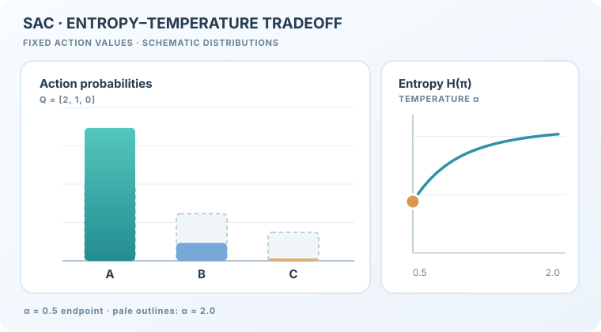

# 軟演員–評論家（Haarnoja 等人，2018）

一種用於連續控制的離策略演員–評論家方法：最大化獎勵加上策略的熵，使用隨機演員與兩個 Q 函數。

## 問題

像 DDPG 這類離策略的確定性方法很脆弱，而像 PPO 這類同策略方法則需要大量樣本。Haarnoja 等人探討：離策略的演員–評論家能否既穩定又有樣本效率；以及在最大化獎勵的同時最大化熵，能否讓探索與穩健性更容易達成。

## 核心想法

目標函數在每一步的期望獎勵上加入策略的熵，並以溫度 \(\alpha\) 決定兩者的取捨。由此得到的軟價值函數 \(V(s) = \mathbb{E}_{a}[Q(s,a) - \log \pi(a \mid s)]\)，會促使策略在獎勵允許的範圍內盡量保持隨機。演員是隨機的，並透過重參數化技巧（reparameterisation trick）訓練，使其取樣的動作可以微分。訓練兩個 Q 函數並取其最小值來計算價值與策略梯度，與 TD3 一樣能限制高估。

## 方程式與演算法

最大熵目標為

\[
J(\pi) = \sum_t \mathbb{E}\left[r(s_t, a_t) + \alpha\, \mathcal{H}\big(\pi(\cdot \mid s_t)\big)\right]
\]

軟 Q 目標為 \(\hat{Q}(s_t, a_t) = r(s_t, a_t) + \gamma\, \mathbb{E}\big[V_{\bar{\psi}}(s_{t+1})\big]\)，其中 \(\bar{\psi}\) 是目標價值網路的權重。策略透過最小化 KL 散度更新；若以重參數化動作 \(a_t = f_\phi(\epsilon; s_t)\) 表示，此目標變為 \(\mathbb{E}\big[\log \pi_\phi(f_\phi(\epsilon; s_t) \mid s_t) - Q_\theta(s_t, f_\phi(\epsilon; s_t))\big]\)。目標價值網路以軟更新速率 \(\tau\) 更新。流程如下：

1. 以隨機策略收集轉換資料，存入回放緩衝區。
2. 抽樣小批次，以目標價值網路計算軟 Q 目標，並更新兩個 Q 函數。
3. 以兩個 Q 函數的最小值更新價值網路與策略。
4. 以速率 \(\tau\) 更新目標價值網路，然後重複。

論文省略了演算法中的溫度，並指出獎勵尺度是唯一需要調整的超參數。

### 教學動畫：溫度與策略熵

*原創向量教學動畫（CC BY-SA 4.0）。* 固定**人工設定**的三個離散動作價值 \(Q=[2,1,0]\)，有限動作集合的最大熵最佳策略可寫為：

\[
\pi_{\alpha}(a\mid s)=\frac{\exp(Q(s,a)/\alpha)}{\sum_{a'}\exp(Q(s,a')/\alpha)}.
\]

在 \(\alpha=2\) 時，動作機率約為 \((0.506,0.307,0.186)\)，熵為 \(1.020\) nats；當 \(\alpha=0.5\)，機率約變為 \((0.867,0.117,0.016)\)，熵降至 \(0.441\) nats。淡色外框保留高溫分布，橘色游標沿解析式熵曲線移動。**這是三動作的概念類比，不是 SAC 連續動作演員的真實輸出，也不是最佳化訓練軌跡或模型實測結果。** MkDocs 網站可使用播放／暫停，或以 Enter／Space 鍵操作；偏好減少動態效果的讀者可看到靜態畫面。無腳本時仍可閱讀圖像。參考 [Haarnoja 等人（2018）](https://arxiv.org/abs/1801.01290)。

### 互動計算實驗：有限動作的溫度與熵

  
無 JavaScript 時仍能直接閱讀上方的靜態 SVG。

調整溫度 \(\alpha\in[0.2,3]\) 與人工動作價值 \(Q=[2g,g,0]\) 的間距，即時計算 Gibbs 最佳策略的各動作機率、熵 \(H(\pi)\)、期望 \(Q\) 及軟目標 \(\mathbb E[Q]+\alpha H\)。預設 \(g=1,\alpha=2\) 時，熵約為 **1.020 nats**；改成 \(\alpha=0.5\) 則約 **0.441 nats**。改變 \(g\) 時，曲線也會重新計算。可透過**上一步／下一步、播放／暫停、進度滑桿、0.5×／1×／2× 速度與重設**查看中間解析狀態。原生控制支援鍵盤，圖面可聚焦後水平捲動；減少動態效果模式停用自動播放，但保留手動逐步檢視。

**此實驗僅是人工設定的離散動作解析最佳策略**，不是 SAC 的連續動作演員、訓練得到的策略、梯度下降軌跡或模型實測。GitHub／無 JavaScript 時保留上方的原有靜態 SVG。

## 結果

論文指出，SAC 在樣本效率與效能上相對於離策略與同策略的先前方法，都有「實質的提升」。在相關工作一節中，論文又寫道，SAC「確實大幅超越了先前最先進的離策略深度強化學習方法」。在 Gym MuJoCo 任務上，圖 1 將 SAC 與 DDPG、PPO、軟 Q 學習（SQL）與 TD3 進行比較。論文報告，DDPG 在 Ant-v1 上「完全沒有進展」。每個演算法都以五個不同的隨機種子各訓練一次。

## 限制

- **溫度敏感。** 效能取決於獎勵尺度，它在此版本中決定了實際的熵權重。後續論文（Haarnoja 等人，2018b）以受約束的公式化方法自動調整溫度；本文並未包含這個步驟。
- **兩個評論家與隨機演員。** 此方法比 DDPG 有更多網路，每次更新的計算量較大。
- **連續動作。** 此方法是為連續控制設計的，論文的結果來自模擬的移動任務。

## 關聯

- 上層主題：[策略梯度與演員–評論家](../index.md)，以及更廣的[強化學習](../../index.zh-TW.md)概觀。
- 其確定性的前身是 [DDPG](../ddpg/index.zh-TW.md)，其修正高估的做法與 [TD3](../td3/index.zh-TW.md) 有共通的想法。
- 它是離策略方法，與同策略的 [PPO](../../proximal-policy-optimisation/index.zh-TW.md) 形成對照。

## 應用

- **模擬機器人移動。** 論文中的 MuJoCo 任務是其報告的應用，此方法也是連續控制的標準基準。

## 未解問題

- 如何在獎勵尺度不同的任務之間，自動調整或學習溫度。
- 此方法在真實機器人上的表現如何；論文並未測試。

## 參考文獻

### 開創性論文

- Haarnoja、Zhou、Abbeel 與 Levine（2018），"Soft actor-critic: Off-policy maximum entropy deep reinforcement learning with a stochastic actor"，[arXiv:1801.01290](https://arxiv.org/abs/1801.01290) — SAC 原始論文，包含最大熵目標與上述 MuJoCo 結果。
- Haarnoja、Zhou、Hartikainen、Tucker、Ha、Tan、Kumar、Zhu、Gupta、Abbeel 與 Levine（2018b），"Soft actor-critic algorithms and applications"，[arXiv:1812.05905](https://arxiv.org/abs/1812.05905) — 後續論文，加入以受約束公式化自動調整溫度的方法。
- Fujimoto、van Hoof 與 Meger（2018），"Addressing function approximation error in actor-critic methods"，[arXiv:1802.09477](https://arxiv.org/abs/1802.09477) — TD3，以相同的雙評論家最小值對抗高估。
- Lillicrap 等人（2016），"Continuous control with deep reinforcement learning"，ICLR，[arXiv:1509.02971](https://arxiv.org/abs/1509.02971) — DDPG，即 SAC 所超越的確定性離策略基準。
- Schulman 等人（2017），"Proximal policy optimization algorithms"，[arXiv:1707.06347](https://arxiv.org/abs/1707.06347) — SAC 比較中的同策略基準。

### 綜述與教科書

- Sutton, R. S. & Barto, A. G. *Reinforcement Learning: An Introduction*，第 2 版。MIT Press, 2018。http://incompleteideas.net/book/the-book-2nd.html — 演員–評論家方法與 SAC 所用價值函數的背景知識。
