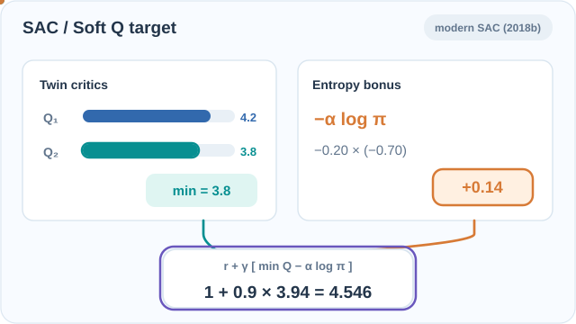
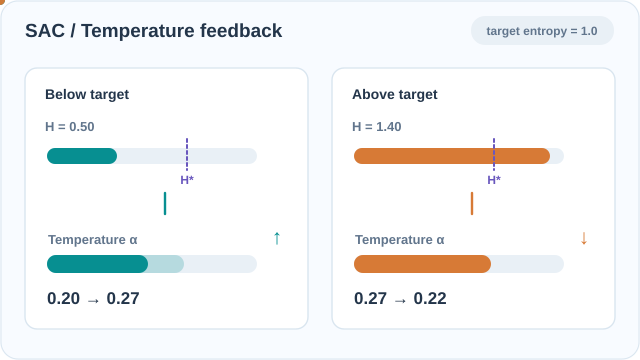

# 軟演員–評論家（Haarnoja 等人，2018）

一種用於連續控制的離策略演員–評論家方法：最大化獎勵加上策略的熵，使用隨機演員與兩個 Q 函數。

## 問題

像 DDPG 這類離策略的確定性方法很脆弱，而像 PPO 這類同策略方法則需要大量樣本。Haarnoja 等人探討：離策略的演員–評論家能否既穩定又有樣本效率；以及在最大化獎勵的同時最大化熵，能否讓探索與穩健性更容易達成。

## 核心想法

目標函數在每一步的期望獎勵上加入策略的熵，並以溫度 \(\alpha\) 決定兩者的取捨。由此得到的軟價值函數 \(V(s) = \mathbb{E}_{a}[Q(s,a) - \log \pi(a \mid s)]\)，會促使策略在獎勵允許的範圍內盡量保持隨機。演員是隨機的，並透過重參數化技巧（reparameterisation trick）訓練，使其取樣的動作可以微分。訓練兩個 Q 函數並取其最小值來計算價值與策略梯度，與 TD3 一樣能限制高估。

## 方程式與演算法

最大熵目標為

\[
J(\pi) = \sum_t \mathbb{E}\left[r(s_t, a_t) + \alpha\, \mathcal{H}\big(\pi(\cdot \mid s_t)\big)\right]
\]

軟 Q 目標為 \(\hat{Q}(s_t, a_t) = r(s_t, a_t) + \gamma\, \mathbb{E}\big[V_{\bar{\psi}}(s_{t+1})\big]\)，其中 \(\bar{\psi}\) 是目標價值網路的權重。策略透過最小化 KL 散度更新；若以重參數化動作 \(a_t = f_\phi(\epsilon; s_t)\) 表示，此目標變為 \(\mathbb{E}\big[\log \pi_\phi(f_\phi(\epsilon; s_t) \mid s_t) - Q_\theta(s_t, f_\phi(\epsilon; s_t))\big]\)。目標價值網路以軟更新速率 \(\tau\) 更新。流程如下：

1. 以隨機策略收集轉換資料，存入回放緩衝區。
2. 抽樣小批次，以目標價值網路計算軟 Q 目標，並更新兩個 Q 函數。
3. 以兩個 Q 函數的最小值更新價值網路與策略。
4. 以速率 \(\tau\) 更新目標價值網路，然後重複。

論文省略了演算法中的溫度，並指出獎勵尺度是唯一需要調整的超參數。

### 現代版 SAC：熵正則化雙評論家目標

上文介紹的 2018 年原始 SAC 實作使用獨立的狀態價值網路；後續 *SAC Algorithms and Applications*（2018b）改為**直接使用兩個目標 Q 函數**構造抽樣的軟 Bellman 目標，而不再另外訓練該價值網路：

$
y_t = r_t + \gamma(1-d_t)\left[
\min_{i=1,2}Q_{\bar\theta_i}(s_{t+1},a_{t+1})
- \alpha\log\pi_{\phi}(a_{t+1}\mid s_{t+1})
\right],\quad a_{t+1}\sim\pi_\phi(\cdot\mid s_{t+1}).
$

其中 $-\alpha\log\pi$ 是軟目標中的熵獎勵，取兩個目標評論家之最小值則用於抑制樂觀的 Q 值估計。使用**人工設定、非模型實測**的 $r=1$、$\gamma=0.9$、$d=0$、$(Q_1,Q_2)=(4.2,3.8)$、$\alpha=0.20$ 及抽樣動作對數密度 $\log\pi=-0.70$，得到 $1+0.9[3.8-0.20(-0.70)]=4.546$；若不含熵獎勵則為 $4.420$。若轉移已終止（$d=1$），就不含 Bootstrap 項。

*原創教學動畫（CC BY-SA 4.0）。* 青綠色路徑傳遞雙評論家最小值估計，橘色路徑傳遞 $-\alpha\log\pi$，最後在下方形成折扣目標。全部數值都是人工教學示例，不代表實際演員或評論家的預測。**MkDocs：**使用播放／暫停控制；**GitHub：**參見[靜態完整圖](../../../../../assets/concept-animations/sac-soft-target-still.svg)。來源：[Haarnoja 等人（2018b）](https://arxiv.org/abs/1812.05905)。

### 自動調整熵溫度（2018b）

後續 SAC 透過**最低期望熵限制**最佳化 $\alpha$。固定目標熵 $\mathcal H_*$ 時，策略熵**低於**目標會使對偶更新傾向提高 $\alpha$、強化探索項；**高於**目標則傾向降低 $\alpha$。這是對偶更新方向，**不保證策略熵立即改變**。連續動作的微分熵可能為負；動畫中的正值僅為教學示意。

*原創教學動畫（CC BY-SA 4.0）。* 紫色標記是兩個面板共用的目標熵 $\mathcal H_*=1.0$。左面板以 $\mathcal H=0.50$ 示意 $\alpha:0.20\to0.27$；右面板以 $\mathcal H=1.40$ 示意 $\alpha:0.27\to0.22$。這些數值**僅呈現調整方向**，不是實際最佳化梯度步驟或模型訓練軌跡。**MkDocs：**使用播放／暫停控制；**GitHub：**參見[靜態完整圖](../../../../../assets/concept-animations/sac-temperature-feedback-still.svg)。來源：[Haarnoja 等人（2018b）](https://arxiv.org/abs/1812.05905)。

## 結果

論文指出，SAC 在樣本效率與效能上相對於離策略與同策略的先前方法，都有「實質的提升」。在相關工作一節中，論文又寫道，SAC「確實大幅超越了先前最先進的離策略深度強化學習方法」。在 Gym MuJoCo 任務上，圖 1 將 SAC 與 DDPG、PPO、軟 Q 學習（SQL）與 TD3 進行比較。論文報告，DDPG 在 Ant-v1 上「完全沒有進展」。每個演算法都以五個不同的隨機種子各訓練一次。

## 限制

- **溫度敏感。** 效能取決於獎勵尺度，它在此版本中決定了實際的熵權重。後續論文（Haarnoja 等人，2018b）以受約束的公式化方法自動調整溫度；本文並未包含這個步驟。
- **兩個評論家與隨機演員。** 此方法比 DDPG 有更多網路，每次更新的計算量較大。
- **連續動作。** 此方法是為連續控制設計的，論文的結果來自模擬的移動任務。

## 關聯

- 上層主題：[策略梯度與演員–評論家](../index.md)，以及更廣的[強化學習](../../index.zh-TW.md)概觀。
- 其確定性的前身是 [DDPG](../ddpg/index.zh-TW.md)，其修正高估的做法與 [TD3](../td3/index.zh-TW.md) 有共通的想法。
- 它是離策略方法，與同策略的 [PPO](../../proximal-policy-optimisation/index.zh-TW.md) 形成對照。

## 應用

- **模擬機器人移動。** 論文中的 MuJoCo 任務是其報告的應用，此方法也是連續控制的標準基準。

## 未解問題

- 如何在獎勵尺度不同的任務之間，自動調整或學習溫度。
- 此方法在真實機器人上的表現如何；論文並未測試。

## 參考文獻

### 開創性論文

- Haarnoja、Zhou、Abbeel 與 Levine（2018），"Soft actor-critic: Off-policy maximum entropy deep reinforcement learning with a stochastic actor"，[arXiv:1801.01290](https://arxiv.org/abs/1801.01290) — SAC 原始論文，包含最大熵目標與上述 MuJoCo 結果。
- Haarnoja、Zhou、Hartikainen、Tucker、Ha、Tan、Kumar、Zhu、Gupta、Abbeel 與 Levine（2018b），"Soft actor-critic algorithms and applications"，[arXiv:1812.05905](https://arxiv.org/abs/1812.05905) — 後續論文，加入以受約束公式化自動調整溫度的方法。
- Fujimoto、van Hoof 與 Meger（2018），"Addressing function approximation error in actor-critic methods"，[arXiv:1802.09477](https://arxiv.org/abs/1802.09477) — TD3，以相同的雙評論家最小值對抗高估。
- Lillicrap 等人（2016），"Continuous control with deep reinforcement learning"，ICLR，[arXiv:1509.02971](https://arxiv.org/abs/1509.02971) — DDPG，即 SAC 所超越的確定性離策略基準。
- Schulman 等人（2017），"Proximal policy optimization algorithms"，[arXiv:1707.06347](https://arxiv.org/abs/1707.06347) — SAC 比較中的同策略基準。

### 綜述與教科書

- Sutton, R. S. & Barto, A. G. *Reinforcement Learning: An Introduction*，第 2 版。MIT Press, 2018。http://incompleteideas.net/book/the-book-2nd.html — 演員–評論家方法與 SAC 所用價值函數的背景知識。
