# 雙延遲深度確定性策略梯度（Fujimoto 等人，2018）

DDPG 的變體，以兩個 Q 函數修正評論家的高估問題，讓演員的更新頻率低於評論家，並以雜訊平滑目標動作。

## 問題

Fujimoto、van Hoof 與 Meger 指出，DDPG 的評論家會高估動作價值；而且演員的策略更新會放大誤差，因為演員是沿著評論家目前不準確的估計而更新。他們的問題是：在不放棄 DDPG 確定性演員的前提下，如何減少演員–評論家方法中的函數逼近誤差。

## 核心想法

TD3 以三種方式修改 DDPG：

1. **截斷式雙 Q 學習（clipped double Q-learning）。** 訓練兩個評論家，目標使用兩者中較小的估計，以限制高估。
2. **延遲的策略更新。** 演員與目標網路的更新頻率低於評論家，此處是每更新兩次評論家才更新一次，使策略追隨較準確的價值。
3. **目標策略平滑（target policy smoothing）。** 在目標動作上加入截斷後的雜訊，使價值目標是在一小片動作區域上取平均，因而無法利用評論家上的尖峰。

## 方程式與演算法

TD3 的目標為

\[
y = r + \gamma \min_{i=1,2} Q_{\theta'_i}\big(s', \pi_{\phi'}(s') + \epsilon\big), \qquad \epsilon \sim \text{clip}\big(\mathcal{N}(0, \sigma), -c, c\big)
\]

論文使用的策略延遲 \(d = 2\)、目標雜訊標準差 \(\sigma = 0.2\)、雜訊截斷 \(c = 0.5\)，以及軟目標更新速率 \(\tau = 0.005\)。每一步的流程如下：

1. 從回放緩衝區抽樣小批次。
2. 由目標演員計算平滑後的目標動作，並形成截斷式雙 Q 目標 \(y\)。
3. 讓兩個評論家都朝 \(y\) 更新。
4. 每 \(d\) 步，沿第一個評論家的梯度更新演員，然後更新目標網路。

*原創教學動畫（CC BY-SA 4.0）。* 上方路徑先在**目標演員的動作**加入截斷雜訊，再由**兩個目標評論家**估計 Q 值，取其中**較小值**形成 bootstrap 目標。下方區分**兩個線上評論家每步更新**，以及**演員與目標網路每兩次評論家更新才更新一次**（論文示例的延遲 (d=2)）。目標網路使用**軟更新**，並非直接硬複製；演員的策略梯度則使用第一個線上評論家。此時序**僅為教學示意，不是訓練實測軌跡**。MkDocs 可使用播放／暫停按鈕；GitHub 可查看[靜態總覽圖](../../../../../assets/concept-animations/td3-delayed-twin-critics-still.svg)。詳見 [Fujimoto 等人（2018）](https://arxiv.org/abs/1802.09477)。

## 結果

論文在七個 OpenAI Gym MuJoCo 任務上評估，每個任務的結果是 10 次試驗（每次 100 萬個時間步）的平均。摘要指出，此方法在每個測試環境中都超越了當時的最先進方法。表 1 給出 TD3、DDPG 與 PPO 的最大平均回報：

| 環境 | TD3 | DDPG | PPO |
|---|---|---|---|
| HalfCheetah | 9636.95 | 3305.60 | 1795.43 |
| Hopper | 3564.07 | 2020.46 | 2164.70 |
| Walker2d | 4682.82 | 1843.85 | 3317.69 |
| Ant | 4372.44 | 1005.30 | 1083.20 |
| Reacher | −3.60 | −6.51 | −6.18 |
| InvertedPendulum | 1000.00 | 1000.00 | 1000.00 |
| InvertedDoublePendulum | 9337.47 | 9355.52 | 8977.94 |

此表為論文原始數據（TD3 欄位省略了 ± 標準差）。在 InvertedDoublePendulum 上，DDPG 的數值略高於 TD3，因此「每個環境都勝出」的說法在該任務上並不成立。

## 限制

- **評估範圍。** 主要結果是連續的 MuJoCo 控制，任務集固定為七個；論文未測試離散動作或像素輸入。
- **確定性探索。** 演員是確定性的，因此探索依賴加在動作上的雜訊，與 DDPG 相同。
- **額外的超參數。** 策略延遲、目標雜訊與雜訊截斷是論文所選定的新設定，結果依賴這些設定。

## 關聯

- 上層主題：[策略梯度與演員–評論家](../index.md)，以及更廣的[強化學習](../../index.zh-TW.md)概觀。
- TD3 建立在 [DDPG](../ddpg/index.zh-TW.md) 之上，其雙 Q 的想法呼應了離散動作中用來修正高估的 [Double DQN](../../value-based-methods/double-dqn/index.zh-TW.md)。
- 同樣處理高估問題的隨機替代方法是 [SAC](../sac/index.zh-TW.md)。

## 應用

- **模擬移動。** Hopper、Walker2d 與 Ant 等 MuJoCo 基準任務，是論文的主要應用。

## 未解問題

- 這三項修正在隨機或極高維的動作空間中是否仍是正確的做法。
- 此方法在模擬移動中獲得的穩定性，能在多大程度上轉移到真實機器人。

## 參考文獻

### 開創性論文

- Fujimoto、van Hoof 與 Meger（2018），"Addressing function approximation error in actor-critic methods"，*Proceedings of ICML 2018*，[arXiv:1802.09477](https://arxiv.org/abs/1802.09477) — TD3 原始論文，包含上述三項修改與 MuJoCo 比較。
- Lillicrap 等人（2016），"Continuous control with deep reinforcement learning"，ICLR，[arXiv:1509.02971](https://arxiv.org/abs/1509.02971) — TD3 所修改的確定性方法 DDPG。
- Haarnoja 等人（2018），"Soft actor-critic: Off-policy maximum entropy deep reinforcement learning with a stochastic actor"，[arXiv:1801.01290](https://arxiv.org/abs/1801.01290) — 與同一族方法比較的隨機演員–評論家方法。
- Schulman 等人（2017），"Proximal policy optimization algorithms"，[arXiv:1707.06347](https://arxiv.org/abs/1707.06347) — TD3 MuJoCo 比較中的同策略基準。
- van Hasselt、Guez 與 Silver（2015），"Deep reinforcement learning with double Q-learning"，[arXiv:1509.06461](https://arxiv.org/abs/1509.06461) — 含函數逼近的雙 Q 學習，截斷式雙 Q 學習即建立在此估計器之上。

### 綜述與教科書

- Sutton, R. S. & Barto, A. G. *Reinforcement Learning: An Introduction*，第 2 版。MIT Press, 2018。http://incompleteideas.net/book/the-book-2nd.html — 演員–評論家方法與價值學習中的高估問題的背景知識。
