# 近端策略最佳化（Schulman 等人，2017）

一種策略梯度方法，會裁剪新舊策略之間的機率比，使每次更新都停留在舊策略附近。

## 問題

單純的策略梯度一步可能太大，一次糟糕的更新就可能讓表現崩潰。信賴區域方法（如 TRPO）以平均 KL 散度的約束來控制步長。TRPO 穩定，但其約束最佳化實作複雜；PPO 的目標是以更簡單的方法達到相近的可靠性。

## 核心想法

令 \(r_t(\theta) = \pi_\theta(a_t \mid s_t) / \pi_{\theta_{\text{old}}}(a_t \mid s_t)\) 為機率比。裁剪目標會把 \(r_t\) 限制在 \([1-\varepsilon, 1+\varepsilon]\) 之內，避免因為大幅移動而獲得額外獎勵。取裁剪項與未裁剪項的最小值，意味著把比值推到此區間之外不會帶來收益。論文在連續控制中使用 \(\varepsilon = 0.2\)。由於更新停留在舊策略附近，同一批資料可以支持數個小批量迭代。

### 動畫解讀：裁剪實際改變了什麼

*原創教學示意圖（CC BY-SA 4.0）。* 虛線是**未裁剪**的 \(r_t\hat A_t\)，實線是單筆樣本的**裁剪代理目標**。動畫以四個狀態移動機率比的標記。當**優勢為正**，\(r_t\) 超過 \(1+\varepsilon\) 後繼續增加，不再提高該樣本的代理目標；當**優勢為負**，\(r_t\) 低於 \(1-\varepsilon\) 後繼續降低，也不再提高目標。裁剪**不會強制把機率比限制在區間內**，也不保證信賴區域。圖中以 \(\varepsilon=0.2\) 示意；標記位置與曲線高度不是實測的策略更新。MkDocs 網站可使用播放／暫停；GitHub 可閱讀[靜態總覽](../../../../assets/concept-animations/ppo-clipped-objective-still.svg)。

## 方程式或演算法

給定優勢估計 \(\hat{A}_t\)，裁剪代理目標為

\[
L^{\text{CLIP}}(\theta) = \mathbb{E}_t\left[\min\left(r_t(\theta)\hat{A}_t,\ \text{clip}\left(r_t(\theta), 1-\varepsilon, 1+\varepsilon\right)\hat{A}_t\right)\right]
\]

若策略與價值函數共享參數，論文會把裁剪代理目標與價值函數損失及熵獎勵合併：

\[
L_t^{\text{CLIP+VF+S}}(\theta) = \mathbb{E}_t\left[L_t^{\text{CLIP}}(\theta) - c_1 L_t^{\text{VF}}(\theta) + c_2 S[\pi_\theta](s_t)\right]
\]

其中 \(L_t^{\text{VF}} = (V_\theta(s_t) - V_t^{\text{targ}})^2\)。Atari 實驗使用 \(c_1 = 1\)、\(c_2 = 0.01\)。MuJoCo 實驗使用獨立的策略網路與價值網路，因此沒有價值損失係數與熵獎勵。

論文的流程如下：

1. 以目前策略 \(\pi_{\theta_{\text{old}}}\) 執行 \(T\) 個時間步並收集軌跡。Atari 設定使用 8 個平行執行者，\(T = 128\)。
2. 以廣義優勢估計（Schulman 等人，2016）估計 \(\hat{A}_t\)，取 \(\gamma = 0.99\)、\(\lambda = 0.95\)。
3. 以小批量對代理目標進行多個迭代的最佳化。MuJoCo 設定使用 \(T = 2048\)、10 個迭代、小批量 64；Atari 設定使用 3 個迭代、小批量 \(32 \times 8\)。
4. 令 \(\theta_{\text{old}} \leftarrow \theta\)，然後重複。

## 結果

- **連續控制。**在七個 MuJoCo 任務上，論文報告 PPO 在幾乎所有環境中都優於先前方法，每次執行 100 萬個時間步。在 21 次執行的消融實驗中，以標準化分數比較裁剪參數：\(\varepsilon = 0.2\) 得 0.82，\(\varepsilon = 0.1\) 得 0.76，\(\varepsilon = 0.3\) 得 0.70，不裁剪也不加懲罰則為 −0.39。
- **Atari。**在 49 款遊戲上，論文報告 PPO 的樣本效率明顯優於 A2C，並與 ACER 相近。以整段訓練的平均獎勵來看，PPO 在 30 款遊戲上最佳，ACER 為 18 款，A2C 為 1 款，沒有平手。

## 限制

- **啟發式裁剪。**裁剪在實務上能使更新接近舊策略，但它不具備 TRPO 的單調改進保證。
- **對實作敏感。**Engstrom 等人（2020）發現，原始描述未涵蓋的程式細節，才是 PPO 相對於 TRPO 優勢的主要來源。結果取決於實作。
- **同策略資料。**每批資料只能支持少數幾次更新，之後即須丟棄，相較於依賴回放的方法，樣本效率受限。
- **基準已過時。**證據來自 2017 年的 MuJoCo 與 Atari 設定，比較對象也是當時的基線。

## 連結

- 母頁：[強化學習](../index.md)
- 同一主題的另一方法：[深度 Q 網路](../deep-q-networks/index.md)，採取值函數路線。
- PPO 也被用於以人類回饋微調大型語言模型。InstructGPT（Ouyang 等人，2022）使用以人類回饋的強化學習微調模型，詳見[從人類回饋學習](../learning-from-human-feedback/index.md)。

## 應用

- **模擬機器人運動。**論文中的 MuJoCo 實驗，是策略梯度方法的標準連續控制基準。
- **語言模型對齊。**InstructGPT 以人類回饋的強化學習微調模型（Ouyang 等人，2022）。

## 未解問題

- 在控制實作細節後，裁剪目標的哪些部分最重要。
- PPO 在樣本效率上與較新的離策略方法相比如何。
- 調參：裁剪範圍、迭代次數與優勢估計器彼此相關，良好的預設值未必能跨任務轉移。

## 參考文獻

### 開創性論文

- Schulman, Wolski, Dhariwal, Radford & Klimov (2017), "Proximal policy optimization algorithms", [arXiv:1707.06347](https://arxiv.org/abs/1707.06347) — The PPO paper, with the clipped objective and the experiments reported above.
- Schulman, Levine, Moritz, Jordan & Abbeel (2015), "Trust region policy optimization", *Proceedings of ICML 2015*, [arXiv:1502.05477](https://arxiv.org/abs/1502.05477) — TRPO, the constrained method that PPO simplifies.
- Schulman, Moritz, Levine, Jordan & Abbeel (2016), "High-dimensional continuous control using generalized advantage estimation", [arXiv:1506.02438](https://arxiv.org/abs/1506.02438) — GAE, the advantage estimator used in the PPO experiments.
- Mnih et al. (2016), "Asynchronous methods for deep reinforcement learning", [arXiv:1602.01783](https://arxiv.org/abs/1602.01783) — A3C, the parallel actor-critic family that the PPO paper's synchronous baseline A2C belongs to.
- Engstrom, Ilyas, Santurkar, Tsipras, Janoos, Rudolph & Madry (2020), "Implementation matters in deep policy gradients: a case study on PPO and TRPO", [arXiv:2005.12729](https://arxiv.org/abs/2005.12729) — Shows that code-level details account for most of PPO's gain over TRPO.

### 綜述與教科書

- Sutton, R. S. & Barto, A. G. *Reinforcement Learning: An Introduction*, 2nd ed. MIT Press, 2018. http://incompleteideas.net/book/the-book-2nd.html — The standard RL textbook, with a free online draft covering policy-gradient methods.

### 文章與文件

- Ouyang et al. (2022), "Training language models to follow instructions with human feedback", [arXiv:2203.02155](https://arxiv.org/abs/2203.02155) — InstructGPT, which fine-tunes a language model with reinforcement learning from human feedback.
