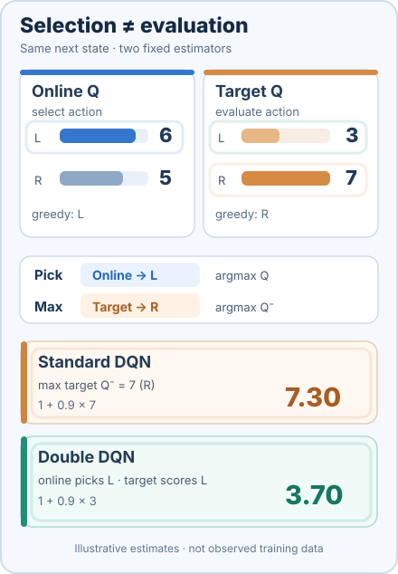

# 雙 DQN（van Hasselt 等人，2016）

對 DQN 目標的一項修改：線上網路選擇動作，目標網路評估該動作，從而降低最大值運算所造成的高估。

## 問題

DQN 的目標對同一個網路的估計取最大值，既用來挑選動作，也用來為它評分。當估計含有雜訊時，最大值會偏向高估。van Hasselt、Guez 與 Silver 顯示，DQN 在他們測試的全部 49 款 Atari 遊戲中都高估了動作價值，而且這種高估會損害效能。

## 核心想法

DQN 的目標中本來就有第二個網路，也就是緩慢更新的目標網路。Double DQN 以不同的方式使用它：線上網路挑選貪婪的下一個動作，目標網路則為該動作評分。把選擇與評估分開，使最大值較不容易挑中正向雜訊。論文指出，這不需要額外的網路或參數，只增加極少的計算量。

## 方程式與演算法

DQN 的目標為

\[
Y_t^{\text{DQN}} = R_{t+1} + \gamma \max_a Q(S_{t+1}, a; \theta^-_t)
\]

Double DQN 的目標為

\[
Y_t^{\text{DoubleDQN}} = R_{t+1} + \gamma\, Q\big(S_{t+1}, \arg\max_a Q(S_{t+1}, a; \theta_t); \theta^-_t\big)
\]

其中 \(\theta\) 是線上參數，\(\theta^-\) 是目標參數。DQN 訓練流程的其他部分，包括回放與平方損失，維持不變，只有目標改變。

### Double DQN 如何分離動作選擇與評估

*原創十秒 SVG／SMIL 教學動畫（CC BY-SA 4.0）。* 在同一個**人工示意的下一狀態**，先固定兩個網路的估計值：$Q_{\theta}(s',L)=6$、$Q_{\theta}(s',R)=5$，但 $Q_{\theta^-}(s',L)=3$、$Q_{\theta^-}(s',R)=7$。線上網路的貪婪動作是 **L**，目標網路最大值對應的動作卻是 **R**。取 $r=1$、$\gamma=0.9$，標準 DQN 在**目標網路**的價值中直接取最大，得到 $1+0.9(7)=\mathbf{7.30}$；Double DQN 先由**線上網路**選 $\arg\max_a Q_{\theta}(s',a)=L$，再讓目標網路評估**同一個 L 動作**，得到 $1+0.9(3)=\mathbf{3.70}$。動畫依序指出兩條選擇路徑並揭露 TD 目標。MkDocs 沿用可透過鍵盤操作的播放／暫停與減少動態效果支援；[GitHub 靜態預覽](../../../../../assets/concept-animations/double-dqn-selector-still.svg)同時保留兩條結果。這些都是**固定的人工數值**，不是訓練過程、實測高估幅度或「Double DQN 每次目標必定較低」的證據。分離選擇與評估可在適當的估計誤差條件下**降低平均高估傾向**，但不保證估計無偏或完全準確。依據文末既有 van Hasselt、Guez 與 Silver（2016）的原始論文。

## 結果

論文在 49 款 Atari 遊戲上報告結果，評估方式與 DQN 相同：

- **人類標準化中位數，無操作起始（no-op starts）：** DQN 為 93.5%，Double DQN 為 114.7%。
- **人類標準化平均，無操作起始：** DQN 為 241.1%，Double DQN 為 330.3%。
- **人類起始（human starts）的中位數：** DQN 為 47.5%，Double DQN 為 88.4%。

論文也以 125,000 步為一個評估階段，測量價值估計，並報告 Double DQN 的估計比 DQN 更接近學習所得策略實際獲得的價值。

## 限制

- **高估被降低，而非消除。** 解耦的目標降低了偏差，但學到的價值仍可能不準確，論文也沒有給出一般性的保證。
- **回放與自舉方式不變。** Double DQN 仍使用單步目標與均勻回放。優先回放與多步回報是各自獨立的改進，之後在 Rainbow 中結合。
- **離散動作。** 動作上的 argmax 仍需要有限的動作集合。

## 關聯

- 上層主題：[基於價值的方法](../index.md)，以及更廣的[強化學習](../../index.zh-TW.md)概觀。
- 它修改了[深度 Q 網路](../../deep-q-networks/index.zh-TW.md)的目標；它所處理的表格式高估問題，在[Q 學習](../q-learning/index.zh-TW.md)中有討論。
- 它是 [Rainbow](../rainbow/index.zh-TW.md) 所結合的六個組件之一。

## 應用

- **Atari 基準智能體。** 此方法在 Atari 2600 測試組上評估，該測試組後來成為基於價值的智能體的標準測試平台（van Hasselt 等人，2016；Hessel 等人，2018）。

## 未解問題

- 雙估計器仍殘留多少偏差，以及何時會造成傷害。
- 把選擇與評估分開，是否對連續動作空間也有幫助；在連續空間中，argmax 本身就很困難。

## 參考文獻

### 開創性論文

- van Hasselt、Guez 與 Silver（2016），"Deep reinforcement learning with double Q-learning"，[arXiv:1509.06461](https://arxiv.org/abs/1509.06461)（2015 年提交至 arXiv）— Double DQN 原始論文，說明 DQN 的高估問題與解耦的目標。
- Mnih 等人（2015），"Human-level control through deep reinforcement learning"，*Nature* 518, 529–533。https://doi.org/10.1038/nature14236 — Double DQN 所修改之目標所屬的 DQN 論文。
- Mnih 等人（2013），"Playing Atari with deep reinforcement learning"，[arXiv:1312.5602](https://arxiv.org/abs/1312.5602) — 早期預印本，引入 Double DQN 實驗所用的 Atari 基準。
- Hessel 等人（2018），"Rainbow: Combining improvements in deep reinforcement learning"，[arXiv:1710.02298](https://arxiv.org/abs/1710.02298) — 檢視六項 DQN 擴充（其中包括 Double DQN）並加以結合。

### 綜述與教科書

- Sutton, R. S. & Barto, A. G. *Reinforcement Learning: An Introduction*，第 2 版。MIT Press, 2018。http://incompleteideas.net/book/the-book-2nd.html — 價值學習中時序差分目標與最大化偏差的背景知識。
