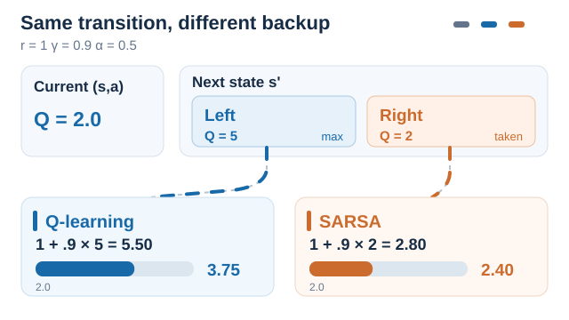
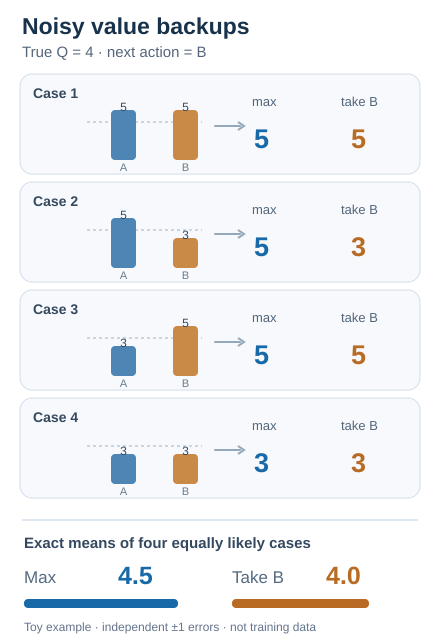
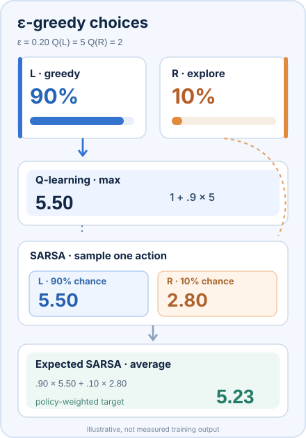
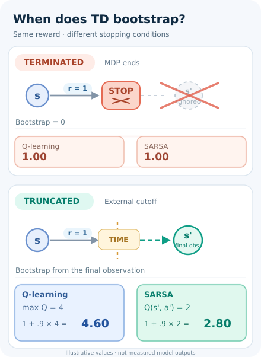

# Q-learning (Watkins & Dayan, 1992)

An off-policy temporal-difference method that learns the optimal action values from sampled transitions, without a model of the environment.

## Problem

An agent that does not know the transition probabilities needs to learn which action is best in each state from experience alone. Dynamic programming needs the model, and Monte Carlo methods must wait for complete episodes. The problem is to learn optimal action values from sampled experience, updating after every step.

## Core idea

Keep a table \(Q(x, a)\) of action values. After each step, with state \(x\), action \(a\), reward \(r\) and next state \(y\), move \(Q(x, a)\) toward \(r + \gamma \max_b Q(y, b)\). The target takes the greedy maximum at the next state, whatever action the agent actually takes next. The learned values therefore describe the optimal policy even while the agent explores with a different policy.

## Equation or algorithm

Watkins and Dayan write the update with a learning factor \(\alpha_n\) that depends on the number of visits to the pair:

\[
Q_n(x,a) = (1 - \alpha_n)\, Q_{n-1}(x,a) + \alpha_n \left[ r_n + \gamma \max_b Q_{n-1}(y_n, b) \right]
\]

for the pair \((x, a)\) visited at step \(n\), and no change for other pairs. The procedure:

1. Initialise \(Q(s, a)\) for all pairs.
2. Start an episode in state \(s\).
3. Choose \(a\) from \(s\) with an exploration rule, such as ε-greedy on \(Q\).
4. Take \(a\), observe \(r\) and the next state \(s'\).
5. Update \(Q(s, a) \leftarrow Q(s, a) + \alpha \left[ r + \gamma \max_{b} Q(s', b) - Q(s, a) \right]\).
6. Set \(s \leftarrow s'\) and repeat until the episode ends.

**Convergence.** Watkins and Dayan show that \(Q_n\) converges to \(Q^*\) with probability one, provided every state–action pair is visited infinitely often, rewards are bounded, \(0 \le \alpha_n < 1\) with \(\sum_n \alpha_n = \infty\) and \(\sum_n \alpha_n^2 < \infty\) for each pair, and \(0 < \gamma < 1\). Tsitsiklis (1994) proves the same convergence through asynchronous stochastic approximation.

### One observed transition, two different backups

*Original ten-second SVG/SMIL instructional animation (CC BY-SA 4.0).* Both branches start from the **same illustrative** transition with $Q(s,a)=2$, reward $r=1$, discount $\gamma=0.9$, learning rate $\alpha=0.5$, and next-state values $Q(s',\mathrm{Left})=5$, $Q(s',\mathrm{Right})=2$. The behaviour policy actually chooses **Right** next, whereas **Left** is greedy. Q-learning bootstraps from **the maximum**, even when the behaviour takes Right:

$
y_{\mathrm{Q}}=1+0.9(5)=5.5,\qquad Q_{\mathrm{new}}=2+0.5(5.5-2)=3.75.
$

SARSA instead uses the **sampled next action**: $y_{\mathrm{SARSA}}=1+0.9(2)=2.8$ and $Q_{\mathrm{new}}=2+0.5(2.8-2)=2.40$. The two animated routes distinguish the **off-policy greedy backup** from the **on-policy sampled-action backup**; they are **alternative one-step updates from the same fixed example**, not two consecutive updates to one table or measured learning curves. The numeric values and action choice are artificial teaching data. On MkDocs, use Play/Pause (keyboard operable); [GitHub and no-script static preview](../../../../../assets/concept-animations/q-sarsa-backup-still.svg) retains both complete calculations. The update rules follow Watkins & Dayan (1992) and Sutton & Barto (2018), already cited in References.

### When a greedy maximum amplifies unbiased noise

*Original 10-second SVG/SMIL illustration (CC BY-SA 4.0).* Consider two actions at the same next state with **equal true action values of 4**. Each estimate has independent, equally likely noise of $+1$ or $-1$, so neither action-value estimator is biased. The four equiprobable estimate pairs are $(5,5)$, $(5,3)$, $(3,5)$ and $(3,3)$. The animation reveals each backup and then the exact ensemble means:

$
\mathbb{E}[\max(\hat Q_A,\hat Q_B)]=\tfrac{5+5+5+3}{4}=\mathbf{4.5},\qquad
\mathbb{E}[\hat Q_B]=\tfrac{5+3+5+3}{4}=\mathbf{4}.
$

The blue backup **selects the maximum from the same noisy estimates**; the orange comparison uses action B, chosen independently of these estimation errors. This isolates *maximisation bias* in the bootstrapped value, **not** the complete $r+\gamma(\cdot)$ TD target. Taking B is a SARSA-compatible sampled-action backup under this controlled behaviour policy, **not a claim that SARSA is generally unbiased**: its learned estimates, policy-dependent sampling and function approximation can introduce other biases. The four cases are an exhaustive artificial probability example, **not four successive training updates or model measurements**. On MkDocs use the keyboard-operable Play/Pause button; the [GitHub static fallback](../../../../../assets/concept-animations/q-sarsa-noisy-backups-still.svg) includes all cases and both means. See van Hasselt et al. (2016) and Sutton & Barto (2018) in References.

For a worked two-network selection/evaluation contrast, see the [Double DQN animation](../double-dqn/index.md); unlike a fixed independent SARSA action, Double DQN's selected action still comes from an online argmax and is scored by a separate target estimator.

### Exploration probabilities versus greedy backup

*Original eleven-second SVG/SMIL animation (CC BY-SA 4.0).* The previous illustration fixes one observed next action. This independent **constructed** example instead makes the stochastic choice explicit. Suppose $Q(s',L)=5$, $Q(s',R)=2$, with a **unique** greedy action L, an $\varepsilon$-greedy policy that explores uniformly across both actions, and $\varepsilon=0.20$. Then $\pi(L\mid s')=1-\varepsilon+\varepsilon/2=0.90$ and $\pi(R\mid s')=\varepsilon/2=0.10$. For $r=1$ and $\gamma=0.9$, the **Q-learning** backup remains $1+0.9(5)=\mathbf{5.50}$ regardless of the behaviour-policy draw. **SARSA** instead has two possible sampled targets: $5.50$ (probability $0.90$) or $2.80$ (probability $0.10$). Taking the *policy expectation* rather than one sampled action gives the **Expected SARSA** target $0.9(5.50)+0.1(2.80)=\mathbf{5.23}$. This is the mean of SARSA's *conditional one-step targets for the frozen table*, **not** a third possible sampled SARSA target or a guarantee about subsequent learning. In particular, it does not imply that Expected SARSA is always less than Q-learning or that its realised performance is better. The diagram highlights alternative backup operations in sequence, **not** actions drawn at visual frequencies proportional to their probabilities. All values are illustrative, not measured results. MkDocs supplies keyboard-operable Play/Pause and reduced-motion fallback; the [GitHub-readable static preview](../../../../../assets/concept-animations/q-sarsa-epsilon-still.svg) shows all routes at once. The ε-greedy and Expected SARSA target definitions follow Sutton & Barto (2018), Chapter 6, already included in References.

### Terminal states versus externally truncated episodes

*Original ten-second SVG/SMIL instructional animation (CC BY-SA 4.0).* **An episode stopping does not always imply a terminal MDP state.** For a *genuine termination* (including a horizon intrinsic to a finite-horizon task), the next-state value is masked. For an **external time-limit truncation** of a continuing task, bootstrapping must instead use the **last observation before reset**, not the next episode's reset observation. Pardo et al. (2018) distinguish these cases; Gymnasium exposes them as separate `terminated` and `truncated` signals.

With an illustrative reward $r=1$, discount $\gamma=0.9$, next-state greedy value $\max_a Q(s',a)=4$, and SARSA continuation-action estimate $Q(s',a')=2$, both methods have target **1.00** for termination. At external truncation, Q-learning's target is **4.60**, while SARSA's sampled-continuation target is **2.80**. Crucially, SARSA may need to **sample the hypothetical continuation action from its policy at the last observation**, since a real next action was not executed before the forced reset; it must not use an action sampled at the reset observation. These values are constructed, **not model measurements**. In the animation, the crossing-out marks a true terminal bootstrap mask, while the dashed time-limit boundary preserves a value path. MkDocs supports keyboard Play/Pause and reduced-motion fallback; [the GitHub/static preview](../../../../../assets/concept-animations/td-terminal-truncation-still.svg) shows both cases. See Pardo et al. (2018) in References.

## Results

Watkins and Dayan's contribution is a convergence theorem, not an empirical benchmark. Its practical reach came through function approximation. Deep Q-networks use the same max-target with a neural network, and reach human-level play on many Atari games (Mnih et al., 2015).

## Limitations

- **Tabular form.** A table entry for each state–action pair is impractical for large or continuous spaces.
- **Maximisation bias.** The max over noisy estimates tends to overestimate values. The Double DQN paper reports overestimation for DQN in all 49 tested Atari games (van Hasselt et al., 2016).
- **Convergence conditions.** The guarantee needs infinite visits to every pair and a learning-rate schedule. Both assumptions can fail in practice, and with function approximation the guarantee no longer holds.

## Connections

- Parent topic: [Value-based methods](../index.md), and the wider [Reinforcement Learning](../../index.md) overview.
- The deep version is [Deep Q-networks](../../deep-q-networks/index.md). The fix for overestimation is [Double DQN](../double-dqn/index.md).
- The on-policy counterpart is [SARSA](../sarsa/index.md), which learns the values of the policy being followed.
- The temporal-difference error used in the update is the signal discussed on the parent page for its link to dopamine.

## Applications

- **Teaching and small discrete problems**, such as grid worlds, where the table is small enough to store. Gridworlds are common teaching examples for tabular methods (Sutton & Barto, 2018).

## Open questions

- Stable off-policy learning with function approximation, where the convergence guarantee does not carry over.
- Reliable value estimates under noise, without the overestimation bias.

## References

### Seminal papers

- Watkins & Dayan (1992), "Q-learning", *Machine Learning* 8(3–4), 279–292. https://doi.org/10.1007/bf00992698 — The paper that defines Q-learning and proves its convergence to optimal action values.
- Tsitsiklis (1994), "Asynchronous stochastic approximation and Q-learning", *Machine Learning* 16(3), 185–202. https://doi.org/10.1007/bf00993306 — Proves convergence of Q-learning through asynchronous stochastic approximation.
- Mnih et al. (2015), "Human-level control through deep reinforcement learning", *Nature* 518, 529–533. https://doi.org/10.1038/nature14236 — The deep version of Q-learning, with replay and a target network.
- van Hasselt, Guez & Silver (2016), "Deep reinforcement learning with double Q-learning", [arXiv:1509.06461](https://arxiv.org/abs/1509.06461) (submitted 2015) — Shows that DQN overestimates action values and reduces the bias.
- Mnih et al. (2013), "Playing Atari with deep reinforcement learning", [arXiv:1312.5602](https://arxiv.org/abs/1312.5602) — Early preprint that applied a Q-learning-based network to raw Atari frames.

- Pardo, F., Tavakoli, A., Levdik, V. & Kormushev, P. (2018). *Time Limits in Reinforcement Learning*. ICML, PMLR 80:4045–4054. https://proceedings.mlr.press/v80/pardo18a.html — Distinguishes true finite-horizon termination from external training cutoffs and explains bootstrapping from the final observation.

### Surveys and textbooks

- Sutton, R. S. & Barto, A. G. *Reinforcement Learning: An Introduction*, 2nd ed. MIT Press, 2018. http://incompleteideas.net/book/the-book-2nd.html — Covers tabular Q-learning in its temporal-difference chapter, with the convergence context.
