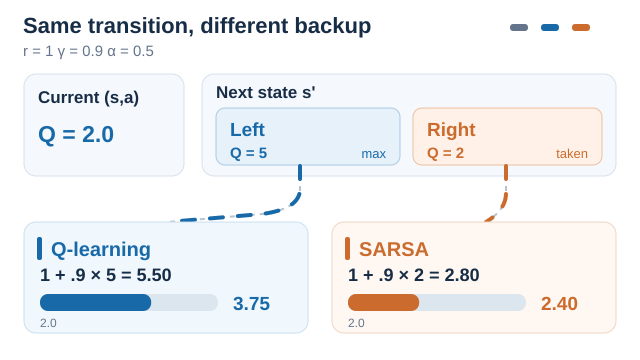
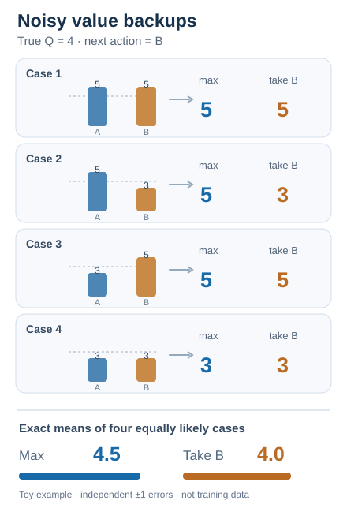
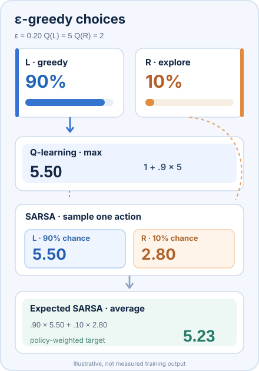
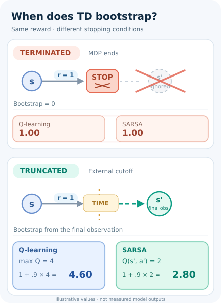
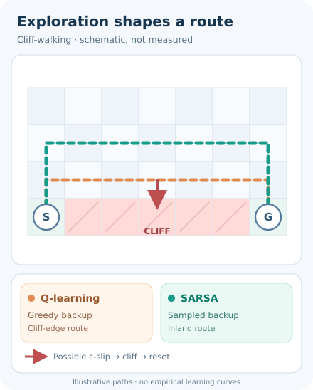
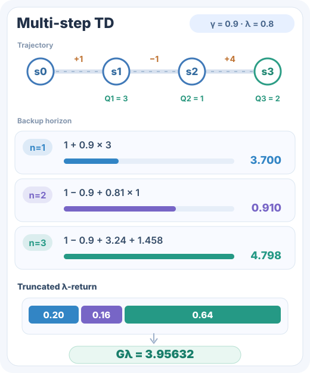
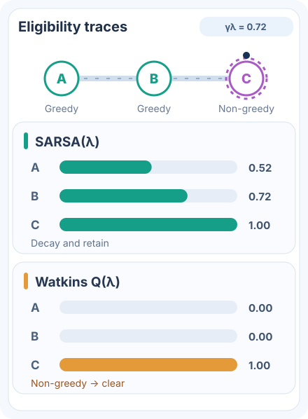

# Q 學習（Watkins 與 Dayan，1992）

一種離策略的時序差分方法：無需環境模型，即可從取樣的轉換中學習最佳動作價值。

## 問題

不知道轉移機率的智能體，需要僅憑經驗學會在每個狀態下哪個動作最好。動態規劃需要模型，蒙地卡羅方法則必須等待完整的回合結束。問題在於：如何從取樣經驗中學習最佳動作價值，並在每一步之後更新。

## 核心想法

維護一張動作價值表 \(Q(x, a)\)。每一步之後，若狀態為 \(x\)、動作為 \(a\)、獎勵為 \(r\)、下一狀態為 \(y\)，就把 \(Q(x, a)\) 朝 \(r + \gamma \max_b Q(y, b)\) 移動。目標在下一狀態取貪婪的最大值，而不論智能體接下來實際採取哪個動作。因此，即使智能體以另一個策略探索，學到的價值仍描述最佳策略。

## 方程式與演算法

Watkins 與 Dayan 以依該配對造訪次數而定的學習因子 \(\alpha_n\) 寫出更新式：

\[
Q_n(x,a) = (1 - \alpha_n)\, Q_{n-1}(x,a) + \alpha_n \left[ r_n + \gamma \max_b Q_{n-1}(y_n, b) \right]
\]

此式適用於在第 \(n\) 步被造訪的配對 \((x, a)\)，其他配對則不變。流程如下：

1. 為所有配對初始化 \(Q(s, a)\)。
2. 從狀態 \(s\) 開始一個回合。
3. 依探索規則從 \(s\) 選擇 \(a\)，例如依 \(Q\) 的 ε-貪婪策略。
4. 執行 \(a\)，觀察 \(r\) 與下一狀態 \(s'\)。
5. 更新 \(Q(s, a) \leftarrow Q(s, a) + \alpha \left[ r + \gamma \max_{b} Q(s', b) - Q(s, a) \right]\)。
6. 令 \(s \leftarrow s'\)，重複直到回合結束。

**收斂。** Watkins 與 Dayan 證明，若滿足以下條件，\(Q_n\) 以機率 1 收斂到 \(Q^*\)：每個狀態–動作配對都被無限次造訪；獎勵有界；每個配對的學習率滿足 \(0 \le \alpha_n < 1\)、\(\sum_n \alpha_n = \infty\) 且 \(\sum_n \alpha_n^2 < \infty\)；且 \(0 < \gamma < 1\)。Tsitsiklis（1994）以非同步隨機逼近證明了相同的收斂性。

### 同一筆轉移，兩種不同的 TD 備份目標

*原創十秒 SVG／SMIL 教學動畫（CC BY-SA 4.0）。* 兩種方法使用**相同的人工示意轉移**：$Q(s,a)=2$、即時獎勵 $r=1$、折扣率 $\gamma=0.9$、學習率 $\alpha=0.5$；下一狀態有 $Q(s',\mathrm{Left})=5$ 與 $Q(s',\mathrm{Right})=2$。行為策略實際選擇下一動作 **Right**，但貪婪動作是 **Left**。Q-learning 的離策略更新依據**最大動作價值**，即使智能體下一步實際採取 Right 也不改變這個 TD 目標：

$
y_{\mathrm{Q}}=1+0.9(5)=5.5,\qquad Q_{\mathrm{new}}=2+0.5(5.5-2)=3.75.
$

SARSA 則使用**實際抽樣的下一動作**：$y_{\mathrm{SARSA}}=1+0.9(2)=2.8$，得到 $Q_{\mathrm{new}}=2+0.5(2.8-2)=2.40$。兩條動態路徑區分**離策略的貪婪備份**與**同策略的實際動作備份**。圖中是同一組起始 Q 值下的**兩種替代更新**，不是連續更新同一張 Q 表，也不是實際訓練曲線。數值與動作均為人工示意。MkDocs 支援鍵盤操作的播放／暫停，GitHub 或無 JavaScript 時可查看[完整靜態回退圖](../../../../../assets/concept-animations/q-sarsa-backup-still.svg)。更新規則參考已列於文末的 Watkins 與 Dayan（1992）、Sutton 與 Barto（2018）。

### 為什麼取最大值會放大無偏估計的雜訊？

*原創十秒 SVG／SMIL 教學動畫（CC BY-SA 4.0）。* 假設下一狀態中兩個動作的**真實價值都等於 4**。兩個估計值分別受到互相獨立、機率各半的 $+1$ 或 $-1$ 雜訊影響，故單獨看每個動作的估計器都是無偏的。四種等機率的估計組合為 $(5,5)$、$(5,3)$、$(3,5)$、$(3,3)$。動畫依序展示每個備份，再顯示精確的枚舉期望：

$
\mathbb{E}[\max(\hat Q_A,\hat Q_B)]=\tfrac{5+5+5+3}{4}=\mathbf{4.5},\qquad
\mathbb{E}[\hat Q_B]=\tfrac{5+3+5+3}{4}=\mathbf{4}.
$

藍色路徑對**同一組含雜訊估計取最大值**，橘色路徑則比較與估計誤差**獨立決定**的下一動作 B；這是刻意隔離 Q-learning 的**最大化偏差（maximisation bias）**，比較的僅是 bootstrap 價值，尚未加入 $r+\gamma(\cdot)$。在這個受控行為策略下，動作 B 可以作為 SARSA 的實際下一動作，但**不表示 SARSA 一般情況下一定無偏**；學習、策略依賴的抽樣或函數近似仍可能帶來其他偏差。四種情況是**人工建構的完整機率枚舉**，不是連續四次更新或模型實測。MkDocs 可用鍵盤操作播放／暫停；[GitHub 靜態回退](../../../../../assets/concept-animations/q-sarsa-noisy-backups-still.svg)保留所有案例與平均值。依據文末的 van Hasselt 等人（2016）及 Sutton 與 Barto（2018）。

若想進一步對照「用線上網路選動作、用目標網路評估」的解耦運算，可參考[雙 DQN 動畫](../double-dqn/index.zh-TW.md)。Double DQN 仍以線上網路的 argmax 選動作，並非像這裡的受控 SARSA 案例一樣，將下一動作獨立於估計雜訊而事先固定。

### 探索機率如何影響實際抽樣的備份目標

*原創十一秒 SVG／SMIL 動畫（CC BY-SA 4.0）。* 前一張圖固定下一個實際動作；這張圖則用**另一個人工建構的情境**，把下一動作的隨機選擇明確呈現。假設 $Q(s',L)=5$、$Q(s',R)=2$，L 是**唯一**的貪婪動作，$\varepsilon$-貪婪策略以均勻機率探索兩個動作，且 $\varepsilon=0.20$。則 $\pi(L\mid s')=1-\varepsilon+\varepsilon/2=0.90$，$\pi(R\mid s')=\varepsilon/2=0.10$。在 $r=1$、$\gamma=0.9$ 下，**Q-learning** 無論行為策略選哪個動作，都使用 $1+0.9(5)=\mathbf{5.50}$ 作為備份目標；**SARSA** 依實際抽到的動作，可能得到 $5.50$（機率 $0.90$）或 $2.80$（機率 $0.10$）。若不抽一個動作，而是對行為策略取期望，**Expected SARSA** 的目標為 $0.9(5.50)+0.1(2.80)=\mathbf{5.23}$。這是**固定 Q 表下 SARSA 單步目標的條件期望**，不是 SARSA 第三種可能的抽樣結果，也不代表後續訓練的整體表現必然較好。動畫依序強調不同備份路徑，**畫面出現的時間比例不代表實際抽樣機率**；全部數值均為示意，非模型實測。MkDocs 可鍵盤操作播放／暫停並支援減少動態效果；[GitHub 靜態回退](../../../../../assets/concept-animations/q-sarsa-epsilon-still.svg)可一次閱讀所有路徑。公式依據文末 Sutton 與 Barto（2018）第 6 章。

### 真正終止與外部時間限制截斷的 TD 備份

*原創十秒 SVG／SMIL 教學動畫（CC BY-SA 4.0）。***回合停止不等於 MDP 真正終止。**若任務已達到真正終止狀態（包含有限時域任務內生的終點），TD 目標就不再加上下一狀態價值；若只是*持續性任務*被外部 TimeLimit 強制截斷，則仍須從**重設前最後一筆觀測**進行 bootstrap，而非使用下一個回合的重設觀測。Pardo 等人（2018）分析了這個差異；Gymnasium 的 `terminated` 和 `truncated` 分別表達這兩種訊號。

假設人工示意 $r=1$、$\gamma=0.9$、$\max_a Q(s',a)=4$，而 SARSA 在最後觀測下的延續動作估計 $Q(s',a')=2$。**真正終止**時，兩種方法的 TD 目標都是 **1.00**；**外部截斷**時，Q-learning 的目標為 **4.60**，SARSA 的延續動作備份為 **2.80**。由於截斷後不一定真的執行下一動作，SARSA 可在最後觀測依其策略**假設性抽樣延續動作**，不能取用重設狀態所抽的動作。這是人工建構的計算案例，**不是模型實測**。動畫中的叉號代表真正終止時移除 bootstrap，虛線時間界線則保留延續價值路徑。MkDocs 可用鍵盤播放／暫停、支援減少動態效果；[GitHub 靜態回退](../../../../../assets/concept-animations/td-terminal-truncation-still.svg)同時呈現兩個條件。依據文末 Pardo 等人（2018）的原始論文。

### 懸崖行走：學習目標與探索行為評估的是哪個策略？

*原創 12 秒 SVG／SMIL 教學動畫（CC BY-SA 4.0）。* 在 Sutton 與 Barto（2018，第 6 章）的經典 **Cliff Walking（懸崖行走）** 情境中，一般移動會得到小幅負獎勵，掉入懸崖則承受很大的懲罰並回到起點。如果智能體**持續使用 ε-greedy 探索**，Q-learning 即使實際上仍會探索，也以**下一狀態的貪婪動作價值**更新，所偏好的最短路線可能緊貼懸崖。SARSA 則以**探索策略實際抽出的下一動作價值**更新，因此靠近懸崖的路徑價值會納入探索時誤踩懸崖的風險，可能偏好較長但離懸崖較遠的路線。

圖中比較的是**兩種可能的策略偏好**，不代表 SARSA 一定採用綠色路線，或 Q-learning 一定掉落；兩者執行時都可能因探索而失誤。若 ε 逐漸降低、轉移機率或獎勵設定不同，偏好路徑也可能改變。圖中的**七欄地圖刻意簡化**，不是教科書原始地圖，也不是模型實測軌跡；移動圓點與紅色掉落僅示意因果過程，動畫的停留時間不代表 ε 的抽樣機率。MkDocs 提供可用鍵盤操作的播放／暫停；[GitHub／無 JavaScript 靜態預覽](../../../../../assets/concept-animations/cliff-walking-still.svg)完整保留兩條路線及失足風險。原理依據文末既有的 Sutton 與 Barto（2018）教材。

### 多步備份期限與一步貪婪目標的區別

*原創十二秒 SVG／SMIL 教學動畫（CC BY-SA 4.0）。* 這個比較呈現一個有別於 **Q 學習下一步取最大值**的設計選擇：在自助式估計之前，先累積**多少步獎勵**。以人工設定的三次獎勵 $(1,-1,4)$、折扣率 $\gamma=0.9$，以及後續**抽樣動作**的價值 $(3,1,2)$ 為例，一步、兩步、三步 **SARSA** 目標依序為 $3.700$、$0.910$、$4.798$。若使用截斷的 $\lambda=0.8$ 前向報酬，可用權重 $0.20$、$0.16$、$0.64$ 加權得到 $3.95632$。動畫依序沿不同期限傳遞，再合併目標；所有值為**固定的教學示意**，不是訓練實測。

**重要區別：** 圖中是**同策略 n-step SARSA**，**不是離策略 n-step Q 學習**。一步 Q 學習會對下一狀態取 $\max_a Q(s_{t+1},a)$；要延伸為多步離策略方法，須明確指定目標策略的修正或其他備份算子。直接把上述抽樣動作報酬代入 Q 學習會改變演算法。GitHub 與無腳本模式可查看[完整靜態回退圖](../../../../../assets/concept-animations/nstep-lambda-forward-still.svg)，MkDocs 則沿用鍵盤可操作的播放／暫停與 Reduced Motion 支援。參見文末 Sutton 與 Barto（2018）第 7、12 章。

### 資格跡：跨時間信用分配與非貪婪動作的截斷

*原創 12 秒 SVG／SMIL 教學動畫（CC BY-SA 4.0）。* 單步的貪婪備份可以擴展為跨時間的信用分配，但**離策略資格跡必須額外處理策略不一致**。Watkins 的 $Q(\lambda)$ 在行為策略選出**非貪婪動作**時會切斷歷史資格跡，避免將後續探索經驗當作原本貪婪路徑的延續。 圖中以三個依序出現、**彼此不同**的狀態－動作對 A、B、C，比較兩種機制：A 與 B 都是貪婪選擇，C 則刻意選為**非貪婪動作**；必須注意，「由探索分支抽樣」不代表抽出的動作一定不是貪婪動作。使用初值為零的表格式**累積資格跡**，且不重複造訪同一個狀態－動作對。設 $\gamma=0.9$、$\lambda=0.8$，因此 $\gamma\lambda=0.72$。

在 SARSA($\lambda$) 中，舊資格跡每步乘上 $\gamma\lambda$，目前造訪的狀態－動作對額外加 1。執行 C 時，$e(A)=0.72^2=0.5184\approx\mathbf{0.52}$、$e(B)=\mathbf{0.72}$、$e(C)=\mathbf{1.00}$。之後的 TD 誤差 $\delta_t^{\mathrm{SARSA}}=r_{t+1}+\gamma Q(s_{t+1},a_{t+1})-Q(s_t,a_t)$，會透過 $\alpha\delta_t e_t(s,a)$ 將更新量分配給包含 A、B 在內的歷史動作。

在 **Watkins $Q(\lambda)$** 中，當 C 為非貪婪動作，先將歷史資格跡**截斷歸零**，再建立目前的 C 資格跡，因此 $e(A)=e(B)=0$、$e(C)=1$。其 TD 誤差仍以貪婪最大動作價值進行 Bootstrap；截斷資格跡**不等於忽略 C 的單步更新**。圖中顯示的是此時的資格跡，不是 Q 值訓練曲線或實測報酬；其他離策略資格跡方法（例如 Tree-backup）也不必採取相同截斷規則。

動畫展現舊資格跡衰減與非貪婪動作造成的截斷；[GitHub／無腳本靜態預覽](../../../../../assets/concept-animations/eligibility-trace-cut-still.svg) 保留最後一個時間點的數值。MkDocs 提供可用鍵盤操作的播放／暫停及 Reduced Motion 回退。**所有數值均為教學示意，並非模型實測。**概念依據本頁參考文獻已列的 Sutton 與 Barto（2018）第 12 章。

## 結果

Watkins 與 Dayan 的貢獻是收斂定理，而非實證基準。它的實際影響來自函數逼近：深度 Q 網路以神經網路使用相同的最大值目標，並在許多 Atari 遊戲上達到人類水準（Mnih 等人，2015）。

## 限制

- **表格形式。** 為每個狀態–動作配對存一筆表格項目，對大型或連續的空間並不實際。
- **最大化偏差。** 對含雜訊估計取最大值，傾向於高估價值。Double DQN 論文報告，DQN 在測試的全部 49 款 Atari 遊戲中都有高估（van Hasselt 等人，2016）。
- **收斂條件。** 此保證需要每個配對被無限次造訪，並需要特定的學習率排程。這兩個假設在實務中都可能不成立；而使用函數逼近時，此保證不再成立。

## 關聯

- 上層主題：[基於價值的方法](../index.md)，以及更廣的[強化學習](../../index.zh-TW.md)概觀。
- 其深度版本是[深度 Q 網路](../../deep-q-networks/index.zh-TW.md)。高估的修正方法是 [Double DQN](../double-dqn/index.zh-TW.md)。
- 同策略的對應方法是 [SARSA](../sarsa/index.zh-TW.md)，它學習的是實際所遵循策略的價值。
- 更新中使用的時序差分誤差，是上層頁面中與多巴胺相關的訊號。

## 應用

- **教學與小型離散問題**，例如格子世界，其表格小到可以儲存。格子世界是表格方法常見的教學範例（Sutton 與 Barto，2018）。

## 未解問題

- 在函數逼近下的穩定離策略學習，此時收斂保證不再成立。
- 在雜訊下取得可靠的價值估計，同時避免高估偏差。

## 參考文獻

### 開創性論文

- Watkins 與 Dayan（1992），"Q-learning"，*Machine Learning* 8(3–4), 279–292。https://doi.org/10.1007/bf00992698 — 定義 Q 學習並證明其收斂到最佳動作價值的論文。
- Tsitsiklis（1994），"Asynchronous stochastic approximation and Q-learning"，*Machine Learning* 16(3), 185–202。https://doi.org/10.1007/bf00993306 — 以非同步隨機逼近證明 Q 學習的收斂性。
- Mnih 等人（2015），"Human-level control through deep reinforcement learning"，*Nature* 518, 529–533。https://doi.org/10.1038/nature14236 — Q 學習的深度版本，包含回放與目標網路。
- van Hasselt、Guez 與 Silver（2016），"Deep reinforcement learning with double Q-learning"，[arXiv:1509.06461](https://arxiv.org/abs/1509.06461)（2015 年提交至 arXiv）— 顯示 DQN 會高估動作價值，並降低此偏差。
- Mnih 等人（2013），"Playing Atari with deep reinforcement learning"，[arXiv:1312.5602](https://arxiv.org/abs/1312.5602) — 早期預印本，將以 Q 學習為基礎的網路應用於原始 Atari 畫面。

- Pardo、Tavakoli、Levdik 與 Kormushev（2018），*Time Limits in Reinforcement Learning*，ICML，PMLR 80:4045–4054。https://proceedings.mlr.press/v80/pardo18a.html — 區分有限時域任務的真正終止與外部訓練時間限制，說明應從截斷時最後觀測延續價值估計。

### 綜述與教科書

- Sutton, R. S. & Barto, A. G. *Reinforcement Learning: An Introduction*，第 2 版。MIT Press, 2018。http://incompleteideas.net/book/the-book-2nd.html — 在時序差分章節中介紹表格式 Q 學習及其收斂背景。
