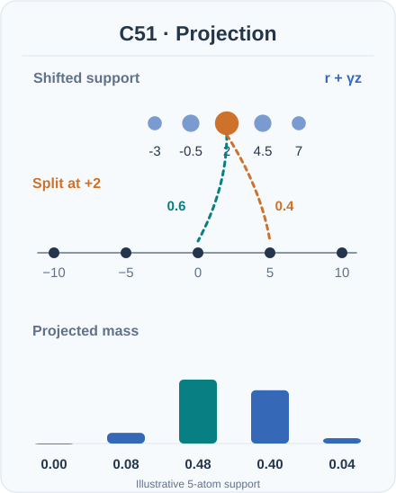
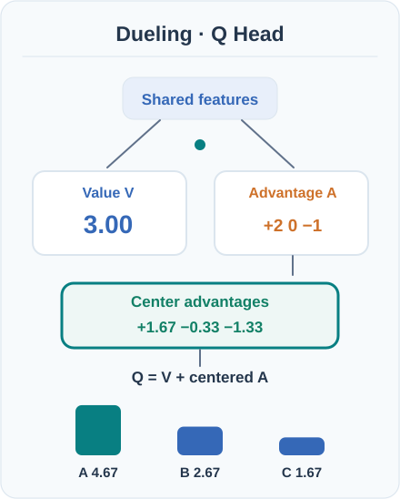

# Rainbow (Hessel et al., 2018)

An agent that combines six separate improvements to DQN into one learner, and reports state-of-the-art performance on the Atari 2600 benchmark.

## Problem

By 2018 many extensions to DQN each fixed one weakness: overestimation, uniform replay, the form of the value function, one-step targets, the modelling of return distributions and exploration by ε-greedy. Each was usually tested alone. Hessel et al. ask how the improvements combine, and which of them matter when they are used together.

## Core idea

Rainbow takes the DQN agent and integrates six components, one from each family:

- **Double Q-learning** decouples action selection from evaluation to reduce overestimation (van Hasselt et al., 2016; see [Double DQN](../double-dqn/index.md)).
- **Prioritised replay** samples transitions with high learning potential more often.
- **Dueling networks** split the network into a value stream and an advantage stream that share an encoder.
- **Multi-step learning** bootstraps from n-step returns rather than one-step targets.
- **Distributional RL** models the full distribution of returns, using 51 atoms, rather than only its mean.
- **Noisy networks** add learned noise to the linear layers for exploration in place of ε-greedy.

The paper also combines these into a single learning procedure, which is what makes it a single agent rather than a set of separate fixes.

## Equation or algorithm

Rainbow keeps the DQN structure of replay, a target network and minibatch updates, and changes the parts described above. The output is a distribution over returns on 51 atoms, and the multi-step component uses \(n = 3\), which the paper found to perform best after comparing \(n = 1, 3\) and \(5\). The full loss, pseudocode and hyperparameter table are in the paper, which should be read for implementation.

## Two animated computations: categorical projection and dueling aggregation

### C51: how probability mass returns to fixed atoms

C51's distributional Bellman update first shifts the next-state return support by a sampled reward and discount, then **projects** the shifted probability mass back onto a fixed categorical support. For an interior shifted value, the mass is split linearly between the two neighbouring atoms. The distribution is trained using a categorical loss, while an action is still selected from the **expected** return, not by treating the most probable atom as the action value.[^rainbow-c51]

*Original instructional motion (CC BY-SA 4.0).* The animation uses a **five-atom toy distribution**, not Rainbow's 51 atoms or learned model outputs. Starting with fixed atoms $z=(-10,-5,0,5,10)$ and probabilities $(0.1,0.2,0.4,0.2,0.1)$, the illustrative reward $r=2$ and discount $\gamma=0.5$ give shifted locations $(-3,-0.5,2,4.5,7)$. The fixed-support projection yields $(0,0.08,0.48,0.40,0.04)$, preserving total mass $1$. The highlighted mass at $2$ goes to $0$ with weight $0.6$ and to $5$ with weight $0.4$. The visual isolates projection; it does **not** simulate parameter updates, terminal-state handling, or support clipping. MkDocs provides Play/Pause (also keyboard Enter/Space); GitHub shows the complete static fallback.

### Dueling head: value, advantages, and identifiability

A dueling network computes a scalar state value $V(s)$ and per-action advantages $A(s,a)$ from a shared feature representation. Rainbow uses the **mean-centred aggregation**, $Q(s,a)=V(s)+A(s,a)-\frac{1}{|\mathcal A|}\sum_b A(s,b)$. Subtracting the action-mean makes the aggregate's mean equal to $V$ and resolves the additive-offset ambiguity of simply summing $V$ and $A$.[^rainbow-dueling]

*Original instructional motion (CC BY-SA 4.0).* The **illustrative** streams are $V=3$ and $A=(2,0,-1)$; the advantage mean is $1/3$, so the three output values are approximately $(4.67,2.67,1.67)$. The highlighted arrows and growing bars show aggregation, **not** actual neuron activations, benchmark performance, or a gradient path. In MkDocs use Play/Pause; GitHub shows the static fallback. No extra JavaScript is required beyond the existing concept-motion player.

## Results

Across the 57 Atari games evaluated in the paper:

- **Median human-normalised score, no-op starts:** 223% for Rainbow.
- **Median human-normalised score, human starts:** 153% for Rainbow.
- **Best single component:** distributional DQN reaches 164% in the no-op regime, with dueling DDQN at 151% and prioritised DDQN at 140%. In the human-starts regime, prioritised DDQN is the best single component at 128%.

The ablation study finds that prioritised replay and multi-step learning are the two most important components. Distributional learning comes just after them.

## Limitations

- **Complexity.** The combined agent has many interacting parts, which makes results harder to attribute and reproduce.
- **Discrete actions.** The method is designed for the Atari setting with a finite action set.
- **Benchmark scope.** The results are on Atari games, and the paper does not show that the same combination works for continuous control.

## Connections

- Parent topic: [Value-based methods](../index.md), and the wider [Reinforcement Learning](../../index.md) overview.
- It combines [Double DQN](../double-dqn/index.md) with the [Deep Q-networks](../../deep-q-networks/index.md) base agent.
- Prioritised replay is covered on the [Experience replay](../../experience-replay/index.md) page.
- Exploration by noisy networks sits on the [Exploration](../../exploration/index.md) page's theme of driving the agent to try new actions.

## Applications

- **Atari benchmark.** Rainbow is a reference point for value-based agents on the Atari 2600 suite (Hessel et al., 2018).

## Open questions

- Which components remain useful once a sophisticated agent is trained at larger scale.
- How much of the result transfers to continuous control and to domains beyond games.

## References

### Seminal papers

- Bellemare, Dabney & Munos (2017), "A Distributional Perspective on Reinforcement Learning", *ICML 2017*. https://proceedings.mlr.press/v70/bellemare17a — Defines categorical distributional Bellman projection and the C51 algorithm.
- Wang et al. (2016), "Dueling Network Architectures for Deep Reinforcement Learning", *ICML 2016*. https://proceedings.mlr.press/v48/wangf16 — Introduces shared features with separate state-value and advantage streams and aggregation.

- Hessel et al. (2018), "Rainbow: Combining improvements in deep reinforcement learning", [arXiv:1710.02298](https://arxiv.org/abs/1710.02298) — The Rainbow paper, with its six-component ablation and the reported Atari results.
- van Hasselt, Guez & Silver (2016), "Deep reinforcement learning with double Q-learning", [arXiv:1509.06461](https://arxiv.org/abs/1509.06461) (submitted 2015) — The double Q-learning component, which reduces overestimation.
- Mnih et al. (2015), "Human-level control through deep reinforcement learning", *Nature* 518, 529–533. https://doi.org/10.1038/nature14236 — The base DQN agent that Rainbow extends.
- Mnih et al. (2013), "Playing Atari with deep reinforcement learning", [arXiv:1312.5602](https://arxiv.org/abs/1312.5602) — The early preprint that introduced the Atari setting used throughout.

### Surveys and textbooks

- Sutton, R. S. & Barto, A. G. *Reinforcement Learning: An Introduction*, 2nd ed. MIT Press, 2018. http://incompleteideas.net/book/the-book-2nd.html — Background on multi-step returns and temporal-difference learning.
[^rainbow-c51]: Bellemare, Dabney & Munos (2017), [ICML original paper](https://proceedings.mlr.press/v70/bellemare17a); Hessel et al. (2018), [Rainbow original paper](https://arxiv.org/abs/1710.02298).
[^rainbow-dueling]: Wang et al. (2016), [ICML original paper](https://proceedings.mlr.press/v48/wangf16); Hessel et al. (2018), [Rainbow original paper](https://arxiv.org/abs/1710.02298).
