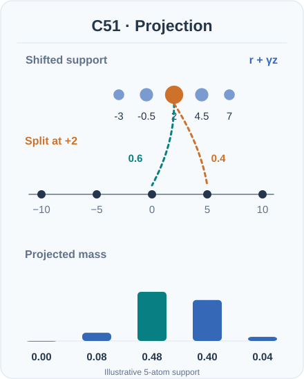
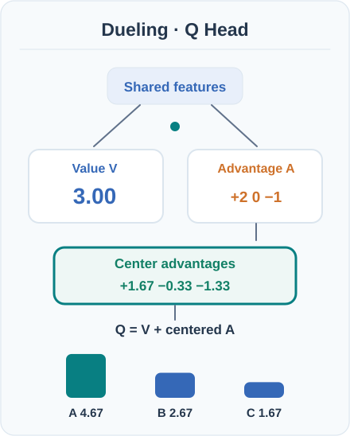

# Rainbow（Hessel 等人，2018）

一個智能體，把 DQN 的六項獨立改進結合到同一個學習器中，並在 Atari 2600 基準上報告了當時最先進的效能。

## 問題

到了 2018 年，DQN 的許多擴充各自修正一個弱點：高估、均勻回放、價值函數的形式、單步目標、回報分布的建模，以及以 ε-貪婪進行探索。這些改進通常各自單獨測試。Hessel 等人探討：這些改進如何結合，以及一起使用時哪些最重要。

## 核心想法

Rainbow 以 DQN 智能體為基礎，整合六個組件，每個來自一個不同的改進家族：

- **雙 Q 學習**將動作選擇與評估分開，以降低高估（van Hasselt 等人，2016；見 [Double DQN](../double-dqn/index.zh-TW.md)）。
- **優先回放**更頻繁地抽樣具有高學習潛力的轉換。
- **對決網路（dueling networks）**把網路分成共用編碼器之後的價值串流與優勢串流。
- **多步學習**以 n 步回報自舉，而非單步目標。
- **分布式強化學習**使用 51 個原子（atoms）建模完整的回報分布，而不只是其平均值。
- **雜訊網路**在線性層中加入可學習的雜訊，以取代 ε-貪婪來進行探索。

論文也把這些組件合併為單一學習流程，這正是它成為一個智能體、而非一組獨立修正的原因。

## 方程式與演算法

Rainbow 保留 DQN 的回放、目標網路與小批次更新的結構，只改寫上述各部分。輸出是 51 個原子上的回報分布；多步組件使用 \(n = 3\)，這是論文比較 \(n = 1, 3, 5\) 後表現最好的設定。完整的損失函數、虛擬碼與超參數表載於論文中，實作時應以原論文為準。

## 兩項動態運算：類別分布投影與 Dueling 聚合

### C51：將機率質量投影回固定原子

C51 的分布式 Bellman 更新先用觀察到的獎勵與折扣率移動下一狀態的回報支撐點，再將機率質量**投影回固定的類別支撐點**。落在兩個相鄰原子之間的質量，會依距離做線性分配。模型以類別分布損失訓練，但動作仍依**預期回報**選取，而不是把機率最大的原子直接當作動作價值。[^rainbow-c51]

*原創教學動畫（CC BY-SA 4.0）。* 圖中僅使用**五個原子的人工示意**，並非 Rainbow 實際使用的 51 個原子，也不是模型輸出。固定原子 $z=(-10,-5,0,5,10)$，起始機率為 $(0.1,0.2,0.4,0.2,0.1)$；人工設定獎勵 $r=2$、折扣率 $\gamma=0.5$，位移後的位置為 $(-3,-0.5,2,4.5,7)$。投影後的機率為 $(0,0.08,0.48,0.40,0.04)$，總和仍為 $1$。其中位於 $2$ 的質量，以 $0.6$ 的權重分配至 $0$，以 $0.4$ 分配至 $5$。動畫只隔離投影運算，**不代表**參數更新、終止狀態處理或超出支撐範圍時的裁切。MkDocs 可播放／暫停（Enter／Space 鍵也可操作）；GitHub 顯示完整靜態回退。

### Dueling 網路：狀態價值、動作優勢與聚合

Dueling 架構從共用特徵分出純量狀態價值 $V(s)$ 及每個動作的優勢值 $A(s,a)$。Rainbow 採用**減去動作優勢平均值**的聚合方式：$Q(s,a)=V(s)+A(s,a)-\frac{1}{|\mathcal A|}\sum_b A(s,b)$。這使各動作 $Q$ 的平均值等於 $V$，避免直接相加時無法唯一區分兩條分支的加法偏移。[^rainbow-dueling]

*原創教學動畫（CC BY-SA 4.0）。* 人工示意的兩條分支為 $V=3$、$A=(2,0,-1)$；優勢平均為 $1/3$，三個輸出約為 $(4.67,2.67,1.67)$。動畫強調聚合路徑與計算結果，**不是**神經元實際活化值、基準測試成績或梯度流。MkDocs 可播放／暫停，GitHub 則直接顯示靜態回退；兩種語言共用相同動畫資產與現有播放器。

## 結果

在論文評估的 57 款 Atari 遊戲上：

- **人類標準化中位數，無操作起始（no-op starts）：** Rainbow 為 223%。
- **人類標準化中位數，人類起始（human starts）：** Rainbow 為 153%。
- **單一最佳組件：** 在無操作起始下，分布式 DQN 為 164%，對決 DDQN 為 151%，優先 DDQN 為 140%。在人類起始下，優先 DDQN 是最佳的單一組件，為 128%。

消融研究發現，優先回放與多步學習是最重要的兩個組件，分布式學習緊隨其後。論文的原話是：「優先回放與多步學習是 Rainbow 中兩個最關鍵的組件。」

## 限制

- **複雜度。** 結合後的智能體有許多相互作用的部分，使結果較難歸因與重現。
- **離散動作。** 此方法是為有限動作集合的 Atari 設定而設計。
- **基準範圍。** 結果來自 Atari 遊戲，論文並未證明同一組合適用於連續控制。

## 關聯

- 上層主題：[基於價值的方法](../index.md)，以及更廣的[強化學習](../../index.zh-TW.md)概觀。
- 它把 [Double DQN](../double-dqn/index.zh-TW.md) 與[深度 Q 網路](../../deep-q-networks/index.zh-TW.md)基礎智能體結合。
- 優先回放在[經驗回放](../../experience-replay/index.zh-TW.md)頁面中說明。
- 以雜訊網路進行探索，與[探索](../../exploration/index.zh-TW.md)頁面「促使智能體嘗試新動作」的主題相關。

## 應用

- **Atari 基準。** Rainbow 是 Atari 2600 測試組上基於價值的智能體的參考點（Hessel 等人，2018）。

## 未解問題

- 在更大規模下訓練出複雜智能體後，哪些組件仍然有用。
- 此結果在多大程度上能轉移到連續控制與遊戲以外的領域。

[^rainbow-c51]: Bellemare、Dabney 與 Munos（2017），[ICML 原始論文](https://proceedings.mlr.press/v70/bellemare17a)；Hessel 等人（2018），[Rainbow 原始論文](https://arxiv.org/abs/1710.02298)。
[^rainbow-dueling]: Wang 等人（2016），[ICML 原始論文](https://proceedings.mlr.press/v48/wangf16)；Hessel 等人（2018），[Rainbow 原始論文](https://arxiv.org/abs/1710.02298)。

## 參考文獻

### 開創性論文

- Bellemare、Dabney 與 Munos（2017），"A Distributional Perspective on Reinforcement Learning"，*ICML 2017*。https://proceedings.mlr.press/v70/bellemare17a — 定義類別分布 Bellman 投影與 C51 演算法。
- Wang 等人（2016），"Dueling Network Architectures for Deep Reinforcement Learning"，*ICML 2016*。https://proceedings.mlr.press/v48/wangf16 — 提出共用特徵、狀態價值分支與優勢分支，以及聚合方式。

- Hessel 等人（2018），"Rainbow: Combining improvements in deep reinforcement learning"，[arXiv:1710.02298](https://arxiv.org/abs/1710.02298) — Rainbow 原始論文，包含六組件的消融研究與報告的 Atari 結果。
- van Hasselt、Guez 與 Silver（2016），"Deep reinforcement learning with double Q-learning"，[arXiv:1509.06461](https://arxiv.org/abs/1509.06461)（2015 年提交至 arXiv）— 雙 Q 學習組件，可降低高估。
- Mnih 等人（2015），"Human-level control through deep reinforcement learning"，*Nature* 518, 529–533。https://doi.org/10.1038/nature14236 — Rainbow 所擴充的基礎 DQN 智能體。
- Mnih 等人（2013），"Playing Atari with deep reinforcement learning"，[arXiv:1312.5602](https://arxiv.org/abs/1312.5602) — 早期預印本，引入全文通用的 Atari 設定。

### 綜述與教科書

- Sutton, R. S. & Barto, A. G. *Reinforcement Learning: An Introduction*，第 2 版。MIT Press, 2018。http://incompleteideas.net/book/the-book-2nd.html — 多步回報與時序差分學習的背景知識。