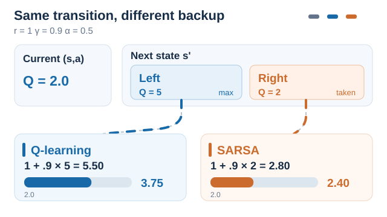
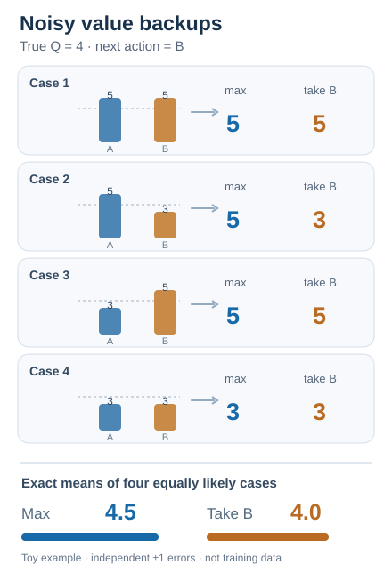
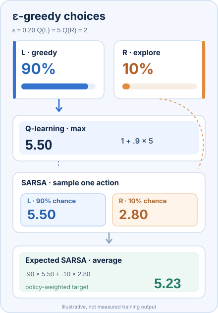
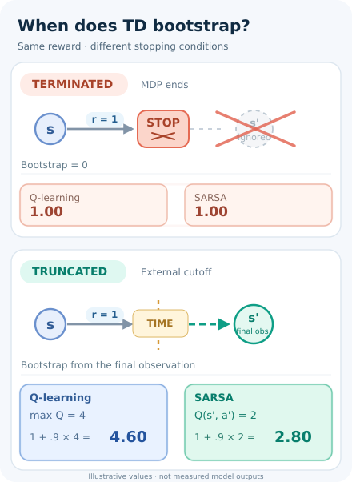

# SARSA (on-policy temporal-difference control)

An on-policy temporal-difference method that moves each action value toward the reward plus the value of the action the agent actually takes next.

## Problem

Q-learning learns the values of the greedy policy, even when the agent behaves differently. An agent that must keep exploring, and pays for its mistakes while learning, may need values that reflect the policy it actually follows. SARSA learns the value of that exploring policy.

## Core idea

After taking \(a\) in \(s\), receiving \(r\) and arriving in \(s'\), choose \(a'\) in \(s'\) with the same exploring policy. Then move \(Q(s, a)\) toward \(r + \gamma Q(s', a')\). The name comes from the five quantities \((s, a, r, s', a')\) used in each update. Because the target uses the action that will actually be taken, the values are those of the behaviour policy.

## Equation or algorithm

\[
Q(s_t, a_t) \leftarrow Q(s_t, a_t) + \alpha \left[ r_{t+1} + \gamma Q(s_{t+1}, a_{t+1}) - Q(s_t, a_t) \right]
\]

The procedure:

1. Initialise \(Q(s, a)\) for all pairs.
2. Start an episode in state \(s\), and choose \(a\) from \(s\) with ε-greedy on \(Q\).
3. Take \(a\), observe \(r\) and the next state \(s'\).
4. Choose \(a'\) from \(s'\) with ε-greedy on \(Q\).
5. Update \(Q(s, a)\) with the rule above.
6. Set \(s \leftarrow s'\) and \(a \leftarrow a'\), then repeat until the episode ends.

The only difference from Q-learning is step 4: Q-learning uses \(\max_b Q(s', b)\) in place of \(Q(s', a')\).

### Why the next *sampled* action matters

*Original ten-second SVG/SMIL instructional animation (CC BY-SA 4.0).* Start both methods from an identical, **hypothetical** experience: $Q(s,a)=2$, $r=1$, $\gamma=0.9$, $\alpha=0.5$. At $s'$, the greedy **Left** has $Q=5$ but the behaviour policy chooses **Right** with $Q=2$. SARSA must first identify that **actually selected** $a'$ before computing its target:

$
y_{\mathrm{SARSA}}=1+0.9(2)=2.8,\qquad
Q_{\mathrm{new}}=2+0.5(2.8-2)=2.40.
$

For comparison, Q-learning ignores this sampled next action **for its backup**: $y_{\mathrm{Q}}=1+0.9(5)=5.5$ and $Q_{\mathrm{new}}=3.75$. This is one controlled counterfactual comparison of **alternative updates**, not an empirical training trace or evidence that SARSA always yields smaller action values. Colours indicate the backup sources, not actual behaviour-policy probabilities. MkDocs offers keyboard-operable Play/Pause and honours reduced-motion preferences; [GitHub/no-script static preview](../../../../../assets/concept-animations/q-sarsa-backup-still.svg) shows both results. See the existing Sutton & Barto (2018) and Watkins & Dayan (1992) references.

### Isolating the max operator from a sampled-action backup

This second illustration isolates a different consequence of the **same off-policy versus on-policy target choice**. Suppose $Q^*(s',A)=Q^*(s',B)=4$ and both estimates have independent fair $\pm1$ errors. Across the four equiprobable pairs $(5,5),(5,3),(3,5),(3,3)$, taking the **maximum** gives $(5,5,5,3)$, mean **4.5**. Taking the **already selected action B** gives $(5,3,5,3)$, mean **4.0**. Here the behaviour's B choice is **independent of the estimation noise**, specifically to isolate max-selection bias. The effect is **not** a general proof that SARSA has unbiased value estimates, nor a measured or sequential training result. The figure compares bootstrap values only, before adding reward and discount; its English labels are shared with the [GitHub static preview](../../../../../assets/concept-animations/q-sarsa-noisy-backups-still.svg). The underlying max-bias discussion is sourced in the existing Sutton & Barto (2018) reference; the comparison does not assert a convergence theorem.

### What ε-greedy exploration does to SARSA's target

*Original eleven-second SVG/SMIL animation (CC BY-SA 4.0).* In a separate **illustrative** two-action example, let the unique greedy action L have $Q(s',L)=5$ and R have $Q(s',R)=2$. An $\varepsilon$-greedy policy with $\varepsilon=0.20$, uniformly random exploration over *both* actions, takes L with probability $0.90$ and R with probability $0.10$. Holding the Q table fixed, with $r=1$ and $\gamma=0.9$, one **sampled SARSA** update uses either $5.50$ (L) or $2.80$ (R) as its TD target. The expectation over the behaviour-policy draw is $0.90(5.50)+0.10(2.80)=\mathbf{5.23}$; **Expected SARSA** uses that probability-weighted target directly, rather than sampling $a'$. In contrast, **Q-learning** always uses the max-based target $5.50$. The animated highlights enumerate alternative computation paths, **not** a simulated rollout or an empirical frequency plot. The expectation is conditional on the given estimates and policy; it is not an unbiased estimate of the optimal value by definition. All numeric values are schematic. Keyboard-operable Play/Pause and reduced-motion fallback are provided on MkDocs; the [GitHub static view](../../../../../assets/concept-animations/q-sarsa-epsilon-still.svg) shows all outcomes. Sutton & Barto (2018), Chapter 6, gives both SARSA and Expected SARSA rules.

### Terminal states versus externally truncated episodes

*Original ten-second SVG/SMIL instructional animation (CC BY-SA 4.0).* **An episode stopping does not always imply a terminal MDP state.** For a *genuine termination* (including a horizon intrinsic to a finite-horizon task), the next-state value is masked. For an **external time-limit truncation** of a continuing task, bootstrapping must instead use the **last observation before reset**, not the next episode's reset observation. Pardo et al. (2018) distinguish these cases; Gymnasium exposes them as separate `terminated` and `truncated` signals.

With an illustrative reward $r=1$, discount $\gamma=0.9$, next-state greedy value $\max_a Q(s',a)=4$, and SARSA continuation-action estimate $Q(s',a')=2$, both methods have target **1.00** for termination. At external truncation, Q-learning's target is **4.60**, while SARSA's sampled-continuation target is **2.80**. Crucially, SARSA may need to **sample the hypothetical continuation action from its policy at the last observation**, since a real next action was not executed before the forced reset; it must not use an action sampled at the reset observation. These values are constructed, **not model measurements**. In the animation, the crossing-out marks a true terminal bootstrap mask, while the dashed time-limit boundary preserves a value path. MkDocs supports keyboard Play/Pause and reduced-motion fallback; [the GitHub/static preview](../../../../../assets/concept-animations/td-terminal-truncation-still.svg) shows both cases. See Pardo et al. (2018) in References.

## Results

SARSA has no single headline benchmark. Rummery and Niranjan (1994) studied connectionist Q-learning variants with on-line updating. Their report introduces MCQ-L, an update rule closely related to SARSA, and on a simulated mobile robot that must reach a goal among obstacles, it finds that on-line learning is less sensitive to the choice of training parameters than backward replay.

## Limitations

- **Values depend on exploration.** The learned values belong to the ε-greedy policy, so the greedy policy is only recovered as exploration decays.
- **Schedule matters.** Convergence results require the exploration rate and step sizes to be chosen carefully, and they do not hold for every schedule.
- **Tabular form.** As with Q-learning, a table is impractical for large or continuous spaces. Deep extensions use the same on-policy target with a neural network.

## Connections

- Parent topic: [Value-based methods](../index.md), and the wider [Reinforcement Learning](../../index.md) overview.
- Off-policy counterpart: [Q-learning](../q-learning/index.md).
- The on-policy idea reappears in policy-gradient methods. [Proximal Policy Optimisation](../../proximal-policy-optimisation/index.md) also learns from data gathered by the current policy, and the [Policy gradient and actor-critic](../../policy-gradient-and-actor-critic/index.md) overview covers critics that use temporal-difference targets.

## Applications

- **Online control**, where the agent must learn while it acts and its exploration has a cost. Rummery and Niranjan (1994) study this setting with a simulated mobile robot and limited sensory feedback.

## Open questions

- How to choose exploration schedules that keep learning both safe and fast.
- How on-policy temporal-difference targets behave when combined with neural networks at scale.

## References

### Seminal papers

- Rummery & Niranjan (1994), Technical Report CUED/F-INFENG/TR 166, Cambridge University Engineering Department. https://mi.eng.cam.ac.uk/reports/abstracts/rummery_tr166.html — Early study of on-line connectionist temporal-difference control, with the robustness result cited above. The report's full title was not confirmed in this check.
- Watkins & Dayan (1992), "Q-learning", *Machine Learning* 8(3–4), 279–292. https://doi.org/10.1007/bf00992698 — The off-policy counterpart, with its convergence theorem.
- Mnih et al. (2015), "Human-level control through deep reinforcement learning", *Nature* 518, 529–533. https://doi.org/10.1038/nature14236 — The deep off-policy value learner, a contrast to SARSA's on-policy target.
- Schulman et al. (2017), "Proximal policy optimization algorithms", [arXiv:1707.06347](https://arxiv.org/abs/1707.06347) — A deep on-policy method that also learns from data gathered by the current policy.

- Pardo, F., Tavakoli, A., Levdik, V. & Kormushev, P. (2018). *Time Limits in Reinforcement Learning*. ICML, PMLR 80:4045–4054. https://proceedings.mlr.press/v80/pardo18a.html — Distinguishes true finite-horizon termination from external training cutoffs and explains bootstrapping from the final observation.

### Surveys and textbooks

- Sutton, R. S. & Barto, A. G. *Reinforcement Learning: An Introduction*, 2nd ed. MIT Press, 2018. http://incompleteideas.net/book/the-book-2nd.html — Presents SARSA as on-policy temporal-difference control in its temporal-difference chapter.
