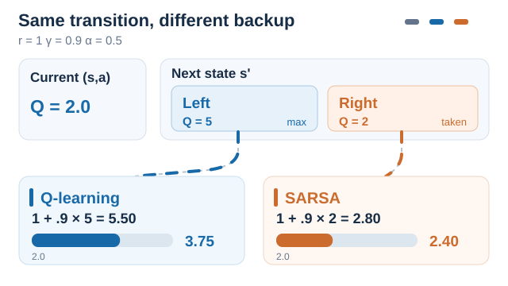
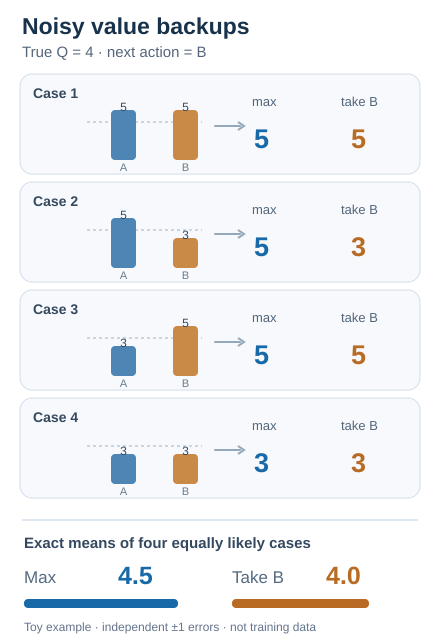
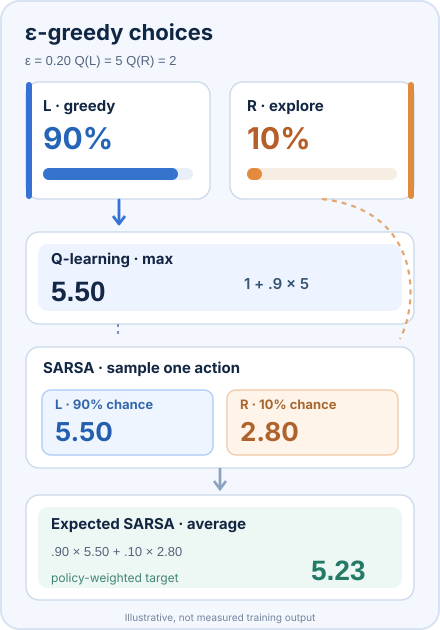
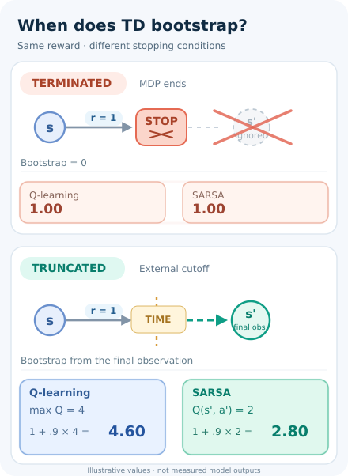
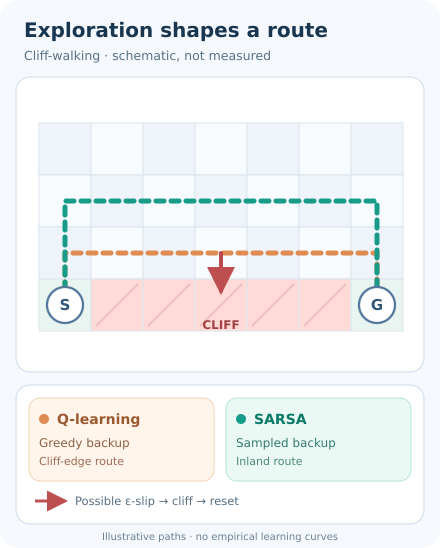

# SARSA（同策略時序差分控制）

一種同策略的時序差分方法：每個動作價值都朝「即時獎勵加上智能體實際接下來所採取動作的價值」移動。

## 問題

Q 學習學到的是貪婪策略的價值，即使智能體的實際行為與之不同。若智能體必須持續探索，並在學習過程中為錯誤付出代價，它可能需要反映其實際遵循策略的價值。SARSA 學習的正是這個探索策略的價值。

## 核心想法

在 \(s\) 中採取 \(a\)、得到 \(r\) 並到達 \(s'\) 後，依同一個探索策略在 \(s'\) 中選擇 \(a'\)。接著把 \(Q(s, a)\) 朝 \(r + \gamma Q(s', a')\) 移動。名稱來自每次更新所用的五個量 \((s, a, r, s', a')\)。由於目標使用的是實際將被執行的動作，學到的價值就是行為策略的價值。

## 方程式與演算法

\[
Q(s_t, a_t) \leftarrow Q(s_t, a_t) + \alpha \left[ r_{t+1} + \gamma Q(s_{t+1}, a_{t+1}) - Q(s_t, a_t) \right]
\]

流程如下：

1. 為所有配對初始化 \(Q(s, a)\)。
2. 從狀態 \(s\) 開始一個回合，依 \(Q\) 的 ε-貪婪策略從 \(s\) 選擇 \(a\)。
3. 執行 \(a\)，觀察 \(r\) 與下一狀態 \(s'\)。
4. 依同一策略從 \(s'\) 選擇 \(a'\)。
5. 以上式更新 \(Q(s, a)\)。
6. 令 \(s \leftarrow s'\)、\(a \leftarrow a'\)，然後重複直到回合結束。

與 Q 學習的唯一差別在第 4 步：Q 學習以 \(\max_b Q(s', b)\) 取代 \(Q(s', a')\)。

### 為何 SARSA 要用實際抽樣的下一動作？

*原創十秒 SVG／SMIL 教學動畫（CC BY-SA 4.0）。* 從**同一筆假想經驗**比較兩種 TD 備份：$Q(s,a)=2$、$r=1$、$\gamma=0.9$、$\alpha=0.5$。到達 $s'$ 後，貪婪動作 **Left** 的價值為 5，行為策略實際選擇的 **Right** 價值為 2。SARSA 必須先確定這個**實際將執行的** $a'$，再計算：

$
y_{\mathrm{SARSA}}=1+0.9(2)=2.8,\qquad
Q_{\mathrm{new}}=2+0.5(2.8-2)=2.40.
$

相對地，Q-learning 的備份目標**不使用這次抽到的下一動作**，而是 $y_{\mathrm{Q}}=1+0.9(5)=5.5$，使 $Q_{\mathrm{new}}=3.75$。這是固定起始 Q 值下的**反事實單步比較**，不是模型實測，也不表示 SARSA 的價值永遠較低；圖中的色彩代表備份訊號來源，並非動作機率。MkDocs 提供可用鍵盤操作的播放／暫停並遵守減少動態效果偏好；GitHub 可顯示[不需指令碼的靜態回退](../../../../../assets/concept-animations/q-sarsa-backup-still.svg)。對應公式可參考文末既有的 Sutton 與 Barto（2018）及 Watkins 與 Dayan（1992）。

### 分離「取最大值」與「使用實際下一動作」的效果

這組動畫用另一個角度比較**離策略與同策略的備份目標**。令下一狀態中兩個動作的真實價值都是 4，各自的估計誤差為獨立、等機率的 $\pm1$。四個等機率組合 $(5,5),(5,3),(3,5),(3,3)$ 中，**取最大值**得到 $(5,5,5,3)$，平均為 **4.5**；**使用已選定的動作 B** 得到 $(5,3,5,3)$，平均為 **4.0**。此處特別假設行為策略選擇 B 的決策與估計雜訊**互相獨立**，只為隔離最大值選擇造成的偏差，**不能推論 SARSA 一般情況下一定無偏**，亦非模型實測或連續訓練。圖中比較的是還沒加入獎勵與折扣率的 bootstrap 值，英文字標籤由雙語教材共用；[GitHub 靜態回退](../../../../../assets/concept-animations/q-sarsa-noisy-backups-still.svg)保留完整四組資料。相關概念參考文末既有的 Sutton 與 Barto（2018）。

### ε-貪婪探索如何改變 SARSA 的備份目標

*原創十一秒 SVG／SMIL 動畫（CC BY-SA 4.0）。* 在**另一個純示意的兩動作情境**中，令唯一貪婪動作 L 的 $Q(s',L)=5$、動作 R 的 $Q(s',R)=2$。$\varepsilon=0.20$ 的 ε-貪婪策略，會在探索時對**全部兩個動作**均勻抽樣，所以選 L 的機率為 $0.90$，選 R 為 $0.10$。固定 Q 表，並令 $r=1$、$\gamma=0.9$，單次**抽樣 SARSA** 會依下一動作得到 $5.50$（L）或 $2.80$（R）的 TD 目標。若對行為策略取期望，則為 $0.90(5.50)+0.10(2.80)=\mathbf{5.23}$；**Expected SARSA** 直接使用這個機率加權目標，而非只抽一個 $a'$。相較之下，**Q-learning** 一律使用最大值目標 $5.50$。動畫逐段強調的是**不同計算路徑**，不是模擬訓練軌跡，也不是依照 90%／10% 的時間比例播放；期望值只在給定 Q 估計與策略的條件下成立，不保證是最佳動作價值的無偏估計。全部數值都是人工示意，非模型實測。MkDocs 提供鍵盤播放／暫停與減少動態效果回退；[GitHub 靜態預覽](../../../../../assets/concept-animations/q-sarsa-epsilon-still.svg)可同時看見各種結果。定義參考文末 Sutton 與 Barto（2018）第 6 章。

### 真正終止與外部時間限制截斷的 TD 備份

*原創十秒 SVG／SMIL 教學動畫（CC BY-SA 4.0）。***回合停止不等於 MDP 真正終止。**若任務已達到真正終止狀態（包含有限時域任務內生的終點），TD 目標就不再加上下一狀態價值；若只是*持續性任務*被外部 TimeLimit 強制截斷，則仍須從**重設前最後一筆觀測**進行 bootstrap，而非使用下一個回合的重設觀測。Pardo 等人（2018）分析了這個差異；Gymnasium 的 `terminated` 和 `truncated` 分別表達這兩種訊號。

假設人工示意 $r=1$、$\gamma=0.9$、$\max_a Q(s',a)=4$，而 SARSA 在最後觀測下的延續動作估計 $Q(s',a')=2$。**真正終止**時，兩種方法的 TD 目標都是 **1.00**；**外部截斷**時，Q-learning 的目標為 **4.60**，SARSA 的延續動作備份為 **2.80**。由於截斷後不一定真的執行下一動作，SARSA 可在最後觀測依其策略**假設性抽樣延續動作**，不能取用重設狀態所抽的動作。這是人工建構的計算案例，**不是模型實測**。動畫中的叉號代表真正終止時移除 bootstrap，虛線時間界線則保留延續價值路徑。MkDocs 可用鍵盤播放／暫停、支援減少動態效果；[GitHub 靜態回退](../../../../../assets/concept-animations/td-terminal-truncation-still.svg)同時呈現兩個條件。依據文末 Pardo 等人（2018）的原始論文。

### 懸崖行走：學習目標與探索行為評估的是哪個策略？

*原創 12 秒 SVG／SMIL 教學動畫（CC BY-SA 4.0）。* 在 Sutton 與 Barto（2018，第 6 章）的經典 **Cliff Walking（懸崖行走）** 情境中，一般移動會得到小幅負獎勵，掉入懸崖則承受很大的懲罰並回到起點。如果智能體**持續使用 ε-greedy 探索**，Q-learning 即使實際上仍會探索，也以**下一狀態的貪婪動作價值**更新，所偏好的最短路線可能緊貼懸崖。SARSA 則以**探索策略實際抽出的下一動作價值**更新，因此靠近懸崖的路徑價值會納入探索時誤踩懸崖的風險，可能偏好較長但離懸崖較遠的路線。

圖中比較的是**兩種可能的策略偏好**，不代表 SARSA 一定採用綠色路線，或 Q-learning 一定掉落；兩者執行時都可能因探索而失誤。若 ε 逐漸降低、轉移機率或獎勵設定不同，偏好路徑也可能改變。圖中的**七欄地圖刻意簡化**，不是教科書原始地圖，也不是模型實測軌跡；移動圓點與紅色掉落僅示意因果過程，動畫的停留時間不代表 ε 的抽樣機率。MkDocs 提供可用鍵盤操作的播放／暫停；[GitHub／無 JavaScript 靜態預覽](../../../../../assets/concept-animations/cliff-walking-still.svg)完整保留兩條路線及失足風險。原理依據文末既有的 Sutton 與 Barto（2018）教材。

## 結果

SARSA 沒有單一的代表性基準。Rummery 與 Niranjan（1994）研究了具有線上更新的連接主義 Q 學習變體。他們的報告提出了與 SARSA 密切相關的更新規則 MCQ-L；在一個必須在障礙物間抵達目標的模擬移動機器人上，他們發現線上學習對訓練參數的選擇比倒序回放（backward replay）更不敏感。

## 限制

- **價值取決於探索。** 學到的價值屬於 ε-貪婪策略，因此只有在探索逐漸減少後，才能恢復貪婪策略。
- **排程很重要。** 收斂結果要求仔細選擇探索率與步長，並非對每種排程都成立。
- **表格形式。** 與 Q 學習相同，表格對大型或連續空間並不實際。深度擴充使用相同的同策略目標搭配神經網路。

## 關聯

- 上層主題：[基於價值的方法](../index.md)，以及更廣的[強化學習](../../index.zh-TW.md)概觀。
- 離策略的對應方法：[Q 學習](../q-learning/index.zh-TW.md)。
- 同策略的想法在策略梯度方法中再次出現。[近端策略最佳化](../../proximal-policy-optimisation/index.zh-TW.md)同樣從當前策略收集的資料中學習，而[策略梯度與演員–評論家](../../policy-gradient-and-actor-critic/index.md)概觀則涵蓋使用時序差分目標的評論家。

## 應用

- **線上控制。** 智能體必須在行動的同時學習，且探索有代價。Rummery 與 Niranjan（1994）以一台模擬移動機器人與有限的感測回饋研究此設定。

## 未解問題

- 如何選擇既安全又快速的探索排程。
- 同策略時序差分目標與大規模神經網路結合時的行為。

## 參考文獻

### 開創性論文

- Rummery 與 Niranjan（1994），Technical Report CUED/F-INFENG/TR 166，Cambridge University Engineering Department。https://mi.eng.cam.ac.uk/reports/abstracts/rummery_tr166.html — 早期研究線上連接主義時序差分控制，上文引用的穩健性結果即來自此報告。本次查核未確認報告的完整標題。
- Watkins 與 Dayan（1992），"Q-learning"，*Machine Learning* 8(3–4), 279–292。https://doi.org/10.1007/bf00992698 — 離策略的對應方法，附其收斂定理。
- Mnih 等人（2015），"Human-level control through deep reinforcement learning"，*Nature* 518, 529–533。https://doi.org/10.1038/nature14236 — 深度離策略價值學習器，與 SARSA 的同策略目標形成對照。
- Schulman 等人（2017），"Proximal policy optimization algorithms"，[arXiv:1707.06347](https://arxiv.org/abs/1707.06347) — 同樣從當前策略收集資料學習的深度同策略方法。

- Pardo、Tavakoli、Levdik 與 Kormushev（2018），*Time Limits in Reinforcement Learning*，ICML，PMLR 80:4045–4054。https://proceedings.mlr.press/v80/pardo18a.html — 區分有限時域任務的真正終止與外部訓練時間限制，說明應從截斷時最後觀測延續價值估計。

### 綜述與教科書

- Sutton, R. S. & Barto, A. G. *Reinforcement Learning: An Introduction*，第 2 版。MIT Press, 2018。http://incompleteideas.net/book/the-book-2nd.html — 在時序差分章節中將 SARSA 介紹為同策略時序差分控制。
