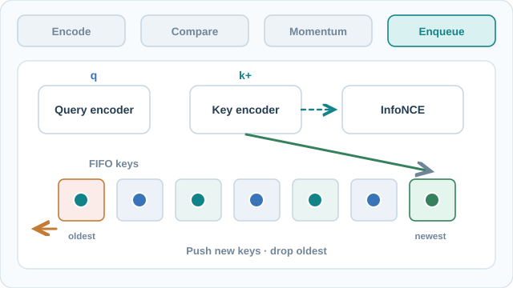

# MoCo: Momentum Contrast for Unsupervised Visual Representation Learning

MoCo is a contrastive method that keeps a large dictionary of negative keys in a queue, and encodes those keys with a slowly moving copy of the encoder. This decouples the number of negatives from the batch size. The family-level picture is on the [Contrastive Learning](index.md) page.

## Overview

He, Fan, Wu, Xie and Girshick (2020) frame unsupervised visual learning as dictionary look-up: an encoded query should match its positive key among a set of encoded keys. The abstract says the method builds "a dynamic dictionary with a queue and a moving-averaged encoder", so that a large and consistent dictionary can be built on the fly. The paper reports that features learned without labels transfer well to detection and segmentation. The abstract says MoCo can outperform its supervised ImageNet pre-training counterpart on seven detection and segmentation tasks.

## Key concepts

- **Query and key**: two views of the same image are encoded, one by the query encoder and one by the key encoder. The pair of their embeddings is the positive pair.
- **Queue**: a first-in, first-out store of keys from recent mini-batches. The queue supplies the negatives. The paper uses \(K = 65{,}536\) keys.
- **Momentum encoder**: the key encoder is not trained by gradients. Its weights are an exponential moving average of the query encoder's weights, with momentum \(m = 0.999\).
- **Temperature**: \(\tau = 0.07\) in the loss.
- **Shuffling BN**: a multi-GPU detail. Batch-norm statistics are computed per GPU, and the key encoder's mini-batch is shuffled before it is split across GPUs, so a query and its positive key do not share statistics from the same subset.

## How it works

Each mini-batch (256 images in the paper's ImageNet setup, spread over 8 GPUs) is encoded twice. The query encoder is updated by gradient descent. The key encoder is updated by the momentum rule

\[
\theta_k \leftarrow m\,\theta_k + (1-m)\,\theta_q
\]

For each query \(q\), the positive key \(k_+\) is the key of its other view, and the negatives are the \(K\) keys in the queue. The loss is InfoNCE:

\[
\mathcal{L}_q = -\log \frac{\exp(q\cdot k_+/\tau)}{\sum_{i=0}^{K}\exp(q\cdot k_i/\tau)}
\]

After each step, the newest keys are added to the queue and the oldest are removed. Because the keys in the queue were produced by slowly changing encoder states, the dictionary stays consistent while it grows far beyond the batch size.

### Visual walkthrough: queued negatives and momentum updates

The static overview distinguishes **encode → compare → SGD → EMA → enqueue**; the controllable simulation below shows the intermediate states and multiple iterations. Two augmented views are encoded separately. InfoNCE contrasts the query with its **positive key and queued negative keys**; the query encoder receives gradients, whereas the key encoder follows an **exponential moving average** of the query weights. Only *after* using the current dictionary are new keys enqueued and the oldest keys evicted. The six queue slots and the arrow layout are **schematic**, not the paper's 65,536-key configuration or measured embeddings.

This static overview remains readable on GitHub and without JavaScript; the MkDocs experiment below provides pause, step, seek and speed controls. This original diagram is licensed **CC BY-SA 4.0**. The algorithm follows He et al. (2020), cited below.

#### Interactive experiment: step through three MoCo updates

**Loss microscope (independent toy example).** Adjust the **Temperature τ** slider (0.10–1.00) to inspect how a fixed positive similarity of 0.70 and six fixed negative similarities (−0.20, −0.10, 0.00, 0.10, 0.20, 0.05) become a softmax probability and an InfoNCE loss. The blue/red bar shows the positive-key probability versus the aggregate negative probability. These similarities are deliberately **not derived from the scalar EMA parameters or FIFO letters above**; this isolates the temperature effect rather than inventing a learned embedding or gradient trajectory. The loss is computed as \(-\log p_+\), with the positive key included in the denominator. The contrastive loss updates the **query encoder only**; the key encoder is updated by EMA.

**Gradient sensitivity (linked to the same temperature slider).** The new continuous curve plots the exact derivative of this fixed toy InfoNCE objective with respect to positive-key similarity \(s_+\): \(\partial\mathcal L/\partial s_+=(p_+-1)/\tau\). The *sum* of negative-similarity derivatives is \((1-p_+)/\tau\), equal and opposite. At very low \(\tau\), softmax saturation can reduce the derivative magnitude; decreasing temperature does **not** monotonically increase it for these fixed logits. These are gradients with respect to illustrative similarities, **not** gradients of the query encoder's parameters or measured training signals.

[View the continuous GIF preview of three toy updates](../../../../assets/concept-animations/moco-momentum-preview.gif) (fixed momentum m = 0.90; viewable on GitHub, while the MkDocs simulator lets you vary momentum).

Use **Play/Pause, Previous/Next, timeline scrubbing, or playback speed** to follow three illustrative minibatch iterations. Each contains five *operations*—encode the positive key, contrast against the **old** FIFO dictionary, update the query weights by SGD, update the key encoder by EMA, then enqueue and evict. Unlike the static overview above, the simulator preserves the queue and parameter values between iterations: the new key is not placed among negatives until **after** the current loss. The six-slot queue A–I, scalar query weights (0.700 → 0.850 → 0.780 → 0.910), initial key weight 0.300 and illustrative momentum 0.9 are a **small hand-calculable example, not measured model parameters**; the paper's configuration uses a much larger dictionary and momentum 0.999. Under reduced-motion settings, moving particles are hidden, while step-by-step states and controls remain usable. The existing SVG and still figure above are the GitHub/no-JavaScript fallback. Original teaching simulation **CC BY-SA 4.0**. **Momentum sensitivity:** Adjust the **Momentum m** slider from `0.50` to `0.99` to see how the target/key scalar follows the online/query scalar across three EMA updates; `|Δ|` is the absolute gap between the two illustrative scalars. Changing m recomputes all subsequent EMA states and pauses playback, but leaves the prescribed SGD values and FIFO queue unchanged. This is a what-if demonstration of parameter updates, not a training trace, learned representation, or performance prediction.

## Key methods

### Momentum Contrast for Unsupervised Visual Representation Learning (He, Fan, Wu, Xie & Girshick, 2020)

- **Problem:** contrastive learning works better with many negatives, but in end-to-end training the negatives are limited to the current batch. The abstract's stated goal is a dictionary that is both large and consistent.
- **Core idea:** keep keys in a queue, and produce them with a momentum-updated encoder, so the dictionary can be large while the key encoder changes slowly.
- **Equation or algorithm:** the InfoNCE loss with \(\tau = 0.07\), the momentum update with \(m = 0.999\), the queue with \(K = 65{,}536\) keys, and shuffling BN, as described in How it works.
- **Results:** under the linear protocol on ImageNet, MoCo with a ResNet-50 reaches 60.6% top-1 accuracy. On PASCAL VOC detection with Faster R-CNN and an R50-C4 backbone, AP is 53.5 for supervised ImageNet pre-training and 55.9 for MoCo pre-trained on ImageNet-1M. On COCO with Mask R-CNN and an R50-FPN backbone, box AP is 38.9 for supervised pre-training and 38.5 for MoCo under the 1× schedule, and 40.6 for supervised pre-training and 40.8 for MoCo under the 2× schedule.
- **Limitations:** on COCO the gain over supervised pre-training is small. Under the 2× schedule MoCo is ahead by 0.2 AP (40.8 against 40.6), and under the 1× schedule the supervised baseline is ahead by 0.4 AP (38.9 against 38.5). Shuffling BN is a workaround for multi-GPU batch statistics rather than a property of the objective. The queue holds keys from earlier encoder states, so the method depends on the momentum value.

## Connections

- [SimCLR](simclr.md) uses a closely related loss, but takes its negatives from the current batch. MoCo's queue removes that dependence on batch size.
- [BYOL](../non-contrastive-methods/byol.md) keeps the momentum-updated encoder idea but drops negatives entirely.
- The linear evaluation protocol and the transfer protocol are discussed in [Theory and evaluation](../theory-and-evaluation/index.md).
- The ResNet backbone is covered under [CNN models](../../../models/cnn/index.md).

## Open questions

- How do queue length and momentum interact? The paper picks \(K = 65{,}536\) and \(m = 0.999\), but the abstract does not show how sensitive the result is to either.
- Does the advantage over supervised pre-training hold for detection and segmentation tasks beyond those reported, and for data that is not ImageNet-like?

## References

### Seminal papers

- He, K., Fan, H., Wu, Y., Xie, S. & Girshick, R. (2020). Momentum Contrast for Unsupervised Visual Representation Learning. CVPR. https://arxiv.org/abs/1911.05722 — The paper described on this page.
- Chen, X., Fan, H., Girshick, R. & He, K. (2020). Improved Baselines with Momentum Contrastive Learning. arXiv:2003.04297. https://arxiv.org/abs/2003.04297 — Revisits MoCo with an improved training recipe, adopting SimCLR's MLP head and augmentations.
- Chen, T., Kornblith, S., Norouzi, M. & Hinton, G. (2020). A Simple Framework for Contrastive Learning of Visual Representations. ICML (PMLR 119). https://arxiv.org/abs/2002.05709 — The contrastive method that uses in-batch negatives, which MoCo's queue replaces.
- Wu, Z., Xiong, Y., Yu, S. X. & Lin, D. (2018). Unsupervised Feature Learning via Non-Parametric Instance Discrimination. CVPR. https://arxiv.org/abs/1805.01978 — Instance discrimination with a memory bank of stored features, an earlier way to get many negatives.
- Oord, A. van den, Li, Y. & Vinyals, O. (2018). Representation Learning with Contrastive Predictive Coding. arXiv:1807.03748. https://arxiv.org/abs/1807.03748 — Introduces the InfoNCE loss used by MoCo.
- Grill, J.-B. et al. (2020). Bootstrap your own latent: A new approach to self-supervised learning. arXiv:2006.07733. https://arxiv.org/abs/2006.07733 — Keeps a momentum target network but uses no negatives, the comparison point for MoCo.
